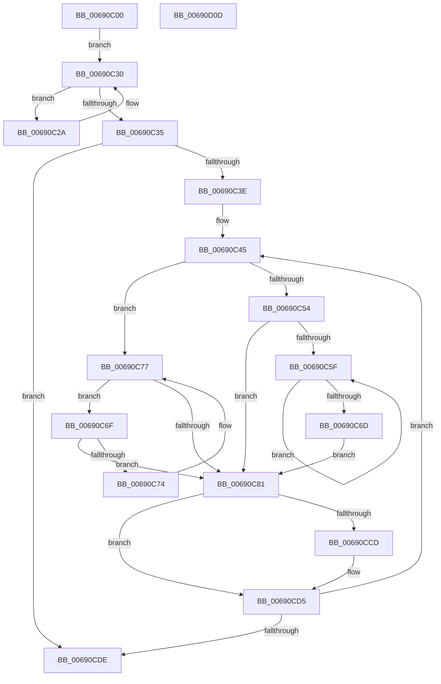

# MiFinishChildPartitionHotAdd

- RVA: `0x00690C00`–`0x00690D0E` (길이 `270` bytes)
- VA: `0x0000000140690C00`
- 실행 섹션: `.text`
- PDB 이름 있음: `예`; PDB Function 태그: `아니요`
- unwind 정보 RVA: `0x00075C18`
- 디코드: `83`개 명령, `270/270` bytes 표시
- 미해석 바이트: `0` (있으면 어셈블리에 `.byte`로 보존)

> 이 문서는 커널 이미지의 기계어와 PDB 기호를 분석해 생성했습니다. 4번과 5번은 함수 원형과 자료형을 바이너리 사용 방식에서 추정한 C 해석이며 원본 소스 복구 결과는 아닙니다.

## 1. Dependencies

- 직접 호출 지점: **8**; 고유 호출 대상: **8**
- 직접 호출자로 확인된 함수: **1**
- RIP 상대 이미지 참조: **0**

### Outgoing calls
- `0x00690C87` → [RtlAvlRemoveNode](../29/RtlAvlRemoveNode_function_00296650.md) (function, `0x00296650`)
- `0x00690C90` → [RtlNumberOfSetBitsEx](../41/RtlNumberOfSetBitsEx_function_00418CA0.md) (function, `0x00418CA0`)
- `0x00690C9B` → [ExAcquireSpinLockExclusive](../24/ExAcquireSpinLockExclusive_function_00248690.md) (function, `0x00248690`)
- `0x00690CAC` → [MiMergePageNodes](MiMergePageNodes_function_006916A0.md) (function, `0x006916A0`)
- `0x00690CC4` → [MiReleaseSpinLockExclusive](../24/MiReleaseSpinLockExclusive_function_002482C0.md) (function, `0x002482C0`)
- `0x00690CD0` → [MiDeletePartitionPageNode](MiDeletePartitionPageNode_function_006908C4.md) (function, `0x006908C4`)
- `0x00690CE1` → [MiMakePartitionMemoryBlock](../../page/80/MiMakePartitionMemoryBlock_function_0080D94C.md) (function, `0x0080D94C`)
- `0x00690CEB` → [MiComputeCommitThresholds](../47/MiComputeCommitThresholds_function_0047C904.md) (function, `0x0047C904`)

### Direct callers
- [MiCompleteMemoryAddition](../../page/7F/MiCompleteMemoryAddition_function_007F9FAC.md) at `0x007F9FEF`

### Static image references
- 디코드된 RIP-relative 메모리 참조가 없습니다.

## 2. Other-region calls and transfers

- 다른 실행 섹션으로 향하는 call: **1**
  - `0x00690CE1` → [MiMakePartitionMemoryBlock](../../page/80/MiMakePartitionMemoryBlock_function_0080D94C.md) (`.text` → `PAGE`)
- 별도 외부 분기/꼬리 이동을 확인하지 못했습니다.

## 3. Assembly (complete function range)

```asm
00690C00  48 89 5C 24 08                  mov qword ptr [rsp + 8], rbx
00690C05  48 89 6C 24 10                  mov qword ptr [rsp + 0x10], rbp
00690C0A  48 89 74 24 18                  mov qword ptr [rsp + 0x18], rsi
00690C0F  57                              push rdi
00690C10  41 54                           push r12
00690C12  41 55                           push r13
00690C14  41 56                           push r14
00690C16  41 57                           push r15
00690C18  48 83 EC 20                     sub rsp, 0x20
00690C1C  48 8B 02                        mov rax, qword ptr [rdx]
00690C1F  4C 8B E2                        mov r12, rdx
00690C22  48 8B E9                        mov rbp, rcx
00690C25  45 33 F6                        xor r14d, r14d
00690C28  EB 06                           jmp 0x140690c30
00690C2A  4C 8B F0                        mov r14, rax
00690C2D  48 8B 00                        mov rax, qword ptr [rax]
00690C30  48 85 C0                        test rax, rax
00690C33  75 F5                           jne 0x140690c2a
00690C35  4D 85 F6                        test r14, r14
00690C38  0F 84 A0 00 00 00               je 0x140690cde
00690C3E  4C 8D A9 C8 00 00 00            lea r13, [rcx + 0xc8]
00690C45  49 8B 46 08                     mov rax, qword ptr [r14 + 8]
00690C49  4D 8B FE                        mov r15, r14
00690C4C  49 8B CE                        mov rcx, r14
00690C4F  48 85 C0                        test rax, rax
00690C52  74 23                           je 0x140690c77
00690C54  48 8B 08                        mov rcx, qword ptr [rax]
00690C57  4C 8B F0                        mov r14, rax
00690C5A  48 85 C9                        test rcx, rcx
00690C5D  74 22                           je 0x140690c81
00690C5F  48 8B 01                        mov rax, qword ptr [rcx]
00690C62  4C 8B F1                        mov r14, rcx
00690C65  48 8B C8                        mov rcx, rax
00690C68  48 85 C0                        test rax, rax
00690C6B  75 F2                           jne 0x140690c5f
00690C6D  EB 12                           jmp 0x140690c81
00690C6F  49 39 0E                        cmp qword ptr [r14], rcx
00690C72  74 0D                           je 0x140690c81
00690C74  49 8B CE                        mov rcx, r14
00690C77  4D 8B 76 10                     mov r14, qword ptr [r14 + 0x10]
00690C7B  49 83 E6 FC                     and r14, 0xfffffffffffffffc
00690C7F  75 EE                           jne 0x140690c6f
00690C81  49 8B D7                        mov rdx, r15
00690C84  49 8B CC                        mov rcx, r12
00690C87  E8 C4 59 C0 FF                  call 0x140296650
00690C8C  49 8D 4F 20                     lea rcx, [r15 + 0x20]
00690C90  E8 0B 80 D8 FF                  call 0x140418ca0
00690C95  49 8B CD                        mov rcx, r13
00690C98  48 8B F0                        mov rsi, rax
00690C9B  E8 F0 79 BB FF                  call 0x140248690
00690CA0  45 33 C0                        xor r8d, r8d
00690CA3  49 8B D7                        mov rdx, r15
00690CA6  48 8B CD                        mov rcx, rbp
00690CA9  40 8A F8                        mov dil, al
00690CAC  E8 EF 09 00 00                  call 0x1406916a0
00690CB1  48 01 B5 50 48 00 00            add qword ptr [rbp + 0x4850], rsi
00690CB8  40 8A D7                        mov dl, dil
00690CBB  49 8B CD                        mov rcx, r13
00690CBE  C6 45 0C 01                     mov byte ptr [rbp + 0xc], 1
00690CC2  8B D8                           mov ebx, eax
00690CC4  E8 F7 75 BB FF                  call 0x1402482c0
00690CC9  85 DB                           test ebx, ebx
00690CCB  74 08                           je 0x140690cd5
00690CCD  49 8B CF                        mov rcx, r15
00690CD0  E8 EF FB FF FF                  call 0x1406908c4
00690CD5  4D 85 F6                        test r14, r14
00690CD8  0F 85 67 FF FF FF               jne 0x140690c45
00690CDE  48 8B CD                        mov rcx, rbp
00690CE1  E8 66 CC 17 00                  call 0x14080d94c
00690CE6  33 D2                           xor edx, edx
00690CE8  48 8B CD                        mov rcx, rbp
00690CEB  E8 14 BC DE FF                  call 0x14047c904
00690CF0  48 8B 5C 24 50                  mov rbx, qword ptr [rsp + 0x50]
00690CF5  48 8B 6C 24 58                  mov rbp, qword ptr [rsp + 0x58]
00690CFA  48 8B 74 24 60                  mov rsi, qword ptr [rsp + 0x60]
00690CFF  48 83 C4 20                     add rsp, 0x20
00690D03  41 5F                           pop r15
00690D05  41 5E                           pop r14
00690D07  41 5D                           pop r13
00690D09  41 5C                           pop r12
00690D0B  5F                              pop rdi
00690D0C  C3                              ret
00690D0D  CC                              int3
```

## 4. C-style interpretation (structured pseudocode)

```c
__int64 __fastcall MiFinishChildPartitionHotAdd(__int64 a1, __int64 a2, int a3)
{
    __int64 result;
    __int64 v_r14;
    __int64 v_rsp;
    unsigned __int64 v_stack_p10;
    unsigned __int64 v_stack_p18;
    unsigned __int64 v_stack_p8;

    v_stack_p8 = v_rbx;
    v_stack_p10 = v_rbp;
    v_stack_p18 = v_rsi;
    v_rsp = (v_rsp) - (32);
    v_r14 = 0;
    goto loc_00690C30;
loc_00690C2A:
loc_00690C30:
    if (*(unsigned __int64 *)(*(unsigned __int64 *)(a2)) != 0) goto loc_00690C2A;
    if (*(unsigned __int64 *)(a2) == 0) goto loc_00690CDE;
loc_00690C45:
    if (*(unsigned __int64 *)(*(unsigned __int64 *)(a2) + 8) == 0) goto loc_00690C77;
    if (*(unsigned __int64 *)(*(unsigned __int64 *)(*(unsigned __int64 *)(a2) + 8)) == 0) goto loc_00690C81;
loc_00690C5F:
    if (*(unsigned __int64 *)(*(unsigned __int64 *)(*(unsigned __int64 *)(*(unsigned __int64 *)(a2) + 8))) != 0) goto loc_00690C5F;
    goto loc_00690C81;
loc_00690C6F:
    if ((*(unsigned __int64 *)(*(unsigned __int64 *)(*(unsigned __int64 *)(*(unsigned __int64 *)(a2) + 8)))) == (*(unsigned __int64 *)(*(unsigned __int64 *)(*(unsigned __int64 *)(*(unsigned __int64 *)(a2) + 8))))) goto loc_00690C81;
loc_00690C77:
    v_r14 = (*(unsigned __int64 *)(*(unsigned __int64 *)(*(unsigned __int64 *)(*(unsigned __int64 *)(a2) + 8)) + 16)) & (-4);
    if (condition_is_not_equal) goto loc_00690C6F;
loc_00690C81:
    result = RtlAvlRemoveNode(a2, *(unsigned __int64 *)(a2), a3, a4);
    result = RtlNumberOfSetBitsEx(*(unsigned __int64 *)(a2) + 32, *(unsigned __int64 *)(a2), a3, a4);
    result = ExAcquireSpinLockExclusive(a1 + 200, *(unsigned __int64 *)(a2), a3, a4);
    a3 = 0;
    result = MiMergePageNodes(a1, *(unsigned __int64 *)(a2), a3, a4);
    *(unsigned __int8 *)(a1 + 12) = 1;
    result = MiReleaseSpinLockExclusive(a1 + 200, (unsigned __int8)((unsigned __int8)(result)), a3, a4);
    if ((unsigned int)((unsigned int)((unsigned int)(result))) != 0) {
        a1 = *(unsigned __int64 *)(a2);
        result = MiDeletePartitionPageNode(a1, (unsigned __int8)((unsigned __int8)(result)), a3, a4);
    }
    if (v_r14 != 0) goto loc_00690C45;
loc_00690CDE:
    result = MiMakePartitionMemoryBlock(a1, (unsigned __int8)((unsigned __int8)(result)), a3, a4);
    a2 = 0;
    result = MiComputeCommitThresholds(a1, a2, a3, a4);
    v_rsp = (v_rsp) + (32);
    return result;
}
```

## 5. (Beta) C Style

```c
int64_t MiFinishChildPartitionHotAdd(void *Arg1, void *Arg2, int32_t Arg3)
{
    uint8_t *arg1 = (uint8_t *)Arg1;
    uint8_t *arg2 = (uint8_t *)Arg2;

    int64_t result;
    int64_t local_r14;
    int64_t local_rsp;
    uint64_t v_stack_p10;
    uint64_t v_stack_p18;
    uint64_t v_stack_p8;

    v_stack_p8 = local_rbx;
    v_stack_p10 = local_rbp;
    v_stack_p18 = local_rsi;
    local_rsp = (local_rsp) - (32);
    local_r14 = 0;
    goto loc_00690C30;
loc_00690C2A:
loc_00690C30:
    if (*(uint64_t *)(*(uint64_t *)(arg2)) != 0) goto loc_00690C2A;
    if (*(uint64_t *)(arg2) == 0) goto loc_00690CDE;
loc_00690C45:
    if (*(uint64_t *)(*(uint64_t *)(arg2) + 0x8) == 0) goto loc_00690C77;
    if (*(uint64_t *)(*(uint64_t *)(*(uint64_t *)(arg2) + 0x8)) == 0) goto loc_00690C81;
loc_00690C5F:
    if (*(uint64_t *)(*(uint64_t *)(*(uint64_t *)(*(uint64_t *)(arg2) + 0x8))) != 0) goto loc_00690C5F;
    goto loc_00690C81;
loc_00690C6F:
    if ((*(uint64_t *)(*(uint64_t *)(*(uint64_t *)(*(uint64_t *)(arg2) + 0x8)))) == (*(uint64_t *)(*(uint64_t *)(*(uint64_t *)(*(uint64_t *)(arg2) + 0x8))))) goto loc_00690C81;
loc_00690C77:
    local_r14 = (*(uint64_t *)(*(uint64_t *)(*(uint64_t *)(*(uint64_t *)(arg2) + 0x8)) + 0x10)) & (-4);
    if (condition_is_not_equal) goto loc_00690C6F;
loc_00690C81:
    result = RtlAvlRemoveNode(Arg2, *(uint64_t *)(arg2), Arg3, a4);
    result = RtlNumberOfSetBitsEx(*(uint64_t *)(arg2) + 32, *(uint64_t *)(arg2), Arg3, a4);
    result = ExAcquireSpinLockExclusive(Arg1 + 200, *(uint64_t *)(arg2), Arg3, a4);
    Arg3 = 0;
    result = MiMergePageNodes(Arg1, *(uint64_t *)(arg2), Arg3, a4);
    *(uint8_t *)(arg1 + 0xC) = 1;
    result = MiReleaseSpinLockExclusive(Arg1 + 200, (uint8_t)((uint8_t)(result)), Arg3, a4);
    if ((uint32_t)((uint32_t)((uint32_t)(result))) != 0) {
        Arg1 = *(uint64_t *)(arg2);
        result = MiDeletePartitionPageNode(Arg1, (uint8_t)((uint8_t)(result)), Arg3, a4);
    }
    if (local_r14 != 0) goto loc_00690C45;
loc_00690CDE:
    result = MiMakePartitionMemoryBlock(Arg1, (uint8_t)((uint8_t)(result)), Arg3, a4);
    Arg2 = 0;
    result = MiComputeCommitThresholds(Arg1, Arg2, Arg3, a4);
    local_rsp = (local_rsp) + (32);
    return result;
}
```

### 관측된 메모리 오프셋

구조체 형식이 확인되지 않은 접근은 인자 기준의 오프셋으로만 기록했습니다.

| 기준 인자 | 오프셋 표현 | 폭 (bit) | 접근 |
|---|---:|---:|---|
| `Arg1` | `+ 0xC` | `8` | `W` |
| `Arg1` | `+ 0xC8` | `64` | `R` |
| `Arg1` | `+ 0x4850` | `64` | `R/W` |
| `Arg2` | `+ 0x0` | `64` | `R` |

## 6. Execution-region graph

[열기: 2D/3D 그래프와 함수 탐색 컨트롤 패널](../../../control-panel.html?section=text&rva=0x00690C00&view=graph)

- 2D 그래프는 위에서 아래로 흐르고, 3D 그래프는 빈 공간을 드래그해 회전합니다. Shift+드래그는 이동, 휠은 확대·축소, 함수 노드 선택은 대상 보고서 이동입니다.

### Static fallback


