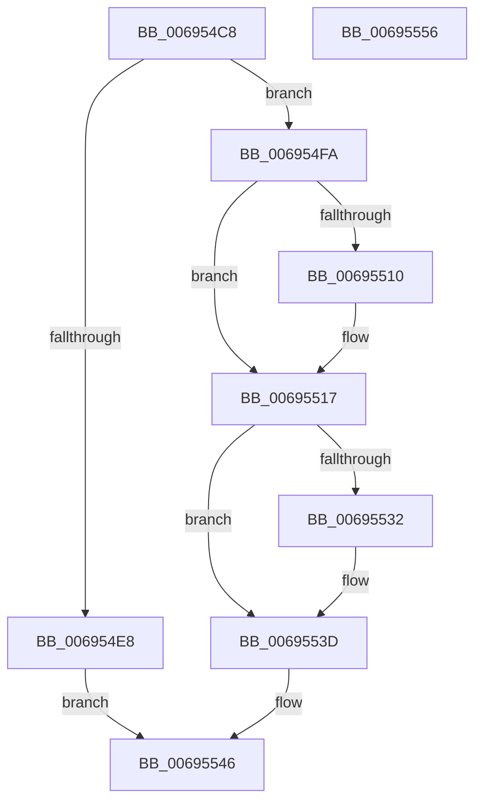

# MiFlushCacheRange

- RVA: `0x006954C8`–`0x00695557` (길이 `143` bytes)
- VA: `0x00000001406954C8`
- 실행 섹션: `.text`
- PDB 이름 있음: `예`; PDB Function 태그: `아니요`
- unwind 정보 RVA: `0x00060BC4`
- 디코드: `39`개 명령, `143/143` bytes 표시
- 미해석 바이트: `0` (있으면 어셈블리에 `.byte`로 보존)

> 이 문서는 커널 이미지의 기계어와 PDB 기호를 분석해 생성했습니다. 4번과 5번은 함수 원형과 자료형을 바이너리 사용 방식에서 추정한 C 해석이며 원본 소스 복구 결과는 아닙니다.

## 1. Dependencies

- 직접 호출 지점: **4**; 고유 호출 대상: **4**
- 직접 호출자로 확인된 함수: **2**
- RIP 상대 이미지 참조: **3**

### Outgoing calls
- `0x006954EE` → [KeInvalidateAllCaches](../30/KeInvalidateAllCaches_function_00308CC0.md) (function, `0x00308CC0`)
- `0x00695512` → [KiRaiseIrqlProcessIrqlFlags](../4F/KiRaiseIrqlProcessIrqlFlags_function_004F56FC.md) (function, `0x004F56FC`)
- `0x00695524` → [MiFlushCacheForAttributeChange](../30/MiFlushCacheForAttributeChange_function_00308944.md) (function, `0x00308944`)
- `0x00695538` → [KiLowerIrqlProcessIrqlFlags](../4F/KiLowerIrqlProcessIrqlFlags_function_004F5698.md) (function, `0x004F5698`)

### Direct callers
- [MiHotRemoveHugeRange](../67/MiHotRemoveHugeRange_function_00675DD0.md) at `0x00675F31`
- [MiRemovePhysicalMemory](../../page/7F/MiRemovePhysicalMemory_function_007FAD3C.md) at `0x007FB004`

### Static image references
- `0x006954D7` → RVA `0x00E2DC5C` (`.data`; read)
- `0x006954E8` → RVA `0x00E2DC54` (`.data`; read/write)
- `0x00695507` → RVA `0x00FC6D20` (`ALMOSTRO`; read)

## 2. Other-region calls and transfers

- 다른 실행 섹션으로 향하는 call: **0**
- 별도 외부 분기/꼬리 이동을 확인하지 못했습니다.

## 3. Assembly (complete function range)

```asm
006954C8  48 89 5C 24 08                  mov qword ptr [rsp + 8], rbx
006954CD  48 89 74 24 10                  mov qword ptr [rsp + 0x10], rsi
006954D2  57                              push rdi
006954D3  48 83 EC 20                     sub rsp, 0x20
006954D7  8B 05 7F 87 79 00               mov eax, dword ptr [rip + 0x79877f]
006954DD  48 8B FA                        mov rdi, rdx
006954E0  48 8B F1                        mov rsi, rcx
006954E3  48 3B D0                        cmp rdx, rax
006954E6  72 12                           jb 0x1406954fa
006954E8  FF 05 66 87 79 00               inc dword ptr [rip + 0x798766]
006954EE  E8 CD 37 C7 FF                  call 0x140308cc0
006954F3  B8 01 00 00 00                  mov eax, 1
006954F8  EB 4C                           jmp 0x140695546
006954FA  44 0F 20 C3                     mov rbx, cr8
006954FE  BA 02 00 00 00                  mov edx, 2
00695503  44 0F 22 C2                     mov cr8, rdx
00695507  83 3D 12 18 93 00 00            cmp dword ptr [rip + 0x931812], 0
0069550E  74 07                           je 0x140695517
00695510  8A CB                           mov cl, bl
00695512  E8 E5 01 E6 FF                  call 0x1404f56fc
00695517  45 33 C9                        xor r9d, r9d
0069551A  48 8B D7                        mov rdx, rdi
0069551D  48 8B CE                        mov rcx, rsi
00695520  45 8D 41 03                     lea r8d, [r9 + 3]
00695524  E8 1B 34 C7 FF                  call 0x140308944
00695529  83 3D F0 17 93 00 00            cmp dword ptr [rip + 0x9317f0], 0
00695530  74 0B                           je 0x14069553d
00695532  44 0F 20 C1                     mov rcx, cr8
00695536  8A D3                           mov dl, bl
00695538  E8 5B 01 E6 FF                  call 0x1404f5698
0069553D  0F B6 C3                        movzx eax, bl
00695540  44 0F 22 C0                     mov cr8, rax
00695544  33 C0                           xor eax, eax
00695546  48 8B 5C 24 30                  mov rbx, qword ptr [rsp + 0x30]
0069554B  48 8B 74 24 38                  mov rsi, qword ptr [rsp + 0x38]
00695550  48 83 C4 20                     add rsp, 0x20
00695554  5F                              pop rdi
00695555  C3                              ret
00695556  CC                              int3
```

## 4. C-style interpretation (structured pseudocode)

```c
__int64 __fastcall MiFlushCacheRange(__int64 a1, __int64 a2, __int64 a3, int a4)
{
    __int64 result;
    __int64 v_rsp;
    unsigned __int64 v_stack_p10;
    unsigned __int64 v_stack_p8;

    v_stack_p8 = v_rbx;
    v_stack_p10 = v_rsi;
    v_rsp = (v_rsp) - (32);
    if (a2 < ((unsigned int)(*(unsigned int *)(v_rip + 7964543)))) goto loc_006954FA;
    result = KeInvalidateAllCaches(a1, a2, a3, a4);
    goto loc_00695546;
loc_006954FA:
    result = 1;
    if ((*(unsigned int *)(v_rip + 9639954)) != 0) {
        a1 = (unsigned __int8)(v_cr8);
        result = KiRaiseIrqlProcessIrqlFlags(a1, 2, a3, a4);
    }
    a4 = 0;
    result = MiFlushCacheForAttributeChange(a1, a2, a4 + 3, a4);
    if ((*(unsigned int *)(v_rip + 9639920)) != 0) {
        a1 = 2;
        a2 = (unsigned __int8)(v_cr8);
        result = KiLowerIrqlProcessIrqlFlags(a1, a2, a4 + 3, a4);
    }
    result = 0;
loc_00695546:
    v_rsp = (v_rsp) + (32);
    return result;
}
```

## 5. (Beta) C Style

```c
int64_t MiFlushCacheRange(int64_t Arg1, int64_t Arg2, int64_t Arg3, int32_t Arg4)
{
    int64_t result;
    int64_t local_rsp;
    uint64_t v_stack_p10;
    uint64_t v_stack_p8;

    v_stack_p8 = local_rbx;
    v_stack_p10 = local_rsi;
    local_rsp = (local_rsp) - (32);
    if (Arg2 < ((uint32_t)(*(uint32_t *)(v_rip + 0x79877F)))) goto loc_006954FA;
    result = KeInvalidateAllCaches(Arg1, Arg2, Arg3, Arg4);
    goto loc_00695546;
loc_006954FA:
    result = 1;
    if ((*(uint32_t *)(v_rip + 0x931812)) != 0) {
        Arg1 = (uint8_t)(v_cr8);
        result = KiRaiseIrqlProcessIrqlFlags(Arg1, 2, Arg3, Arg4);
    }
    Arg4 = 0;
    result = MiFlushCacheForAttributeChange(Arg1, Arg2, Arg4 + 3, Arg4);
    if ((*(uint32_t *)(v_rip + 0x9317F0)) != 0) {
        Arg1 = 2;
        Arg2 = (uint8_t)(v_cr8);
        result = KiLowerIrqlProcessIrqlFlags(Arg1, Arg2, Arg4 + 3, Arg4);
    }
    result = 0;
loc_00695546:
    local_rsp = (local_rsp) + (32);
    return result;
}
```

## 6. Execution-region graph

[열기: 2D/3D 그래프와 함수 탐색 컨트롤 패널](../../../control-panel.html?section=text&rva=0x006954C8&view=graph)

- 2D 그래프는 위에서 아래로 흐르고, 3D 그래프는 빈 공간을 드래그해 회전합니다. Shift+드래그는 이동, 휠은 확대·축소, 함수 노드 선택은 대상 보고서 이동입니다.

### Static fallback


