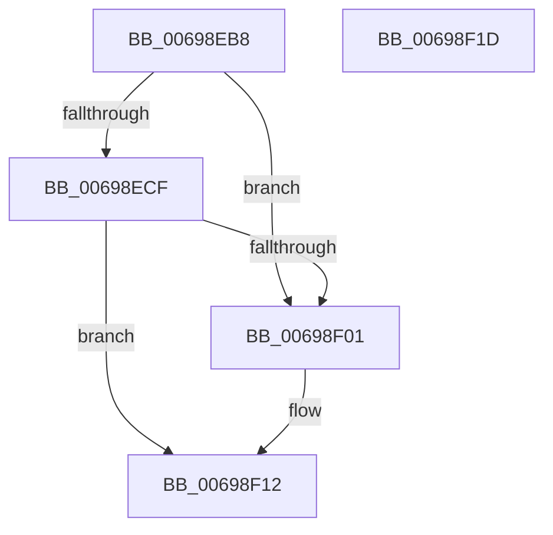

# MiFreeCacheSlice

- RVA: `0x00698EB8`–`0x00698F1E` (길이 `102` bytes)
- VA: `0x0000000140698EB8`
- 실행 섹션: `.text`
- PDB 이름 있음: `예`; PDB Function 태그: `아니요`
- unwind 정보 RVA: `0x0005CAAC`
- 디코드: `26`개 명령, `102/102` bytes 표시
- 미해석 바이트: `0` (있으면 어셈블리에 `.byte`로 보존)

> 이 문서는 커널 이미지의 기계어와 PDB 기호를 분석해 생성했습니다. 4번과 5번은 함수 원형과 자료형을 바이너리 사용 방식에서 추정한 C 해석이며 원본 소스 복구 결과는 아닙니다.

## 1. Dependencies

- 직접 호출 지점: **2**; 고유 호출 대상: **2**
- 직접 호출자로 확인된 함수: **2**
- RIP 상대 이미지 참조: **0**

### Outgoing calls
- `0x00698EF8` → [MiCoalesceActivePagesIntoFree](MiCoalesceActivePagesIntoFree_function_00693558.md) (function, `0x00693558`)
- `0x00698F0D` → [MiFreeLargeZeroPages](../3B/MiFreeLargeZeroPages_function_003B5F0C.md) (function, `0x003B5F0C`)

### Direct callers
- [MiFreeLargeProcessPagesToCache](MiFreeLargeProcessPagesToCache_function_00698F24.md) at `0x006990FD`
- [MiFreeProcessLargePageCache](MiFreeProcessLargePageCache_function_00699204.md) at `0x00699307`

### Static image references
- 디코드된 RIP-relative 메모리 참조가 없습니다.

## 2. Other-region calls and transfers

- 다른 실행 섹션으로 향하는 call: **0**
- 별도 외부 분기/꼬리 이동을 확인하지 못했습니다.

## 3. Assembly (complete function range)

```asm
00698EB8  48 89 5C 24 08                  mov qword ptr [rsp + 8], rbx
00698EBD  57                              push rdi
00698EBE  48 83 EC 20                     sub rsp, 0x20
00698EC2  48 83 7A 40 20                  cmp qword ptr [rdx + 0x40], 0x20
00698EC7  48 8B DA                        mov rbx, rdx
00698ECA  48 8B F9                        mov rdi, rcx
00698ECD  75 32                           jne 0x140698f01
00698ECF  48 B8 00 00 00 00 00 DE FF FF   movabs rax, 0xffffde0000000000
00698ED9  48 8B 52 30                     mov rdx, qword ptr [rdx + 0x30]
00698EDD  41 B8 01 00 00 00               mov r8d, 1
00698EE3  48 2B D0                        sub rdx, rax
00698EE6  48 B8 AB AA AA AA AA AA AA AA   movabs rax, 0xaaaaaaaaaaaaaaab
00698EF0  48 C1 FA 04                     sar rdx, 4
00698EF4  48 0F AF D0                     imul rdx, rax
00698EF8  E8 5B A6 FF FF                  call 0x140693558
00698EFD  85 C0                           test eax, eax
00698EFF  75 11                           jne 0x140698f12
00698F01  41 B8 01 00 00 00               mov r8d, 1
00698F07  48 8B D3                        mov rdx, rbx
00698F0A  48 8B CF                        mov rcx, rdi
00698F0D  E8 FA CF D1 FF                  call 0x1403b5f0c
00698F12  48 8B 5C 24 30                  mov rbx, qword ptr [rsp + 0x30]
00698F17  48 83 C4 20                     add rsp, 0x20
00698F1B  5F                              pop rdi
00698F1C  C3                              ret
00698F1D  CC                              int3
```

## 4. C-style interpretation (structured pseudocode)

```c
__int64 __fastcall MiFreeCacheSlice(__int64 a1, __int64 a2)
{
    __int64 result;
    __int64 v_rsp;
    unsigned __int64 v_stack_p8;

    v_stack_p8 = v_rbx;
    v_rsp = (v_rsp) - (32);
    if ((*(unsigned __int64 *)(a2 + 64)) != 32) goto loc_00698F01;
    a2 = (*(unsigned __int64 *)(a2 + 48)) - (result);
    a2 = (a2) >> (4);
    a2 = (a2) * (result);
    result = MiCoalesceActivePagesIntoFree(a1, a2, 1, a4);
    if ((unsigned int)(result) == 0) {
        a3 = 1;
        a2 = a2;
        a1 = a1;
        result = MiFreeLargeZeroPages(a1, a2, a3, a4);
    }
    v_rsp = (v_rsp) + (32);
    return result;
}
```

## 5. (Beta) C Style

```c
int64_t MiFreeCacheSlice(int64_t Arg1, void *Arg2)
{
    uint8_t *arg2 = (uint8_t *)Arg2;

    int64_t result;
    int64_t local_rsp;
    uint64_t v_stack_p8;

    v_stack_p8 = local_rbx;
    local_rsp = (local_rsp) - (32);
    if ((*(uint64_t *)(arg2 + 0x40)) != 32) goto loc_00698F01;
    Arg2 = (*(uint64_t *)(arg2 + 0x30)) - (result);
    Arg2 = (Arg2) >> (4);
    Arg2 = (Arg2) * (result);
    result = MiCoalesceActivePagesIntoFree(Arg1, Arg2, 1, a4);
    if ((uint32_t)(result) == 0) {
        a3 = 1;
        Arg2 = Arg2;
        Arg1 = Arg1;
        result = MiFreeLargeZeroPages(Arg1, Arg2, a3, a4);
    }
    local_rsp = (local_rsp) + (32);
    return result;
}
```

### 관측된 메모리 오프셋

구조체 형식이 확인되지 않은 접근은 인자 기준의 오프셋으로만 기록했습니다.

| 기준 인자 | 오프셋 표현 | 폭 (bit) | 접근 |
|---|---:|---:|---|
| `Arg2` | `+ 0x30` | `64` | `R` |
| `Arg2` | `+ 0x40` | `64` | `R` |

## 6. Execution-region graph

[열기: 2D/3D 그래프와 함수 탐색 컨트롤 패널](../../../control-panel.html?section=text&rva=0x00698EB8&view=graph)

- 2D 그래프는 위에서 아래로 흐르고, 3D 그래프는 빈 공간을 드래그해 회전합니다. Shift+드래그는 이동, 휠은 확대·축소, 함수 노드 선택은 대상 보고서 이동입니다.

### Static fallback


