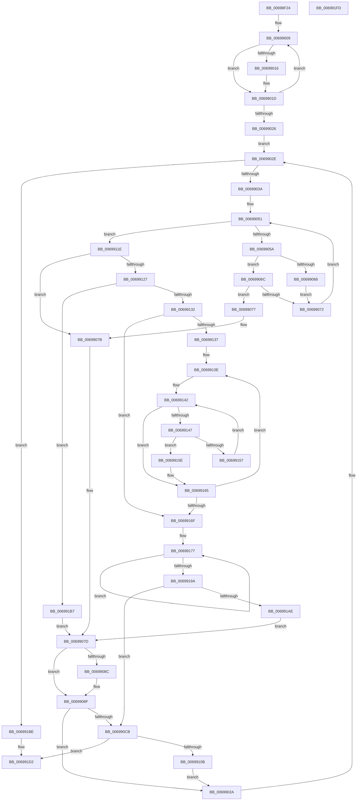

# MiFreeLargeProcessPagesToCache

- RVA: `0x00698F24`–`0x006991FE` (길이 `730` bytes)
- VA: `0x0000000140698F24`
- 실행 섹션: `.text`
- PDB 이름 있음: `예`; PDB Function 태그: `아니요`
- unwind 정보 RVA: `0x000D962C`
- 디코드: `196`개 명령, `730/730` bytes 표시
- 미해석 바이트: `0` (있으면 어셈블리에 `.byte`로 보존)

> 이 문서는 커널 이미지의 기계어와 PDB 기호를 분석해 생성했습니다. 4번과 5번은 함수 원형과 자료형을 바이너리 사용 방식에서 추정한 C 해석이며 원본 소스 복구 결과는 아닙니다.

## 1. Dependencies

- 직접 호출 지점: **10**; 고유 호출 대상: **8**
- 직접 호출자로 확인된 함수: **1**
- RIP 상대 이미지 참조: **2**

### Outgoing calls
- `0x00698F91` → [MiPageToNode](../33/MiPageToNode_function_00338CD0.md) (function, `0x00338CD0`)
- `0x00698FE1` → [MiFreeLargePageCharges](../3F/MiFreeLargePageCharges_function_003F7FF0.md) (function, `0x003F7FF0`)
- `0x00698FF0` → [ExAcquireSpinLockExclusive](../24/ExAcquireSpinLockExclusive_function_00248690.md) (function, `0x00248690`)
- `0x006990D6` → [memset](../6C/memset_function_006C6C40.md) (function, `0x006C6C40`)
- `0x006990E3` → [MiEmptyCacheSlice](MiEmptyCacheSlice_function_00698DD4.md) (function, `0x00698DD4`)
- `0x006990EE` → [MiReleaseSpinLockExclusive](../24/MiReleaseSpinLockExclusive_function_002482C0.md) (function, `0x002482C0`)
- `0x006990FD` → [MiFreeCacheSlice](MiFreeCacheSlice_function_00698EB8.md) (function, `0x00698EB8`)
- `0x0069910E` → [ExAcquireSpinLockExclusive](../24/ExAcquireSpinLockExclusive_function_00248690.md) (function, `0x00248690`)
- `0x006991CD` → [MiReleaseSpinLockExclusive](../24/MiReleaseSpinLockExclusive_function_002482C0.md) (function, `0x002482C0`)
- `0x006991DD` → [_security_check_cookie](../6A/_security_check_cookie_function_006AC640.md) (function, `0x006AC640`)

### Direct callers
- [MiFreeLargePages](../2A/MiFreeLargePages_function_002A99D0.md) at `0x002A9B93`
- [MiFreeLargePages](../2A/MiFreeLargePages_function_002A99D0.md) at `0x002A9D21`

### Static image references
- `0x00698F3B` → RVA `0x00E0A740` (`.data`; read)
- `0x00698F96` → RVA `0x00E30088` (`.data`; read)

## 2. Other-region calls and transfers

- 다른 실행 섹션으로 향하는 call: **0**
- 별도 외부 분기/꼬리 이동을 확인하지 못했습니다.

## 3. Assembly (complete function range)

```asm
00698F24  48 89 5C 24 18                  mov qword ptr [rsp + 0x18], rbx
00698F29  55                              push rbp
00698F2A  56                              push rsi
00698F2B  57                              push rdi
00698F2C  41 54                           push r12
00698F2E  41 55                           push r13
00698F30  41 56                           push r14
00698F32  41 57                           push r15
00698F34  48 81 EC B0 00 00 00            sub rsp, 0xb0
00698F3B  48 8B 05 FE 17 77 00            mov rax, qword ptr [rip + 0x7717fe]
00698F42  48 33 C4                        xor rax, rsp
00698F45  48 89 84 24 A0 00 00 00         mov qword ptr [rsp + 0xa0], rax
00698F4D  65 48 8B 04 25 88 01 00 00      mov rax, qword ptr gs:[0x188]
00698F56  4C 8B E9                        mov r13, rcx
00698F59  48 8B 09                        mov rcx, qword ptr [rcx]
00698F5C  48 8B F2                        mov rsi, rdx
00698F5F  48 8B 98 B8 00 00 00            mov rbx, qword ptr [rax + 0xb8]
00698F66  48 8D 04 49                     lea rax, [rcx + rcx*2]
00698F6A  48 03 C0                        add rax, rax
00698F6D  48 8B AB 10 04 00 00            mov rbp, qword ptr [rbx + 0x410]
00698F74  48 89 6C 24 30                  mov qword ptr [rsp + 0x30], rbp
00698F79  48 8B BD 18 04 00 00            mov rdi, qword ptr [rbp + 0x418]
00698F80  48 BA 20 00 00 00 00 DE FF FF   movabs rdx, 0xffffde0000000020
00698F8A  8B 04 C2                        mov eax, dword ptr [rdx + rax*8]
00698F8D  89 44 24 20                     mov dword ptr [rsp + 0x20], eax
00698F91  E8 3A FD C9 FF                  call 0x140338cd0
00698F96  48 8B 0D EB 70 79 00            mov rcx, qword ptr [rip + 0x7970eb]
00698F9D  45 33 C0                        xor r8d, r8d
00698FA0  0F B7 93 AE 04 00 00            movzx edx, word ptr [rbx + 0x4ae]
00698FA7  4C 8B 0C D1                     mov r9, qword ptr [rcx + rdx*8]
00698FAB  0F B6 54 24 22                  movzx edx, byte ptr [rsp + 0x22]
00698FB0  48 C1 EA 06                     shr rdx, 6
00698FB4  4C 89 4C 24 28                  mov qword ptr [rsp + 0x28], r9
00698FB9  41 8B 89 58 40 00 00            mov ecx, dword ptr [r9 + 0x4058]
00698FC0  89 4F 18                        mov dword ptr [rdi + 0x18], ecx
00698FC3  48 83 C7 20                     add rdi, 0x20
00698FC7  8B C8                           mov ecx, eax
00698FC9  48 8D 04 49                     lea rax, [rcx + rcx*2]
00698FCD  49 8B C9                        mov rcx, r9
00698FD0  48 03 D0                        add rdx, rax
00698FD3  48 C1 E2 06                     shl rdx, 6
00698FD7  48 03 FA                        add rdi, rdx
00698FDA  48 8B D6                        mov rdx, rsi
00698FDD  48 C1 E2 04                     shl rdx, 4
00698FE1  E8 0A F0 D5 FF                  call 0x1403f7ff0
00698FE6  4C 8D A5 20 04 00 00            lea r12, [rbp + 0x420]
00698FED  49 8B CC                        mov rcx, r12
00698FF0  E8 9B F6 BA FF                  call 0x140248690
00698FF5  41 B8 04 00 00 00               mov r8d, 4
00698FFB  48 8D 5F 0E                     lea rbx, [rdi + 0xe]
00698FFF  44 8A F8                        mov r15b, al
00699002  48 8B D3                        mov rdx, rbx
00699005  45 8D 48 FD                     lea r9d, [r8 - 3]
00699009  0F B7 0A                        movzx ecx, word ptr [rdx]
0069900C  B8 FF FF 00 00                  mov eax, 0xffff
00699011  66 3B C8                        cmp cx, ax
00699014  74 07                           je 0x14069901d
00699016  66 41 03 C9                     add cx, r9w
0069901A  66 89 0A                        mov word ptr [rdx], cx
0069901D  48 83 C2 10                     add rdx, 0x10
00699021  4D 2B C1                        sub r8, r9
00699024  75 E3                           jne 0x140699009
00699026  33 C0                           xor eax, eax
00699028  EB 04                           jmp 0x14069902e
0069902A  48 8D 5F 0E                     lea rbx, [rdi + 0xe]
0069902E  4C 8B F6                        mov r14, rsi
00699031  48 85 F6                        test rsi, rsi
00699034  0F 84 84 01 00 00               je 0x1406991be
0069903A  49 2B F1                        sub rsi, r9
0069903D  83 CA FF                        or edx, 0xffffffff
00699040  8B C8                           mov ecx, eax
00699042  4D 8B 5C F5 00                  mov r11, qword ptr [r13 + rsi*8]
00699047  49 8B EB                        mov rbp, r11
0069904A  48 81 E5 00 FE FF FF            and rbp, 0xfffffffffffffe00
00699051  83 F9 04                        cmp ecx, 4
00699054  0F 83 C4 00 00 00               jae 0x14069911e
0069905A  44 8B C1                        mov r8d, ecx
0069905D  4D 03 C0                        add r8, r8
00699060  42 F6 44 C7 0C 3F               test byte ptr [rdi + r8*8 + 0xc], 0x3f
00699066  75 04                           jne 0x14069906c
00699068  8B D1                           mov edx, ecx
0069906A  EB 06                           jmp 0x140699072
0069906C  4A 39 2C C7                     cmp qword ptr [rdi + r8*8], rbp
00699070  74 05                           je 0x140699077
00699072  41 03 C9                        add ecx, r9d
00699075  EB DA                           jmp 0x140699051
00699077  41 83 C8 FF                     or r8d, 0xffffffff
0069907B  33 C0                           xor eax, eax
0069907D  8B D9                           mov ebx, ecx
0069907F  48 C1 E3 04                     shl rbx, 4
00699083  48 03 DF                        add rbx, rdi
00699086  41 83 F8 FF                     cmp r8d, -1
0069908A  74 03                           je 0x14069908f
0069908C  48 89 2B                        mov qword ptr [rbx], rbp
0069908F  4C 2B 1B                        sub r11, qword ptr [rbx]
00699092  66 89 43 0E                     mov word ptr [rbx + 0xe], ax
00699096  0F B7 43 0C                     movzx eax, word ptr [rbx + 0xc]
0069909A  49 C1 EB 04                     shr r11, 4
0069909E  41 8D 0C 01                     lea ecx, [r9 + rax]
006990A2  66 33 C8                        xor cx, ax
006990A5  66 83 E1 3F                     and cx, 0x3f
006990A9  66 33 C8                        xor cx, ax
006990AC  8B 43 08                        mov eax, dword ptr [rbx + 8]
006990AF  44 0F AB D8                     bts eax, r11d
006990B3  66 89 4B 0C                     mov word ptr [rbx + 0xc], cx
006990B7  80 E1 3F                        and cl, 0x3f
006990BA  89 43 08                        mov dword ptr [rbx + 8], eax
006990BD  B8 00 00 00 00                  mov eax, 0
006990C2  80 F9 20                        cmp cl, 0x20
006990C5  0F 85 5F FF FF FF               jne 0x14069902a
006990CB  33 D2                           xor edx, edx
006990CD  48 8D 4C 24 40                  lea rcx, [rsp + 0x40]
006990D2  44 8D 42 60                     lea r8d, [rdx + 0x60]
006990D6  E8 65 DB 02 00                  call 0x1406c6c40
006990DB  4C 8B C3                        mov r8, rbx
006990DE  48 8D 54 24 40                  lea rdx, [rsp + 0x40]
006990E3  E8 EC FC FF FF                  call 0x140698dd4
006990E8  41 8A D7                        mov dl, r15b
006990EB  49 8B CC                        mov rcx, r12
006990EE  E8 CD F1 BA FF                  call 0x1402482c0
006990F3  48 8B 4C 24 28                  mov rcx, qword ptr [rsp + 0x28]
006990F8  48 8D 54 24 40                  lea rdx, [rsp + 0x40]
006990FD  E8 B6 FD FF FF                  call 0x140698eb8
00699102  48 85 F6                        test rsi, rsi
00699105  0F 84 C7 00 00 00               je 0x1406991d2
0069910B  49 8B CC                        mov rcx, r12
0069910E  E8 7D F5 BA FF                  call 0x140248690
00699113  33 C0                           xor eax, eax
00699115  44 8D 48 01                     lea r9d, [rax + 1]
00699119  E9 0C FF FF FF                  jmp 0x14069902a
0069911E  44 8B C2                        mov r8d, edx
00699121  0F 85 54 FF FF FF               jne 0x14069907b
00699127  33 C0                           xor eax, eax
00699129  83 FA FF                        cmp edx, -1
0069912C  0F 85 85 00 00 00               jne 0x1406991b7
00699132  48 85 F6                        test rsi, rsi
00699135  74 38                           je 0x14069916f
00699137  4C 8B CF                        mov r9, rdi
0069913A  44 8D 50 04                     lea r10d, [rax + 4]
0069913E  48 8D 4E FF                     lea rcx, [rsi - 1]
00699142  48 85 C9                        test rcx, rcx
00699145  74 1E                           je 0x140699165
00699147  49 8B 44 CD 00                  mov rax, qword ptr [r13 + rcx*8]
0069914C  48 25 00 FE FF FF               and rax, 0xfffffffffffffe00
00699152  49 39 01                        cmp qword ptr [r9], rax
00699155  74 07                           je 0x14069915e
00699157  48 FF C9                        dec rcx
0069915A  33 C0                           xor eax, eax
0069915C  EB E4                           jmp 0x140699142
0069915E  33 C0                           xor eax, eax
00699160  66 41 89 41 0E                  mov word ptr [r9 + 0xe], ax
00699165  49 83 C1 10                     add r9, 0x10
00699169  49 83 EA 01                     sub r10, 1
0069916D  75 CF                           jne 0x14069913e
0069916F  44 8B D0                        mov r10d, eax
00699172  8B D0                           mov edx, eax
00699174  4C 8B CB                        mov r9, rbx
00699177  41 8B C2                        mov eax, r10d
0069917A  8B CA                           mov ecx, edx
0069917C  48 03 C0                        add rax, rax
0069917F  0F B7 44 C7 0E                  movzx eax, word ptr [rdi + rax*8 + 0xe]
00699184  66 41 39 01                     cmp word ptr [r9], ax
00699188  4D 8D 49 10                     lea r9, [r9 + 0x10]
0069918C  41 0F 42 CA                     cmovb ecx, r10d
00699190  FF C2                           inc edx
00699192  44 8B D1                        mov r10d, ecx
00699195  83 FA 04                        cmp edx, 4
00699198  72 DD                           jb 0x140699177
0069919A  8B D9                           mov ebx, ecx
0069919C  33 C0                           xor eax, eax
0069919E  48 C1 E3 04                     shl rbx, 4
006991A2  49 8B F6                        mov rsi, r14
006991A5  48 03 DF                        add rbx, rdi
006991A8  0F 85 1D FF FF FF               jne 0x1406990cb
006991AE  44 8D 48 01                     lea r9d, [rax + 1]
006991B2  E9 C6 FE FF FF                  jmp 0x14069907d
006991B7  8B CA                           mov ecx, edx
006991B9  E9 BF FE FF FF                  jmp 0x14069907d
006991BE  48 8B 4C 24 30                  mov rcx, qword ptr [rsp + 0x30]
006991C3  41 8A D7                        mov dl, r15b
006991C6  48 81 C1 20 04 00 00            add rcx, 0x420
006991CD  E8 EE F0 BA FF                  call 0x1402482c0
006991D2  48 8B 8C 24 A0 00 00 00         mov rcx, qword ptr [rsp + 0xa0]
006991DA  48 33 CC                        xor rcx, rsp
006991DD  E8 5E 34 01 00                  call 0x1406ac640
006991E2  48 8B 9C 24 00 01 00 00         mov rbx, qword ptr [rsp + 0x100]
006991EA  48 81 C4 B0 00 00 00            add rsp, 0xb0
006991F1  41 5F                           pop r15
006991F3  41 5E                           pop r14
006991F5  41 5D                           pop r13
006991F7  41 5C                           pop r12
006991F9  5F                              pop rdi
006991FA  5E                              pop rsi
006991FB  5D                              pop rbp
006991FC  C3                              ret
006991FD  CC                              int3
```

## 4. C-style interpretation (structured pseudocode)

```c
__int64 __fastcall MiFreeLargeProcessPagesToCache(__int64 a1, __int64 a2, int a3)
{
    __int64 result;
    __int64 v_r10;
    __int64 v_r11;
    __int64 v_rbp;
    __int64 v_rbx;
    __int64 v_rdi;
    __int64 v_rsi;
    __int64 v_rsp;
    unsigned __int64 v_stack_m48;
    unsigned __int64 v_stack_mA8;
    unsigned __int64 v_stack_mB8;
    unsigned __int64 v_stack_mC0;
    unsigned __int8 v_stack_mC6;
    unsigned int v_stack_mC8;
    unsigned __int64 v_stack_p18;

    v_stack_p18 = v_rbx;
    v_rsp = (v_rsp) - (176);
    result = (*(unsigned __int64 *)(v_rip + 7804926)) ^ (v_rsp);
    v_stack_m48 = result;
    result = (*(unsigned __int64 *)(a1) + *(unsigned __int64 *)(a1) * 2) + (*(unsigned __int64 *)(a1) + *(unsigned __int64 *)(a1) * 2);
    v_stack_mB8 = *(unsigned __int64 *)(*(unsigned __int64 *)(*(unsigned __int64 *)(gs_base + (0 + 392)) + 184) + 1040);
    v_stack_mC8 = (unsigned int)((unsigned int)(*(unsigned int *)(a2 + result * 8)));
    result = MiPageToNode(*(unsigned __int64 *)(a1), a2, a3, a4);
    a3 = 0;
    a2 = (v_stack_mC6) >> (6);
    v_stack_mC0 = *(unsigned __int64 *)(*(unsigned __int64 *)(v_rip + 7958763) + *(unsigned __int16 *)(*(unsigned __int64 *)(*(unsigned __int64 *)(gs_base + (0 + 392)) + 184) + 1198) * 8);
    *(unsigned int *)(*(unsigned __int64 *)(*(unsigned __int64 *)(*(unsigned __int64 *)(*(unsigned __int64 *)(gs_base + (0 + 392)) + 184) + 1040) + 1048) + 24) = (unsigned int)((unsigned int)(*(unsigned int *)(*(unsigned __int64 *)(*(unsigned __int64 *)(v_rip + 7958763) + *(unsigned __int16 *)(*(unsigned __int64 *)(*(unsigned __int64 *)(gs_base + (0 + 392)) + 184) + 1198) * 8) + 16472)));
    v_rdi = (*(unsigned __int64 *)(*(unsigned __int64 *)(*(unsigned __int64 *)(*(unsigned __int64 *)(gs_base + (0 + 392)) + 184) + 1040) + 1048)) + (32);
    a2 = (a2) + ((unsigned int)((unsigned int)(result)) + (unsigned int)((unsigned int)(result)) * 2);
    a2 = (a2) << (6);
    v_rdi = (v_rdi) + (a2);
    a2 = (a2) << (4);
    result = MiFreeLargePageCharges(*(unsigned __int64 *)(*(unsigned __int64 *)(v_rip + 7958763) + *(unsigned __int16 *)(*(unsigned __int64 *)(*(unsigned __int64 *)(gs_base + (0 + 392)) + 184) + 1198) * 8), a2, a3, *(unsigned __int64 *)(*(unsigned __int64 *)(v_rip + 7958763) + *(unsigned __int16 *)(*(unsigned __int64 *)(*(unsigned __int64 *)(gs_base + (0 + 392)) + 184) + 1198) * 8));
    result = ExAcquireSpinLockExclusive(*(unsigned __int64 *)(*(unsigned __int64 *)(*(unsigned __int64 *)(gs_base + (0 + 392)) + 184) + 1040) + 1056, a2, a3, *(unsigned __int64 *)(*(unsigned __int64 *)(v_rip + 7958763) + *(unsigned __int16 *)(*(unsigned __int64 *)(*(unsigned __int64 *)(gs_base + (0 + 392)) + 184) + 1198) * 8));
loc_00699009:
    if (((unsigned __int16)(*(unsigned __int16 *)(v_rdi + 14))) != ((unsigned __int16)((unsigned int)(0xFFFFULL)))) {
        a1 = (unsigned __int16)((*(unsigned __int16 *)(v_rdi + 14)) + ((unsigned __int16)(4 - 3)));
        *(unsigned __int16 *)(v_rdi + 14) = (unsigned __int16)(a1);
    }
    a2 = (v_rdi + 14) + (16);
    a3 = (4) - (4 - 3);
    if (condition_is_not_equal) goto loc_00699009;
    result = 0;
    goto loc_0069902E;
loc_0069902A:
loc_0069902E:
    if (a2 == 0) goto loc_006991BE;
    v_rsi = (a2) - (4 - 3);
    a2 = (unsigned int)((a2) | (0xFFFFFFFFULL));
    v_rbp = (*(unsigned __int64 *)(a1 + v_rsi * 8)) & (-512);
loc_00699051:
    if (0 >= 4) goto loc_0069911E;
    a3 = (0) + (0);
    if (((*(unsigned __int8 *)(v_rdi + a3 * 8 + 12)) & (63)) != 0) goto loc_0069906C;
    goto loc_00699072;
loc_0069906C:
    if ((*(unsigned __int64 *)(v_rdi + a3 * 8)) == v_rbp) goto loc_00699077;
loc_00699072:
    a1 = (unsigned int)((0) + ((unsigned int)(4 - 3)));
    goto loc_00699051;
loc_00699077:
    a3 = (unsigned int)((a3) | (0xFFFFFFFFULL));
loc_0069907B:
    result = 0;
loc_0069907D:
    v_rbx = ((unsigned int)((unsigned int)(a1))) << (4);
    v_rbx = (v_rbx) + (v_rdi);
    if (a3 != -1) {
        *(unsigned __int64 *)(v_rbx) = v_rbp;
    }
    v_r11 = (*(unsigned __int64 *)(a1 + v_rsi * 8)) - (*(unsigned __int64 *)(v_rbx));
    *(unsigned __int16 *)(v_rbx + 14) = 0;
    v_r11 = (v_r11) >> (4);
    a1 = (unsigned __int16)((4 - 3 + *(unsigned __int16 *)(v_rbx + 12) * 1) ^ ((unsigned __int16)(*(unsigned __int16 *)(v_rbx + 12))));
    a1 = (unsigned __int16)((a1) & (63));
    a1 = (unsigned __int16)((a1) ^ ((unsigned __int16)(*(unsigned __int16 *)(v_rbx + 12))));
    *(unsigned __int16 *)(v_rbx + 12) = (unsigned __int16)(a1);
    a1 = (unsigned __int8)((a1) & (63));
    *(unsigned int *)(v_rbx + 8) = (unsigned int)((unsigned int)(*(unsigned int *)(v_rbx + 8)));
    if (((unsigned __int8)(a1)) != 32) goto loc_0069902A;
loc_006990CB:
    a2 = 0;
    result = memset(v_stack_mA8, a2, a2 + 96, 4 - 3);
    result = MiEmptyCacheSlice(v_stack_mA8, v_stack_mA8, v_rbx, 4 - 3);
    result = MiReleaseSpinLockExclusive(*(unsigned __int64 *)(*(unsigned __int64 *)(*(unsigned __int64 *)(gs_base + (0 + 392)) + 184) + 1040) + 1056, (unsigned __int8)((unsigned __int8)(result)), v_rbx, 4 - 3);
    result = MiFreeCacheSlice(v_stack_mC0, v_stack_mA8, v_rbx, 4 - 3);
    if (v_rsi == 0) goto loc_006991D2;
    result = ExAcquireSpinLockExclusive(*(unsigned __int64 *)(*(unsigned __int64 *)(*(unsigned __int64 *)(gs_base + (0 + 392)) + 184) + 1040) + 1056, v_stack_mA8, v_rbx, 4 - 3);
    result = 0;
    goto loc_0069902A;
loc_0069911E:
    if (condition_is_not_equal) goto loc_0069907B;
    result = 0;
    if (((unsigned int)(v_stack_mA8)) != -1) goto loc_006991B7;
    if (v_rsi == 0) goto loc_0069916F;
loc_0069913E:
loc_00699142:
    if (v_rsi - 1 == 0) goto loc_00699165;
    result = (*(unsigned __int64 *)(a1 + v_rsi - 1 * 8)) & (-512);
    if ((*(unsigned __int64 *)(v_rdi)) == result) goto loc_0069915E;
    a1 = (v_rsi - 1) - 1;
    result = 0;
    goto loc_00699142;
loc_0069915E:
    result = 0;
    *(unsigned __int16 *)(v_rdi + 14) = 0;
loc_00699165:
    a4 = (v_rdi) + (16);
    v_r10 = (result + 4) - (1);
    if (condition_is_not_equal) goto loc_0069913E;
loc_0069916F:
loc_00699177:
    result = (0) + (0);
    a1 = 0;
    if ((*(unsigned __int16 *)(v_rbx)) < ((unsigned __int16)(*(unsigned __int16 *)(v_rdi + result * 8 + 14)))) { a1 = 0; }
    a2 = (unsigned int)((0) + 1);
    if (((unsigned int)(a2)) < 4) goto loc_00699177;
    result = 0;
    v_rbx = ((unsigned int)((unsigned int)(a1))) << (4);
    v_rbx = (v_rbx) + (v_rdi);
    if (condition_is_not_equal) goto loc_006990CB;
    goto loc_0069907D;
loc_006991B7:
    goto loc_0069907D;
loc_006991BE:
    a1 = (v_stack_mB8) + (0x420ULL);
    result = MiReleaseSpinLockExclusive(a1, (unsigned __int8)((unsigned __int8)(result)), (unsigned int)((unsigned int)(v_stack_mA8)), result + 1);
loc_006991D2:
    a1 = (v_stack_m48) ^ (v_rsp);
    result = _security_check_cookie(a1, (unsigned __int8)((unsigned __int8)(result)), (unsigned int)((unsigned int)(v_stack_mA8)), result + 1);
    v_rsp = (v_rsp) + (176);
    return result;
}
```

## 5. (Beta) C Style

```c
int64_t MiFreeLargeProcessPagesToCache(void *Arg1, int64_t Arg2, int32_t Arg3)
{
    uint8_t *arg1 = (uint8_t *)Arg1;

    int64_t result;
    int64_t local_r10;
    int64_t local_r11;
    int64_t local_rbp;
    int64_t local_rbx;
    int64_t local_rdi;
    int64_t local_rsi;
    int64_t local_rsp;
    uint64_t v_stack_m48;
    uint64_t v_stack_mA8;
    uint64_t v_stack_mB8;
    uint64_t v_stack_mC0;
    uint8_t v_stack_mC6;
    uint32_t v_stack_mC8;
    uint64_t v_stack_p18;

    v_stack_p18 = local_rbx;
    local_rsp = (local_rsp) - (176);
    result = (*(uint64_t *)(v_rip + 0x7717FE)) ^ (local_rsp);
    v_stack_m48 = result;
    result = (*(uint64_t *)(arg1) + *(uint64_t *)(arg1) * 2) + (*(uint64_t *)(arg1) + *(uint64_t *)(arg1) * 2);
    v_stack_mB8 = *(uint64_t *)(*(uint64_t *)(*(uint64_t *)(gs_base + (0 + 0x188)) + 0xB8) + 0x410);
    v_stack_mC8 = (uint32_t)((uint32_t)(*(uint32_t *)(Arg2 + result * 8)));
    result = MiPageToNode(*(uint64_t *)(arg1), Arg2, Arg3, a4);
    Arg3 = 0;
    Arg2 = (v_stack_mC6) >> (6);
    v_stack_mC0 = *(uint64_t *)(*(uint64_t *)(v_rip + 0x7970EB) + *(uint16_t *)(*(uint64_t *)(*(uint64_t *)(gs_base + (0 + 0x188)) + 0xB8) + 0x4AE) * 8);
    *(uint32_t *)(*(uint64_t *)(*(uint64_t *)(*(uint64_t *)(*(uint64_t *)(gs_base + (0 + 0x188)) + 0xB8) + 0x410) + 0x418) + 0x18) = (uint32_t)((uint32_t)(*(uint32_t *)(*(uint64_t *)(*(uint64_t *)(v_rip + 0x7970EB) + *(uint16_t *)(*(uint64_t *)(*(uint64_t *)(gs_base + (0 + 0x188)) + 0xB8) + 0x4AE) * 8) + 0x4058)));
    local_rdi = (*(uint64_t *)(*(uint64_t *)(*(uint64_t *)(*(uint64_t *)(gs_base + (0 + 0x188)) + 0xB8) + 0x410) + 0x418)) + (32);
    Arg2 = (Arg2) + ((uint32_t)((uint32_t)(result)) + (uint32_t)((uint32_t)(result)) * 2);
    Arg2 = (Arg2) << (6);
    local_rdi = (local_rdi) + (Arg2);
    Arg2 = (Arg2) << (4);
    result = MiFreeLargePageCharges(*(uint64_t *)(*(uint64_t *)(v_rip + 0x7970EB) + *(uint16_t *)(*(uint64_t *)(*(uint64_t *)(gs_base + (0 + 0x188)) + 0xB8) + 0x4AE) * 8), Arg2, Arg3, *(uint64_t *)(*(uint64_t *)(v_rip + 0x7970EB) + *(uint16_t *)(*(uint64_t *)(*(uint64_t *)(gs_base + (0 + 0x188)) + 0xB8) + 0x4AE) * 8));
    result = ExAcquireSpinLockExclusive(*(uint64_t *)(*(uint64_t *)(*(uint64_t *)(gs_base + (0 + 0x188)) + 0xB8) + 0x410) + 1056, Arg2, Arg3, *(uint64_t *)(*(uint64_t *)(v_rip + 0x7970EB) + *(uint16_t *)(*(uint64_t *)(*(uint64_t *)(gs_base + (0 + 0x188)) + 0xB8) + 0x4AE) * 8));
loc_00699009:
    if (((uint16_t)(*(uint16_t *)(local_rdi + 0xE))) != ((uint16_t)((uint32_t)(0xFFFFULL)))) {
        Arg1 = (uint16_t)((*(uint16_t *)(local_rdi + 0xE)) + ((uint16_t)(4 - 3)));
        *(uint16_t *)(local_rdi + 0xE) = (uint16_t)(Arg1);
    }
    Arg2 = (local_rdi + 14) + (16);
    Arg3 = (4) - (4 - 3);
    if (condition_is_not_equal) goto loc_00699009;
    result = 0;
    goto loc_0069902E;
loc_0069902A:
loc_0069902E:
    if (Arg2 == 0) goto loc_006991BE;
    local_rsi = (Arg2) - (4 - 3);
    Arg2 = (uint32_t)((Arg2) | (0xFFFFFFFFULL));
    local_rbp = (*(uint64_t *)(arg1 + local_rsi * 8)) & (-512);
loc_00699051:
    if (0 >= 4) goto loc_0069911E;
    Arg3 = (0) + (0);
    if (((*(uint8_t *)(local_rdi + Arg3 * 8 + 0xC)) & (63)) != 0) goto loc_0069906C;
    goto loc_00699072;
loc_0069906C:
    if ((*(uint64_t *)(local_rdi + Arg3 * 8)) == local_rbp) goto loc_00699077;
loc_00699072:
    Arg1 = (uint32_t)((0) + ((uint32_t)(4 - 3)));
    goto loc_00699051;
loc_00699077:
    Arg3 = (uint32_t)((Arg3) | (0xFFFFFFFFULL));
loc_0069907B:
    result = 0;
loc_0069907D:
    local_rbx = ((uint32_t)((uint32_t)(Arg1))) << (4);
    local_rbx = (local_rbx) + (local_rdi);
    if (Arg3 != -1) {
        *(uint64_t *)(local_rbx) = local_rbp;
    }
    local_r11 = (*(uint64_t *)(arg1 + local_rsi * 8)) - (*(uint64_t *)(local_rbx));
    *(uint16_t *)(local_rbx + 0xE) = 0;
    local_r11 = (local_r11) >> (4);
    Arg1 = (uint16_t)((4 - 3 + *(uint16_t *)(local_rbx + 0xC) * 1) ^ ((uint16_t)(*(uint16_t *)(local_rbx + 0xC))));
    Arg1 = (uint16_t)((Arg1) & (63));
    Arg1 = (uint16_t)((Arg1) ^ ((uint16_t)(*(uint16_t *)(local_rbx + 0xC))));
    *(uint16_t *)(local_rbx + 0xC) = (uint16_t)(Arg1);
    Arg1 = (uint8_t)((Arg1) & (63));
    *(uint32_t *)(local_rbx + 0x8) = (uint32_t)((uint32_t)(*(uint32_t *)(local_rbx + 0x8)));
    if (((uint8_t)(Arg1)) != 32) goto loc_0069902A;
loc_006990CB:
    Arg2 = 0;
    result = memset(v_stack_mA8, Arg2, Arg2 + 96, 4 - 3);
    result = MiEmptyCacheSlice(v_stack_mA8, v_stack_mA8, local_rbx, 4 - 3);
    result = MiReleaseSpinLockExclusive(*(uint64_t *)(*(uint64_t *)(*(uint64_t *)(gs_base + (0 + 0x188)) + 0xB8) + 0x410) + 1056, (uint8_t)((uint8_t)(result)), local_rbx, 4 - 3);
    result = MiFreeCacheSlice(v_stack_mC0, v_stack_mA8, local_rbx, 4 - 3);
    if (local_rsi == 0) goto loc_006991D2;
    result = ExAcquireSpinLockExclusive(*(uint64_t *)(*(uint64_t *)(*(uint64_t *)(gs_base + (0 + 0x188)) + 0xB8) + 0x410) + 1056, v_stack_mA8, local_rbx, 4 - 3);
    result = 0;
    goto loc_0069902A;
loc_0069911E:
    if (condition_is_not_equal) goto loc_0069907B;
    result = 0;
    if (((uint32_t)(v_stack_mA8)) != -1) goto loc_006991B7;
    if (local_rsi == 0) goto loc_0069916F;
loc_0069913E:
loc_00699142:
    if (local_rsi - 1 == 0) goto loc_00699165;
    result = (*(uint64_t *)(arg1 + local_rsi - 0x1 * 8)) & (-512);
    if ((*(uint64_t *)(local_rdi)) == result) goto loc_0069915E;
    Arg1 = (local_rsi - 1) - 1;
    result = 0;
    goto loc_00699142;
loc_0069915E:
    result = 0;
    *(uint16_t *)(local_rdi + 0xE) = 0;
loc_00699165:
    a4 = (local_rdi) + (16);
    local_r10 = (result + 4) - (1);
    if (condition_is_not_equal) goto loc_0069913E;
loc_0069916F:
loc_00699177:
    result = (0) + (0);
    Arg1 = 0;
    if ((*(uint16_t *)(local_rbx)) < ((uint16_t)(*(uint16_t *)(local_rdi + result * 8 + 0xE)))) { Arg1 = 0; }
    Arg2 = (uint32_t)((0) + 1);
    if (((uint32_t)(Arg2)) < 4) goto loc_00699177;
    result = 0;
    local_rbx = ((uint32_t)((uint32_t)(Arg1))) << (4);
    local_rbx = (local_rbx) + (local_rdi);
    if (condition_is_not_equal) goto loc_006990CB;
    goto loc_0069907D;
loc_006991B7:
    goto loc_0069907D;
loc_006991BE:
    Arg1 = (v_stack_mB8) + (0x420ULL);
    result = MiReleaseSpinLockExclusive(Arg1, (uint8_t)((uint8_t)(result)), (uint32_t)((uint32_t)(v_stack_mA8)), result + 1);
loc_006991D2:
    Arg1 = (v_stack_m48) ^ (local_rsp);
    result = _security_check_cookie(Arg1, (uint8_t)((uint8_t)(result)), (uint32_t)((uint32_t)(v_stack_mA8)), result + 1);
    local_rsp = (local_rsp) + (176);
    return result;
}
```

### 관측된 메모리 오프셋

구조체 형식이 확인되지 않은 접근은 인자 기준의 오프셋으로만 기록했습니다.

| 기준 인자 | 오프셋 표현 | 폭 (bit) | 접근 |
|---|---:|---:|---|
| `Arg1` | `+ 0x0` | `64` | `R` |
| `Arg1` | `+ 0x0 + rcx*8` | `64` | `R` |
| `Arg1` | `+ 0x0 + rsi*8` | `64` | `R` |

## 6. Execution-region graph

[열기: 2D/3D 그래프와 함수 탐색 컨트롤 패널](../../../control-panel.html?section=text&rva=0x00698F24&view=graph)

- 2D 그래프는 위에서 아래로 흐르고, 3D 그래프는 빈 공간을 드래그해 회전합니다. Shift+드래그는 이동, 휠은 확대·축소, 함수 노드 선택은 대상 보고서 이동입니다.

### Static fallback


