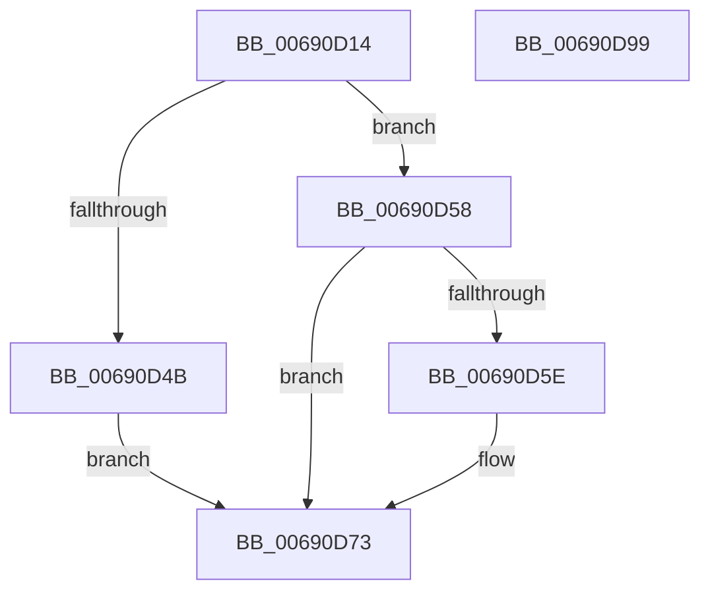

# MiFreePartitionNodePages

- RVA: `0x00690D14`–`0x00690D9A` (길이 `134` bytes)
- VA: `0x0000000140690D14`
- 실행 섹션: `.text`
- PDB 이름 있음: `예`; PDB Function 태그: `아니요`
- unwind 정보 RVA: `0x000CA9E0`
- 디코드: `41`개 명령, `134/134` bytes 표시
- 미해석 바이트: `0` (있으면 어셈블리에 `.byte`로 보존)

> 이 문서는 커널 이미지의 기계어와 PDB 기호를 분석해 생성했습니다. 4번과 5번은 함수 원형과 자료형을 바이너리 사용 방식에서 추정한 C 해석이며 원본 소스 복구 결과는 아닙니다.

## 1. Dependencies

- 직접 호출 지점: **2**; 고유 호출 대상: **2**
- 직접 호출자로 확인된 함수: **2**
- RIP 상대 이미지 참조: **0**

### Outgoing calls
- `0x00690D37` → [memset](../6C/memset_function_006C6C40.md) (function, `0x006C6C40`)
- `0x00690D7E` → [MiActOnPartitionNodePages](../68/MiActOnPartitionNodePages_function_0068F7F4.md) (function, `0x0068F7F4`)

### Direct callers
- [MiFreePartitionTree](MiFreePartitionTree_function_00690E50.md) at `0x00690E9E`
- [MiInsertPartitionPageNodes](MiInsertPartitionPageNodes_function_00690F94.md) at `0x006910CF`

### Static image references
- 디코드된 RIP-relative 메모리 참조가 없습니다.

## 2. Other-region calls and transfers

- 다른 실행 섹션으로 향하는 call: **0**
- 별도 외부 분기/꼬리 이동을 확인하지 못했습니다.

## 3. Assembly (complete function range)

```asm
00690D14  48 89 5C 24 08                  mov qword ptr [rsp + 8], rbx
00690D19  48 89 74 24 10                  mov qword ptr [rsp + 0x10], rsi
00690D1E  57                              push rdi
00690D1F  48 83 EC 70                     sub rsp, 0x70
00690D23  48 8B F2                        mov rsi, rdx
00690D26  41 8B F8                        mov edi, r8d
00690D29  33 D2                           xor edx, edx
00690D2B  48 8B D9                        mov rbx, rcx
00690D2E  48 8D 4C 24 20                  lea rcx, [rsp + 0x20]
00690D33  44 8D 42 48                     lea r8d, [rdx + 0x48]
00690D37  E8 04 5F 03 00                  call 0x1406c6c40
00690D3C  BA 04 00 00 00                  mov edx, 4
00690D41  48 89 5C 24 20                  mov qword ptr [rsp + 0x20], rbx
00690D46  40 84 FA                        test dl, dil
00690D49  74 0D                           je 0x140690d58
00690D4B  8B D7                           mov edx, edi
00690D4D  83 E2 20                        and edx, 0x20
00690D50  83 CA 10                        or edx, 0x10
00690D53  C1 EA 04                        shr edx, 4
00690D56  EB 1B                           jmp 0x140690d73
00690D58  40 F6 C7 01                     test dil, 1
00690D5C  74 15                           je 0x140690d73
00690D5E  33 C9                           xor ecx, ecx
00690D60  BA 02 00 00 00                  mov edx, 2
00690D65  8B C7                           mov eax, edi
00690D67  89 54 24 34                     mov dword ptr [rsp + 0x34], edx
00690D6B  83 E0 30                        and eax, 0x30
00690D6E  3C 30                           cmp al, 0x30
00690D70  0F 45 D1                        cmovne edx, ecx
00690D73  4C 8D 4C 24 20                  lea r9, [rsp + 0x20]
00690D78  44 8B C7                        mov r8d, edi
00690D7B  48 8B CE                        mov rcx, rsi
00690D7E  E8 71 EA FF FF                  call 0x14068f7f4
00690D83  8B 44 24 38                     mov eax, dword ptr [rsp + 0x38]
00690D87  4C 8D 5C 24 70                  lea r11, [rsp + 0x70]
00690D8C  49 8B 5B 10                     mov rbx, qword ptr [r11 + 0x10]
00690D90  49 8B 73 18                     mov rsi, qword ptr [r11 + 0x18]
00690D94  49 8B E3                        mov rsp, r11
00690D97  5F                              pop rdi
00690D98  C3                              ret
00690D99  CC                              int3
```

## 4. C-style interpretation (structured pseudocode)

```c
__int64 __fastcall MiFreePartitionNodePages(__int64 a1, __int64 a2, int a3)
{
    __int64 result;
    __int64 v_rsp;
    unsigned int v_stack_m40;
    unsigned int v_stack_m44;
    unsigned __int64 v_stack_m58;
    unsigned __int64 v_stack_m8;
    unsigned __int64 v_stack_p10;
    unsigned __int64 v_stack_p8;

    v_stack_p8 = v_rbx;
    v_stack_p10 = v_rsi;
    v_rsp = (v_rsp) - (112);
    a2 = 0;
    result = memset(v_stack_m58, a2, a2 + 72, a4);
    v_stack_m58 = a1;
    if (((4) & ((unsigned __int8)((unsigned int)(a3)))) == 0) goto loc_00690D58;
    a2 = (unsigned int)(((unsigned int)((unsigned int)((unsigned int)(a3)))) & (32));
    a2 = (unsigned int)((a2) | (16));
    a2 = (unsigned int)((a2) >> (4));
    goto loc_00690D73;
loc_00690D58:
    if ((((unsigned __int8)((unsigned int)(a3))) & (1)) != 0) {
        a1 = 0;
        a2 = 2;
        result = (unsigned int)((unsigned int)(a3));
        v_stack_m44 = (unsigned int)(a2);
        result = (unsigned int)((result) & (48));
        if (((unsigned __int8)(result)) != 48) { a2 = 0; }
    }
    result = MiActOnPartitionNodePages(a2, a2, (unsigned int)((unsigned int)((unsigned int)(a3))), v_stack_m58);
    return (unsigned int)(v_stack_m40);
}
```

## 5. (Beta) C Style

```c
int64_t MiFreePartitionNodePages(int64_t Arg1, int64_t Arg2, int32_t Arg3)
{
    int64_t result;
    int64_t local_rsp;
    uint32_t v_stack_m40;
    uint32_t v_stack_m44;
    uint64_t v_stack_m58;
    uint64_t v_stack_m8;
    uint64_t v_stack_p10;
    uint64_t v_stack_p8;

    v_stack_p8 = local_rbx;
    v_stack_p10 = local_rsi;
    local_rsp = (local_rsp) - (112);
    Arg2 = 0;
    result = memset(v_stack_m58, Arg2, Arg2 + 72, a4);
    v_stack_m58 = Arg1;
    if (((4) & ((uint8_t)((uint32_t)(Arg3)))) == 0) goto loc_00690D58;
    Arg2 = (uint32_t)(((uint32_t)((uint32_t)((uint32_t)(Arg3)))) & (32));
    Arg2 = (uint32_t)((Arg2) | (16));
    Arg2 = (uint32_t)((Arg2) >> (4));
    goto loc_00690D73;
loc_00690D58:
    if ((((uint8_t)((uint32_t)(Arg3))) & (1)) != 0) {
        Arg1 = 0;
        Arg2 = 2;
        result = (uint32_t)((uint32_t)(Arg3));
        v_stack_m44 = (uint32_t)(Arg2);
        result = (uint32_t)((result) & (48));
        if (((uint8_t)(result)) != 48) { Arg2 = 0; }
    }
    result = MiActOnPartitionNodePages(Arg2, Arg2, (uint32_t)((uint32_t)((uint32_t)(Arg3))), v_stack_m58);
    return (uint32_t)(v_stack_m40);
}
```

## 6. Execution-region graph

[열기: 2D/3D 그래프와 함수 탐색 컨트롤 패널](../../../control-panel.html?section=text&rva=0x00690D14&view=graph)

- 2D 그래프는 위에서 아래로 흐르고, 3D 그래프는 빈 공간을 드래그해 회전합니다. Shift+드래그는 이동, 휠은 확대·축소, 함수 노드 선택은 대상 보고서 이동입니다.

### Static fallback


