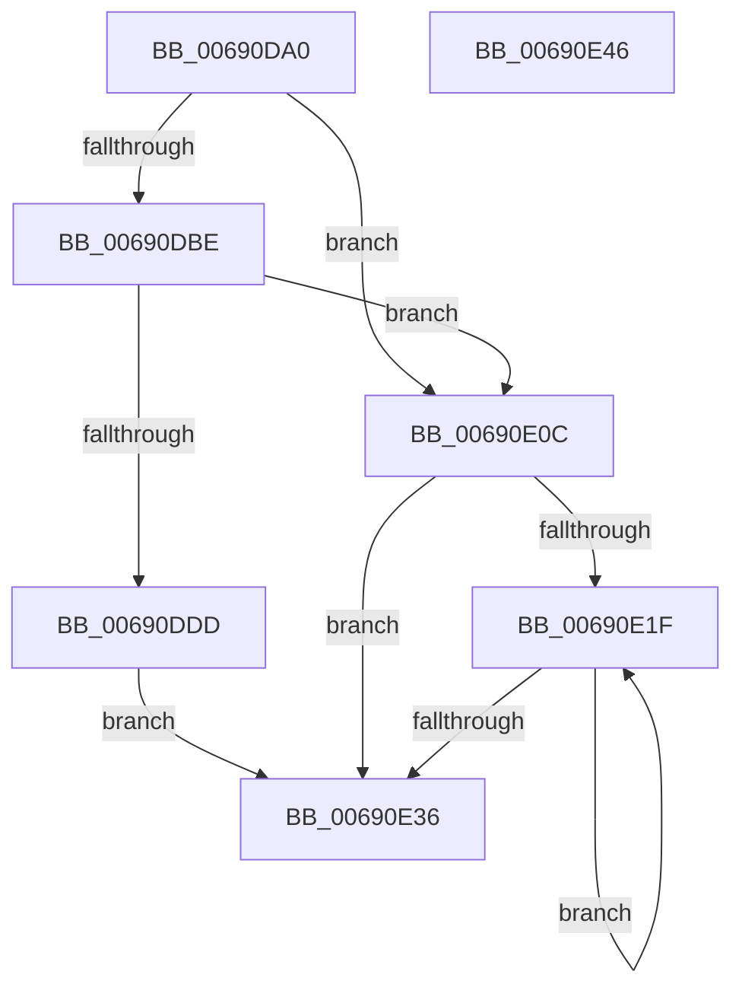

# MiFreePartitionPageRun

- RVA: `0x00690DA0`–`0x00690E47` (길이 `167` bytes)
- VA: `0x0000000140690DA0`
- 실행 섹션: `.text`
- PDB 이름 있음: `예`; PDB Function 태그: `아니요`
- unwind 정보 RVA: `0x000717F8`
- 디코드: `44`개 명령, `167/167` bytes 표시
- 미해석 바이트: `0` (있으면 어셈블리에 `.byte`로 보존)

> 이 문서는 커널 이미지의 기계어와 PDB 기호를 분석해 생성했습니다. 4번과 5번은 함수 원형과 자료형을 바이너리 사용 방식에서 추정한 C 해석이며 원본 소스 복구 결과는 아닙니다.

## 1. Dependencies

- 직접 호출 지점: **2**; 고유 호출 대상: **2**
- 직접 호출자로 확인된 함수: **1**
- RIP 상대 이미지 참조: **1**

### Outgoing calls
- `0x00690E05` → [MiFreeMdlPageRun](../37/MiFreeMdlPageRun_function_00375A4C.md) (function, `0x00375A4C`)
- `0x00690E24` → [MiInsertHugeRangeInPartition](MiInsertHugeRangeInPartition_function_00690F28.md) (function, `0x00690F28`)

### Direct callers
- [MiActOnPartitionNodePages](../68/MiActOnPartitionNodePages_function_0068F7F4.md) at `0x0068FAEF`

### Static image references
- `0x00690DAF` → RVA `0x00E2DCE0` (`.data`; read)

## 2. Other-region calls and transfers

- 다른 실행 섹션으로 향하는 call: **0**
- 별도 외부 분기/꼬리 이동을 확인하지 못했습니다.

## 3. Assembly (complete function range)

```asm
00690DA0  48 89 5C 24 10                  mov qword ptr [rsp + 0x10], rbx
00690DA5  48 89 74 24 18                  mov qword ptr [rsp + 0x18], rsi
00690DAA  57                              push rdi
00690DAB  48 83 EC 30                     sub rsp, 0x30
00690DAF  48 3B 15 2A CF 79 00            cmp rdx, qword ptr [rip + 0x79cf2a]
00690DB6  49 8B D8                        mov rbx, r8
00690DB9  48 8B FA                        mov rdi, rdx
00690DBC  77 4E                           ja 0x140690e0c
00690DBE  48 8D 04 52                     lea rax, [rdx + rdx*2]
00690DC2  48 03 C0                        add rax, rax
00690DC5  48 B9 28 00 00 00 00 DE FF FF   movabs rcx, 0xffffde0000000028
00690DCF  48 8B 04 C1                     mov rax, qword ptr [rcx + rax*8]
00690DD3  48 C1 E8 36                     shr rax, 0x36
00690DD7  0F BA E0 00                     bt eax, 0
00690DDB  73 2F                           jae 0x140690e0c
00690DDD  41 81 E1 00 08 00 00            and r9d, 0x800
00690DE4  45 33 C0                        xor r8d, r8d
00690DE7  41 0F BA E9 0C                  bts r9d, 0xc
00690DEC  48 8B D3                        mov rdx, rbx
00690DEF  41 C1 E9 0B                     shr r9d, 0xb
00690DF3  48 8B CF                        mov rcx, rdi
00690DF6  44 39 44 24 60                  cmp dword ptr [rsp + 0x60], r8d
00690DFB  41 0F 95 C0                     setne r8b
00690DFF  48 83 64 24 20 00               and qword ptr [rsp + 0x20], 0
00690E05  E8 42 4C CE FF                  call 0x140375a4c
00690E0A  EB 2A                           jmp 0x140690e36
00690E0C  33 F6                           xor esi, esi
00690E0E  48 C1 EB 12                     shr rbx, 0x12
00690E12  39 74 24 60                     cmp dword ptr [rsp + 0x60], esi
00690E16  40 0F 95 C6                     setne sil
00690E1A  48 85 DB                        test rbx, rbx
00690E1D  74 17                           je 0x140690e36
00690E1F  8B D6                           mov edx, esi
00690E21  48 8B CF                        mov rcx, rdi
00690E24  E8 FF 00 00 00                  call 0x140690f28
00690E29  48 81 C7 00 00 04 00            add rdi, 0x40000
00690E30  48 83 EB 01                     sub rbx, 1
00690E34  75 E9                           jne 0x140690e1f
00690E36  48 8B 5C 24 48                  mov rbx, qword ptr [rsp + 0x48]
00690E3B  48 8B 74 24 50                  mov rsi, qword ptr [rsp + 0x50]
00690E40  48 83 C4 30                     add rsp, 0x30
00690E44  5F                              pop rdi
00690E45  C3                              ret
00690E46  CC                              int3
```

## 4. C-style interpretation (structured pseudocode)

```c
__int64 __fastcall MiFreePartitionPageRun(__int64 a1, __int64 a2, __int64 a3, int a4, unsigned int a5)
{
    __int64 result;
    __int64 v_rbx;
    __int64 v_rdi;
    __int64 v_rsi;
    __int64 v_rsp;
    unsigned __int64 v_stack_m18;
    unsigned __int64 v_stack_p10;
    unsigned __int64 v_stack_p18;

    v_stack_p10 = v_rbx;
    v_stack_p18 = v_rsi;
    v_rsp = (v_rsp) - (48);
    if (a2 > (*(unsigned __int64 *)(v_rip + 7982890))) goto loc_00690E0C;
    result = (a2 + a2 * 2) + (a2 + a2 * 2);
    result = (*(unsigned __int64 *)(a1 + result * 8)) >> (54);
    if (condition_is_above_or_equal) goto loc_00690E0C;
    a4 = (unsigned int)((a4) & (0x800ULL));
    a3 = 0;
    a4 = (unsigned int)((a4) >> (11));
    a3 = (a5 != 0) ? 1 : 0;
    result = MiFreeMdlPageRun(a2, 0, a3, a4);
    goto loc_00690E36;
loc_00690E0C:
    v_rsi = 0;
    v_rbx = (a3) >> (18);
    v_rsi = (a5 != 0) ? 1 : 0;
    if (v_rbx == 0) goto loc_00690E36;
loc_00690E1F:
    result = MiInsertHugeRangeInPartition(a2, (unsigned int)((unsigned int)(v_rsi)), a3, a4);
    v_rdi = (a2) + (0x40000ULL);
    v_rbx = (v_rbx) - (1);
    if (condition_is_not_equal) goto loc_00690E1F;
loc_00690E36:
    v_rsp = (v_rsp) + (48);
    return result;
}
```

## 5. (Beta) C Style

```c
int64_t MiFreePartitionPageRun(int64_t Arg1, int64_t Arg2, int64_t Arg3, int32_t Arg4, uint32_t Arg5)
{
    int64_t result;
    int64_t local_rbx;
    int64_t local_rdi;
    int64_t local_rsi;
    int64_t local_rsp;
    uint64_t v_stack_m18;
    uint64_t v_stack_p10;
    uint64_t v_stack_p18;

    v_stack_p10 = local_rbx;
    v_stack_p18 = local_rsi;
    local_rsp = (local_rsp) - (48);
    if (Arg2 > (*(uint64_t *)(v_rip + 0x79CF2A))) goto loc_00690E0C;
    result = (Arg2 + Arg2 * 2) + (Arg2 + Arg2 * 2);
    result = (*(uint64_t *)(Arg1 + result * 8)) >> (54);
    if (condition_is_above_or_equal) goto loc_00690E0C;
    Arg4 = (uint32_t)((Arg4) & (0x800ULL));
    Arg3 = 0;
    Arg4 = (uint32_t)((Arg4) >> (11));
    Arg3 = (Arg5 != 0) ? 1 : 0;
    result = MiFreeMdlPageRun(Arg2, 0, Arg3, Arg4);
    goto loc_00690E36;
loc_00690E0C:
    local_rsi = 0;
    local_rbx = (Arg3) >> (18);
    local_rsi = (Arg5 != 0) ? 1 : 0;
    if (local_rbx == 0) goto loc_00690E36;
loc_00690E1F:
    result = MiInsertHugeRangeInPartition(Arg2, (uint32_t)((uint32_t)(local_rsi)), Arg3, Arg4);
    local_rdi = (Arg2) + (0x40000ULL);
    local_rbx = (local_rbx) - (1);
    if (condition_is_not_equal) goto loc_00690E1F;
loc_00690E36:
    local_rsp = (local_rsp) + (48);
    return result;
}
```

## 6. Execution-region graph

[열기: 2D/3D 그래프와 함수 탐색 컨트롤 패널](../../../control-panel.html?section=text&rva=0x00690DA0&view=graph)

- 2D 그래프는 위에서 아래로 흐르고, 3D 그래프는 빈 공간을 드래그해 회전합니다. Shift+드래그는 이동, 휠은 확대·축소, 함수 노드 선택은 대상 보고서 이동입니다.

### Static fallback


