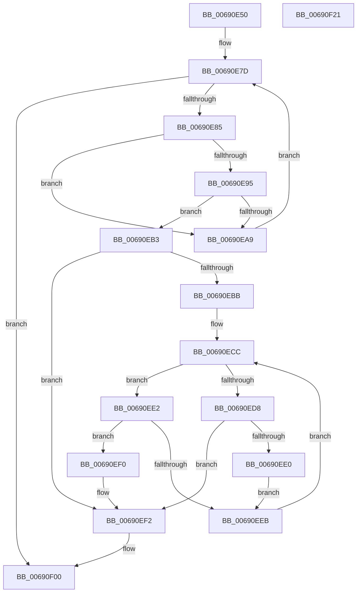

# MiFreePartitionTree

- RVA: `0x00690E50`–`0x00690F22` (길이 `210` bytes)
- VA: `0x0000000140690E50`
- 실행 섹션: `.text`
- PDB 이름 있음: `예`; PDB Function 태그: `아니요`
- unwind 정보 RVA: `0x0005FEF8`
- 디코드: `68`개 명령, `210/210` bytes 표시
- 미해석 바이트: `0` (있으면 어셈블리에 `.byte`로 보존)

> 이 문서는 커널 이미지의 기계어와 PDB 기호를 분석해 생성했습니다. 4번과 5번은 함수 원형과 자료형을 바이너리 사용 방식에서 추정한 C 해석이며 원본 소스 복구 결과는 아닙니다.

## 1. Dependencies

- 직접 호출 지점: **4**; 고유 호출 대상: **4**
- 직접 호출자로 확인된 함수: **3**
- RIP 상대 이미지 참조: **0**

### Outgoing calls
- `0x00690E8B` → [RtlAvlRemoveNode](../29/RtlAvlRemoveNode_function_00296650.md) (function, `0x00296650`)
- `0x00690E9E` → [MiFreePartitionNodePages](MiFreePartitionNodePages_function_00690D14.md) (function, `0x00690D14`)
- `0x00690EAC` → [MiDeletePartitionPageNode](MiDeletePartitionPageNode_function_006908C4.md) (function, `0x006908C4`)
- `0x00690EFB` → [RtlAvlInsertNodeEx](../26/RtlAvlInsertNodeEx_function_00265790.md) (function, `0x00265790`)

### Direct callers
- [MiInsertPartitionPages](MiInsertPartitionPages_function_006911A0.md) at `0x00691315`
- [MiInsertPartitionPages](MiInsertPartitionPages_function_006911A0.md) at `0x0069132F`
- [MiInsertPartitionPages](MiInsertPartitionPages_function_006911A0.md) at `0x006913BA`
- [MiAllocatePartitionPhysicalPages](../../page/80/MiAllocatePartitionPhysicalPages_function_0080C9D4.md) at `0x0080CFD9`
- [MiHotAddPartitionMemory](../../page/80/MiHotAddPartitionMemory_function_0080D5B4.md) at `0x0080D62D`
- [MiHotAddPartitionMemory](../../page/80/MiHotAddPartitionMemory_function_0080D5B4.md) at `0x0080D883`

### Static image references
- 디코드된 RIP-relative 메모리 참조가 없습니다.

## 2. Other-region calls and transfers

- 다른 실행 섹션으로 향하는 call: **0**
- 별도 외부 분기/꼬리 이동을 확인하지 못했습니다.

## 3. Assembly (complete function range)

```asm
00690E50  48 8B C4                        mov rax, rsp
00690E53  48 89 58 08                     mov qword ptr [rax + 8], rbx
00690E57  48 89 68 10                     mov qword ptr [rax + 0x10], rbp
00690E5B  48 89 70 18                     mov qword ptr [rax + 0x18], rsi
00690E5F  48 89 78 20                     mov qword ptr [rax + 0x20], rdi
00690E63  41 54                           push r12
00690E65  41 56                           push r14
00690E67  41 57                           push r15
00690E69  48 83 EC 20                     sub rsp, 0x20
00690E6D  33 DB                           xor ebx, ebx
00690E6F  45 8B F1                        mov r14d, r9d
00690E72  8B EB                           mov ebp, ebx
00690E74  45 8B F8                        mov r15d, r8d
00690E77  48 8B F2                        mov rsi, rdx
00690E7A  4C 8B E1                        mov r12, rcx
00690E7D  48 8B 3E                        mov rdi, qword ptr [rsi]
00690E80  48 85 FF                        test rdi, rdi
00690E83  74 7B                           je 0x140690f00
00690E85  48 8B D7                        mov rdx, rdi
00690E88  48 8B CE                        mov rcx, rsi
00690E8B  E8 C0 57 C0 FF                  call 0x140296650
00690E90  45 85 F6                        test r14d, r14d
00690E93  74 14                           je 0x140690ea9
00690E95  45 8B C7                        mov r8d, r15d
00690E98  48 8B D7                        mov rdx, rdi
00690E9B  49 8B CC                        mov rcx, r12
00690E9E  E8 71 FE FF FF                  call 0x140690d14
00690EA3  8B E8                           mov ebp, eax
00690EA5  85 C0                           test eax, eax
00690EA7  78 0A                           js 0x140690eb3
00690EA9  48 8B CF                        mov rcx, rdi
00690EAC  E8 13 FA FF FF                  call 0x1406908c4
00690EB1  EB CA                           jmp 0x140690e7d
00690EB3  48 8B 16                        mov rdx, qword ptr [rsi]
00690EB6  48 85 D2                        test rdx, rdx
00690EB9  74 37                           je 0x140690ef2
00690EBB  48 8B 4F 18                     mov rcx, qword ptr [rdi + 0x18]
00690EBF  49 B8 FF FF FF FF FF FF FF 3F   movabs r8, 0x3fffffffffffffff
00690EC9  49 23 C8                        and rcx, r8
00690ECC  48 8B 42 18                     mov rax, qword ptr [rdx + 0x18]
00690ED0  49 23 C0                        and rax, r8
00690ED3  48 3B C8                        cmp rcx, rax
00690ED6  73 0A                           jae 0x140690ee2
00690ED8  48 8B 02                        mov rax, qword ptr [rdx]
00690EDB  48 85 C0                        test rax, rax
00690EDE  74 12                           je 0x140690ef2
00690EE0  EB 09                           jmp 0x140690eeb
00690EE2  48 8B 42 08                     mov rax, qword ptr [rdx + 8]
00690EE6  48 85 C0                        test rax, rax
00690EE9  74 05                           je 0x140690ef0
00690EEB  48 8B D0                        mov rdx, rax
00690EEE  EB DC                           jmp 0x140690ecc
00690EF0  B3 01                           mov bl, 1
00690EF2  4C 8B CF                        mov r9, rdi
00690EF5  44 8A C3                        mov r8b, bl
00690EF8  48 8B CE                        mov rcx, rsi
00690EFB  E8 90 48 BD FF                  call 0x140265790
00690F00  48 8B 5C 24 40                  mov rbx, qword ptr [rsp + 0x40]
00690F05  8B C5                           mov eax, ebp
00690F07  48 8B 6C 24 48                  mov rbp, qword ptr [rsp + 0x48]
00690F0C  48 8B 74 24 50                  mov rsi, qword ptr [rsp + 0x50]
00690F11  48 8B 7C 24 58                  mov rdi, qword ptr [rsp + 0x58]
00690F16  48 83 C4 20                     add rsp, 0x20
00690F1A  41 5F                           pop r15
00690F1C  41 5E                           pop r14
00690F1E  41 5C                           pop r12
00690F20  C3                              ret
00690F21  CC                              int3
```

## 4. C-style interpretation (structured pseudocode)

```c
__int64 __fastcall MiFreePartitionTree(__int64 a1, __int64 a2, int a3, int a4)
{
    __int64 result;
    __int64 v_rbx;
    __int64 v_rsp;
    unsigned __int64 v_stack_p10;
    unsigned __int64 v_stack_p18;
    unsigned __int64 v_stack_p20;
    unsigned __int64 v_stack_p8;

    *(unsigned __int64 *)(v_rsp + 8) = v_rbx;
    *(unsigned __int64 *)(v_rsp + 16) = v_rbp;
    *(unsigned __int64 *)(v_rsp + 24) = v_rsi;
    *(unsigned __int64 *)(v_rsp + 32) = v_rdi;
    v_rsp = (v_rsp) - (32);
    v_rbx = 0;
loc_00690E7D:
    if (*(unsigned __int64 *)(a2) == 0) goto loc_00690F00;
    result = RtlAvlRemoveNode(a2, *(unsigned __int64 *)(a2), a3, a4);
    if ((unsigned int)((unsigned int)(a4)) == 0) goto loc_00690EA9;
    result = MiFreePartitionNodePages(a1, *(unsigned __int64 *)(a2), (unsigned int)((unsigned int)((unsigned int)(a3))), a4);
    if (sign_flag) goto loc_00690EB3;
loc_00690EA9:
    result = MiDeletePartitionPageNode(*(unsigned __int64 *)(a2), *(unsigned __int64 *)(a2), (unsigned int)((unsigned int)((unsigned int)(a3))), a4);
    goto loc_00690E7D;
loc_00690EB3:
    if (*(unsigned __int64 *)(a2) == 0) goto loc_00690EF2;
    a1 = (*(unsigned __int64 *)(*(unsigned __int64 *)(a2) + 24)) & ((unsigned int)((unsigned int)((unsigned int)(a3))));
loc_00690ECC:
    result = (*(unsigned __int64 *)(*(unsigned __int64 *)(a2) + 24)) & ((unsigned int)((unsigned int)((unsigned int)(a3))));
    if (a1 >= result) goto loc_00690EE2;
    if (*(unsigned __int64 *)(*(unsigned __int64 *)(a2)) == 0) goto loc_00690EF2;
    goto loc_00690EEB;
loc_00690EE2:
    if (*(unsigned __int64 *)(*(unsigned __int64 *)(a2) + 8) == 0) goto loc_00690EF0;
loc_00690EEB:
    goto loc_00690ECC;
loc_00690EF0:
loc_00690EF2:
    result = RtlAvlInsertNodeEx(a2, *(unsigned __int64 *)(*(unsigned __int64 *)(a2) + 8), 1, *(unsigned __int64 *)(a2));
loc_00690F00:
    v_rsp = (v_rsp) + (32);
    return (unsigned int)((unsigned int)((unsigned int)((unsigned int)(result))));
}
```

## 5. (Beta) C Style

```c
int64_t MiFreePartitionTree(int64_t Arg1, void *Arg2, int32_t Arg3, int32_t Arg4)
{
    uint8_t *arg2 = (uint8_t *)Arg2;

    int64_t result;
    int64_t local_rbx;
    int64_t local_rsp;
    uint64_t v_stack_p10;
    uint64_t v_stack_p18;
    uint64_t v_stack_p20;
    uint64_t v_stack_p8;

    *(uint64_t *)(local_rsp + 0x8) = local_rbx;
    *(uint64_t *)(local_rsp + 0x10) = local_rbp;
    *(uint64_t *)(local_rsp + 0x18) = local_rsi;
    *(uint64_t *)(local_rsp + 0x20) = local_rdi;
    local_rsp = (local_rsp) - (32);
    local_rbx = 0;
loc_00690E7D:
    if (*(uint64_t *)(arg2) == 0) goto loc_00690F00;
    result = RtlAvlRemoveNode(Arg2, *(uint64_t *)(arg2), Arg3, Arg4);
    if ((uint32_t)((uint32_t)(Arg4)) == 0) goto loc_00690EA9;
    result = MiFreePartitionNodePages(Arg1, *(uint64_t *)(arg2), (uint32_t)((uint32_t)((uint32_t)(Arg3))), Arg4);
    if (sign_flag) goto loc_00690EB3;
loc_00690EA9:
    result = MiDeletePartitionPageNode(*(uint64_t *)(arg2), *(uint64_t *)(arg2), (uint32_t)((uint32_t)((uint32_t)(Arg3))), Arg4);
    goto loc_00690E7D;
loc_00690EB3:
    if (*(uint64_t *)(arg2) == 0) goto loc_00690EF2;
    Arg1 = (*(uint64_t *)(*(uint64_t *)(arg2) + 0x18)) & ((uint32_t)((uint32_t)((uint32_t)(Arg3))));
loc_00690ECC:
    result = (*(uint64_t *)(*(uint64_t *)(arg2) + 0x18)) & ((uint32_t)((uint32_t)((uint32_t)(Arg3))));
    if (Arg1 >= result) goto loc_00690EE2;
    if (*(uint64_t *)(*(uint64_t *)(arg2)) == 0) goto loc_00690EF2;
    goto loc_00690EEB;
loc_00690EE2:
    if (*(uint64_t *)(*(uint64_t *)(arg2) + 0x8) == 0) goto loc_00690EF0;
loc_00690EEB:
    goto loc_00690ECC;
loc_00690EF0:
loc_00690EF2:
    result = RtlAvlInsertNodeEx(Arg2, *(uint64_t *)(*(uint64_t *)(arg2) + 0x8), 1, *(uint64_t *)(arg2));
loc_00690F00:
    local_rsp = (local_rsp) + (32);
    return (uint32_t)((uint32_t)((uint32_t)((uint32_t)(result))));
}
```

### 관측된 메모리 오프셋

구조체 형식이 확인되지 않은 접근은 인자 기준의 오프셋으로만 기록했습니다.

| 기준 인자 | 오프셋 표현 | 폭 (bit) | 접근 |
|---|---:|---:|---|
| `Arg2` | `+ 0x0` | `64` | `R` |

## 6. Execution-region graph

[열기: 2D/3D 그래프와 함수 탐색 컨트롤 패널](../../../control-panel.html?section=text&rva=0x00690E50&view=graph)

- 2D 그래프는 위에서 아래로 흐르고, 3D 그래프는 빈 공간을 드래그해 회전합니다. Shift+드래그는 이동, 휠은 확대·축소, 함수 노드 선택은 대상 보고서 이동입니다.

### Static fallback


