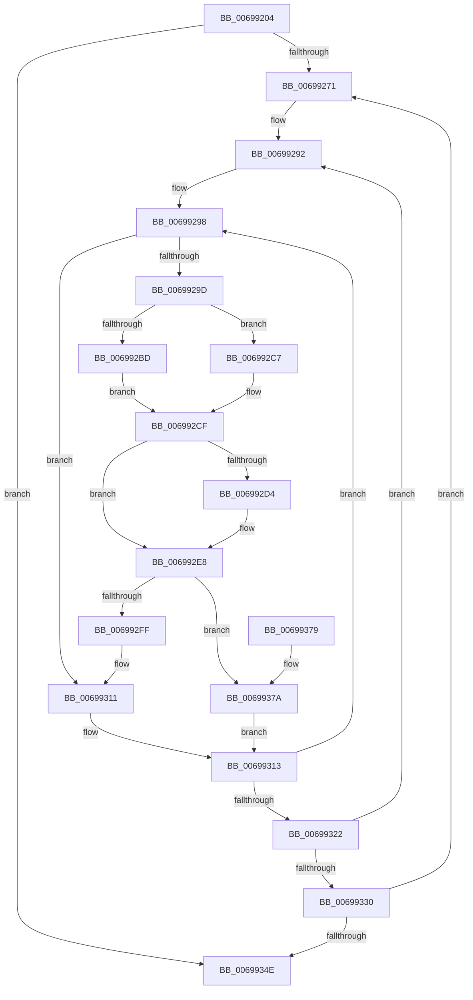

# MiFreeProcessLargePageCache

- RVA: `0x00699204`–`0x00699381` (길이 `381` bytes)
- VA: `0x0000000140699204`
- 실행 섹션: `.text`
- PDB 이름 있음: `예`; PDB Function 태그: `아니요`
- unwind 정보 RVA: `0x000D9654`
- 디코드: `101`개 명령, `381/381` bytes 표시
- 미해석 바이트: `0` (있으면 어셈블리에 `.byte`로 보존)

> 이 문서는 커널 이미지의 기계어와 PDB 기호를 분석해 생성했습니다. 4번과 5번은 함수 원형과 자료형을 바이너리 사용 방식에서 추정한 C 해석이며 원본 소스 복구 결과는 아닙니다.

## 1. Dependencies

- 직접 호출 지점: **8**; 고유 호출 대상: **7**
- 직접 호출자로 확인된 함수: **2**
- RIP 상대 이미지 참조: **2**

### Outgoing calls
- `0x00699245` → [memset](../6C/memset_function_006C6C40.md) (function, `0x006C6C40`)
- `0x006992A8` → [memset](../6C/memset_function_006C6C40.md) (function, `0x006C6C40`)
- `0x006992C0` → [ExAcquireSpinLockExclusiveAtDpcLevel](../24/ExAcquireSpinLockExclusiveAtDpcLevel_function_00248E80.md) (function, `0x00248E80`)
- `0x006992C7` → [ExAcquireSpinLockExclusive](../24/ExAcquireSpinLockExclusive_function_00248690.md) (function, `0x00248690`)
- `0x006992E3` → [MiEmptyCacheSlice](MiEmptyCacheSlice_function_00698DD4.md) (function, `0x00698DD4`)
- `0x006992EE` → [MiReleaseSpinLockExclusive](../24/MiReleaseSpinLockExclusive_function_002482C0.md) (function, `0x002482C0`)
- `0x00699307` → [MiFreeCacheSlice](MiFreeCacheSlice_function_00698EB8.md) (function, `0x00698EB8`)
- `0x00699359` → [_security_check_cookie](../6A/_security_check_cookie_function_006AC640.md) (function, `0x006AC640`)

### Direct callers
- [MiPruneProcessLargePageCaches](../2D/MiPruneProcessLargePageCaches_function_002DBD60.md) at `0x002DBE50`
- [sub_006F64F4](../6F/Unknown_function_006F64F4.md) at `0x006F653E`

### Static image references
- `0x0069921B` → RVA `0x00E0A740` (`.data`; read)
- `0x00699254` → RVA `0x00FC5000` (`ALMOSTRO`; read)

## 2. Other-region calls and transfers

- 다른 실행 섹션으로 향하는 call: **0**
- 별도 외부 분기/꼬리 이동을 확인하지 못했습니다.

## 3. Assembly (complete function range)

```asm
00699204  48 89 5C 24 18                  mov qword ptr [rsp + 0x18], rbx
00699209  55                              push rbp
0069920A  56                              push rsi
0069920B  57                              push rdi
0069920C  41 54                           push r12
0069920E  41 55                           push r13
00699210  41 56                           push r14
00699212  41 57                           push r15
00699214  48 81 EC C0 00 00 00            sub rsp, 0xc0
0069921B  48 8B 05 1E 15 77 00            mov rax, qword ptr [rip + 0x77151e]
00699222  48 33 C4                        xor rax, rsp
00699225  48 89 84 24 B0 00 00 00         mov qword ptr [rsp + 0xb0], rax
0069922D  4C 8B EA                        mov r13, rdx
00699230  48 89 54 24 40                  mov qword ptr [rsp + 0x40], rdx
00699235  33 D2                           xor edx, edx
00699237  48 89 4C 24 30                  mov qword ptr [rsp + 0x30], rcx
0069923C  48 8D 4C 24 50                  lea rcx, [rsp + 0x50]
00699241  44 8D 42 60                     lea r8d, [rdx + 0x60]
00699245  E8 F6 D9 02 00                  call 0x1406c6c40
0069924A  45 0F 20 C7                     mov r15, cr8
0069924E  49 8B 45 10                     mov rax, qword ptr [r13 + 0x10]
00699252  33 D2                           xor edx, edx
00699254  66 3B 15 A5 BD 92 00            cmp dx, word ptr [rip + 0x92bda5]
0069925B  8B DA                           mov ebx, edx
0069925D  4C 89 7C 24 28                  mov qword ptr [rsp + 0x28], r15
00699262  48 89 44 24 38                  mov qword ptr [rsp + 0x38], rax
00699267  89 54 24 20                     mov dword ptr [rsp + 0x20], edx
0069926B  0F 83 DD 00 00 00               jae 0x14069934e
00699271  8B C3                           mov eax, ebx
00699273  49 8D 6D 20                     lea rbp, [r13 + 0x20]
00699277  4C 8B 6C 24 30                  mov r13, qword ptr [rsp + 0x30]
0069927C  41 BC 03 00 00 00               mov r12d, 3
00699282  48 8B 5C 24 38                  mov rbx, qword ptr [rsp + 0x38]
00699287  48 8D 0C 40                     lea rcx, [rax + rax*2]
0069928B  48 C1 E1 06                     shl rcx, 6
0069928F  48 03 E9                        add rbp, rcx
00699292  8B F2                           mov esi, edx
00699294  48 8D 7D 0C                     lea rdi, [rbp + 0xc]
00699298  F6 07 3F                        test byte ptr [rdi], 0x3f
0069929B  74 74                           je 0x140699311
0069929D  33 D2                           xor edx, edx
0069929F  48 8D 4C 24 50                  lea rcx, [rsp + 0x50]
006992A4  44 8D 42 60                     lea r8d, [rdx + 0x60]
006992A8  E8 93 D9 02 00                  call 0x1406c6c40
006992AD  4C 8D B3 20 01 00 00            lea r14, [rbx + 0x120]
006992B4  49 8B CE                        mov rcx, r14
006992B7  41 80 FF 02                     cmp r15b, 2
006992BB  75 0A                           jne 0x1406992c7
006992BD  41 B7 11                        mov r15b, 0x11
006992C0  E8 BB FB BA FF                  call 0x140248e80
006992C5  EB 08                           jmp 0x1406992cf
006992C7  E8 C4 F3 BA FF                  call 0x140248690
006992CC  44 8A F8                        mov r15b, al
006992CF  F6 07 3F                        test byte ptr [rdi], 0x3f
006992D2  74 14                           je 0x1406992e8
006992D4  44 8B C6                        mov r8d, esi
006992D7  48 8D 54 24 50                  lea rdx, [rsp + 0x50]
006992DC  49 C1 E0 04                     shl r8, 4
006992E0  4C 03 C5                        add r8, rbp
006992E3  E8 EC FA FF FF                  call 0x140698dd4
006992E8  41 8A D7                        mov dl, r15b
006992EB  49 8B CE                        mov rcx, r14
006992EE  E8 CD EF BA FF                  call 0x1402482c0
006992F3  33 D2                           xor edx, edx
006992F5  48 39 94 24 90 00 00 00         cmp qword ptr [rsp + 0x90], rdx
006992FD  74 7B                           je 0x14069937a
006992FF  48 8D 54 24 50                  lea rdx, [rsp + 0x50]
00699304  49 8B CD                        mov rcx, r13
00699307  E8 AC FB FF FF                  call 0x140698eb8
0069930C  4C 8B 7C 24 28                  mov r15, qword ptr [rsp + 0x28]
00699311  33 D2                           xor edx, edx
00699313  FF C6                           inc esi
00699315  48 83 C7 10                     add rdi, 0x10
00699319  83 FE 04                        cmp esi, 4
0069931C  0F 82 76 FF FF FF               jb 0x140699298
00699322  48 83 C5 40                     add rbp, 0x40
00699326  49 83 EC 01                     sub r12, 1
0069932A  0F 85 62 FF FF FF               jne 0x140699292
00699330  8B 5C 24 20                     mov ebx, dword ptr [rsp + 0x20]
00699334  0F B7 05 C5 BC 92 00            movzx eax, word ptr [rip + 0x92bcc5]
0069933B  FF C3                           inc ebx
0069933D  4C 8B 6C 24 40                  mov r13, qword ptr [rsp + 0x40]
00699342  89 5C 24 20                     mov dword ptr [rsp + 0x20], ebx
00699346  3B D8                           cmp ebx, eax
00699348  0F 82 23 FF FF FF               jb 0x140699271
0069934E  48 8B 8C 24 B0 00 00 00         mov rcx, qword ptr [rsp + 0xb0]
00699356  48 33 CC                        xor rcx, rsp
00699359  E8 E2 32 01 00                  call 0x1406ac640
0069935E  48 8B 9C 24 10 01 00 00         mov rbx, qword ptr [rsp + 0x110]
00699366  48 81 C4 C0 00 00 00            add rsp, 0xc0
0069936D  41 5F                           pop r15
0069936F  41 5E                           pop r14
00699371  41 5D                           pop r13
00699373  41 5C                           pop r12
00699375  5F                              pop rdi
00699376  5E                              pop rsi
00699377  5D                              pop rbp
00699378  C3                              ret
00699379  CC                              int3
0069937A  4C 8B 7C 24 28                  mov r15, qword ptr [rsp + 0x28]
0069937F  EB 92                           jmp 0x140699313
```

## 4. C-style interpretation (structured pseudocode)

```c
__int64 __fastcall MiFreeProcessLargePageCache(__int64 a1, __int64 a2)
{
    __int64 result;
    __int64 v_r12;
    __int64 v_rbp;
    __int64 v_rbx;
    __int64 v_rdi;
    __int64 v_rsi;
    __int64 v_rsp;
    unsigned __int64 v_stack_m48;
    unsigned __int64 v_stack_m68;
    unsigned __int64 v_stack_mA8;
    unsigned __int64 v_stack_mB8;
    unsigned __int64 v_stack_mC0;
    unsigned __int64 v_stack_mC8;
    unsigned __int64 v_stack_mD0;
    unsigned int v_stack_mD8;
    unsigned __int64 v_stack_p18;
    unsigned __int64 v_stack_p28;

    v_stack_p18 = v_rbx;
    v_rsp = (v_rsp) - (192);
    result = (*(unsigned __int64 *)(v_rip + 7804190)) ^ (v_rsp);
    v_stack_m48 = result;
    v_stack_mB8 = a2;
    a2 = 0;
    v_stack_mC8 = a1;
    result = memset(v_stack_mA8, a2, a2 + 96, a4);
    a2 = 0;
    v_stack_mD0 = v_cr8;
    v_stack_mC0 = *(unsigned __int64 *)(a2 + 16);
    v_stack_mD8 = 0;
    if (0 >= (*(unsigned __int16 *)(v_rip + 9616805))) goto loc_0069934E;
loc_00699271:
    a1 = (0 + 0 * 2) << (6);
    v_rbp = (a2 + 32) + (a1);
loc_00699292:
loc_00699298:
    if (((*(unsigned __int8 *)(v_rbp + 12)) & (63)) == 0) goto loc_00699311;
    a2 = 0;
    result = memset(v_stack_mA8, a2, a2 + 96, a4);
    if (((unsigned __int8)(v_cr8)) != 2) goto loc_006992C7;
    result = ExAcquireSpinLockExclusiveAtDpcLevel(v_stack_mC0 + 288, a2, a2 + 96, a4);
    goto loc_006992CF;
loc_006992C7:
    result = ExAcquireSpinLockExclusive(v_stack_mC0 + 288, a2, a2 + 96, a4);
loc_006992CF:
    if (((*(unsigned __int8 *)(v_rbp + 12)) & (63)) != 0) {
        a3 = 0;
        a2 = v_stack_mA8;
        a3 = (a3) << (4);
        a3 = (a3) + (v_rbp);
        result = MiEmptyCacheSlice(v_stack_mC0 + 288, a2, a3, a4);
    }
    result = MiReleaseSpinLockExclusive(v_stack_mC0 + 288, (unsigned __int8)((unsigned __int8)(result)), a3, a4);
    a2 = 0;
    if (v_stack_m68 == 0) goto loc_0069937A;
    result = MiFreeCacheSlice(v_stack_mC8, v_stack_mA8, a3, a4);
loc_00699311:
    a2 = 0;
loc_00699313:
    v_rsi = (unsigned int)((0) + 1);
    v_rdi = (v_rbp + 12) + (16);
    if (((unsigned int)(v_rsi)) < 4) goto loc_00699298;
    v_rbp = (v_rbp) + (64);
    v_r12 = (3) - (1);
    if (condition_is_not_equal) goto loc_00699292;
    v_rbx = (unsigned int)(((unsigned int)(v_stack_mD8)) + 1);
    v_stack_mD8 = (unsigned int)(v_rbx);
    if (((unsigned int)(v_rbx)) < ((unsigned int)(*(unsigned __int16 *)(v_rip + 9616581)))) goto loc_00699271;
loc_0069934E:
    a1 = (v_stack_m48) ^ (v_rsp);
    result = _security_check_cookie(a1, a2, a3, a4);
    v_rsp = (v_rsp) + (192);
    return result;
loc_0069937A:
    goto loc_00699313;
}
```

## 5. (Beta) C Style

```c
int64_t MiFreeProcessLargePageCache(int64_t Arg1, void *Arg2)
{
    uint8_t *arg2 = (uint8_t *)Arg2;

    int64_t result;
    int64_t local_r12;
    int64_t local_rbp;
    int64_t local_rbx;
    int64_t local_rdi;
    int64_t local_rsi;
    int64_t local_rsp;
    uint64_t v_stack_m48;
    uint64_t v_stack_m68;
    uint64_t v_stack_mA8;
    uint64_t v_stack_mB8;
    uint64_t v_stack_mC0;
    uint64_t v_stack_mC8;
    uint64_t v_stack_mD0;
    uint32_t v_stack_mD8;
    uint64_t v_stack_p18;
    uint64_t v_stack_p28;

    v_stack_p18 = local_rbx;
    local_rsp = (local_rsp) - (192);
    result = (*(uint64_t *)(v_rip + 0x77151E)) ^ (local_rsp);
    v_stack_m48 = result;
    v_stack_mB8 = Arg2;
    Arg2 = 0;
    v_stack_mC8 = Arg1;
    result = memset(v_stack_mA8, Arg2, Arg2 + 96, a4);
    Arg2 = 0;
    v_stack_mD0 = v_cr8;
    v_stack_mC0 = *(uint64_t *)(arg2 + 0x10);
    v_stack_mD8 = 0;
    if (0 >= (*(uint16_t *)(v_rip + 0x92BDA5))) goto loc_0069934E;
loc_00699271:
    Arg1 = (0 + 0 * 2) << (6);
    local_rbp = (Arg2 + 32) + (Arg1);
loc_00699292:
loc_00699298:
    if (((*(uint8_t *)(local_rbp + 0xC)) & (63)) == 0) goto loc_00699311;
    Arg2 = 0;
    result = memset(v_stack_mA8, Arg2, Arg2 + 96, a4);
    if (((uint8_t)(v_cr8)) != 2) goto loc_006992C7;
    result = ExAcquireSpinLockExclusiveAtDpcLevel(v_stack_mC0 + 288, Arg2, Arg2 + 96, a4);
    goto loc_006992CF;
loc_006992C7:
    result = ExAcquireSpinLockExclusive(v_stack_mC0 + 288, Arg2, Arg2 + 96, a4);
loc_006992CF:
    if (((*(uint8_t *)(local_rbp + 0xC)) & (63)) != 0) {
        a3 = 0;
        Arg2 = v_stack_mA8;
        a3 = (a3) << (4);
        a3 = (a3) + (local_rbp);
        result = MiEmptyCacheSlice(v_stack_mC0 + 288, Arg2, a3, a4);
    }
    result = MiReleaseSpinLockExclusive(v_stack_mC0 + 288, (uint8_t)((uint8_t)(result)), a3, a4);
    Arg2 = 0;
    if (v_stack_m68 == 0) goto loc_0069937A;
    result = MiFreeCacheSlice(v_stack_mC8, v_stack_mA8, a3, a4);
loc_00699311:
    Arg2 = 0;
loc_00699313:
    local_rsi = (uint32_t)((0) + 1);
    local_rdi = (local_rbp + 12) + (16);
    if (((uint32_t)(local_rsi)) < 4) goto loc_00699298;
    local_rbp = (local_rbp) + (64);
    local_r12 = (3) - (1);
    if (condition_is_not_equal) goto loc_00699292;
    local_rbx = (uint32_t)(((uint32_t)(v_stack_mD8)) + 1);
    v_stack_mD8 = (uint32_t)(local_rbx);
    if (((uint32_t)(local_rbx)) < ((uint32_t)(*(uint16_t *)(v_rip + 0x92BCC5)))) goto loc_00699271;
loc_0069934E:
    Arg1 = (v_stack_m48) ^ (local_rsp);
    result = _security_check_cookie(Arg1, Arg2, a3, a4);
    local_rsp = (local_rsp) + (192);
    return result;
loc_0069937A:
    goto loc_00699313;
}
```

### 관측된 메모리 오프셋

구조체 형식이 확인되지 않은 접근은 인자 기준의 오프셋으로만 기록했습니다.

| 기준 인자 | 오프셋 표현 | 폭 (bit) | 접근 |
|---|---:|---:|---|
| `Arg2` | `+ 0x10` | `64` | `R` |

## 6. Execution-region graph

[열기: 2D/3D 그래프와 함수 탐색 컨트롤 패널](../../../control-panel.html?section=text&rva=0x00699204&view=graph)

- 2D 그래프는 위에서 아래로 흐르고, 3D 그래프는 빈 공간을 드래그해 회전합니다. Shift+드래그는 이동, 휠은 확대·축소, 함수 노드 선택은 대상 보고서 이동입니다.

### Static fallback


