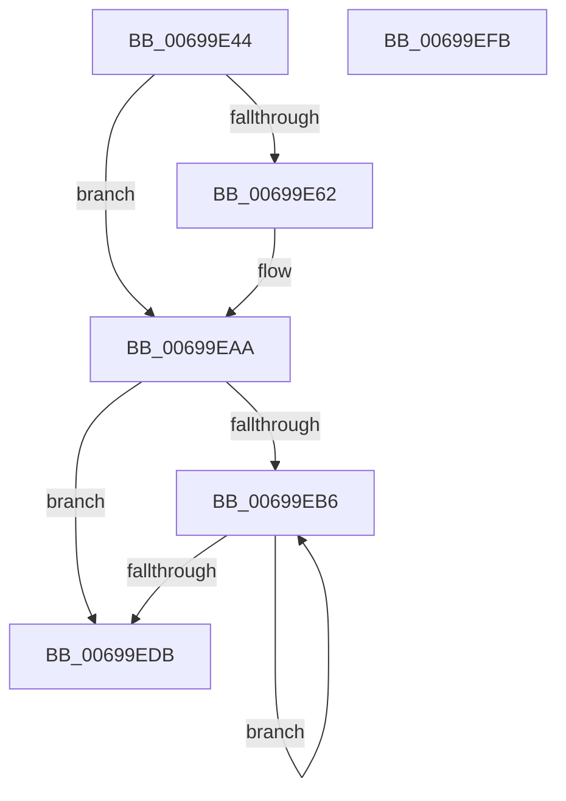

# MiFreeZeroCalibrationBuffer

- RVA: `0x00699E44`–`0x00699EFC` (길이 `184` bytes)
- VA: `0x0000000140699E44`
- 실행 섹션: `.text`
- PDB 이름 있음: `예`; PDB Function 태그: `아니요`
- unwind 정보 RVA: `0x00060BC4`
- 디코드: `44`개 명령, `184/184` bytes 표시
- 미해석 바이트: `0` (있으면 어셈블리에 `.byte`로 보존)

> 이 문서는 커널 이미지의 기계어와 PDB 기호를 분석해 생성했습니다. 4번과 5번은 함수 원형과 자료형을 바이너리 사용 방식에서 추정한 C 해석이며 원본 소스 복구 결과는 아닙니다.

## 1. Dependencies

- 직접 호출 지점: **3**; 고유 호출 대상: **3**
- 직접 호출자로 확인된 함수: **2**
- RIP 상대 이미지 참조: **1**

### Outgoing calls
- `0x00699EA5` → [MiReleasePtes](../24/MiReleasePtes_function_00247240.md) (function, `0x00247240`)
- `0x00699EC4` → [MiFreePagesFromMdl](../3F/MiFreePagesFromMdl_function_003F8300.md) (function, `0x003F8300`)
- `0x00699ECE` → [ExFreePoolWithTag](../../poolcode/B8/ExFreePoolWithTag_function_00B82870.md) (function, `0x00B82870`)

### Direct callers
- [MiAllocateZeroCalibrationBuffer](MiAllocateZeroCalibrationBuffer_function_00699844.md) at `0x006999C2`
- [MiZeroPageCalibrate](MiZeroPageCalibrate_function_0069A69C.md) at `0x0069A9F0`

### Static image references
- `0x00699E9E` → RVA `0x00E37668` (`.data`; read)

## 2. Other-region calls and transfers

- 다른 실행 섹션으로 향하는 call: **1**
  - `0x00699ECE` → [ExFreePoolWithTag](../../poolcode/B8/ExFreePoolWithTag_function_00B82870.md) (`.text` → `POOLCODE`)
- 별도 외부 분기/꼬리 이동을 확인하지 못했습니다.

## 3. Assembly (complete function range)

```asm
00699E44  48 89 5C 24 08                  mov qword ptr [rsp + 8], rbx
00699E49  48 89 74 24 10                  mov qword ptr [rsp + 0x10], rsi
00699E4E  57                              push rdi
00699E4F  48 83 EC 20                     sub rsp, 0x20
00699E53  48 8B 91 10 01 00 00            mov rdx, qword ptr [rcx + 0x110]
00699E5A  48 8B F9                        mov rdi, rcx
00699E5D  48 85 D2                        test rdx, rdx
00699E60  74 48                           je 0x140699eaa
00699E62  48 8B 81 18 01 00 00            mov rax, qword ptr [rcx + 0x118]
00699E69  41 B8 00 00 00 00               mov r8d, 0
00699E6F  48 A9 FF 0F 00 00               test rax, 0xfff
00699E75  41 0F 95 C0                     setne r8b
00699E79  48 C1 E8 0C                     shr rax, 0xc
00699E7D  44 03 C0                        add r8d, eax
00699E80  48 C1 EA 09                     shr rdx, 9
00699E84  48 B8 F8 FF FF FF 7F 00 00 00   movabs rax, 0x7ffffffff8
00699E8E  48 23 D0                        and rdx, rax
00699E91  48 B8 00 00 00 00 80 F6 FF FF   movabs rax, 0xfffff68000000000
00699E9B  48 03 D0                        add rdx, rax
00699E9E  48 8D 0D C3 D7 79 00            lea rcx, [rip + 0x79d7c3]
00699EA5  E8 96 D3 BA FF                  call 0x140247240
00699EAA  48 8B B7 20 01 00 00            mov rsi, qword ptr [rdi + 0x120]
00699EB1  48 85 F6                        test rsi, rsi
00699EB4  74 25                           je 0x140699edb
00699EB6  48 8B 1E                        mov rbx, qword ptr [rsi]
00699EB9  45 33 C9                        xor r9d, r9d
00699EBC  45 33 C0                        xor r8d, r8d
00699EBF  33 D2                           xor edx, edx
00699EC1  48 8B CE                        mov rcx, rsi
00699EC4  E8 37 E4 D5 FF                  call 0x1403f8300
00699EC9  33 D2                           xor edx, edx
00699ECB  48 8B CE                        mov rcx, rsi
00699ECE  E8 9D 89 4E 00                  call 0x140b82870
00699ED3  48 8B F3                        mov rsi, rbx
00699ED6  48 85 DB                        test rbx, rbx
00699ED9  75 DB                           jne 0x140699eb6
00699EDB  48 83 A7 10 01 00 00 00         and qword ptr [rdi + 0x110], 0
00699EE3  48 83 A7 20 01 00 00 00         and qword ptr [rdi + 0x120], 0
00699EEB  48 8B 5C 24 30                  mov rbx, qword ptr [rsp + 0x30]
00699EF0  48 8B 74 24 38                  mov rsi, qword ptr [rsp + 0x38]
00699EF5  48 83 C4 20                     add rsp, 0x20
00699EF9  5F                              pop rdi
00699EFA  C3                              ret
00699EFB  CC                              int3
```

## 4. C-style interpretation (structured pseudocode)

```c
__int64 __fastcall MiFreeZeroCalibrationBuffer(__int64 a1, __int64 a2, __int64 a3, int a4)
{
    __int64 result;
    __int64 v_rsp;
    unsigned __int64 v_stack_p10;
    unsigned __int64 v_stack_p8;

    v_stack_p8 = v_rbx;
    v_stack_p10 = v_rsi;
    v_rsp = (v_rsp) - (32);
    if (*(unsigned __int64 *)(a1 + 272) != 0) {
        result = *(unsigned __int64 *)(a1 + 280);
        a3 = 0;
        a3 = (((result) & (0xFFFULL)) != 0) ? 1 : 0;
        result = (result) >> (12);
        a3 = (unsigned int)((a3) + ((unsigned int)(result)));
        a2 = (*(unsigned __int64 *)(a1 + 272)) >> (9);
        a2 = (a2) & (result);
        a2 = (a2) + (result);
        a1 = v_rip + 7985091;
        result = MiReleasePtes(a1, a2, a3, a4);
    }
    if (*(unsigned __int64 *)(a1 + 288) == 0) goto loc_00699EDB;
loc_00699EB6:
    a4 = 0;
    a3 = 0;
    a2 = 0;
    result = MiFreePagesFromMdl(*(unsigned __int64 *)(a1 + 288), a2, a3, a4);
    a2 = 0;
    result = ExFreePoolWithTag(*(unsigned __int64 *)(a1 + 288), a2, a3, a4);
    if (*(unsigned __int64 *)(*(unsigned __int64 *)(a1 + 288)) != 0) goto loc_00699EB6;
loc_00699EDB:
    v_rsp = (v_rsp) + (32);
    return result;
}
```

## 5. (Beta) C Style

```c
int64_t MiFreeZeroCalibrationBuffer(void *Arg1, int64_t Arg2, int64_t Arg3, int32_t Arg4)
{
    uint8_t *arg1 = (uint8_t *)Arg1;

    int64_t result;
    int64_t local_rsp;
    uint64_t v_stack_p10;
    uint64_t v_stack_p8;

    v_stack_p8 = local_rbx;
    v_stack_p10 = local_rsi;
    local_rsp = (local_rsp) - (32);
    if (*(uint64_t *)(arg1 + 0x110) != 0) {
        result = *(uint64_t *)(arg1 + 0x118);
        Arg3 = 0;
        Arg3 = (((result) & (0xFFFULL)) != 0) ? 1 : 0;
        result = (result) >> (12);
        Arg3 = (uint32_t)((Arg3) + ((uint32_t)(result)));
        Arg2 = (*(uint64_t *)(arg1 + 0x110)) >> (9);
        Arg2 = (Arg2) & (result);
        Arg2 = (Arg2) + (result);
        Arg1 = v_rip + 7985091;
        result = MiReleasePtes(Arg1, Arg2, Arg3, Arg4);
    }
    if (*(uint64_t *)(arg1 + 0x120) == 0) goto loc_00699EDB;
loc_00699EB6:
    Arg4 = 0;
    Arg3 = 0;
    Arg2 = 0;
    result = MiFreePagesFromMdl(*(uint64_t *)(arg1 + 0x120), Arg2, Arg3, Arg4);
    Arg2 = 0;
    result = ExFreePoolWithTag(*(uint64_t *)(arg1 + 0x120), Arg2, Arg3, Arg4);
    if (*(uint64_t *)(*(uint64_t *)(arg1 + 0x120)) != 0) goto loc_00699EB6;
loc_00699EDB:
    local_rsp = (local_rsp) + (32);
    return result;
}
```

### 관측된 메모리 오프셋

구조체 형식이 확인되지 않은 접근은 인자 기준의 오프셋으로만 기록했습니다.

| 기준 인자 | 오프셋 표현 | 폭 (bit) | 접근 |
|---|---:|---:|---|
| `Arg1` | `+ 0x110` | `64` | `R` |
| `Arg1` | `+ 0x110` | `64` | `R/W` |
| `Arg1` | `+ 0x118` | `64` | `R` |
| `Arg1` | `+ 0x120` | `64` | `R` |
| `Arg1` | `+ 0x120` | `64` | `R/W` |

## 6. Execution-region graph

[열기: 2D/3D 그래프와 함수 탐색 컨트롤 패널](../../../control-panel.html?section=text&rva=0x00699E44&view=graph)

- 2D 그래프는 위에서 아래로 흐르고, 3D 그래프는 빈 공간을 드래그해 회전합니다. Shift+드래그는 이동, 휠은 확대·축소, 함수 노드 선택은 대상 보고서 이동입니다.

### Static fallback


