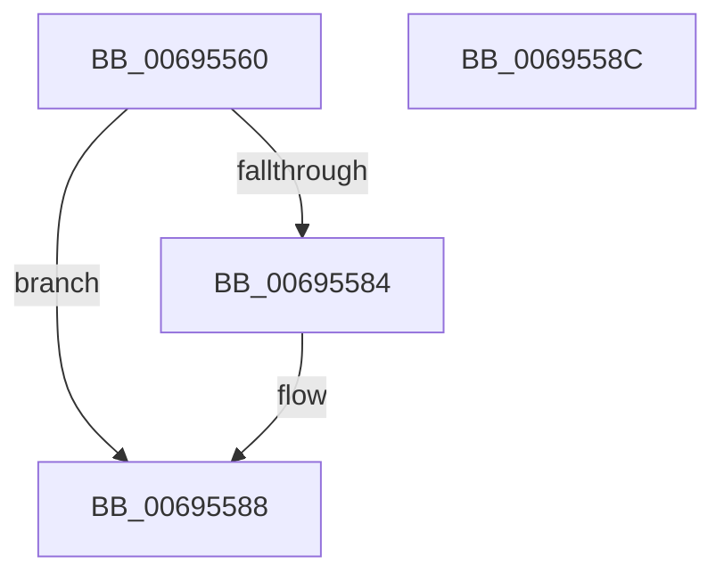

# MiGetAggregateWorkingSetSize

- RVA: `0x00695560`–`0x0069558D` (길이 `45` bytes)
- VA: `0x0000000140695560`
- 실행 섹션: `.text`
- PDB 이름 있음: `예`; PDB Function 태그: `아니요`
- unwind 정보 RVA: `0x000DB714`
- 디코드: `13`개 명령, `45/45` bytes 표시
- 미해석 바이트: `0` (있으면 어셈블리에 `.byte`로 보존)

> 이 문서는 커널 이미지의 기계어와 PDB 기호를 분석해 생성했습니다. 4번과 5번은 함수 원형과 자료형을 바이너리 사용 방식에서 추정한 C 해석이며 원본 소스 복구 결과는 아닙니다.

## 1. Dependencies

- 직접 호출 지점: **0**; 고유 호출 대상: **0**
- 직접 호출자로 확인된 함수: **1**
- RIP 상대 이미지 참조: **1**

### Outgoing calls
- 직접 디코드된 call 명령이 없습니다.

### Direct callers
- [MmLogSystemShareablePfnInfo](../../page/80/MmLogSystemShareablePfnInfo_function_008093F4.md) at `0x0080942E`

### Static image references
- `0x00695570` → RVA `0x00E388C0` (`.data`; read)

## 2. Other-region calls and transfers

- 다른 실행 섹션으로 향하는 call: **0**
- 별도 외부 분기/꼬리 이동을 확인하지 못했습니다.

## 3. Assembly (complete function range)

```asm
00695560  48 8B 91 90 00 00 00            mov rdx, qword ptr [rcx + 0x90]
00695567  45 33 C0                        xor r8d, r8d
0069556A  8B 81 B8 00 00 00               mov eax, dword ptr [rcx + 0xb8]
00695570  48 8D 0D 49 33 7A 00            lea rcx, [rip + 0x7a3349]
00695577  24 0F                           and al, 0xf
00695579  3C 01                           cmp al, 1
0069557B  49 0F 45 C8                     cmovne rcx, r8
0069557F  48 85 C9                        test rcx, rcx
00695582  74 04                           je 0x140695588
00695584  48 8B 51 08                     mov rdx, qword ptr [rcx + 8]
00695588  48 8B C2                        mov rax, rdx
0069558B  C3                              ret
0069558C  CC                              int3
```

## 4. C-style interpretation (structured pseudocode)

```c
__int64 __fastcall MiGetAggregateWorkingSetSize(__int64 a1, __int64 a2, int a3)
{
    __int64 result;

    a3 = 0;
    result = (unsigned __int8)(((unsigned int)(*(unsigned int *)(a1 + 184))) & (15));
    a1 = v_rip + 8008521;
    if (((unsigned __int8)(result)) != 1) { a1 = 0; }
    if (a1 != 0) {
        a2 = *(unsigned __int64 *)(a1 + 8);
    }
    return a2;
}
```

## 5. (Beta) C Style

```c
int64_t MiGetAggregateWorkingSetSize(void *Arg1, int64_t Arg2, int32_t Arg3)
{
    uint8_t *arg1 = (uint8_t *)Arg1;

    int64_t result;

    Arg3 = 0;
    result = (uint8_t)(((uint32_t)(*(uint32_t *)(arg1 + 0xB8))) & (15));
    Arg1 = v_rip + 8008521;
    if (((uint8_t)(result)) != 1) { Arg1 = 0; }
    if (Arg1 != NULL) {
        Arg2 = *(uint64_t *)(arg1 + 0x8);
    }
    return Arg2;
}
```

### 관측된 메모리 오프셋

구조체 형식이 확인되지 않은 접근은 인자 기준의 오프셋으로만 기록했습니다.

| 기준 인자 | 오프셋 표현 | 폭 (bit) | 접근 |
|---|---:|---:|---|
| `Arg1` | `+ 0x90` | `64` | `R` |
| `Arg1` | `+ 0xB8` | `32` | `R` |

## 6. Execution-region graph

[열기: 2D/3D 그래프와 함수 탐색 컨트롤 패널](../../../control-panel.html?section=text&rva=0x00695560&view=graph)

- 2D 그래프는 위에서 아래로 흐르고, 3D 그래프는 빈 공간을 드래그해 회전합니다. Shift+드래그는 이동, 휠은 확대·축소, 함수 노드 선택은 대상 보고서 이동입니다.

### Static fallback


