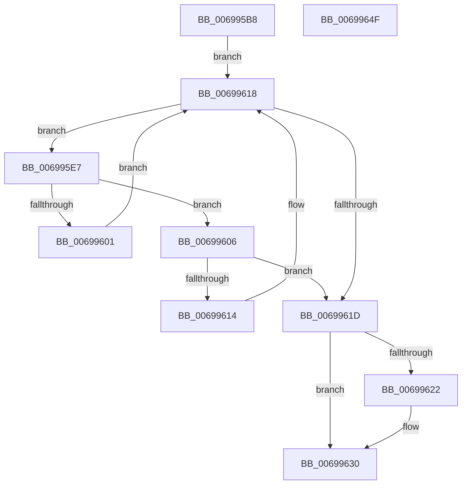

# MiGetPrototypePteBoundaries

- RVA: `0x006995B8`–`0x00699650` (길이 `152` bytes)
- VA: `0x00000001406995B8`
- 실행 섹션: `.text`
- PDB 이름 있음: `예`; PDB Function 태그: `아니요`
- unwind 정보 RVA: `0x0008E1D0`
- 디코드: `43`개 명령, `152/152` bytes 표시
- 미해석 바이트: `0` (있으면 어셈블리에 `.byte`로 보존)

> 이 문서는 커널 이미지의 기계어와 PDB 기호를 분석해 생성했습니다. 4번과 5번은 함수 원형과 자료형을 바이너리 사용 방식에서 추정한 C 해석이며 원본 소스 복구 결과는 아닙니다.

## 1. Dependencies

- 직접 호출 지점: **4**; 고유 호출 대상: **3**
- 직접 호출자로 확인된 함수: **1**
- RIP 상대 이미지 참조: **2**

### Outgoing calls
- `0x006995D9` → [ExAcquireSpinLockSharedAtDpcLevel](../24/ExAcquireSpinLockSharedAtDpcLevel_function_00248E30.md) (function, `0x00248E30`)
- `0x006995F4` → [MiObtainProtoBaseFromNode](../3E/MiObtainProtoBaseFromNode_function_003E09C0.md) (function, `0x003E09C0`)
- `0x00699628` → [MiObtainProtoBaseFromNode](../3E/MiObtainProtoBaseFromNode_function_003E09C0.md) (function, `0x003E09C0`)
- `0x00699637` → [ExReleaseSpinLockSharedFromDpcLevel](../24/ExReleaseSpinLockSharedFromDpcLevel_function_0024A590.md) (function, `0x0024A590`)

### Direct callers
- [MiMakeTransitionHeatBatch](../40/MiMakeTransitionHeatBatch_function_00409A94.md) at `0x00409BF2`

### Static image references
- `0x006995CC` → RVA `0x00E2D710` (`.data`; read)
- `0x006995DE` → RVA `0x00E2D708` (`.data`; read)

## 2. Other-region calls and transfers

- 다른 실행 섹션으로 향하는 call: **0**
- 별도 외부 분기/꼬리 이동을 확인하지 못했습니다.

## 3. Assembly (complete function range)

```asm
006995B8  48 89 5C 24 08                  mov qword ptr [rsp + 8], rbx
006995BD  48 89 74 24 18                  mov qword ptr [rsp + 0x18], rsi
006995C2  57                              push rdi
006995C3  48 83 EC 20                     sub rsp, 0x20
006995C7  48 8B F9                        mov rdi, rcx
006995CA  33 DB                           xor ebx, ebx
006995CC  48 8D 0D 3D 41 79 00            lea rcx, [rip + 0x79413d]
006995D3  48 89 1A                        mov qword ptr [rdx], rbx
006995D6  48 8B F2                        mov rsi, rdx
006995D9  E8 52 F8 BA FF                  call 0x140248e30
006995DE  4C 8B 15 23 41 79 00            mov r10, qword ptr [rip + 0x794123]
006995E5  EB 31                           jmp 0x140699618
006995E7  48 8D 54 24 38                  lea rdx, [rsp + 0x38]
006995EC  48 89 5C 24 38                  mov qword ptr [rsp + 0x38], rbx
006995F1  49 8B CA                        mov rcx, r10
006995F4  E8 C7 73 D4 FF                  call 0x1403e09c0
006995F9  4C 8B D8                        mov r11, rax
006995FC  48 3B F8                        cmp rdi, rax
006995FF  73 05                           jae 0x140699606
00699601  4D 8B 12                        mov r10, qword ptr [r10]
00699604  EB 12                           jmp 0x140699618
00699606  48 8B 44 24 38                  mov rax, qword ptr [rsp + 0x38]
0069960B  49 8D 0C C3                     lea rcx, [r11 + rax*8]
0069960F  48 3B F9                        cmp rdi, rcx
00699612  72 09                           jb 0x14069961d
00699614  4D 8B 52 08                     mov r10, qword ptr [r10 + 8]
00699618  4D 85 D2                        test r10, r10
0069961B  75 CA                           jne 0x1406995e7
0069961D  4D 85 D2                        test r10, r10
00699620  74 0E                           je 0x140699630
00699622  48 8B D6                        mov rdx, rsi
00699625  49 8B CA                        mov rcx, r10
00699628  E8 93 73 D4 FF                  call 0x1403e09c0
0069962D  48 8B D8                        mov rbx, rax
00699630  48 8D 0D D9 40 79 00            lea rcx, [rip + 0x7940d9]
00699637  E8 54 0F BB FF                  call 0x14024a590
0069963C  48 8B 74 24 40                  mov rsi, qword ptr [rsp + 0x40]
00699641  48 8B C3                        mov rax, rbx
00699644  48 8B 5C 24 30                  mov rbx, qword ptr [rsp + 0x30]
00699649  48 83 C4 20                     add rsp, 0x20
0069964D  5F                              pop rdi
0069964E  C3                              ret
0069964F  CC                              int3
```

## 4. C-style interpretation (structured pseudocode)

```c
__int64 __fastcall MiGetPrototypePteBoundaries(__int64 a1, __int64 a2)
{
    __int64 result;
    __int64 v_rbx;
    __int64 v_rsp;
    unsigned __int64 v_stack_p10;
    unsigned __int64 v_stack_p18;
    unsigned __int64 v_stack_p8;

    v_stack_p8 = v_rbx;
    v_stack_p18 = v_rsi;
    v_rsp = (v_rsp) - (32);
    v_rbx = 0;
    *(unsigned __int64 *)(a2) = 0;
    result = ExAcquireSpinLockSharedAtDpcLevel(v_rip + 7946557, a2, a3, a4);
    goto loc_00699618;
loc_006995E7:
    v_stack_p10 = 0;
    result = MiObtainProtoBaseFromNode(*(unsigned __int64 *)(v_rip + 7946531), v_stack_p10, a3, a4);
    if (a1 >= result) goto loc_00699606;
    goto loc_00699618;
loc_00699606:
    if (a1 < (result + v_stack_p10 * 8)) goto loc_0069961D;
loc_00699618:
    if (*(unsigned __int64 *)(*(unsigned __int64 *)(*(unsigned __int64 *)(v_rip + 7946531)) + 8) != 0) goto loc_006995E7;
loc_0069961D:
    result = v_stack_p10;
    if (*(unsigned __int64 *)(*(unsigned __int64 *)(*(unsigned __int64 *)(v_rip + 7946531)) + 8) != 0) {
        a2 = a2;
        a1 = *(unsigned __int64 *)(*(unsigned __int64 *)(*(unsigned __int64 *)(v_rip + 7946531)) + 8);
        result = MiObtainProtoBaseFromNode(a1, a2, a3, a4);
        v_rbx = result;
    }
    result = ExReleaseSpinLockSharedFromDpcLevel(v_rip + 7946457, a2, a3, a4);
    v_rsp = (v_rsp) + (32);
    return v_rbx;
}
```

## 5. (Beta) C Style

```c
int64_t MiGetPrototypePteBoundaries(int64_t Arg1, void *Arg2)
{
    uint8_t *arg2 = (uint8_t *)Arg2;

    int64_t result;
    int64_t local_rbx;
    int64_t local_rsp;
    uint64_t v_stack_p10;
    uint64_t v_stack_p18;
    uint64_t v_stack_p8;

    v_stack_p8 = local_rbx;
    v_stack_p18 = local_rsi;
    local_rsp = (local_rsp) - (32);
    local_rbx = 0;
    *(uint64_t *)(arg2) = 0;
    result = ExAcquireSpinLockSharedAtDpcLevel(v_rip + 7946557, Arg2, a3, a4);
    goto loc_00699618;
loc_006995E7:
    v_stack_p10 = 0;
    result = MiObtainProtoBaseFromNode(*(uint64_t *)(v_rip + 0x794123), v_stack_p10, a3, a4);
    if (Arg1 >= result) goto loc_00699606;
    goto loc_00699618;
loc_00699606:
    if (Arg1 < (result + v_stack_p10 * 8)) goto loc_0069961D;
loc_00699618:
    if (*(uint64_t *)(*(uint64_t *)(*(uint64_t *)(v_rip + 0x794123)) + 0x8) != 0) goto loc_006995E7;
loc_0069961D:
    result = v_stack_p10;
    if (*(uint64_t *)(*(uint64_t *)(*(uint64_t *)(v_rip + 0x794123)) + 0x8) != 0) {
        Arg2 = Arg2;
        Arg1 = *(uint64_t *)(*(uint64_t *)(*(uint64_t *)(v_rip + 0x794123)) + 0x8);
        result = MiObtainProtoBaseFromNode(Arg1, Arg2, a3, a4);
        local_rbx = result;
    }
    result = ExReleaseSpinLockSharedFromDpcLevel(v_rip + 7946457, Arg2, a3, a4);
    local_rsp = (local_rsp) + (32);
    return local_rbx;
}
```

### 관측된 메모리 오프셋

구조체 형식이 확인되지 않은 접근은 인자 기준의 오프셋으로만 기록했습니다.

| 기준 인자 | 오프셋 표현 | 폭 (bit) | 접근 |
|---|---:|---:|---|
| `Arg2` | `+ 0x0` | `64` | `W` |

## 6. Execution-region graph

[열기: 2D/3D 그래프와 함수 탐색 컨트롤 패널](../../../control-panel.html?section=text&rva=0x006995B8&view=graph)

- 2D 그래프는 위에서 아래로 흐르고, 3D 그래프는 빈 공간을 드래그해 회전합니다. Shift+드래그는 이동, 휠은 확대·축소, 함수 노드 선택은 대상 보고서 이동입니다.

### Static fallback


