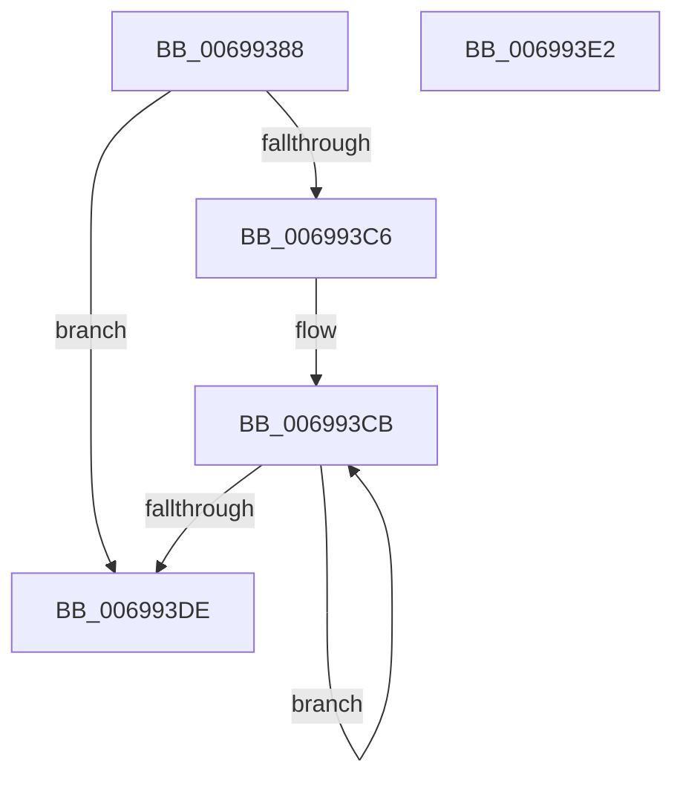

# MiGetVadPte

- RVA: `0x00699388`–`0x006993E3` (길이 `91` bytes)
- VA: `0x0000000140699388`
- 실행 섹션: `.text`
- PDB 이름 있음: `예`; PDB Function 태그: `아니요`
- unwind 정보 RVA: `0x000DB714`
- 디코드: `25`개 명령, `91/91` bytes 표시
- 미해석 바이트: `0` (있으면 어셈블리에 `.byte`로 보존)

> 이 문서는 커널 이미지의 기계어와 PDB 기호를 분석해 생성했습니다. 4번과 5번은 함수 원형과 자료형을 바이너리 사용 방식에서 추정한 C 해석이며 원본 소스 복구 결과는 아닙니다.

## 1. Dependencies

- 직접 호출 지점: **0**; 고유 호출 대상: **0**
- 직접 호출자로 확인된 함수: **1**
- RIP 상대 이미지 참조: **1**

### Outgoing calls
- 직접 디코드된 call 명령이 없습니다.

### Direct callers
- [MiComputeIdealLargePage](MiComputeIdealLargePage_function_006987C0.md) at `0x00698840`
- [MiComputeIdealLargePage](MiComputeIdealLargePage_function_006987C0.md) at `0x00698887`
- [MiComputeIdealLargePage](MiComputeIdealLargePage_function_006987C0.md) at `0x006988B2`

### Static image references
- `0x00699399` → RVA `0x00013F10` (`.rdata`; read)

## 2. Other-region calls and transfers

- 다른 실행 섹션으로 향하는 call: **0**
- 별도 외부 분기/꼬리 이동을 확인하지 못했습니다.

## 3. Assembly (complete function range)

```asm
00699388  8B 41 30                        mov eax, dword ptr [rcx + 0x30]
0069938B  49 BA F8 FF FF FF 7F 00 00 00   movabs r10, 0x7ffffffff8
00699395  48 C1 E8 13                     shr rax, 0x13
00699399  48 8D 0D 70 AB 97 FF            lea rcx, [rip - 0x685490]
006993A0  83 E0 03                        and eax, 3
006993A3  48 C1 EA 09                     shr rdx, 9
006993A7  49 23 D2                        and rdx, r10
006993AA  49 B9 00 00 00 00 80 F6 FF FF   movabs r9, 0xfffff68000000000
006993B4  8B 0C 81                        mov ecx, dword ptr [rcx + rax*4]
006993B7  49 8B C1                        mov rax, r9
006993BA  48 03 D0                        add rdx, rax
006993BD  B8 02 00 00 00                  mov eax, 2
006993C2  3B C8                           cmp ecx, eax
006993C4  73 18                           jae 0x1406993de
006993C6  2B C1                           sub eax, ecx
006993C8  44 8B C0                        mov r8d, eax
006993CB  48 C1 EA 09                     shr rdx, 9
006993CF  49 23 D2                        and rdx, r10
006993D2  49 8B C9                        mov rcx, r9
006993D5  48 03 D1                        add rdx, rcx
006993D8  49 83 E8 01                     sub r8, 1
006993DC  75 ED                           jne 0x1406993cb
006993DE  48 8B C2                        mov rax, rdx
006993E1  C3                              ret
006993E2  CC                              int3
```

## 4. C-style interpretation (structured pseudocode)

```c
__int64 __fastcall MiGetVadPte(__int64 a1, __int64 a2)
{
    __int64 result;

    result = ((unsigned int)(*(unsigned int *)(a1 + 48))) >> (19);
    result = (unsigned int)((result) & (3));
    a2 = (a2) >> (9);
    a2 = (a2) & (v_r10);
    a2 = (a2) + (a4);
    if (((unsigned int)((unsigned int)(*(unsigned int *)(v_rip - 6837392 + result * 4)))) >= 2) goto loc_006993DE;
    result = (unsigned int)((2) - ((unsigned int)((unsigned int)(*(unsigned int *)(v_rip - 6837392 + result * 4)))));
loc_006993CB:
    a2 = (a2) >> (9);
    a2 = (a2) & (v_r10);
    a2 = (a2) + (a4);
    a3 = ((unsigned int)((unsigned int)(result))) - (1);
    if (condition_is_not_equal) goto loc_006993CB;
loc_006993DE:
    return a2;
}
```

## 5. (Beta) C Style

```c
int64_t MiGetVadPte(void *Arg1, int64_t Arg2)
{
    uint8_t *arg1 = (uint8_t *)Arg1;

    int64_t result;

    result = ((uint32_t)(*(uint32_t *)(arg1 + 0x30))) >> (19);
    result = (uint32_t)((result) & (3));
    Arg2 = (Arg2) >> (9);
    Arg2 = (Arg2) & (local_r10);
    Arg2 = (Arg2) + (a4);
    if (((uint32_t)((uint32_t)(*(uint32_t *)(v_rip - 0x685490 + result * 4)))) >= 2) goto loc_006993DE;
    result = (uint32_t)((2) - ((uint32_t)((uint32_t)(*(uint32_t *)(v_rip - 0x685490 + result * 4)))));
loc_006993CB:
    Arg2 = (Arg2) >> (9);
    Arg2 = (Arg2) & (local_r10);
    Arg2 = (Arg2) + (a4);
    a3 = ((uint32_t)((uint32_t)(result))) - (1);
    if (condition_is_not_equal) goto loc_006993CB;
loc_006993DE:
    return Arg2;
}
```

### 관측된 메모리 오프셋

구조체 형식이 확인되지 않은 접근은 인자 기준의 오프셋으로만 기록했습니다.

| 기준 인자 | 오프셋 표현 | 폭 (bit) | 접근 |
|---|---:|---:|---|
| `Arg1` | `+ 0x30` | `32` | `R` |

## 6. Execution-region graph

[열기: 2D/3D 그래프와 함수 탐색 컨트롤 패널](../../../control-panel.html?section=text&rva=0x00699388&view=graph)

- 2D 그래프는 위에서 아래로 흐르고, 3D 그래프는 빈 공간을 드래그해 회전합니다. Shift+드래그는 이동, 휠은 확대·축소, 함수 노드 선택은 대상 보고서 이동입니다.

### Static fallback


