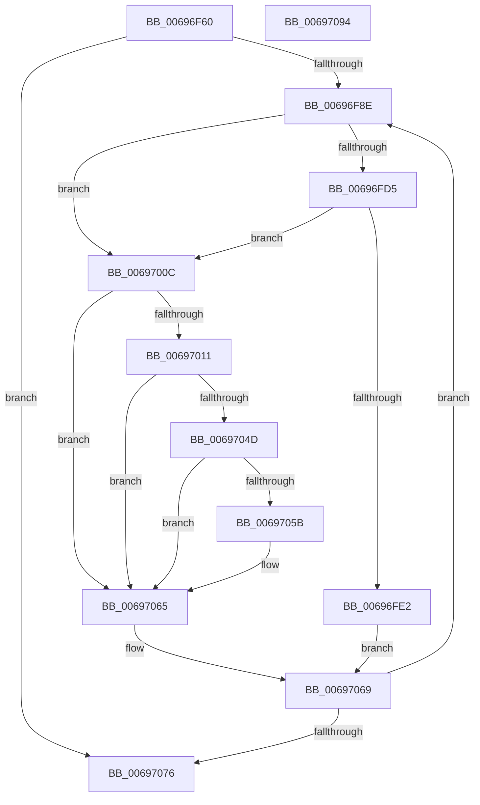

# MiInitializeBootLoadedDriverPfnRange

- RVA: `0x00696F60`–`0x00697095` (길이 `309` bytes)
- VA: `0x0000000140696F60`
- 실행 섹션: `.text`
- PDB 이름 있음: `예`; PDB Function 태그: `아니요`
- unwind 정보 RVA: `0x0005E6B4`
- 디코드: `79`개 명령, `309/309` bytes 표시
- 미해석 바이트: `0` (있으면 어셈블리에 `.byte`로 보존)

> 이 문서는 커널 이미지의 기계어와 PDB 기호를 분석해 생성했습니다. 4번과 5번은 함수 원형과 자료형을 바이너리 사용 방식에서 추정한 C 해석이며 원본 소스 복구 결과는 아닙니다.

## 1. Dependencies

- 직접 호출 지점: **2**; 고유 호출 대상: **2**
- 직접 호출자로 확인된 함수: **1**
- RIP 상대 이미지 참조: **1**

### Outgoing calls
- `0x00696FBD` → [MiGetPfnSlabType](../28/MiGetPfnSlabType_function_0028E2D0.md) (function, `0x0028E2D0`)
- `0x00697060` → [MiMarkPfnVerified](../38/MiMarkPfnVerified_function_003833C4.md) (function, `0x003833C4`)

### Direct callers
- [MiInitializeBootLoadedDriverPfns](../../init/C6/MiInitializeBootLoadedDriverPfns_function_00C6BB10.md) at `0x00C6BBC7`
- [MiInitializeBootLoadedDriverPfns](../../init/C6/MiInitializeBootLoadedDriverPfns_function_00C6BB10.md) at `0x00C6BBDA`
- [MiInitializeBootLoadedDriverPfns](../../init/C6/MiInitializeBootLoadedDriverPfns_function_00C6BB10.md) at `0x00C6BC24`
- [MiInitializeBootLoadedDriverPfns](../../init/C6/MiInitializeBootLoadedDriverPfns_function_00C6BB10.md) at `0x00C6BC53`

### Static image references
- `0x00696FD5` → RVA `0x00FC6A88` (`ALMOSTRO`; read)

## 2. Other-region calls and transfers

- 다른 실행 섹션으로 향하는 call: **0**
- 별도 외부 분기/꼬리 이동을 확인하지 못했습니다.

## 3. Assembly (complete function range)

```asm
00696F60  48 8B C4                        mov rax, rsp
00696F63  48 89 58 08                     mov qword ptr [rax + 8], rbx
00696F67  48 89 68 10                     mov qword ptr [rax + 0x10], rbp
00696F6B  48 89 70 18                     mov qword ptr [rax + 0x18], rsi
00696F6F  48 89 78 20                     mov qword ptr [rax + 0x20], rdi
00696F73  41 56                           push r14
00696F75  48 83 EC 20                     sub rsp, 0x20
00696F79  33 F6                           xor esi, esi
00696F7B  48 8D 2C D1                     lea rbp, [rcx + rdx*8]
00696F7F  45 8B F0                        mov r14d, r8d
00696F82  48 8B F9                        mov rdi, rcx
00696F85  48 3B CD                        cmp rcx, rbp
00696F88  0F 83 E8 00 00 00               jae 0x140697076
00696F8E  4C 8B 07                        mov r8, qword ptr [rdi]
00696F91  48 B9 FF FF FF FF FF 00 00 00   movabs rcx, 0xffffffffff
00696F9B  49 8B C0                        mov rax, r8
00696F9E  48 C1 E8 0C                     shr rax, 0xc
00696FA2  48 23 C1                        and rax, rcx
00696FA5  48 8D 1C 40                     lea rbx, [rax + rax*2]
00696FA9  48 C1 E3 04                     shl rbx, 4
00696FAD  48 B8 00 00 00 00 00 DE FF FF   movabs rax, 0xffffde0000000000
00696FB7  48 03 D8                        add rbx, rax
00696FBA  48 8B CB                        mov rcx, rbx
00696FBD  E8 0E 73 BF FF                  call 0x14028e2d0
00696FC2  83 F8 09                        cmp eax, 9
00696FC5  48 8D 4E 01                     lea rcx, [rsi + 1]
00696FC9  48 0F 44 CE                     cmove rcx, rsi
00696FCD  48 8B F1                        mov rsi, rcx
00696FD0  45 85 F6                        test r14d, r14d
00696FD3  74 37                           je 0x14069700c
00696FD5  48 F7 05 A8 FA 92 00 00 40 00 00  test qword ptr [rip + 0x92faa8], 0x4000
00696FE0  74 2A                           je 0x14069700c
00696FE2  48 8B 43 10                     mov rax, qword ptr [rbx + 0x10]
00696FE6  49 C1 F8 3F                     sar r8, 0x3f
00696FEA  49 83 E0 FE                     and r8, 0xfffffffffffffffe
00696FEE  49 83 C0 03                     add r8, 3
00696FF2  49 C1 E0 05                     shl r8, 5
00696FF6  49 8B C8                        mov rcx, r8
00696FF9  48 33 C8                        xor rcx, rax
00696FFC  48 81 E1 1F FC FF FF            and rcx, 0xfffffffffffffc1f
00697003  49 33 C8                        xor rcx, r8
00697006  48 89 4B 10                     mov qword ptr [rbx + 0x10], rcx
0069700A  EB 5D                           jmp 0x140697069
0069700C  4D 85 C0                        test r8, r8
0069700F  78 54                           js 0x140697065
00697011  48 8B 43 10                     mov rax, qword ptr [rbx + 0x10]
00697015  48 8B 0D 6C FA 92 00            mov rcx, qword ptr [rip + 0x92fa6c]
0069701C  48 C1 E9 0F                     shr rcx, 0xf
00697020  80 E1 01                        and cl, 1
00697023  F6 D9                           neg cl
00697025  48 1B C9                        sbb rcx, rcx
00697028  48 25 1F FC FF FF               and rax, 0xfffffffffffffc1f
0069702E  48 83 E1 A0                     and rcx, 0xffffffffffffffa0
00697032  48 81 C1 C0 00 00 00            add rcx, 0xc0
00697039  48 0B C8                        or rcx, rax
0069703C  48 F7 05 41 FA 92 00 00 80 00 00  test qword ptr [rip + 0x92fa41], 0x8000
00697047  48 89 4B 10                     mov qword ptr [rbx + 0x10], rcx
0069704B  74 18                           je 0x140697065
0069704D  48 8B 43 28                     mov rax, qword ptr [rbx + 0x28]
00697051  48 C1 E8 3C                     shr rax, 0x3c
00697055  24 07                           and al, 7
00697057  3C 03                           cmp al, 3
00697059  74 0A                           je 0x140697065
0069705B  33 D2                           xor edx, edx
0069705D  48 8B CB                        mov rcx, rbx
00697060  E8 5F C3 CE FF                  call 0x1403833c4
00697065  80 4B 23 08                     or byte ptr [rbx + 0x23], 8
00697069  48 83 C7 08                     add rdi, 8
0069706D  48 3B FD                        cmp rdi, rbp
00697070  0F 82 18 FF FF FF               jb 0x140696f8e
00697076  48 8B 5C 24 30                  mov rbx, qword ptr [rsp + 0x30]
0069707B  48 8B C6                        mov rax, rsi
0069707E  48 8B 74 24 40                  mov rsi, qword ptr [rsp + 0x40]
00697083  48 8B 6C 24 38                  mov rbp, qword ptr [rsp + 0x38]
00697088  48 8B 7C 24 48                  mov rdi, qword ptr [rsp + 0x48]
0069708D  48 83 C4 20                     add rsp, 0x20
00697091  41 5E                           pop r14
00697093  C3                              ret
00697094  CC                              int3
```

## 4. C-style interpretation (structured pseudocode)

```c
__int64 __fastcall MiInitializeBootLoadedDriverPfnRange(__int64 a1, __int64 a2, int a3)
{
    __int64 result;
    __int64 v_rbx;
    __int64 v_rdi;
    __int64 v_rsi;
    __int64 v_rsp;
    unsigned __int64 v_stack_p10;
    unsigned __int64 v_stack_p18;
    unsigned __int64 v_stack_p20;
    unsigned __int64 v_stack_p8;

    *(unsigned __int64 *)(v_rsp + 8) = v_rbx;
    *(unsigned __int64 *)(v_rsp + 16) = v_rbp;
    *(unsigned __int64 *)(v_rsp + 24) = v_rsi;
    *(unsigned __int64 *)(v_rsp + 32) = v_rdi;
    v_rsp = (v_rsp) - (32);
    v_rsi = 0;
    if (a1 >= (a1 + a2 * 8)) goto loc_00697076;
loc_00696F8E:
    result = (*(unsigned __int64 *)(a1)) >> (12);
    result = (result) & (a1);
    v_rbx = (result + result * 2) << (4);
    v_rbx = (v_rbx) + (result);
    result = MiGetPfnSlabType(v_rbx, a2, *(unsigned __int64 *)(a1), a4);
    a1 = v_rsi + 1;
    if (((unsigned int)(result)) == 9) { a1 = 0; }
    if ((unsigned int)((unsigned int)(a3)) == 0) goto loc_0069700C;
    if (((*(unsigned __int64 *)(v_rip + 9632424)) & (0x4000ULL)) == 0) goto loc_0069700C;
    a3 = (*(unsigned __int64 *)(a1)) >> (63);
    a3 = (a3) & (-2);
    a3 = (a3) + (3);
    a3 = (a3) << (5);
    a1 = (a3) ^ (*(unsigned __int64 *)(v_rbx + 16));
    a1 = (a1) & (-993);
    a1 = (a1) ^ (a3);
    *(unsigned __int64 *)(v_rbx + 16) = a1;
    goto loc_00697069;
loc_0069700C:
    if (sign_flag) goto loc_00697065;
    a1 = (*(unsigned __int64 *)(v_rip + 9632364)) >> (15);
    a1 = (unsigned __int8)((a1) & (1));
    a1 = (unsigned __int8)(-(a1));
    result = (*(unsigned __int64 *)(v_rbx + 16)) & (-993);
    a1 = (a1) & (-96);
    a1 = (a1) + (192);
    a1 = (a1) | (result);
    *(unsigned __int64 *)(v_rbx + 16) = a1;
    if (((*(unsigned __int64 *)(v_rip + 9632321)) & (0x8000ULL)) == 0) goto loc_00697065;
    result = (*(unsigned __int64 *)(v_rbx + 40)) >> (60);
    result = (unsigned __int8)((result) & (7));
    if (((unsigned __int8)(result)) != 3) {
        a2 = 0;
        a1 = v_rbx;
        result = MiMarkPfnVerified(a1, a2, a3, a4);
    }
loc_00697069:
    v_rdi = (a1) + (8);
    if (v_rdi < (a1 + a2 * 8)) goto loc_00696F8E;
loc_00697076:
    v_rsp = (v_rsp) + (32);
    return a1;
}
```

## 5. (Beta) C Style

```c
void *MiInitializeBootLoadedDriverPfnRange(void *Arg1, int64_t Arg2, int32_t Arg3)
{
    uint8_t *arg1 = (uint8_t *)Arg1;

    int64_t result;
    int64_t local_rbx;
    int64_t local_rdi;
    int64_t local_rsi;
    int64_t local_rsp;
    uint64_t v_stack_p10;
    uint64_t v_stack_p18;
    uint64_t v_stack_p20;
    uint64_t v_stack_p8;

    *(uint64_t *)(local_rsp + 0x8) = local_rbx;
    *(uint64_t *)(local_rsp + 0x10) = local_rbp;
    *(uint64_t *)(local_rsp + 0x18) = local_rsi;
    *(uint64_t *)(local_rsp + 0x20) = local_rdi;
    local_rsp = (local_rsp) - (32);
    local_rsi = 0;
    if (Arg1 >= (Arg1 + Arg2 * 8)) goto loc_00697076;
loc_00696F8E:
    result = (*(uint64_t *)(arg1)) >> (12);
    result = (result) & (Arg1);
    local_rbx = (result + result * 2) << (4);
    local_rbx = (local_rbx) + (result);
    result = MiGetPfnSlabType(local_rbx, Arg2, *(uint64_t *)(arg1), a4);
    Arg1 = local_rsi + 1;
    if (((uint32_t)(result)) == 9) { Arg1 = 0; }
    if ((uint32_t)((uint32_t)(Arg3)) == 0) goto loc_0069700C;
    if (((*(uint64_t *)(v_rip + 0x92FAA8)) & (0x4000ULL)) == 0) goto loc_0069700C;
    Arg3 = (*(uint64_t *)(arg1)) >> (63);
    Arg3 = (Arg3) & (-2);
    Arg3 = (Arg3) + (3);
    Arg3 = (Arg3) << (5);
    Arg1 = (Arg3) ^ (*(uint64_t *)(local_rbx + 0x10));
    Arg1 = (Arg1) & (-993);
    Arg1 = (Arg1) ^ (Arg3);
    *(void **)(local_rbx + 0x10) = Arg1;
    goto loc_00697069;
loc_0069700C:
    if (sign_flag) goto loc_00697065;
    Arg1 = (*(uint64_t *)(v_rip + 0x92FA6C)) >> (15);
    Arg1 = (uint8_t)((Arg1) & (1));
    Arg1 = (uint8_t)(-(Arg1));
    result = (*(uint64_t *)(local_rbx + 0x10)) & (-993);
    Arg1 = (Arg1) & (-96);
    Arg1 = (Arg1) + (192);
    Arg1 = (Arg1) | (result);
    *(void **)(local_rbx + 0x10) = Arg1;
    if (((*(uint64_t *)(v_rip + 0x92FA41)) & (0x8000ULL)) == 0) goto loc_00697065;
    result = (*(uint64_t *)(local_rbx + 0x28)) >> (60);
    result = (uint8_t)((result) & (7));
    if (((uint8_t)(result)) != 3) {
        Arg2 = 0;
        Arg1 = local_rbx;
        result = MiMarkPfnVerified(Arg1, Arg2, Arg3, a4);
    }
loc_00697069:
    local_rdi = (Arg1) + (8);
    if (local_rdi < (Arg1 + Arg2 * 8)) goto loc_00696F8E;
loc_00697076:
    local_rsp = (local_rsp) + (32);
    return Arg1;
}
```

### 관측된 메모리 오프셋

구조체 형식이 확인되지 않은 접근은 인자 기준의 오프셋으로만 기록했습니다.

| 기준 인자 | 오프셋 표현 | 폭 (bit) | 접근 |
|---|---:|---:|---|
| `Arg1` | `+ 0x0 + rdx*8` | `64` | `R` |

## 6. Execution-region graph

[열기: 2D/3D 그래프와 함수 탐색 컨트롤 패널](../../../control-panel.html?section=text&rva=0x00696F60&view=graph)

- 2D 그래프는 위에서 아래로 흐르고, 3D 그래프는 빈 공간을 드래그해 회전합니다. Shift+드래그는 이동, 휠은 확대·축소, 함수 노드 선택은 대상 보고서 이동입니다.

### Static fallback


