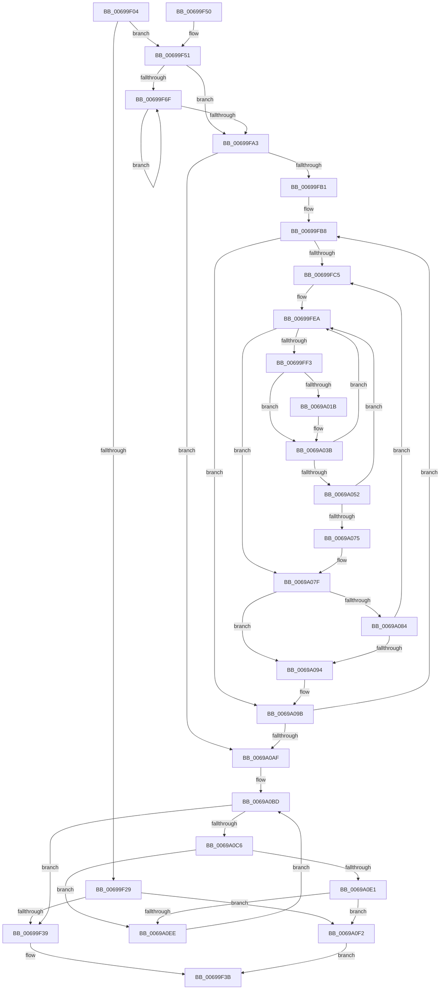

# MiInitializeZeroEngineCurrentPassDpcAffinity

- RVA: `0x00699F04`–`0x0069A0FC` (길이 `504` bytes)
- VA: `0x0000000140699F04`
- 실행 섹션: `.text`
- PDB 이름 있음: `예`; PDB Function 태그: `아니요`
- unwind 정보 RVA: `0x000D96DC`
- 디코드: `128`개 명령, `504/504` bytes 표시
- 미해석 바이트: `0` (있으면 어셈블리에 `.byte`로 보존)

> 이 문서는 커널 이미지의 기계어와 PDB 기호를 분석해 생성했습니다. 4번과 5번은 함수 원형과 자료형을 바이너리 사용 방식에서 추정한 C 해석이며 원본 소스 복구 결과는 아닙니다.

## 1. Dependencies

- 직접 호출 지점: **2**; 고유 호출 대상: **2**
- 직접 호출자로 확인된 함수: **1**
- RIP 상대 이미지 참조: **2**

### Outgoing calls
- `0x00699F54` → [MiEngineAffinity](../2C/MiEngineAffinity_function_002CCB64.md) (function, `0x002CCB64`)
- `0x00699FF8` → [KeFindFirstSetRightGroupAffinity](../2C/KeFindFirstSetRightGroupAffinity_function_002CFB10.md) (function, `0x002CFB10`)

### Direct callers
- [MiStartDpcZeroingRound](MiStartDpcZeroingRound_function_0069A24C.md) at `0x0069A268`

### Static image references
- `0x00699FFF` → RVA `0x00FC8C40` (`ALMOSTRO`; read)
- `0x0069A029` → RVA `0x00E2DBF8` (`.data`; read)

## 2. Other-region calls and transfers

- 다른 실행 섹션으로 향하는 call: **0**
- 별도 외부 분기/꼬리 이동을 확인하지 못했습니다.

## 3. Assembly (complete function range)

```asm
00699F04  48 89 5C 24 10                  mov qword ptr [rsp + 0x10], rbx
00699F09  48 89 4C 24 08                  mov qword ptr [rsp + 8], rcx
00699F0E  55                              push rbp
00699F0F  56                              push rsi
00699F10  57                              push rdi
00699F11  41 54                           push r12
00699F13  41 55                           push r13
00699F15  41 56                           push r14
00699F17  41 57                           push r15
00699F19  48 83 EC 30                     sub rsp, 0x30
00699F1D  48 8B 39                        mov rdi, qword ptr [rcx]
00699F20  33 DB                           xor ebx, ebx
00699F22  44 8B F2                        mov r14d, edx
00699F25  39 1F                           cmp dword ptr [rdi], ebx
00699F27  75 28                           jne 0x140699f51
00699F29  65 8B 04 25 A4 01 00 00         mov eax, dword ptr gs:[0x1a4]
00699F31  3B C2                           cmp eax, edx
00699F33  0F 82 B9 01 00 00               jb 0x14069a0f2
00699F39  33 C0                           xor eax, eax
00699F3B  48 8B 5C 24 78                  mov rbx, qword ptr [rsp + 0x78]
00699F40  48 83 C4 30                     add rsp, 0x30
00699F44  41 5F                           pop r15
00699F46  41 5E                           pop r14
00699F48  41 5D                           pop r13
00699F4A  41 5C                           pop r12
00699F4C  5F                              pop rdi
00699F4D  5E                              pop rsi
00699F4E  5D                              pop rbp
00699F4F  C3                              ret
00699F50  CC                              int3
00699F51  48 8B CF                        mov rcx, rdi
00699F54  E8 0B 2C C3 FF                  call 0x1402ccb64
00699F59  48 8B E8                        mov rbp, rax
00699F5C  44 8B C3                        mov r8d, ebx
00699F5F  8B 40 08                        mov eax, dword ptr [rax + 8]
00699F62  89 84 24 80 00 00 00            mov dword ptr [rsp + 0x80], eax
00699F69  66 3B 5D 10                     cmp bx, word ptr [rbp + 0x10]
00699F6D  73 34                           jae 0x140699fa3
00699F6F  48 8B 87 90 00 00 00            mov rax, qword ptr [rdi + 0x90]
00699F76  48 8B 8F 98 00 00 00            mov rcx, qword ptr [rdi + 0x98]
00699F7D  41 8B D0                        mov edx, r8d
00699F80  41 FF C0                        inc r8d
00699F83  48 03 D2                        add rdx, rdx
00699F86  0F 10 04 D0                     movups xmm0, xmmword ptr [rax + rdx*8]
00699F8A  F3 0F 7F 04 D1                  movdqu xmmword ptr [rcx + rdx*8], xmm0
00699F8F  48 8B 87 98 00 00 00            mov rax, qword ptr [rdi + 0x98]
00699F96  48 89 1C D0                     mov qword ptr [rax + rdx*8], rbx
00699F9A  0F B7 45 10                     movzx eax, word ptr [rbp + 0x10]
00699F9E  44 3B C0                        cmp r8d, eax
00699FA1  72 CC                           jb 0x140699f6f
00699FA3  8B F3                           mov esi, ebx
00699FA5  44 8B E3                        mov r12d, ebx
00699FA8  45 85 F6                        test r14d, r14d
00699FAB  0F 84 FE 00 00 00               je 0x14069a0af
00699FB1  8B 8C 24 80 00 00 00            mov ecx, dword ptr [rsp + 0x80]
00699FB8  44 8B FB                        mov r15d, ebx
00699FBB  66 3B 5D 10                     cmp bx, word ptr [rbp + 0x10]
00699FBF  0F 83 D6 00 00 00               jae 0x14069a09b
00699FC5  48 8B 87 90 00 00 00            mov rax, qword ptr [rdi + 0x90]
00699FCC  41 8B CF                        mov ecx, r15d
00699FCF  48 C1 E1 04                     shl rcx, 4
00699FD3  48 89 8C 24 88 00 00 00         mov qword ptr [rsp + 0x88], rcx
00699FDB  0F 10 04 01                     movups xmm0, xmmword ptr [rcx + rax]
00699FDF  F3 0F 7F 44 24 20               movdqu xmmword ptr [rsp + 0x20], xmm0
00699FE5  4C 8B 6C 24 20                  mov r13, qword ptr [rsp + 0x20]
00699FEA  4D 85 ED                        test r13, r13
00699FED  0F 84 8C 00 00 00               je 0x14069a07f
00699FF3  48 8D 4C 24 20                  lea rcx, [rsp + 0x20]
00699FF8  E8 13 5B C3 FF                  call 0x1402cfb10
00699FFD  8B C8                           mov ecx, eax
00699FFF  48 8D 15 3A EC 92 00            lea rdx, [rip + 0x92ec3a]
0069A006  48 8B 44 24 70                  mov rax, qword ptr [rsp + 0x70]
0069A00B  48 8B 14 CA                     mov rdx, qword ptr [rdx + rcx*8]
0069A00F  44 8B 82 34 B9 00 00            mov r8d, dword ptr [rdx + 0xb934]
0069A016  38 58 19                        cmp byte ptr [rax + 0x19], bl
0069A019  74 20                           je 0x14069a03b
0069A01B  8B 82 54 87 00 00               mov eax, dword ptr [rdx + 0x8754]
0069A021  48 8D 04 40                     lea rax, [rax + rax*2]
0069A025  48 C1 E0 07                     shl rax, 7
0069A029  48 03 05 C8 3B 79 00            add rax, qword ptr [rip + 0x793bc8]
0069A030  48 8B 80 78 01 00 00            mov rax, qword ptr [rax + 0x178]
0069A037  44 03 40 0C                     add r8d, dword ptr [rax + 0xc]
0069A03B  48 8B 82 60 8E 00 00            mov rax, qword ptr [rdx + 0x8e60]
0069A042  48 F7 D0                        not rax
0069A045  4C 23 E8                        and r13, rax
0069A048  4C 89 6C 24 20                  mov qword ptr [rsp + 0x20], r13
0069A04D  44 3B C6                        cmp r8d, esi
0069A050  75 98                           jne 0x140699fea
0069A052  4C 8B 87 98 00 00 00            mov r8, qword ptr [rdi + 0x98]
0069A059  48 8B 8C 24 88 00 00 00         mov rcx, qword ptr [rsp + 0x88]
0069A061  48 8B 82 C8 00 00 00            mov rax, qword ptr [rdx + 0xc8]
0069A068  4D 8B 0C 08                     mov r9, qword ptr [r8 + rcx]
0069A06C  49 85 C1                        test r9, rax
0069A06F  0F 85 75 FF FF FF               jne 0x140699fea
0069A075  49 0B C1                        or rax, r9
0069A078  49 89 04 08                     mov qword ptr [r8 + rcx], rax
0069A07C  41 FF C4                        inc r12d
0069A07F  45 3B E6                        cmp r12d, r14d
0069A082  74 10                           je 0x14069a094
0069A084  0F B7 45 10                     movzx eax, word ptr [rbp + 0x10]
0069A088  41 FF C7                        inc r15d
0069A08B  44 3B F8                        cmp r15d, eax
0069A08E  0F 82 31 FF FF FF               jb 0x140699fc5
0069A094  8B 8C 24 80 00 00 00            mov ecx, dword ptr [rsp + 0x80]
0069A09B  FF C6                           inc esi
0069A09D  8B C3                           mov eax, ebx
0069A09F  3B F1                           cmp esi, ecx
0069A0A1  0F 45 C6                        cmovne eax, esi
0069A0A4  8B F0                           mov esi, eax
0069A0A6  45 3B E6                        cmp r12d, r14d
0069A0A9  0F 85 09 FF FF FF               jne 0x140699fb8
0069A0AF  65 4C 8B 04 25 20 00 00 00      mov r8, qword ptr gs:[0x20]
0069A0B8  44 0F B7 4D 10                  movzx r9d, word ptr [rbp + 0x10]
0069A0BD  41 3B D9                        cmp ebx, r9d
0069A0C0  0F 83 73 FE FF FF               jae 0x140699f39
0069A0C6  48 8B 97 98 00 00 00            mov rdx, qword ptr [rdi + 0x98]
0069A0CD  41 0F B6 80 D0 00 00 00         movzx eax, byte ptr [r8 + 0xd0]
0069A0D5  8B CB                           mov ecx, ebx
0069A0D7  48 03 C9                        add rcx, rcx
0069A0DA  66 3B 44 CA 08                  cmp ax, word ptr [rdx + rcx*8 + 8]
0069A0DF  75 0D                           jne 0x14069a0ee
0069A0E1  49 8B 80 C8 00 00 00            mov rax, qword ptr [r8 + 0xc8]
0069A0E8  48 85 04 CA                     test qword ptr [rdx + rcx*8], rax
0069A0EC  75 04                           jne 0x14069a0f2
0069A0EE  FF C3                           inc ebx
0069A0F0  EB CB                           jmp 0x14069a0bd
0069A0F2  B8 01 00 00 00                  mov eax, 1
0069A0F7  E9 3F FE FF FF                  jmp 0x140699f3b
```

## 4. C-style interpretation (structured pseudocode)

```c
__int64 __fastcall MiInitializeZeroEngineCurrentPassDpcAffinity(__int64 a1, int a2)
{
    __int64 result;
    __int64 v_r12;
    __int64 v_r13;
    __int64 v_r15;
    __int64 v_rbx;
    __int64 v_rsi;
    __int64 v_rsp;
    unsigned __int64 v_stack_p10;
    unsigned __int64 v_stack_p20;
    unsigned __int64 v_stack_p70;
    unsigned __int64 v_stack_p8;
    unsigned int v_stack_p80;
    unsigned __int64 v_stack_p88;

    v_stack_p10 = v_rbx;
    v_stack_p8 = a1;
    v_rsp = (v_rsp) - (48);
    v_rbx = 0;
    if ((*(unsigned int *)(*(unsigned __int64 *)(a1))) != 0) goto loc_00699F51;
    if (((unsigned int)((unsigned int)(*(unsigned int *)(gs_base + (0 + 420))))) < a2) goto loc_0069A0F2;
loc_00699F39:
    result = 0;
loc_00699F3B:
    v_rsp = (v_rsp) + (48);
    return result;
loc_00699F51:
    result = MiEngineAffinity(*(unsigned __int64 *)(a1), a2, a3, a4);
    v_stack_p80 = (unsigned int)((unsigned int)(*(unsigned int *)(result + 8)));
    if (((unsigned __int16)(v_stack_p10)) >= (*(unsigned __int16 *)(result + 16))) goto loc_00699FA3;
loc_00699F6F:
    a3 = (unsigned int)(((unsigned int)((unsigned int)(v_stack_p10))) + 1);
    a2 = ((unsigned int)((unsigned int)((unsigned int)((unsigned int)(v_stack_p10))))) + ((unsigned int)((unsigned int)((unsigned int)((unsigned int)(v_stack_p10)))));
    *(unsigned __int64 *)(*(unsigned __int64 *)(*(unsigned __int64 *)(a1) + 152) + a2 * 8) = v_xmm0;
    *(unsigned __int64 *)(*(unsigned __int64 *)(*(unsigned __int64 *)(a1) + 152) + a2 * 8) = v_stack_p10;
    if (((unsigned int)(a3)) < ((unsigned int)(*(unsigned __int16 *)(result + 16)))) goto loc_00699F6F;
loc_00699FA3:
    if ((unsigned int)((unsigned int)(a2)) == 0) goto loc_0069A0AF;
loc_00699FB8:
    if (((unsigned __int16)(v_stack_p10)) >= (*(unsigned __int16 *)(result + 16))) goto loc_0069A09B;
loc_00699FC5:
    a1 = ((unsigned int)((unsigned int)((unsigned int)((unsigned int)(v_stack_p10))))) << (4);
    v_stack_p88 = a1;
    v_stack_p20 = v_xmm0;
loc_00699FEA:
    if (v_stack_p20 == 0) goto loc_0069A07F;
    result = KeFindFirstSetRightGroupAffinity(v_stack_p20, a2, a3, a4);
    result = v_stack_p70;
    if ((*(unsigned __int8 *)(v_stack_p70 + 25)) != ((unsigned __int8)(v_stack_p10))) {
        result = *(unsigned int *)(*(unsigned __int64 *)(v_rip + 9628730 + (unsigned int)((unsigned int)(result)) * 8) + 34644);
        result = result + result * 2;
        result = (result) << (7);
        result = (result) + (*(unsigned __int64 *)(v_rip + 7945160));
        result = *(unsigned __int64 *)(result + 376);
        a3 = (unsigned int)(((unsigned int)(*(unsigned int *)(*(unsigned __int64 *)(v_rip + 9628730 + (unsigned int)((unsigned int)(result)) * 8) + 47412))) + (*(unsigned int *)(result + 12)));
    }
    result = ~(*(unsigned __int64 *)(*(unsigned __int64 *)(v_rip + 9628730 + (unsigned int)((unsigned int)(result)) * 8) + 36448));
    v_r13 = (v_stack_p20) & (result);
    v_stack_p20 = v_r13;
    if (((unsigned int)(a3)) != ((unsigned int)((unsigned int)((unsigned int)(v_stack_p10))))) goto loc_00699FEA;
    if (((*(unsigned __int64 *)(*(unsigned __int64 *)(*(unsigned __int64 *)(a1) + 152) + v_stack_p88 * 1)) & (*(unsigned __int64 *)(*(unsigned __int64 *)(v_rip + 9628730 + (unsigned int)((unsigned int)(result)) * 8) + 200))) != 0) goto loc_00699FEA;
    result = (*(unsigned __int64 *)(*(unsigned __int64 *)(v_rip + 9628730 + (unsigned int)((unsigned int)(result)) * 8) + 200)) | (*(unsigned __int64 *)(*(unsigned __int64 *)(*(unsigned __int64 *)(a1) + 152) + v_stack_p88 * 1));
    *(unsigned __int64 *)(*(unsigned __int64 *)(*(unsigned __int64 *)(a1) + 152) + v_stack_p88 * 1) = result;
    v_r12 = (unsigned int)(((unsigned int)((unsigned int)(v_stack_p10))) + 1);
loc_0069A07F:
    if (((unsigned int)(v_r12)) == ((unsigned int)((unsigned int)(a2)))) goto loc_0069A094;
    v_r15 = (unsigned int)(((unsigned int)((unsigned int)(v_stack_p10))) + 1);
    if (((unsigned int)(v_r15)) < ((unsigned int)(*(unsigned __int16 *)(result + 16)))) goto loc_00699FC5;
loc_0069A094:
loc_0069A09B:
    v_rsi = (unsigned int)(((unsigned int)((unsigned int)(v_stack_p10))) + 1);
    result = (unsigned int)((unsigned int)(v_stack_p10));
    if (((unsigned int)(v_rsi)) != ((unsigned int)((unsigned int)(v_stack_p80)))) { result = (unsigned int)(v_rsi); }
    if (((unsigned int)(v_r12)) != ((unsigned int)((unsigned int)(a2)))) goto loc_00699FB8;
loc_0069A0AF:
loc_0069A0BD:
    if (((unsigned int)(v_stack_p10)) >= ((unsigned int)(*(unsigned __int16 *)(result + 16)))) goto loc_00699F39;
    a1 = ((unsigned int)((unsigned int)(v_stack_p10))) + ((unsigned int)((unsigned int)(v_stack_p10)));
    if (((unsigned __int16)(*(unsigned __int8 *)(*(unsigned __int64 *)(gs_base + (0 + 32)) + 208))) != (*(unsigned __int16 *)(*(unsigned __int64 *)(*(unsigned __int64 *)(a1) + 152) + a1 * 8 + 8))) goto loc_0069A0EE;
    if (((*(unsigned __int64 *)(*(unsigned __int64 *)(*(unsigned __int64 *)(a1) + 152) + a1 * 8)) & (*(unsigned __int64 *)(*(unsigned __int64 *)(gs_base + (0 + 32)) + 200))) != 0) goto loc_0069A0F2;
loc_0069A0EE:
    v_rbx = (unsigned int)((v_stack_p10) + 1);
    goto loc_0069A0BD;
loc_0069A0F2:
    goto loc_00699F3B;
}
```

## 5. (Beta) C Style

```c
int64_t MiInitializeZeroEngineCurrentPassDpcAffinity(void *Arg1, int32_t Arg2)
{
    uint8_t *arg1 = (uint8_t *)Arg1;

    int64_t result;
    int64_t local_r12;
    int64_t local_r13;
    int64_t local_r15;
    int64_t local_rbx;
    int64_t local_rsi;
    int64_t local_rsp;
    uint64_t v_stack_p10;
    uint64_t v_stack_p20;
    uint64_t v_stack_p70;
    uint64_t v_stack_p8;
    uint32_t v_stack_p80;
    uint64_t v_stack_p88;

    v_stack_p10 = local_rbx;
    v_stack_p8 = Arg1;
    local_rsp = (local_rsp) - (48);
    local_rbx = 0;
    if ((*(uint32_t *)(*(uint64_t *)(arg1))) != 0) goto loc_00699F51;
    if (((uint32_t)((uint32_t)(*(uint32_t *)(gs_base + (0 + 0x1A4))))) < Arg2) goto loc_0069A0F2;
loc_00699F39:
    result = 0;
loc_00699F3B:
    local_rsp = (local_rsp) + (48);
    return result;
loc_00699F51:
    result = MiEngineAffinity(*(uint64_t *)(arg1), Arg2, a3, a4);
    v_stack_p80 = (uint32_t)((uint32_t)(*(uint32_t *)(result + 0x8)));
    if (((uint16_t)(v_stack_p10)) >= (*(uint16_t *)(result + 0x10))) goto loc_00699FA3;
loc_00699F6F:
    a3 = (uint32_t)(((uint32_t)((uint32_t)(v_stack_p10))) + 1);
    Arg2 = ((uint32_t)((uint32_t)((uint32_t)((uint32_t)(v_stack_p10))))) + ((uint32_t)((uint32_t)((uint32_t)((uint32_t)(v_stack_p10)))));
    *(uint64_t *)(*(uint64_t *)(*(uint64_t *)(arg1) + 0x98) + Arg2 * 8) = v_xmm0;
    *(uint64_t *)(*(uint64_t *)(*(uint64_t *)(arg1) + 0x98) + Arg2 * 8) = v_stack_p10;
    if (((uint32_t)(a3)) < ((uint32_t)(*(uint16_t *)(result + 0x10)))) goto loc_00699F6F;
loc_00699FA3:
    if ((uint32_t)((uint32_t)(Arg2)) == 0) goto loc_0069A0AF;
loc_00699FB8:
    if (((uint16_t)(v_stack_p10)) >= (*(uint16_t *)(result + 0x10))) goto loc_0069A09B;
loc_00699FC5:
    Arg1 = ((uint32_t)((uint32_t)((uint32_t)((uint32_t)(v_stack_p10))))) << (4);
    v_stack_p88 = Arg1;
    v_stack_p20 = v_xmm0;
loc_00699FEA:
    if (v_stack_p20 == 0) goto loc_0069A07F;
    result = KeFindFirstSetRightGroupAffinity(v_stack_p20, Arg2, a3, a4);
    result = v_stack_p70;
    if ((*(uint8_t *)(v_stack_p70 + 0x19)) != ((uint8_t)(v_stack_p10))) {
        result = *(uint32_t *)(*(uint64_t *)(v_rip + 0x92EC3A + (uint32_t)((uint32_t)(result)) * 8) + 0x8754);
        result = result + result * 2;
        result = (result) << (7);
        result = (result) + (*(uint64_t *)(v_rip + 0x793BC8));
        result = *(uint64_t *)(result + 0x178);
        a3 = (uint32_t)(((uint32_t)(*(uint32_t *)(*(uint64_t *)(v_rip + 0x92EC3A + (uint32_t)((uint32_t)(result)) * 8) + 0xB934))) + (*(uint32_t *)(result + 0xC)));
    }
    result = ~(*(uint64_t *)(*(uint64_t *)(v_rip + 0x92EC3A + (uint32_t)((uint32_t)(result)) * 8) + 0x8E60));
    local_r13 = (v_stack_p20) & (result);
    v_stack_p20 = local_r13;
    if (((uint32_t)(a3)) != ((uint32_t)((uint32_t)((uint32_t)(v_stack_p10))))) goto loc_00699FEA;
    if (((*(uint64_t *)(*(uint64_t *)(*(uint64_t *)(arg1) + 0x98) + v_stack_p88 * 1)) & (*(uint64_t *)(*(uint64_t *)(v_rip + 0x92EC3A + (uint32_t)((uint32_t)(result)) * 8) + 0xC8))) != 0) goto loc_00699FEA;
    result = (*(uint64_t *)(*(uint64_t *)(v_rip + 0x92EC3A + (uint32_t)((uint32_t)(result)) * 8) + 0xC8)) | (*(uint64_t *)(*(uint64_t *)(*(uint64_t *)(arg1) + 0x98) + v_stack_p88 * 1));
    *(uint64_t *)(*(uint64_t *)(*(uint64_t *)(arg1) + 0x98) + v_stack_p88 * 1) = result;
    local_r12 = (uint32_t)(((uint32_t)((uint32_t)(v_stack_p10))) + 1);
loc_0069A07F:
    if (((uint32_t)(local_r12)) == ((uint32_t)((uint32_t)(Arg2)))) goto loc_0069A094;
    local_r15 = (uint32_t)(((uint32_t)((uint32_t)(v_stack_p10))) + 1);
    if (((uint32_t)(local_r15)) < ((uint32_t)(*(uint16_t *)(result + 0x10)))) goto loc_00699FC5;
loc_0069A094:
loc_0069A09B:
    local_rsi = (uint32_t)(((uint32_t)((uint32_t)(v_stack_p10))) + 1);
    result = (uint32_t)((uint32_t)(v_stack_p10));
    if (((uint32_t)(local_rsi)) != ((uint32_t)((uint32_t)(v_stack_p80)))) { result = (uint32_t)(local_rsi); }
    if (((uint32_t)(local_r12)) != ((uint32_t)((uint32_t)(Arg2)))) goto loc_00699FB8;
loc_0069A0AF:
loc_0069A0BD:
    if (((uint32_t)(v_stack_p10)) >= ((uint32_t)(*(uint16_t *)(result + 0x10)))) goto loc_00699F39;
    Arg1 = ((uint32_t)((uint32_t)(v_stack_p10))) + ((uint32_t)((uint32_t)(v_stack_p10)));
    if (((uint16_t)(*(uint8_t *)(*(uint64_t *)(gs_base + (0 + 0x20)) + 0xD0))) != (*(uint16_t *)(*(uint64_t *)(*(uint64_t *)(arg1) + 0x98) + arg1 * 8 + 0x8))) goto loc_0069A0EE;
    if (((*(uint64_t *)(*(uint64_t *)(*(uint64_t *)(arg1) + 0x98) + arg1 * 8)) & (*(uint64_t *)(*(uint64_t *)(gs_base + (0 + 0x20)) + 0xC8))) != 0) goto loc_0069A0F2;
loc_0069A0EE:
    local_rbx = (uint32_t)((v_stack_p10) + 1);
    goto loc_0069A0BD;
loc_0069A0F2:
    goto loc_00699F3B;
}
```

### 관측된 메모리 오프셋

구조체 형식이 확인되지 않은 접근은 인자 기준의 오프셋으로만 기록했습니다.

| 기준 인자 | 오프셋 표현 | 폭 (bit) | 접근 |
|---|---:|---:|---|
| `Arg1` | `+ 0x0` | `64` | `R` |

## 6. Execution-region graph

[열기: 2D/3D 그래프와 함수 탐색 컨트롤 패널](../../../control-panel.html?section=text&rva=0x00699F04&view=graph)

- 2D 그래프는 위에서 아래로 흐르고, 3D 그래프는 빈 공간을 드래그해 회전합니다. Shift+드래그는 이동, 휠은 확대·축소, 함수 노드 선택은 대상 보고서 이동입니다.

### Static fallback


