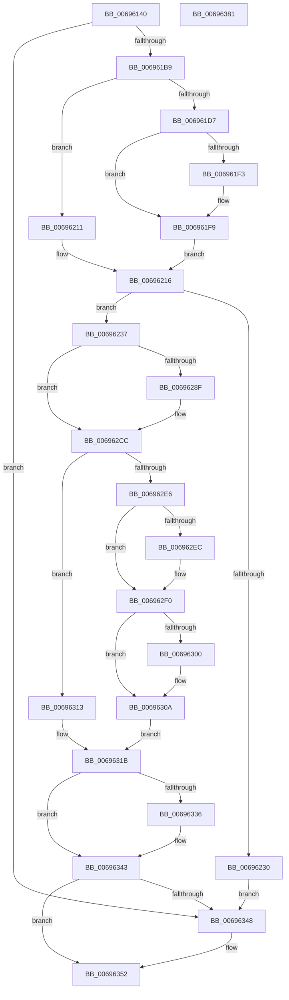

# MiInsertNewZeroThread

- RVA: `0x00696140`–`0x00696382` (길이 `578` bytes)
- VA: `0x0000000140696140`
- 실행 섹션: `.text`
- PDB 이름 있음: `예`; PDB Function 태그: `아니요`
- unwind 정보 RVA: `0x000CB330`
- 디코드: `147`개 명령, `578/578` bytes 표시
- 미해석 바이트: `0` (있으면 어셈블리에 `.byte`로 보존)

> 이 문서는 커널 이미지의 기계어와 PDB 기호를 분석해 생성했습니다. 4번과 5번은 함수 원형과 자료형을 바이너리 사용 방식에서 추정한 C 해석이며 원본 소스 복구 결과는 아닙니다.

## 1. Dependencies

- 직접 호출 지점: **14**; 고유 호출 대상: **12**
- 직접 호출자로 확인된 함수: **1**
- RIP 상대 이미지 참조: **3**

### Outgoing calls
- `0x006961AA` → [MiMakeSpaceForConductorListZeroThread](../../page/81/MiMakeSpaceForConductorListZeroThread_function_008109D4.md) (function, `0x008109D4`)
- `0x006961C7` → [ExAcquireSpinLockExclusive](../24/ExAcquireSpinLockExclusive_function_00248690.md) (function, `0x00248690`)
- `0x0069620A` → [MiIncrementZeroEngineThread](../2C/MiIncrementZeroEngineThread_function_002CBB80.md) (function, `0x002CBB80`)
- `0x00696227` → [MiReleaseSpinLockExclusive](../24/MiReleaseSpinLockExclusive_function_002482C0.md) (function, `0x002482C0`)
- `0x0069623A` → [MiEngineAffinity](../2C/MiEngineAffinity_function_002CCB64.md) (function, `0x002CCB64`)
- `0x00696281` → [PsCreateSystemThreadEx](../../page/9E/PsCreateSystemThreadEx_function_009ED120.md) (function, `0x009ED120`)
- `0x006962B6` → [ObReferenceObjectByHandleWithTag](../../page/86/ObReferenceObjectByHandleWithTag_function_00869610.md) (function, `0x00869610`)
- `0x006962C3` → [ObCloseHandle](../../page/8A/ObCloseHandle_function_008A1870.md) (function, `0x008A1870`)
- `0x006962DA` → [ExAcquireSpinLockExclusive](../24/ExAcquireSpinLockExclusive_function_00248690.md) (function, `0x00248690`)
- `0x00696316` → [MiRemoveThreadFromEngineLists](../2C/MiRemoveThreadFromEngineLists_function_002CAB1C.md) (function, `0x002CAB1C`)
- `0x0069632C` → [MiReleaseSpinLockExclusive](../24/MiReleaseSpinLockExclusive_function_002482C0.md) (function, `0x002482C0`)
- `0x0069633E` → [ObfDereferenceObjectWithTag](../2F/ObfDereferenceObjectWithTag_function_002F78E0.md) (function, `0x002F78E0`)
- `0x0069634D` → [MiDeleteZeroThreadContext](../4D/MiDeleteZeroThreadContext_function_004DF788.md) (function, `0x004DF788`)
- `0x0069635B` → [_security_check_cookie](../6A/_security_check_cookie_function_006AC640.md) (function, `0x006AC640`)

### Direct callers
- [MiStartZeroEngineThreads](../../page/81/MiStartZeroEngineThreads_function_00810CCC.md) at `0x00810D19`

### Static image references
- `0x00696162` → RVA `0x00E0A740` (`.data`; read)
- `0x0069625F` → RVA `0x002CB9B0` (`MiBackgroundZeroNodePages`; read)
- `0x0069628F` → RVA `0x00FC6AC8` (`ALMOSTRO`; read)

## 2. Other-region calls and transfers

- 다른 실행 섹션으로 향하는 call: **4**
  - `0x006961AA` → [MiMakeSpaceForConductorListZeroThread](../../page/81/MiMakeSpaceForConductorListZeroThread_function_008109D4.md) (`.text` → `PAGE`)
  - `0x00696281` → [PsCreateSystemThreadEx](../../page/9E/PsCreateSystemThreadEx_function_009ED120.md) (`.text` → `PAGE`)
  - `0x006962B6` → [ObReferenceObjectByHandleWithTag](../../page/86/ObReferenceObjectByHandleWithTag_function_00869610.md) (`.text` → `PAGE`)
  - `0x006962C3` → [ObCloseHandle](../../page/8A/ObCloseHandle_function_008A1870.md) (`.text` → `PAGE`)
- 별도 외부 분기/꼬리 이동을 확인하지 못했습니다.

## 3. Assembly (complete function range)

```asm
00696140  48 89 5C 24 10                  mov qword ptr [rsp + 0x10], rbx
00696145  48 89 74 24 18                  mov qword ptr [rsp + 0x18], rsi
0069614A  48 89 7C 24 20                  mov qword ptr [rsp + 0x20], rdi
0069614F  55                              push rbp
00696150  41 54                           push r12
00696152  41 55                           push r13
00696154  41 56                           push r14
00696156  41 57                           push r15
00696158  48 8B EC                        mov rbp, rsp
0069615B  48 81 EC 80 00 00 00            sub rsp, 0x80
00696162  48 8B 05 D7 45 77 00            mov rax, qword ptr [rip + 0x7745d7]
00696169  48 33 C4                        xor rax, rsp
0069616C  48 89 45 F8                     mov qword ptr [rbp - 8], rax
00696170  48 83 65 D0 00                  and qword ptr [rbp - 0x30], 0
00696175  48 8D 55 E0                     lea rdx, [rbp - 0x20]
00696179  48 8B B9 50 01 00 00            mov rdi, qword ptr [rcx + 0x150]
00696180  48 8B D9                        mov rbx, rcx
00696183  45 33 F6                        xor r14d, r14d
00696186  4C 21 75 E0                     and qword ptr [rbp - 0x20], r14
0069618A  4C 89 75 D8                     mov qword ptr [rbp - 0x28], r14
0069618E  4C 8B BF B0 00 00 00            mov r15, qword ptr [rdi + 0xb0]
00696195  49 8B 47 30                     mov rax, qword ptr [r15 + 0x30]
00696199  48 8B 88 B8 00 00 00            mov rcx, qword ptr [rax + 0xb8]
006961A0  4C 8B A9 80 00 00 00            mov r13, qword ptr [rcx + 0x80]
006961A7  49 8B CF                        mov rcx, r15
006961AA  E8 25 A8 17 00                  call 0x1408109d4
006961AF  8B F0                           mov esi, eax
006961B1  85 C0                           test eax, eax
006961B3  0F 88 8F 01 00 00               js 0x140696348
006961B9  48 8B 8F D0 00 00 00            mov rcx, qword ptr [rdi + 0xd0]
006961C0  48 81 C1 B0 3B 00 00            add rcx, 0x3bb0
006961C7  E8 C4 24 BB FF                  call 0x140248690
006961CC  8B 4F 04                        mov ecx, dword ptr [rdi + 4]
006961CF  44 8A E0                        mov r12b, al
006961D2  3B 4F 08                        cmp ecx, dword ptr [rdi + 8]
006961D5  73 3A                           jae 0x140696211
006961D7  FF C1                           inc ecx
006961D9  48 8D 97 C0 00 00 00            lea rdx, [rdi + 0xc0]
006961E0  89 4F 04                        mov dword ptr [rdi + 4], ecx
006961E3  48 8D 8B A0 01 00 00            lea rcx, [rbx + 0x1a0]
006961EA  4C 8B 42 08                     mov r8, qword ptr [rdx + 8]
006961EE  49 39 10                        cmp qword ptr [r8], rdx
006961F1  74 06                           je 0x1406961f9
006961F3  41 8D 4E 03                     lea ecx, [r14 + 3]
006961F7  CD 29                           int 0x29
006961F9  48 89 11                        mov qword ptr [rcx], rdx
006961FC  4C 89 41 08                     mov qword ptr [rcx + 8], r8
00696200  49 89 08                        mov qword ptr [r8], rcx
00696203  48 89 4A 08                     mov qword ptr [rdx + 8], rcx
00696207  48 8B CB                        mov rcx, rbx
0069620A  E8 71 59 C3 FF                  call 0x1402cbb80
0069620F  EB 05                           jmp 0x140696216
00696211  BE 2D 01 00 C0                  mov esi, 0xc000012d
00696216  48 8B 8F D0 00 00 00            mov rcx, qword ptr [rdi + 0xd0]
0069621D  41 8A D4                        mov dl, r12b
00696220  48 81 C1 B0 3B 00 00            add rcx, 0x3bb0
00696227  E8 94 20 BB FF                  call 0x1402482c0
0069622C  85 F6                           test esi, esi
0069622E  79 07                           jns 0x140696237
00696230  33 F6                           xor esi, esi
00696232  E9 11 01 00 00                  jmp 0x140696348
00696237  48 8B CF                        mov rcx, rdi
0069623A  E8 25 69 C3 FF                  call 0x1402ccb64
0069623F  4C 21 74 24 40                  and qword ptr [rsp + 0x40], r14
00696244  41 BC FF FF 1F 00               mov r12d, 0x1fffff
0069624A  4D 8B CD                        mov r9, r13
0069624D  45 33 C0                        xor r8d, r8d
00696250  41 8B D4                        mov edx, r12d
00696253  48 8B 08                        mov rcx, qword ptr [rax]
00696256  48 8D 45 E8                     lea rax, [rbp - 0x18]
0069625A  48 89 44 24 38                  mov qword ptr [rsp + 0x38], rax
0069625F  48 8D 05 4A 57 C3 FF            lea rax, [rip - 0x3ca8b6]
00696266  48 89 5C 24 30                  mov qword ptr [rsp + 0x30], rbx
0069626B  48 89 44 24 28                  mov qword ptr [rsp + 0x28], rax
00696270  0F 10 01                        movups xmm0, xmmword ptr [rcx]
00696273  4C 21 74 24 20                  and qword ptr [rsp + 0x20], r14
00696278  48 8D 4D D0                     lea rcx, [rbp - 0x30]
0069627C  F3 0F 7F 45 E8                  movdqu xmmword ptr [rbp - 0x18], xmm0
00696281  E8 9A 6E 35 00                  call 0x1409ed120
00696286  45 33 ED                        xor r13d, r13d
00696289  8B F0                           mov esi, eax
0069628B  85 C0                           test eax, eax
0069628D  78 3D                           js 0x1406962cc
0069628F  4C 8B 05 32 08 93 00            mov r8, qword ptr [rip + 0x930832]
00696296  48 8D 45 D8                     lea rax, [rbp - 0x28]
0069629A  48 8B 4D D0                     mov rcx, qword ptr [rbp - 0x30]
0069629E  45 33 C9                        xor r9d, r9d
006962A1  4C 89 6C 24 30                  mov qword ptr [rsp + 0x30], r13
006962A6  41 8B D4                        mov edx, r12d
006962A9  48 89 44 24 28                  mov qword ptr [rsp + 0x28], rax
006962AE  C7 44 24 20 4D 6D 5A 65         mov dword ptr [rsp + 0x20], 0x655a6d4d
006962B6  E8 55 33 1D 00                  call 0x140869610
006962BB  48 8B 4D D0                     mov rcx, qword ptr [rbp - 0x30]
006962BF  33 D2                           xor edx, edx
006962C1  8B F0                           mov esi, eax
006962C3  E8 A8 B5 20 00                  call 0x1408a1870
006962C8  4C 8B 75 D8                     mov r14, qword ptr [rbp - 0x28]
006962CC  48 8B 8F D0 00 00 00            mov rcx, qword ptr [rdi + 0xd0]
006962D3  48 81 C1 B0 3B 00 00            add rcx, 0x3bb0
006962DA  E8 B1 23 BB FF                  call 0x140248690
006962DF  44 8A E0                        mov r12b, al
006962E2  85 F6                           test esi, esi
006962E4  78 2D                           js 0x140696313
006962E6  44 38 6F 1F                     cmp byte ptr [rdi + 0x1f], r13b
006962EA  75 04                           jne 0x1406962f0
006962EC  C6 47 1F 01                     mov byte ptr [rdi + 0x1f], 1
006962F0  48 8B 4D E0                     mov rcx, qword ptr [rbp - 0x20]
006962F4  4C 89 31                        mov qword ptr [rcx], r14
006962F7  4C 39 AB 48 01 00 00            cmp qword ptr [rbx + 0x148], r13
006962FE  75 0A                           jne 0x14069630a
00696300  4C 89 B3 48 01 00 00            mov qword ptr [rbx + 0x148], r14
00696307  4D 8B F5                        mov r14, r13
0069630A  41 FF 47 3C                     inc dword ptr [r15 + 0x3c]
0069630E  49 8B DD                        mov rbx, r13
00696311  EB 08                           jmp 0x14069631b
00696313  48 8B CB                        mov rcx, rbx
00696316  E8 01 48 C3 FF                  call 0x1402cab1c
0069631B  48 8B 8F D0 00 00 00            mov rcx, qword ptr [rdi + 0xd0]
00696322  41 8A D4                        mov dl, r12b
00696325  48 81 C1 B0 3B 00 00            add rcx, 0x3bb0
0069632C  E8 8F 1F BB FF                  call 0x1402482c0
00696331  4D 85 F6                        test r14, r14
00696334  74 0D                           je 0x140696343
00696336  BA 4D 6D 5A 65                  mov edx, 0x655a6d4d
0069633B  49 8B CE                        mov rcx, r14
0069633E  E8 9D 15 C6 FF                  call 0x1402f78e0
00696343  48 85 DB                        test rbx, rbx
00696346  74 0A                           je 0x140696352
00696348  33 D2                           xor edx, edx
0069634A  48 8B CB                        mov rcx, rbx
0069634D  E8 36 94 E4 FF                  call 0x1404df788
00696352  8B C6                           mov eax, esi
00696354  48 8B 4D F8                     mov rcx, qword ptr [rbp - 8]
00696358  48 33 CC                        xor rcx, rsp
0069635B  E8 E0 62 01 00                  call 0x1406ac640
00696360  4C 8D 9C 24 80 00 00 00         lea r11, [rsp + 0x80]
00696368  49 8B 5B 38                     mov rbx, qword ptr [r11 + 0x38]
0069636C  49 8B 73 40                     mov rsi, qword ptr [r11 + 0x40]
00696370  49 8B 7B 48                     mov rdi, qword ptr [r11 + 0x48]
00696374  49 8B E3                        mov rsp, r11
00696377  41 5F                           pop r15
00696379  41 5E                           pop r14
0069637B  41 5D                           pop r13
0069637D  41 5C                           pop r12
0069637F  5D                              pop rbp
00696380  C3                              ret
00696381  CC                              int3
```

## 4. C-style interpretation (structured pseudocode)

```c
__int64 __fastcall MiInsertNewZeroThread(__int64 a1)
{
    __int64 result;
    __int64 v_r13;
    __int64 v_r14;
    __int64 v_rsi;
    __int64 v_rsp;
    unsigned __int64 v_stack_m28;
    unsigned __int64 v_stack_m30;
    unsigned __int64 v_stack_m40;
    unsigned __int64 v_stack_m48;
    unsigned __int64 v_stack_m50;
    unsigned __int64 v_stack_m58;
    unsigned __int64 v_stack_m68;
    unsigned __int64 v_stack_m70;
    unsigned __int64 v_stack_m78;
    unsigned __int64 v_stack_m80;
    unsigned __int64 v_stack_m88;
    unsigned __int64 v_stack_p10;
    unsigned __int64 v_stack_p18;
    unsigned __int64 v_stack_p20;

    v_stack_p10 = v_rbx;
    v_stack_p18 = v_rsi;
    v_stack_p20 = v_rdi;
    v_rsp = (v_rsp) - (128);
    result = (*(unsigned __int64 *)(v_rip + 7816663)) ^ (v_rsp);
    v_stack_m30 = result;
    v_r14 = 0;
    v_stack_m50 = 0;
    result = MiMakeSpaceForConductorListZeroThread(*(unsigned __int64 *)(*(unsigned __int64 *)(a1 + 336) + 176), v_stack_m48, a3, a4);
    if (sign_flag) goto loc_00696348;
    a1 = (*(unsigned __int64 *)(*(unsigned __int64 *)(a1 + 336) + 208)) + (0x3BB0ULL);
    result = ExAcquireSpinLockExclusive(a1, v_stack_m48, a3, a4);
    if (((unsigned int)((unsigned int)(*(unsigned int *)(*(unsigned __int64 *)(a1 + 336) + 4)))) >= (*(unsigned int *)(*(unsigned __int64 *)(a1 + 336) + 8))) goto loc_00696211;
    a1 = (unsigned int)(((unsigned int)(*(unsigned int *)(*(unsigned __int64 *)(a1 + 336) + 4))) + 1);
    *(unsigned int *)(*(unsigned __int64 *)(a1 + 336) + 4) = (unsigned int)(a1);
    if ((*(unsigned __int64 *)(*(unsigned __int64 *)(*(unsigned __int64 *)(a1 + 336) + 192 + 8))) != (*(unsigned __int64 *)(a1 + 336) + 192)) {
        a1 = v_r14 + 3;
    }
    *(unsigned __int64 *)(a1) = *(unsigned __int64 *)(a1 + 336) + 192;
    *(unsigned __int64 *)(a1 + 8) = *(unsigned __int64 *)(*(unsigned __int64 *)(a1 + 336) + 192 + 8);
    *(unsigned __int64 *)(*(unsigned __int64 *)(*(unsigned __int64 *)(a1 + 336) + 192 + 8)) = a1;
    *(unsigned __int64 *)(*(unsigned __int64 *)(a1 + 336) + 192 + 8) = a1;
    result = MiIncrementZeroEngineThread(a1, *(unsigned __int64 *)(a1 + 336) + 192, *(unsigned __int64 *)(*(unsigned __int64 *)(a1 + 336) + 192 + 8), a4);
    goto loc_00696216;
loc_00696211:
loc_00696216:
    a1 = (*(unsigned __int64 *)(*(unsigned __int64 *)(a1 + 336) + 208)) + (0x3BB0ULL);
    result = MiReleaseSpinLockExclusive(a1, (unsigned __int8)((unsigned __int8)(result)), *(unsigned __int64 *)(*(unsigned __int64 *)(a1 + 336) + 192 + 8), a4);
    if (!sign_flag) goto loc_00696237;
    v_rsi = 0;
    goto loc_00696348;
loc_00696237:
    result = MiEngineAffinity(*(unsigned __int64 *)(a1 + 336), (unsigned __int8)((unsigned __int8)(result)), *(unsigned __int64 *)(*(unsigned __int64 *)(a1 + 336) + 192 + 8), a4);
    a3 = 0;
    v_stack_m70 = v_stack_m40;
    v_stack_m78 = a1;
    v_stack_m80 = v_rip - 3975350;
    v_stack_m40 = v_xmm0;
    result = PsCreateSystemThreadEx(v_stack_m58, (unsigned int)((unsigned int)((unsigned int)(0x1FFFFFULL))), a3, *(unsigned __int64 *)(*(unsigned __int64 *)(*(unsigned __int64 *)(*(unsigned __int64 *)(*(unsigned __int64 *)(a1 + 336) + 176) + 48) + 184) + 128));
    v_r13 = 0;
    v_rsi = (unsigned int)((unsigned int)(result));
    if (!(sign_flag)) {
        a3 = *(unsigned __int64 *)(v_rip + 9635890);
        result = v_stack_m50;
        a1 = v_stack_m58;
        a4 = 0;
        v_stack_m78 = 0;
        a2 = (unsigned int)((unsigned int)(0x1FFFFFULL));
        v_stack_m80 = result;
        v_stack_m88 = 0x655A6D4DULL;
        result = ObReferenceObjectByHandleWithTag(a1, a2, a3, a4);
        a1 = v_stack_m58;
        a2 = 0;
        v_rsi = (unsigned int)(result);
        result = ObCloseHandle(a1, a2, a3, a4);
        v_r14 = v_stack_m50;
    }
    a1 = (*(unsigned __int64 *)(*(unsigned __int64 *)(a1 + 336) + 208)) + (0x3BB0ULL);
    result = ExAcquireSpinLockExclusive(a1, a2, a3, a4);
    if (sign_flag) goto loc_00696313;
    if ((*(unsigned __int8 *)(*(unsigned __int64 *)(a1 + 336) + 31)) == 0) {
        *(unsigned __int8 *)(*(unsigned __int64 *)(a1 + 336) + 31) = 1;
    }
    *(unsigned __int64 *)(v_stack_m48) = v_r14;
    if ((*(unsigned __int64 *)(a1 + 328)) == 0) {
        *(unsigned __int64 *)(a1 + 328) = v_r14;
        v_r14 = 0;
    }
    goto loc_0069631B;
loc_00696313:
    result = MiRemoveThreadFromEngineLists(0, a2, a3, a4);
loc_0069631B:
    a1 = (*(unsigned __int64 *)(*(unsigned __int64 *)(a1 + 336) + 208)) + (0x3BB0ULL);
    result = MiReleaseSpinLockExclusive(a1, (unsigned __int8)((unsigned __int8)(result)), a3, a4);
    if (v_r14 != 0) {
        a2 = 0x655A6D4DULL;
        a1 = v_r14;
        result = ObfDereferenceObjectWithTag(a1, a2, a3, a4);
    }
    if (0 != 0) {
        a2 = 0;
        a1 = 0;
        result = MiDeleteZeroThreadContext(a1, a2, a3, a4);
    }
    a1 = (v_stack_m30) ^ (v_rsp);
    result = _security_check_cookie(a1, a2, a3, a4);
    return result;
}
```

## 5. (Beta) C Style

```c
int64_t MiInsertNewZeroThread(void *Arg1)
{
    uint8_t *arg1 = (uint8_t *)Arg1;

    int64_t result;
    int64_t local_r13;
    int64_t local_r14;
    int64_t local_rsi;
    int64_t local_rsp;
    uint64_t v_stack_m28;
    uint64_t v_stack_m30;
    uint64_t v_stack_m40;
    uint64_t v_stack_m48;
    uint64_t v_stack_m50;
    uint64_t v_stack_m58;
    uint64_t v_stack_m68;
    uint64_t v_stack_m70;
    uint64_t v_stack_m78;
    uint64_t v_stack_m80;
    uint64_t v_stack_m88;
    uint64_t v_stack_p10;
    uint64_t v_stack_p18;
    uint64_t v_stack_p20;

    v_stack_p10 = local_rbx;
    v_stack_p18 = local_rsi;
    v_stack_p20 = local_rdi;
    local_rsp = (local_rsp) - (128);
    result = (*(uint64_t *)(v_rip + 0x7745D7)) ^ (local_rsp);
    v_stack_m30 = result;
    local_r14 = 0;
    v_stack_m50 = 0;
    result = MiMakeSpaceForConductorListZeroThread(*(uint64_t *)(*(uint64_t *)(arg1 + 0x150) + 0xB0), v_stack_m48, a3, a4);
    if (sign_flag) goto loc_00696348;
    Arg1 = (*(uint64_t *)(*(uint64_t *)(arg1 + 0x150) + 0xD0)) + (0x3BB0ULL);
    result = ExAcquireSpinLockExclusive(Arg1, v_stack_m48, a3, a4);
    if (((uint32_t)((uint32_t)(*(uint32_t *)(*(uint64_t *)(arg1 + 0x150) + 0x4)))) >= (*(uint32_t *)(*(uint64_t *)(arg1 + 0x150) + 0x8))) goto loc_00696211;
    Arg1 = (uint32_t)(((uint32_t)(*(uint32_t *)(*(uint64_t *)(arg1 + 0x150) + 0x4))) + 1);
    *(uint32_t *)(*(uint64_t *)(arg1 + 0x150) + 0x4) = (uint32_t)(Arg1);
    if ((*(uint64_t *)(*(uint64_t *)(*(uint64_t *)(arg1 + 0x150) + 0xC0 + 0x8))) != (*(uint64_t *)(arg1 + 0x150) + 192)) {
        Arg1 = local_r14 + 3;
    }
    *(uint64_t *)(arg1) = *(uint64_t *)(arg1 + 0x150) + 192;
    *(uint64_t *)(arg1 + 0x8) = *(uint64_t *)(*(uint64_t *)(arg1 + 0x150) + 0xC0 + 0x8);
    *(void **)(*(uint64_t *)(*(uint64_t *)(arg1 + 0x150) + 0xC0 + 0x8)) = Arg1;
    *(void **)(*(uint64_t *)(arg1 + 0x150) + 0xC0 + 0x8) = Arg1;
    result = MiIncrementZeroEngineThread(Arg1, *(uint64_t *)(arg1 + 0x150) + 192, *(uint64_t *)(*(uint64_t *)(arg1 + 0x150) + 0xC0 + 0x8), a4);
    goto loc_00696216;
loc_00696211:
loc_00696216:
    Arg1 = (*(uint64_t *)(*(uint64_t *)(arg1 + 0x150) + 0xD0)) + (0x3BB0ULL);
    result = MiReleaseSpinLockExclusive(Arg1, (uint8_t)((uint8_t)(result)), *(uint64_t *)(*(uint64_t *)(arg1 + 0x150) + 0xC0 + 0x8), a4);
    if (!sign_flag) goto loc_00696237;
    local_rsi = 0;
    goto loc_00696348;
loc_00696237:
    result = MiEngineAffinity(*(uint64_t *)(arg1 + 0x150), (uint8_t)((uint8_t)(result)), *(uint64_t *)(*(uint64_t *)(arg1 + 0x150) + 0xC0 + 0x8), a4);
    a3 = 0;
    v_stack_m70 = v_stack_m40;
    v_stack_m78 = Arg1;
    v_stack_m80 = v_rip - 3975350;
    v_stack_m40 = v_xmm0;
    result = PsCreateSystemThreadEx(v_stack_m58, (uint32_t)((uint32_t)((uint32_t)(0x1FFFFFULL))), a3, *(uint64_t *)(*(uint64_t *)(*(uint64_t *)(*(uint64_t *)(*(uint64_t *)(arg1 + 0x150) + 0xB0) + 0x30) + 0xB8) + 0x80));
    local_r13 = 0;
    local_rsi = (uint32_t)((uint32_t)(result));
    if (!(sign_flag)) {
        a3 = *(uint64_t *)(v_rip + 0x930832);
        result = v_stack_m50;
        Arg1 = v_stack_m58;
        a4 = 0;
        v_stack_m78 = 0;
        a2 = (uint32_t)((uint32_t)(0x1FFFFFULL));
        v_stack_m80 = result;
        v_stack_m88 = 0x655A6D4DULL;
        result = ObReferenceObjectByHandleWithTag(Arg1, a2, a3, a4);
        Arg1 = v_stack_m58;
        a2 = 0;
        local_rsi = (uint32_t)(result);
        result = ObCloseHandle(Arg1, a2, a3, a4);
        local_r14 = v_stack_m50;
    }
    Arg1 = (*(uint64_t *)(*(uint64_t *)(arg1 + 0x150) + 0xD0)) + (0x3BB0ULL);
    result = ExAcquireSpinLockExclusive(Arg1, a2, a3, a4);
    if (sign_flag) goto loc_00696313;
    if ((*(uint8_t *)(*(uint64_t *)(arg1 + 0x150) + 0x1F)) == 0) {
        *(uint8_t *)(*(uint64_t *)(arg1 + 0x150) + 0x1F) = 1;
    }
    *(uint64_t *)(v_stack_m48) = local_r14;
    if ((*(uint64_t *)(arg1 + 0x148)) == 0) {
        *(uint64_t *)(arg1 + 0x148) = local_r14;
        local_r14 = 0;
    }
    goto loc_0069631B;
loc_00696313:
    result = MiRemoveThreadFromEngineLists(0, a2, a3, a4);
loc_0069631B:
    Arg1 = (*(uint64_t *)(*(uint64_t *)(arg1 + 0x150) + 0xD0)) + (0x3BB0ULL);
    result = MiReleaseSpinLockExclusive(Arg1, (uint8_t)((uint8_t)(result)), a3, a4);
    if (local_r14 != 0) {
        a2 = 0x655A6D4DULL;
        Arg1 = local_r14;
        result = ObfDereferenceObjectWithTag(Arg1, a2, a3, a4);
    }
    if (0 != 0) {
        a2 = 0;
        Arg1 = 0;
        result = MiDeleteZeroThreadContext(Arg1, a2, a3, a4);
    }
    Arg1 = (v_stack_m30) ^ (local_rsp);
    result = _security_check_cookie(Arg1, a2, a3, a4);
    return result;
}
```

### 관측된 메모리 오프셋

구조체 형식이 확인되지 않은 접근은 인자 기준의 오프셋으로만 기록했습니다.

| 기준 인자 | 오프셋 표현 | 폭 (bit) | 접근 |
|---|---:|---:|---|
| `Arg1` | `+ 0x148` | `64` | `R` |
| `Arg1` | `+ 0x148` | `64` | `W` |
| `Arg1` | `+ 0x150` | `64` | `R` |
| `Arg1` | `+ 0x1A0` | `64` | `R` |

## 6. Execution-region graph

[열기: 2D/3D 그래프와 함수 탐색 컨트롤 패널](../../../control-panel.html?section=text&rva=0x00696140&view=graph)

- 2D 그래프는 위에서 아래로 흐르고, 3D 그래프는 빈 공간을 드래그해 회전합니다. Shift+드래그는 이동, 휠은 확대·축소, 함수 노드 선택은 대상 보고서 이동입니다.

### Static fallback


