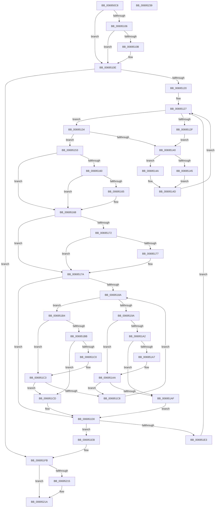

# MiInsertPageFileMemoryExtents

- RVA: `0x006950C8`–`0x0069523A` (길이 `370` bytes)
- VA: `0x00000001406950C8`
- 실행 섹션: `.text`
- PDB 이름 있음: `예`; PDB Function 태그: `아니요`
- unwind 정보 RVA: `0x00068D9C`
- 디코드: `119`개 명령, `370/370` bytes 표시
- 미해석 바이트: `0` (있으면 어셈블리에 `.byte`로 보존)

> 이 문서는 커널 이미지의 기계어와 PDB 기호를 분석해 생성했습니다. 4번과 5번은 함수 원형과 자료형을 바이너리 사용 방식에서 추정한 C 해석이며 원본 소스 복구 결과는 아닙니다.

## 1. Dependencies

- 직접 호출 지점: **4**; 고유 호출 대상: **4**
- 직접 호출자로 확인된 함수: **1**
- RIP 상대 이미지 참조: **0**

### Outgoing calls
- `0x006950F1` → [ExAcquireSpinLockExclusive](../24/ExAcquireSpinLockExclusive_function_00248690.md) (function, `0x00248690`)
- `0x00695191` → [MiComparePageFileMemoryExtents](MiComparePageFileMemoryExtents_function_00694BE8.md) (function, `0x00694BE8`)
- `0x006951D9` → [RtlRbInsertNodeEx](../2E/RtlRbInsertNodeEx_function_002E4570.md) (function, `0x002E4570`)
- `0x0069521F` → [MiReleaseSpinLockExclusive](../24/MiReleaseSpinLockExclusive_function_002482C0.md) (function, `0x002482C0`)

### Direct callers
- [MiCreatePagefileMemoryExtents](../../page/80/MiCreatePagefileMemoryExtents_function_0080F1BC.md) at `0x0080F38A`

### Static image references
- 디코드된 RIP-relative 메모리 참조가 없습니다.

## 2. Other-region calls and transfers

- 다른 실행 섹션으로 향하는 call: **0**
- 별도 외부 분기/꼬리 이동을 확인하지 못했습니다.

## 3. Assembly (complete function range)

```asm
006950C8  48 89 5C 24 18                  mov qword ptr [rsp + 0x18], rbx
006950CD  48 89 4C 24 08                  mov qword ptr [rsp + 8], rcx
006950D2  55                              push rbp
006950D3  56                              push rsi
006950D4  57                              push rdi
006950D5  41 54                           push r12
006950D7  41 55                           push r13
006950D9  41 56                           push r14
006950DB  41 57                           push r15
006950DD  48 83 EC 20                     sub rsp, 0x20
006950E1  48 8D B9 C8 00 00 00            lea rdi, [rcx + 0xc8]
006950E8  48 8B F1                        mov rsi, rcx
006950EB  48 8B CF                        mov rcx, rdi
006950EE  4C 8B F2                        mov r14, rdx
006950F1  E8 9A 35 BB FF                  call 0x140248690
006950F6  41 F6 46 08 01                  test byte ptr [r14 + 8], 1
006950FB  8A C8                           mov cl, al
006950FD  49 8B 1E                        mov rbx, qword ptr [r14]
00695100  88 44 24 68                     mov byte ptr [rsp + 0x68], al
00695104  74 08                           je 0x14069510e
00695106  48 85 DB                        test rbx, rbx
00695109  74 03                           je 0x14069510e
0069510B  49 33 DE                        xor rbx, r14
0069510E  45 0F B6 66 08                  movzx r12d, byte ptr [r14 + 8]
00695113  41 83 E4 01                     and r12d, 1
00695117  48 85 DB                        test rbx, rbx
0069511A  0F 84 DB 00 00 00               je 0x1406951fb
00695120  4C 8D BE E0 00 00 00            lea r15, [rsi + 0xe0]
00695127  48 8B 03                        mov rax, qword ptr [rbx]
0069512A  48 85 C0                        test rax, rax
0069512D  74 05                           je 0x140695134
0069512F  48 8B CB                        mov rcx, rbx
00695132  EB 0C                           jmp 0x140695140
00695134  48 8D 4B 08                     lea rcx, [rbx + 8]
00695138  48 8B 01                        mov rax, qword ptr [rcx]
0069513B  48 85 C0                        test rax, rax
0069513E  74 13                           je 0x140695153
00695140  45 85 E4                        test r12d, r12d
00695143  74 05                           je 0x14069514a
00695145  48 33 D8                        xor rbx, rax
00695148  EB 03                           jmp 0x14069514d
0069514A  48 8B D8                        mov rbx, rax
0069514D  48 83 21 00                     and qword ptr [rcx], 0
00695151  EB D4                           jmp 0x140695127
00695153  48 8B 73 10                     mov rsi, qword ptr [rbx + 0x10]
00695157  48 83 E6 FC                     and rsi, 0xfffffffffffffffc
0069515B  45 85 E4                        test r12d, r12d
0069515E  74 08                           je 0x140695168
00695160  48 85 F6                        test rsi, rsi
00695163  74 03                           je 0x140695168
00695165  48 33 F3                        xor rsi, rbx
00695168  41 F6 47 08 01                  test byte ptr [r15 + 8], 1
0069516D  49 8B 3F                        mov rdi, qword ptr [r15]
00695170  74 08                           je 0x14069517a
00695172  48 85 FF                        test rdi, rdi
00695175  74 03                           je 0x14069517a
00695177  49 33 FF                        xor rdi, r15
0069517A  41 0F B6 6F 08                  movzx ebp, byte ptr [r15 + 8]
0069517F  45 32 C0                        xor r8b, r8b
00695182  83 E5 01                        and ebp, 1
00695185  48 85 FF                        test rdi, rdi
00695188  74 46                           je 0x1406951d0
0069518A  48 8B D7                        mov rdx, rdi
0069518D  48 8D 4B 18                     lea rcx, [rbx + 0x18]
00695191  E8 52 FA FF FF                  call 0x140694be8
00695196  85 C0                           test eax, eax
00695198  78 1A                           js 0x1406951b4
0069519A  48 8B 47 08                     mov rax, qword ptr [rdi + 8]
0069519E  85 ED                           test ebp, ebp
006951A0  74 08                           je 0x1406951aa
006951A2  48 85 C0                        test rax, rax
006951A5  74 08                           je 0x1406951af
006951A7  48 33 C7                        xor rax, rdi
006951AA  48 85 C0                        test rax, rax
006951AD  75 19                           jne 0x1406951c8
006951AF  41 B0 01                        mov r8b, 1
006951B2  EB 1C                           jmp 0x1406951d0
006951B4  48 8B 07                        mov rax, qword ptr [rdi]
006951B7  85 ED                           test ebp, ebp
006951B9  74 08                           je 0x1406951c3
006951BB  48 85 C0                        test rax, rax
006951BE  74 0D                           je 0x1406951cd
006951C0  48 33 C7                        xor rax, rdi
006951C3  48 85 C0                        test rax, rax
006951C6  74 05                           je 0x1406951cd
006951C8  48 8B F8                        mov rdi, rax
006951CB  EB BD                           jmp 0x14069518a
006951CD  45 32 C0                        xor r8b, r8b
006951D0  4C 8B CB                        mov r9, rbx
006951D3  48 8B D7                        mov rdx, rdi
006951D6  49 8B CF                        mov rcx, r15
006951D9  E8 92 F3 C4 FF                  call 0x1402e4570
006951DE  48 85 F6                        test rsi, rsi
006951E1  74 08                           je 0x1406951eb
006951E3  48 8B DE                        mov rbx, rsi
006951E6  E9 3C FF FF FF                  jmp 0x140695127
006951EB  48 8B 7C 24 60                  mov rdi, qword ptr [rsp + 0x60]
006951F0  8A 4C 24 68                     mov cl, byte ptr [rsp + 0x68]
006951F4  48 81 C7 C8 00 00 00            add rdi, 0xc8
006951FB  41 0F B6 46 08                  movzx eax, byte ptr [r14 + 8]
00695200  49 C7 06 00 00 00 00            mov qword ptr [r14], 0
00695207  49 C7 46 08 00 00 00 00         mov qword ptr [r14 + 8], 0
0069520F  0F BA E0 00                     bt eax, 0
00695213  73 05                           jae 0x14069521a
00695215  41 C6 46 08 01                  mov byte ptr [r14 + 8], 1
0069521A  8A D1                           mov dl, cl
0069521C  48 8B CF                        mov rcx, rdi
0069521F  E8 9C 30 BB FF                  call 0x1402482c0
00695224  48 8B 5C 24 70                  mov rbx, qword ptr [rsp + 0x70]
00695229  48 83 C4 20                     add rsp, 0x20
0069522D  41 5F                           pop r15
0069522F  41 5E                           pop r14
00695231  41 5D                           pop r13
00695233  41 5C                           pop r12
00695235  5F                              pop rdi
00695236  5E                              pop rsi
00695237  5D                              pop rbp
00695238  C3                              ret
00695239  CC                              int3
```

## 4. C-style interpretation (structured pseudocode)

```c
__int64 __fastcall MiInsertPageFileMemoryExtents(__int64 a1, __int64 a2, unsigned __int8 a3)
{
    __int64 result;
    __int64 v_r12;
    __int64 v_rbp;
    __int64 v_rbx;
    __int64 v_rdi;
    __int64 v_rsi;
    __int64 v_rsp;
    unsigned __int8 v_stack_p10;
    unsigned __int64 v_stack_p18;
    unsigned __int64 v_stack_p8;

    v_stack_p18 = v_rbx;
    v_stack_p8 = a1;
    v_rsp = (v_rsp) - (32);
    result = ExAcquireSpinLockExclusive(a1 + 200, a2, a3, a4);
    v_stack_p10 = (unsigned __int8)(result);
    if (((*(unsigned __int8 *)(a2 + 8)) & (1)) == 0) goto loc_0069510E;
    v_rbx = *(unsigned __int64 *)(a2);
    if (*(unsigned __int64 *)(a2) != 0) {
        v_rbx = (*(unsigned __int64 *)(a2)) ^ (a2);
    }
    v_r12 = (unsigned int)((*(unsigned __int8 *)(a2 + 8)) & (1));
    if (v_rbx == 0) goto loc_006951FB;
loc_00695127:
    if (*(unsigned __int64 *)(v_rbx) == 0) goto loc_00695134;
    goto loc_00695140;
loc_00695134:
    if (*(unsigned __int64 *)(v_rbx + 8) == 0) goto loc_00695153;
loc_00695140:
    if ((unsigned int)(v_r12) == 0) goto loc_0069514A;
    v_rbx = (v_rbx) ^ (*(unsigned __int64 *)(v_rbx + 8));
    goto loc_0069514D;
loc_0069514A:
loc_0069514D:
    goto loc_00695127;
loc_00695153:
    v_rsi = (*(unsigned __int64 *)(*(unsigned __int64 *)(v_rbx + 8) + 16)) & (-4);
    if ((unsigned int)(v_r12) == 0) goto loc_00695168;
    if (v_rsi != 0) {
        v_rsi = (v_rsi) ^ (*(unsigned __int64 *)(v_rbx + 8));
    }
    if (((*(unsigned __int8 *)(a1 + 224 + 8)) & (1)) == 0) goto loc_0069517A;
    v_rdi = *(unsigned __int64 *)(a1 + 224);
    if (*(unsigned __int64 *)(a1 + 224) != 0) {
        v_rdi = (*(unsigned __int64 *)(a1 + 224)) ^ (a1 + 224);
    }
    a3 = 0;
    v_rbp = (unsigned int)((*(unsigned __int8 *)(a1 + 224 + 8)) & (1));
    if (v_rdi == 0) goto loc_006951D0;
loc_0069518A:
    result = MiComparePageFileMemoryExtents(*(unsigned __int64 *)(v_rbx + 8) + 24, v_rdi, a3, a4);
    if (sign_flag) goto loc_006951B4;
    if ((unsigned int)(v_rbp) == 0) goto loc_006951AA;
    if (*(unsigned __int64 *)(v_rdi + 8) == 0) goto loc_006951AF;
    result = (*(unsigned __int64 *)(v_rdi + 8)) ^ (v_rdi);
loc_006951AA:
    if (result != 0) goto loc_006951C8;
loc_006951AF:
    goto loc_006951D0;
loc_006951B4:
    if ((unsigned int)(v_rbp) == 0) goto loc_006951C3;
    if (*(unsigned __int64 *)(v_rdi) == 0) goto loc_006951CD;
    result = (*(unsigned __int64 *)(v_rdi)) ^ (v_rdi);
loc_006951C3:
    if (result == 0) goto loc_006951CD;
loc_006951C8:
    goto loc_0069518A;
loc_006951CD:
    a3 = 0;
loc_006951D0:
    result = RtlRbInsertNodeEx(a1 + 224, result, a3, *(unsigned __int64 *)(v_rbx + 8));
    if (v_rsi == 0) goto loc_006951EB;
    goto loc_00695127;
loc_006951EB:
    v_rdi = (v_stack_p8) + (200);
loc_006951FB:
    *(unsigned __int64 *)(a2) = 0;
    *(unsigned __int64 *)(a2 + 8) = 0;
    if (!(condition_is_above_or_equal)) {
        *(unsigned __int8 *)(a2 + 8) = 1;
    }
    result = MiReleaseSpinLockExclusive(v_rdi, (unsigned __int8)(v_stack_p10), a3, *(unsigned __int64 *)(v_rbx + 8));
    v_rsp = (v_rsp) + (32);
    return result;
}
```

## 5. (Beta) C Style

```c
int64_t MiInsertPageFileMemoryExtents(void *Arg1, void *Arg2, uint8_t Arg3)
{
    uint8_t *arg1 = (uint8_t *)Arg1;
    uint8_t *arg2 = (uint8_t *)Arg2;

    int64_t result;
    int64_t local_r12;
    int64_t local_rbp;
    int64_t local_rbx;
    int64_t local_rdi;
    int64_t local_rsi;
    int64_t local_rsp;
    uint8_t v_stack_p10;
    uint64_t v_stack_p18;
    uint64_t v_stack_p8;

    v_stack_p18 = local_rbx;
    v_stack_p8 = Arg1;
    local_rsp = (local_rsp) - (32);
    result = ExAcquireSpinLockExclusive(Arg1 + 200, Arg2, Arg3, a4);
    v_stack_p10 = (uint8_t)(result);
    if (((*(uint8_t *)(arg2 + 0x8)) & (1)) == 0) goto loc_0069510E;
    local_rbx = *(uint64_t *)(arg2);
    if (*(uint64_t *)(arg2) != 0) {
        local_rbx = (*(uint64_t *)(arg2)) ^ (Arg2);
    }
    local_r12 = (uint32_t)((*(uint8_t *)(arg2 + 0x8)) & (1));
    if (local_rbx == 0) goto loc_006951FB;
loc_00695127:
    if (*(uint64_t *)(local_rbx) == 0) goto loc_00695134;
    goto loc_00695140;
loc_00695134:
    if (*(uint64_t *)(local_rbx + 0x8) == 0) goto loc_00695153;
loc_00695140:
    if ((uint32_t)(local_r12) == 0) goto loc_0069514A;
    local_rbx = (local_rbx) ^ (*(uint64_t *)(local_rbx + 0x8));
    goto loc_0069514D;
loc_0069514A:
loc_0069514D:
    goto loc_00695127;
loc_00695153:
    local_rsi = (*(uint64_t *)(*(uint64_t *)(local_rbx + 0x8) + 0x10)) & (-4);
    if ((uint32_t)(local_r12) == 0) goto loc_00695168;
    if (local_rsi != 0) {
        local_rsi = (local_rsi) ^ (*(uint64_t *)(local_rbx + 0x8));
    }
    if (((*(uint8_t *)(arg1 + 0xE0 + 0x8)) & (1)) == 0) goto loc_0069517A;
    local_rdi = *(uint64_t *)(arg1 + 0xE0);
    if (*(uint64_t *)(arg1 + 0xE0) != 0) {
        local_rdi = (*(uint64_t *)(arg1 + 0xE0)) ^ (Arg1 + 224);
    }
    Arg3 = 0;
    local_rbp = (uint32_t)((*(uint8_t *)(arg1 + 0xE0 + 0x8)) & (1));
    if (local_rdi == 0) goto loc_006951D0;
loc_0069518A:
    result = MiComparePageFileMemoryExtents(*(uint64_t *)(local_rbx + 0x8) + 24, local_rdi, Arg3, a4);
    if (sign_flag) goto loc_006951B4;
    if ((uint32_t)(local_rbp) == 0) goto loc_006951AA;
    if (*(uint64_t *)(local_rdi + 0x8) == 0) goto loc_006951AF;
    result = (*(uint64_t *)(local_rdi + 0x8)) ^ (local_rdi);
loc_006951AA:
    if (result != 0) goto loc_006951C8;
loc_006951AF:
    goto loc_006951D0;
loc_006951B4:
    if ((uint32_t)(local_rbp) == 0) goto loc_006951C3;
    if (*(uint64_t *)(local_rdi) == 0) goto loc_006951CD;
    result = (*(uint64_t *)(local_rdi)) ^ (local_rdi);
loc_006951C3:
    if (result == 0) goto loc_006951CD;
loc_006951C8:
    goto loc_0069518A;
loc_006951CD:
    Arg3 = 0;
loc_006951D0:
    result = RtlRbInsertNodeEx(Arg1 + 224, result, Arg3, *(uint64_t *)(local_rbx + 0x8));
    if (local_rsi == 0) goto loc_006951EB;
    goto loc_00695127;
loc_006951EB:
    local_rdi = (v_stack_p8) + (200);
loc_006951FB:
    *(uint64_t *)(arg2) = 0;
    *(uint64_t *)(arg2 + 0x8) = 0;
    if (!(condition_is_above_or_equal)) {
        *(uint8_t *)(arg2 + 0x8) = 1;
    }
    result = MiReleaseSpinLockExclusive(local_rdi, (uint8_t)(v_stack_p10), Arg3, *(uint64_t *)(local_rbx + 0x8));
    local_rsp = (local_rsp) + (32);
    return result;
}
```

### 관측된 메모리 오프셋

구조체 형식이 확인되지 않은 접근은 인자 기준의 오프셋으로만 기록했습니다.

| 기준 인자 | 오프셋 표현 | 폭 (bit) | 접근 |
|---|---:|---:|---|
| `Arg1` | `+ 0x0` | `64` | `R` |
| `Arg1` | `+ 0x8` | `8` | `R` |
| `Arg1` | `+ 0xC8` | `64` | `R` |
| `Arg1` | `+ 0xE0` | `64` | `R` |
| `Arg2` | `+ 0x0` | `64` | `R` |
| `Arg2` | `+ 0x0` | `64` | `W` |
| `Arg2` | `+ 0x8` | `8` | `R` |
| `Arg2` | `+ 0x8` | `8` | `W` |
| `Arg2` | `+ 0x8` | `64` | `W` |

## 6. Execution-region graph

[열기: 2D/3D 그래프와 함수 탐색 컨트롤 패널](../../../control-panel.html?section=text&rva=0x006950C8&view=graph)

- 2D 그래프는 위에서 아래로 흐르고, 3D 그래프는 빈 공간을 드래그해 회전합니다. Shift+드래그는 이동, 휠은 확대·축소, 함수 노드 선택은 대상 보고서 이동입니다.

### Static fallback


