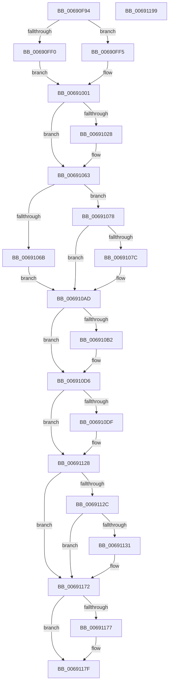

# MiInsertPartitionPageNodes

- RVA: `0x00690F94`–`0x0069119A` (길이 `518` bytes)
- VA: `0x0000000140690F94`
- 실행 섹션: `.text`
- PDB 이름 있음: `예`; PDB Function 태그: `아니요`
- unwind 정보 RVA: `0x000BBDE4`
- 디코드: `136`개 명령, `518/518` bytes 표시
- 미해석 바이트: `0` (있으면 어셈블리에 `.byte`로 보존)

> 이 문서는 커널 이미지의 기계어와 PDB 기호를 분석해 생성했습니다. 4번과 5번은 함수 원형과 자료형을 바이너리 사용 방식에서 추정한 C 해석이며 원본 소스 복구 결과는 아닙니다.

## 1. Dependencies

- 직접 호출 지점: **13**; 고유 호출 대상: **11**
- 직접 호출자로 확인된 함수: **1**
- RIP 상대 이미지 참조: **0**

### Outgoing calls
- `0x00690FD0` → [RtlNumberOfSetBitsEx](../41/RtlNumberOfSetBitsEx_function_00418CA0.md) (function, `0x00418CA0`)
- `0x00691053` → [MiIncreaseCommitLimits](../68/MiIncreaseCommitLimits_function_0068CADC.md) (function, `0x0068CADC`)
- `0x0069107F` → [MiLockDynamicMemoryExclusive](../67/MiLockDynamicMemoryExclusive_function_006730F8.md) (function, `0x006730F8`)
- `0x0069108E` → [ExAcquireSpinLockExclusive](../24/ExAcquireSpinLockExclusive_function_00248690.md) (function, `0x00248690`)
- `0x006910A8` → [MiReleaseSpinLockExclusive](../24/MiReleaseSpinLockExclusive_function_002482C0.md) (function, `0x002482C0`)
- `0x006910CF` → [MiFreePartitionNodePages](MiFreePartitionNodePages_function_00690D14.md) (function, `0x00690D14`)
- `0x006910E9` → [ExAcquireSpinLockExclusive](../24/ExAcquireSpinLockExclusive_function_00248690.md) (function, `0x00248690`)
- `0x006910FE` → [MiMergePageNodes](MiMergePageNodes_function_006916A0.md) (function, `0x006916A0`)
- `0x0069110B` → [MiReleaseSpinLockExclusive](../24/MiReleaseSpinLockExclusive_function_002482C0.md) (function, `0x002482C0`)
- `0x00691113` → [MiMakePartitionMemoryBlock](../../page/80/MiMakePartitionMemoryBlock_function_0080D94C.md) (function, `0x0080D94C`)
- `0x00691123` → [MiUnlockDynamicMemoryExclusive](../67/MiUnlockDynamicMemoryExclusive_function_00673C5C.md) (function, `0x00673C5C`)
- `0x0069116C` → [KeBugCheckEx](../4F/KeBugCheckEx_function_004FD660.md) (function, `0x004FD660`)
- `0x0069117A` → [MiDeletePartitionPageNode](MiDeletePartitionPageNode_function_006908C4.md) (function, `0x006908C4`)

### Direct callers
- [MiInsertPartitionPages](MiInsertPartitionPages_function_006911A0.md) at `0x0069155B`

### Static image references
- 디코드된 RIP-relative 메모리 참조가 없습니다.

## 2. Other-region calls and transfers

- 다른 실행 섹션으로 향하는 call: **1**
  - `0x00691113` → [MiMakePartitionMemoryBlock](../../page/80/MiMakePartitionMemoryBlock_function_0080D94C.md) (`.text` → `PAGE`)
- 별도 외부 분기/꼬리 이동을 확인하지 못했습니다.

## 3. Assembly (complete function range)

```asm
00690F94  48 89 5C 24 08                  mov qword ptr [rsp + 8], rbx
00690F99  4C 89 4C 24 20                  mov qword ptr [rsp + 0x20], r9
00690F9E  55                              push rbp
00690F9F  56                              push rsi
00690FA0  57                              push rdi
00690FA1  41 54                           push r12
00690FA3  41 55                           push r13
00690FA5  41 56                           push r14
00690FA7  41 57                           push r15
00690FA9  48 83 EC 40                     sub rsp, 0x40
00690FAD  49 8B 40 18                     mov rax, qword ptr [r8 + 0x18]
00690FB1  4C 8B F9                        mov r15, rcx
00690FB4  48 B9 FF FF FF FF FF FF FF 3F   movabs rcx, 0x3fffffffffffffff
00690FBE  4D 8B E8                        mov r13, r8
00690FC1  48 23 C1                        and rax, rcx
00690FC4  4C 8B F2                        mov r14, rdx
00690FC7  49 8D 48 20                     lea rcx, [r8 + 0x20]
00690FCB  48 89 44 24 38                  mov qword ptr [rsp + 0x38], rax
00690FD0  E8 CB 7C D8 FF                  call 0x140418ca0
00690FD5  45 8B 46 18                     mov r8d, dword ptr [r14 + 0x18]
00690FD9  45 33 C9                        xor r9d, r9d
00690FDC  41 8B C8                        mov ecx, r8d
00690FDF  48 89 44 24 30                  mov qword ptr [rsp + 0x30], rax
00690FE4  41 8D 71 01                     lea esi, [r9 + 1]
00690FE8  81 E1 80 00 00 00               and ecx, 0x80
00690FEE  74 05                           je 0x140690ff5
00690FF0  40 8A FE                        mov dil, sil
00690FF3  EB 0C                           jmp 0x140691001
00690FF5  41 0F BA E0 0A                  bt r8d, 0xa
00690FFA  41 0F B6 F9                     movzx edi, r9b
00690FFE  0F 42 FE                        cmovb edi, esi
00691001  65 48 8B 14 25 88 01 00 00      mov rdx, qword ptr gs:[0x188]
0069100A  45 8A E1                        mov r12b, r9b
0069100D  48 89 94 24 90 00 00 00         mov qword ptr [rsp + 0x90], rdx
00691015  41 8B E9                        mov ebp, r9d
00691018  89 B4 24 88 00 00 00            mov dword ptr [rsp + 0x88], esi
0069101F  41 F7 C0 90 01 00 00            test r8d, 0x190
00691026  75 3B                           jne 0x140691063
00691028  41 F7 D0                        not r8d
0069102B  4C 89 4C 24 28                  mov qword ptr [rsp + 0x28], r9
00691030  44 23 C6                        and r8d, esi
00691033  41 8B D9                        mov ebx, r9d
00691036  85 C9                           test ecx, ecx
00691038  4C 8B C8                        mov r9, rax
0069103B  48 8B D0                        mov rdx, rax
0069103E  49 8B CF                        mov rcx, r15
00691041  41 0F 44 D8                     cmove ebx, r8d
00691045  4C 8B C0                        mov r8, rax
00691048  89 9C 24 88 00 00 00            mov dword ptr [rsp + 0x88], ebx
0069104F  89 5C 24 20                     mov dword ptr [rsp + 0x20], ebx
00691053  E8 84 BA FF FF                  call 0x14068cadc
00691058  48 8B 94 24 90 00 00 00         mov rdx, qword ptr [rsp + 0x90]
00691060  45 33 C9                        xor r9d, r9d
00691063  41 8B 46 18                     mov eax, dword ptr [r14 + 0x18]
00691067  A8 20                           test al, 0x20
00691069  74 0D                           je 0x140691078
0069106B  4C 89 8C 24 98 00 00 00         mov qword ptr [rsp + 0x98], r9
00691073  44 8A E6                        mov r12b, sil
00691076  EB 35                           jmp 0x1406910ad
00691078  A8 10                           test al, 0x10
0069107A  75 31                           jne 0x1406910ad
0069107C  49 8B CF                        mov rcx, r15
0069107F  E8 74 20 FE FF                  call 0x1406730f8
00691084  49 8D 9F C8 00 00 00            lea rbx, [r15 + 0xc8]
0069108B  48 8B CB                        mov rcx, rbx
0069108E  E8 FD 75 BB FF                  call 0x140248690
00691093  48 8B 4C 24 30                  mov rcx, qword ptr [rsp + 0x30]
00691098  8A D0                           mov dl, al
0069109A  49 01 8F 50 48 00 00            add qword ptr [r15 + 0x4850], rcx
006910A1  48 8B CB                        mov rcx, rbx
006910A4  41 88 77 0C                     mov byte ptr [r15 + 0xc], sil
006910A8  E8 13 72 BB FF                  call 0x1402482c0
006910AD  40 84 FF                        test dil, dil
006910B0  75 24                           jne 0x1406910d6
006910B2  41 8B 46 18                     mov eax, dword ptr [r14 + 0x18]
006910B6  49 8B D5                        mov rdx, r13
006910B9  44 8B C0                        mov r8d, eax
006910BC  49 8B CF                        mov rcx, r15
006910BF  41 0F BA E8 0B                  bts r8d, 0xb
006910C4  39 AC 24 88 00 00 00            cmp dword ptr [rsp + 0x88], ebp
006910CB  44 0F 45 C0                     cmovne r8d, eax
006910CF  E8 40 FC FF FF                  call 0x140690d14
006910D4  8B E8                           mov ebp, eax
006910D6  41 8B 4E 18                     mov ecx, dword ptr [r14 + 0x18]
006910DA  F6 C1 10                        test cl, 0x10
006910DD  75 49                           jne 0x140691128
006910DF  49 8D BF C8 00 00 00            lea rdi, [r15 + 0xc8]
006910E6  48 8B CF                        mov rcx, rdi
006910E9  E8 A2 75 BB FF                  call 0x140248690
006910EE  4C 8B 84 24 98 00 00 00         mov r8, qword ptr [rsp + 0x98]
006910F6  49 8B D5                        mov rdx, r13
006910F9  49 8B CF                        mov rcx, r15
006910FC  8A D8                           mov bl, al
006910FE  E8 9D 05 00 00                  call 0x1406916a0
00691103  8A D3                           mov dl, bl
00691105  48 8B CF                        mov rcx, rdi
00691108  40 8A F0                        mov sil, al
0069110B  E8 B0 71 BB FF                  call 0x1402482c0
00691110  49 8B CF                        mov rcx, r15
00691113  E8 34 C8 17 00                  call 0x14080d94c
00691118  48 8B 94 24 90 00 00 00         mov rdx, qword ptr [rsp + 0x90]
00691120  49 8B CF                        mov rcx, r15
00691123  E8 34 2B FE FF                  call 0x140673c5c
00691128  85 ED                           test ebp, ebp
0069112A  79 46                           jns 0x140691172
0069112C  45 84 E4                        test r12b, r12b
0069112F  75 41                           jne 0x140691172
00691131  4C 8B 4C 24 38                  mov r9, qword ptr [rsp + 0x38]
00691136  BA 07 10 04 00                  mov edx, 0x41007
0069113B  48 63 C5                        movsxd rax, ebp
0069113E  B9 1A 00 00 00                  mov ecx, 0x1a
00691143  48 C1 E0 20                     shl rax, 0x20
00691147  48 89 84 24 98 00 00 00         mov qword ptr [rsp + 0x98], rax
0069114F  41 8B 46 18                     mov eax, dword ptr [r14 + 0x18]
00691153  89 84 24 98 00 00 00            mov dword ptr [rsp + 0x98], eax
0069115A  48 8B 44 24 30                  mov rax, qword ptr [rsp + 0x30]
0069115F  4C 8B 84 24 98 00 00 00         mov r8, qword ptr [rsp + 0x98]
00691167  48 89 44 24 20                  mov qword ptr [rsp + 0x20], rax
0069116C  E8 EF C4 E6 FF                  call 0x1404fd660
00691171  CC                              int3
00691172  40 84 F6                        test sil, sil
00691175  74 08                           je 0x14069117f
00691177  49 8B CD                        mov rcx, r13
0069117A  E8 45 F7 FF FF                  call 0x1406908c4
0069117F  48 8B 9C 24 80 00 00 00         mov rbx, qword ptr [rsp + 0x80]
00691187  8B C5                           mov eax, ebp
00691189  48 83 C4 40                     add rsp, 0x40
0069118D  41 5F                           pop r15
0069118F  41 5E                           pop r14
00691191  41 5D                           pop r13
00691193  41 5C                           pop r12
00691195  5F                              pop rdi
00691196  5E                              pop rsi
00691197  5D                              pop rbp
00691198  C3                              ret
00691199  CC                              int3
```

## 4. C-style interpretation (structured pseudocode)

```c
__int64 __fastcall MiInsertPartitionPageNodes(__int64 a1, __int64 a2, __int64 a3, __int64 a4)
{
    __int64 result;
    __int64 v_rbp;
    __int64 v_rbx;
    __int64 v_rdi;
    __int64 v_rsi;
    __int64 v_rsp;
    unsigned __int64 v_stack_m40;
    unsigned __int64 v_stack_m48;
    unsigned __int64 v_stack_m50;
    unsigned int v_stack_m58;
    unsigned int v_stack_p10;
    unsigned __int64 v_stack_p18;
    unsigned __int64 v_stack_p20;
    unsigned __int64 v_stack_p8;

    v_stack_p8 = v_rbx;
    v_stack_p20 = a4;
    v_rsp = (v_rsp) - (64);
    result = (*(unsigned __int64 *)(a3 + 24)) & (a1);
    v_stack_m40 = result;
    result = RtlNumberOfSetBitsEx(a3 + 32, a2, a3, a4);
    a4 = 0;
    v_stack_m48 = result;
    a1 = (unsigned int)(((unsigned int)((unsigned int)((unsigned int)(*(unsigned int *)(a2 + 24))))) & (128));
    if (condition_is_equal) goto loc_00690FF5;
    goto loc_00691001;
loc_00690FF5:
    v_rdi = 0;
    if (condition_is_below) { v_rdi = (unsigned int)(a4 + 1); }
loc_00691001:
    v_stack_p18 = *(unsigned __int64 *)(gs_base + (0 + 392));
    v_stack_p10 = (unsigned int)(a4 + 1);
    if ((((unsigned int)((unsigned int)(*(unsigned int *)(a2 + 24)))) & (400)) == 0) {
        a3 = (unsigned int)(~((unsigned int)(*(unsigned int *)(a2 + 24))));
        v_stack_m50 = 0;
        a3 = (unsigned int)((a3) & ((unsigned int)(a4 + 1)));
        v_rbx = 0;
        a4 = result;
        a2 = result;
        a1 = a1;
        if ((unsigned int)(a1) == 0) { v_rbx = (unsigned int)(a3); }
        a3 = result;
        v_stack_p10 = (unsigned int)(v_rbx);
        v_stack_m58 = (unsigned int)(v_rbx);
        result = MiIncreaseCommitLimits(a1, a2, a3, a4);
        a2 = v_stack_p18;
        a4 = 0;
    }
    if ((((unsigned __int8)((unsigned int)(*(unsigned int *)(a2 + 24)))) & (32)) == 0) goto loc_00691078;
    v_stack_p20 = 0;
    goto loc_006910AD;
loc_00691078:
    result = (unsigned int)(*(unsigned int *)(a2 + 24));
    if ((((unsigned __int8)((unsigned int)(*(unsigned int *)(a2 + 24)))) & (16)) == 0) {
        a1 = a1;
        result = MiLockDynamicMemoryExclusive(a1, a2, a3, a4);
        v_rbx = a1 + 200;
        a1 = v_rbx;
        result = ExAcquireSpinLockExclusive(a1, a2, a3, a4);
        a1 = v_stack_m48;
        a2 = (unsigned __int8)(result);
        a1 = v_rbx;
        *(unsigned __int8 *)(a1 + 12) = (unsigned __int8)(a4 + 1);
        result = MiReleaseSpinLockExclusive(a1, a2, a3, a4);
    }
    v_rbp = 0;
    if ((unsigned __int8)(v_rdi) == 0) {
        result = *(unsigned int *)(a2 + 24);
        a2 = a3;
        a3 = (unsigned int)(result);
        a1 = a1;
        if (v_stack_p10 != 0) { a3 = (unsigned int)(result); }
        result = MiFreePartitionNodePages(a1, a2, a3, a4);
        v_rbp = (unsigned int)(result);
    }
    v_rsi = a4 + 1;
    if ((((unsigned __int8)((unsigned int)(*(unsigned int *)(a2 + 24)))) & (16)) == 0) {
        v_rdi = a1 + 200;
        a1 = v_rdi;
        result = ExAcquireSpinLockExclusive(a1, a2, a3, a4);
        a3 = v_stack_p20;
        a2 = a3;
        a1 = a1;
        v_rbx = (unsigned __int8)(result);
        result = MiMergePageNodes(a1, a2, a3, a4);
        a2 = (unsigned __int8)(v_rbx);
        a1 = v_rdi;
        v_rsi = (unsigned __int8)(result);
        result = MiReleaseSpinLockExclusive(a1, a2, a3, a4);
        a1 = a1;
        result = MiMakePartitionMemoryBlock(a1, a2, a3, a4);
        a2 = v_stack_p18;
        a1 = a1;
        result = MiUnlockDynamicMemoryExclusive(a1, a2, a3, a4);
    }
    if (!sign_flag) goto loc_00691172;
    if ((unsigned __int8)((unsigned __int8)(a4 + 1)) == 0) {
        a4 = v_stack_m40;
        a2 = 0x41007ULL;
        result = (int)((unsigned int)(v_rbp));
        a1 = 26;
        result = (result) << (32);
        v_stack_p20 = result;
        result = *(unsigned int *)(a2 + 24);
        v_stack_p20 = (unsigned int)(result);
        result = v_stack_m48;
        a3 = v_stack_p20;
        v_stack_m58 = result;
        result = KeBugCheckEx(a1, a2, a3, a4);
    }
    if ((unsigned __int8)(v_rsi) != 0) {
        a1 = a3;
        result = MiDeletePartitionPageNode(a1, a2, a3, a4);
    }
    v_rsp = (v_rsp) + (64);
    return (unsigned int)((unsigned int)(v_rbp));
}
```

## 5. (Beta) C Style

```c
int64_t MiInsertPartitionPageNodes(void *Arg1, void *Arg2, void *Arg3, int64_t Arg4)
{
    uint8_t *arg1 = (uint8_t *)Arg1;
    uint8_t *arg2 = (uint8_t *)Arg2;
    uint8_t *arg3 = (uint8_t *)Arg3;

    int64_t result;
    int64_t local_rbp;
    int64_t local_rbx;
    int64_t local_rdi;
    int64_t local_rsi;
    int64_t local_rsp;
    uint64_t v_stack_m40;
    uint64_t v_stack_m48;
    uint64_t v_stack_m50;
    uint32_t v_stack_m58;
    uint32_t v_stack_p10;
    uint64_t v_stack_p18;
    uint64_t v_stack_p20;
    uint64_t v_stack_p8;

    v_stack_p8 = local_rbx;
    v_stack_p20 = Arg4;
    local_rsp = (local_rsp) - (64);
    result = (*(uint64_t *)(arg3 + 0x18)) & (Arg1);
    v_stack_m40 = result;
    result = RtlNumberOfSetBitsEx(Arg3 + 32, Arg2, Arg3, Arg4);
    Arg4 = 0;
    v_stack_m48 = result;
    Arg1 = (uint32_t)(((uint32_t)((uint32_t)((uint32_t)(*(uint32_t *)(arg2 + 0x18))))) & (128));
    if (condition_is_equal) goto loc_00690FF5;
    goto loc_00691001;
loc_00690FF5:
    local_rdi = 0;
    if (condition_is_below) { local_rdi = (uint32_t)(Arg4 + 1); }
loc_00691001:
    v_stack_p18 = *(uint64_t *)(gs_base + (0 + 0x188));
    v_stack_p10 = (uint32_t)(Arg4 + 1);
    if ((((uint32_t)((uint32_t)(*(uint32_t *)(arg2 + 0x18)))) & (400)) == 0) {
        Arg3 = (uint32_t)(~((uint32_t)(*(uint32_t *)(arg2 + 0x18))));
        v_stack_m50 = 0;
        Arg3 = (uint32_t)((Arg3) & ((uint32_t)(Arg4 + 1)));
        local_rbx = 0;
        Arg4 = result;
        Arg2 = result;
        Arg1 = Arg1;
        if ((uint32_t)(Arg1) == 0) { local_rbx = (uint32_t)(Arg3); }
        Arg3 = result;
        v_stack_p10 = (uint32_t)(local_rbx);
        v_stack_m58 = (uint32_t)(local_rbx);
        result = MiIncreaseCommitLimits(Arg1, Arg2, Arg3, Arg4);
        Arg2 = v_stack_p18;
        Arg4 = 0;
    }
    if ((((uint8_t)((uint32_t)(*(uint32_t *)(arg2 + 0x18)))) & (32)) == 0) goto loc_00691078;
    v_stack_p20 = 0;
    goto loc_006910AD;
loc_00691078:
    result = (uint32_t)(*(uint32_t *)(arg2 + 0x18));
    if ((((uint8_t)((uint32_t)(*(uint32_t *)(arg2 + 0x18)))) & (16)) == 0) {
        Arg1 = Arg1;
        result = MiLockDynamicMemoryExclusive(Arg1, Arg2, Arg3, Arg4);
        local_rbx = Arg1 + 200;
        Arg1 = local_rbx;
        result = ExAcquireSpinLockExclusive(Arg1, Arg2, Arg3, Arg4);
        Arg1 = v_stack_m48;
        Arg2 = (uint8_t)(result);
        Arg1 = local_rbx;
        *(uint8_t *)(arg1 + 0xC) = (uint8_t)(Arg4 + 1);
        result = MiReleaseSpinLockExclusive(Arg1, Arg2, Arg3, Arg4);
    }
    local_rbp = 0;
    if ((uint8_t)(local_rdi) == 0) {
        result = *(uint32_t *)(arg2 + 0x18);
        Arg2 = Arg3;
        Arg3 = (uint32_t)(result);
        Arg1 = Arg1;
        if (v_stack_p10 != 0) { Arg3 = (uint32_t)(result); }
        result = MiFreePartitionNodePages(Arg1, Arg2, Arg3, Arg4);
        local_rbp = (uint32_t)(result);
    }
    local_rsi = Arg4 + 1;
    if ((((uint8_t)((uint32_t)(*(uint32_t *)(arg2 + 0x18)))) & (16)) == 0) {
        local_rdi = Arg1 + 200;
        Arg1 = local_rdi;
        result = ExAcquireSpinLockExclusive(Arg1, Arg2, Arg3, Arg4);
        Arg3 = v_stack_p20;
        Arg2 = Arg3;
        Arg1 = Arg1;
        local_rbx = (uint8_t)(result);
        result = MiMergePageNodes(Arg1, Arg2, Arg3, Arg4);
        Arg2 = (uint8_t)(local_rbx);
        Arg1 = local_rdi;
        local_rsi = (uint8_t)(result);
        result = MiReleaseSpinLockExclusive(Arg1, Arg2, Arg3, Arg4);
        Arg1 = Arg1;
        result = MiMakePartitionMemoryBlock(Arg1, Arg2, Arg3, Arg4);
        Arg2 = v_stack_p18;
        Arg1 = Arg1;
        result = MiUnlockDynamicMemoryExclusive(Arg1, Arg2, Arg3, Arg4);
    }
    if (!sign_flag) goto loc_00691172;
    if ((uint8_t)((uint8_t)(Arg4 + 1)) == 0) {
        Arg4 = v_stack_m40;
        Arg2 = 0x41007ULL;
        result = (int32_t)((uint32_t)(local_rbp));
        Arg1 = 26;
        result = (result) << (32);
        v_stack_p20 = result;
        result = *(uint32_t *)(arg2 + 0x18);
        v_stack_p20 = (uint32_t)(result);
        result = v_stack_m48;
        Arg3 = v_stack_p20;
        v_stack_m58 = result;
        result = KeBugCheckEx(Arg1, Arg2, Arg3, Arg4);
    }
    if ((uint8_t)(local_rsi) != 0) {
        Arg1 = Arg3;
        result = MiDeletePartitionPageNode(Arg1, Arg2, Arg3, Arg4);
    }
    local_rsp = (local_rsp) + (64);
    return (uint32_t)((uint32_t)(local_rbp));
}
```

### 관측된 메모리 오프셋

구조체 형식이 확인되지 않은 접근은 인자 기준의 오프셋으로만 기록했습니다.

| 기준 인자 | 오프셋 표현 | 폭 (bit) | 접근 |
|---|---:|---:|---|
| `Arg1` | `+ 0xC` | `8` | `W` |
| `Arg1` | `+ 0xC8` | `64` | `R` |
| `Arg1` | `+ 0x4850` | `64` | `R/W` |
| `Arg2` | `+ 0x18` | `32` | `R` |
| `Arg3` | `+ 0x18` | `64` | `R` |
| `Arg3` | `+ 0x20` | `64` | `R` |

## 6. Execution-region graph

[열기: 2D/3D 그래프와 함수 탐색 컨트롤 패널](../../../control-panel.html?section=text&rva=0x00690F94&view=graph)

- 2D 그래프는 위에서 아래로 흐르고, 3D 그래프는 빈 공간을 드래그해 회전합니다. Shift+드래그는 이동, 휠은 확대·축소, 함수 노드 선택은 대상 보고서 이동입니다.

### Static fallback


