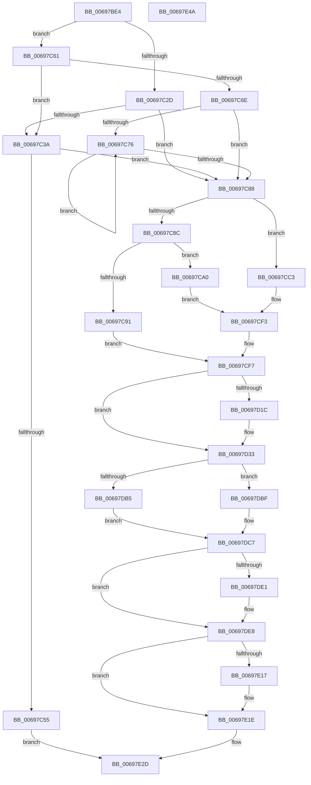

# MiInsertPteTracker

- RVA: `0x00697BE4`–`0x00697E4B` (길이 `615` bytes)
- VA: `0x0000000140697BE4`
- 실행 섹션: `.text`
- PDB 이름 있음: `예`; PDB Function 태그: `아니요`
- unwind 정보 RVA: `0x000D960C`
- 디코드: `160`개 명령, `615/615` bytes 표시
- 미해석 바이트: `0` (있으면 어셈블리에 `.byte`로 보존)

> 이 문서는 커널 이미지의 기계어와 PDB 기호를 분석해 생성했습니다. 4번과 5번은 함수 원형과 자료형을 바이너리 사용 방식에서 추정한 C 해석이며 원본 소스 복구 결과는 아닙니다.

## 1. Dependencies

- 직접 호출 지점: **10**; 고유 호출 대상: **10**
- 직접 호출자로 확인된 함수: **3**
- RIP 상대 이미지 참조: **9**

### Outgoing calls
- `0x00697C17` → [memset](../6C/memset_function_006C6C40.md) (function, `0x006C6C40`)
- `0x00697C2D` → [ExpInterlockedPopEntrySList](../6B/ExpInterlockedPopEntrySList_function_006BA570.md) (function, `0x006BA570`)
- `0x00697C48` → [MiAllocatePool](../35/MiAllocatePool_function_0035B540.md) (function, `0x0035B540`)
- `0x00697C61` → [ExpInterlockedFlushSList](../6B/ExpInterlockedFlushSList_function_006BA5F0.md) (function, `0x006BA5F0`)
- `0x00697C7B` → [ExFreePoolWithTag](../../poolcode/B8/ExFreePoolWithTag_function_00B82870.md) (function, `0x00B82870`)
- `0x00697D13` → [MiCaptureStackTraceEx](MiCaptureStackTraceEx_function_0069709C.md) (function, `0x0069709C`)
- `0x00697D1C` → [MiGetInstructionPointer](../67/MiGetInstructionPointer_function_00670E88.md) (function, `0x00670E88`)
- `0x00697DB8` → [ExAcquireSpinLockExclusiveAtDpcLevel](../24/ExAcquireSpinLockExclusiveAtDpcLevel_function_00248E80.md) (function, `0x00248E80`)
- `0x00697DBF` → [ExAcquireSpinLockExclusive](../24/ExAcquireSpinLockExclusive_function_00248690.md) (function, `0x00248690`)
- `0x00697E28` → [MiReleaseSpinLockExclusive](../24/MiReleaseSpinLockExclusive_function_002482C0.md) (function, `0x002482C0`)

### Direct callers
- [sub_006E141E](../6E/Unknown_function_006E141E.md) at `0x006E142D`
- [sub_006E1C04](../6E/Unknown_function_006E1C04.md) at `0x006E1C82`
- [MmAllocateMappingAddressEx](../../page/A7/MmAllocateMappingAddressEx_function_00A726B0.md) at `0x00A72853`

### Static image references
- `0x00697C1C` → RVA `0x00E35E00` (`.data`; read)
- `0x00697C55` → RVA `0x00E35FA5` (`.data`; write)
- `0x00697DAA` → RVA `0x00E35E10` (`.data`; read)
- `0x00697DCA` → RVA `0x00E388F0` (`.data`; read)
- `0x00697DF6` → RVA `0x00E389F8` (`.data`; read)
- `0x00697DFD` → RVA `0x00E389F0` (`.data`; read/write)
- `0x00697E07` → RVA `0x00E38A00` (`.data`; read)
- `0x00697E0E` → RVA `0x00E389F8` (`.data`; write)
- `0x00697E17` → RVA `0x00E38A00` (`.data`; write)

## 2. Other-region calls and transfers

- 다른 실행 섹션으로 향하는 call: **1**
  - `0x00697C7B` → [ExFreePoolWithTag](../../poolcode/B8/ExFreePoolWithTag_function_00B82870.md) (`.text` → `POOLCODE`)
- 별도 외부 분기/꼬리 이동을 확인하지 못했습니다.

## 3. Assembly (complete function range)

```asm
00697BE4  48 89 5C 24 08                  mov qword ptr [rsp + 8], rbx
00697BE9  48 89 6C 24 10                  mov qword ptr [rsp + 0x10], rbp
00697BEE  48 89 74 24 18                  mov qword ptr [rsp + 0x18], rsi
00697BF3  57                              push rdi
00697BF4  41 56                           push r14
00697BF6  41 57                           push r15
00697BF8  48 81 EC C0 00 00 00            sub rsp, 0xc0
00697BFF  45 8B F0                        mov r14d, r8d
00697C02  8B EA                           mov ebp, edx
00697C04  48 8B F1                        mov rsi, rcx
00697C07  33 D2                           xor edx, edx
00697C09  41 B8 A0 00 00 00               mov r8d, 0xa0
00697C0F  48 8D 4C 24 20                  lea rcx, [rsp + 0x20]
00697C14  45 8B F9                        mov r15d, r9d
00697C17  E8 24 F0 02 00                  call 0x1406c6c40
00697C1C  66 83 3D DC E1 79 00 0A         cmp word ptr [rip + 0x79e1dc], 0xa
00697C24  48 8D 0D D5 E1 79 00            lea rcx, [rip + 0x79e1d5]
00697C2B  73 34                           jae 0x140697c61
00697C2D  E8 3E 29 02 00                  call 0x1406ba570
00697C32  48 8B F8                        mov rdi, rax
00697C35  48 85 C0                        test rax, rax
00697C38  75 4E                           jne 0x140697c88
00697C3A  BA 80 00 00 00                  mov edx, 0x80
00697C3F  41 B8 4D 6D 53 79               mov r8d, 0x79536d4d
00697C45  8D 4A C0                        lea ecx, [rdx - 0x40]
00697C48  E8 F3 38 CC FF                  call 0x14035b540
00697C4D  48 8B F8                        mov rdi, rax
00697C50  48 85 C0                        test rax, rax
00697C53  75 33                           jne 0x140697c88
00697C55  C6 05 49 E3 79 00 01            mov byte ptr [rip + 0x79e349], 1
00697C5C  E9 CC 01 00 00                  jmp 0x140697e2d
00697C61  E8 8A 29 02 00                  call 0x1406ba5f0
00697C66  48 8B F8                        mov rdi, rax
00697C69  48 85 C0                        test rax, rax
00697C6C  74 CC                           je 0x140697c3a
00697C6E  48 8B 08                        mov rcx, qword ptr [rax]
00697C71  48 85 C9                        test rcx, rcx
00697C74  74 12                           je 0x140697c88
00697C76  48 8B 19                        mov rbx, qword ptr [rcx]
00697C79  33 D2                           xor edx, edx
00697C7B  E8 F0 AB 4E 00                  call 0x140b82870
00697C80  48 8B CB                        mov rcx, rbx
00697C83  48 85 DB                        test rbx, rbx
00697C86  75 EE                           jne 0x140697c76
00697C88  85 ED                           test ebp, ebp
00697C8A  74 37                           je 0x140697cc3
00697C8C  83 FD 01                        cmp ebp, 1
00697C8F  74 0F                           je 0x140697ca0
00697C91  48 8B 4E 10                     mov rcx, qword ptr [rsi + 0x10]
00697C95  48 C1 E9 0C                     shr rcx, 0xc
00697C99  48 83 67 10 00                  and qword ptr [rdi + 0x10], 0
00697C9E  EB 57                           jmp 0x140697cf7
00697CA0  8B 4E 2C                        mov ecx, dword ptr [rsi + 0x2c]
00697CA3  03 4E 20                        add ecx, dword ptr [rsi + 0x20]
00697CA6  48 8B 46 10                     mov rax, qword ptr [rsi + 0x10]
00697CAA  81 E1 FF 0F 00 00               and ecx, 0xfff
00697CB0  48 05 FF 0F 00 00               add rax, 0xfff
00697CB6  48 C7 47 10 01 00 00 00         mov qword ptr [rdi + 0x10], 1
00697CBE  48 03 C8                        add rcx, rax
00697CC1  EB 30                           jmp 0x140697cf3
00697CC3  8B 4E 20                        mov ecx, dword ptr [rsi + 0x20]
00697CC6  03 4E 2C                        add ecx, dword ptr [rsi + 0x2c]
00697CC9  8B 46 28                        mov eax, dword ptr [rsi + 0x28]
00697CCC  81 E1 FF 0F 00 00               and ecx, 0xfff
00697CD2  48 05 FF 0F 00 00               add rax, 0xfff
00697CD8  48 89 77 10                     mov qword ptr [rdi + 0x10], rsi
00697CDC  48 03 C8                        add rcx, rax
00697CDF  48 8B 46 20                     mov rax, qword ptr [rsi + 0x20]
00697CE3  48 89 47 28                     mov qword ptr [rdi + 0x28], rax
00697CE7  8B 46 2C                        mov eax, dword ptr [rsi + 0x2c]
00697CEA  89 47 30                        mov dword ptr [rdi + 0x30], eax
00697CED  8B 46 28                        mov eax, dword ptr [rsi + 0x28]
00697CF0  89 47 34                        mov dword ptr [rdi + 0x34], eax
00697CF3  48 C1 E9 0C                     shr rcx, 0xc
00697CF7  48 8D 69 01                     lea rbp, [rcx + 1]
00697CFB  41 8B DE                        mov ebx, r14d
00697CFE  83 E3 02                        and ebx, 2
00697D01  BA 07 00 00 00                  mov edx, 7
00697D06  48 0F 44 E9                     cmove rbp, rcx
00697D0A  48 8D 4C 24 20                  lea rcx, [rsp + 0x20]
00697D0F  48 89 6F 18                     mov qword ptr [rdi + 0x18], rbp
00697D13  E8 84 F3 FF FF                  call 0x14069709c
00697D18  85 C0                           test eax, eax
00697D1A  75 17                           jne 0x140697d33
00697D1C  E8 67 91 FD FF                  call 0x140670e88
00697D21  48 89 44 24 20                  mov qword ptr [rsp + 0x20], rax
00697D26  48 8B 84 24 D8 00 00 00         mov rax, qword ptr [rsp + 0xd8]
00697D2E  48 89 44 24 28                  mov qword ptr [rsp + 0x28], rax
00697D33  0F 28 44 24 20                  movaps xmm0, xmmword ptr [rsp + 0x20]
00697D38  42 8D 0C BD 00 00 00 00         lea ecx, [r15*4]
00697D40  0F 11 47 48                     movups xmmword ptr [rdi + 0x48], xmm0
00697D44  41 83 E6 01                     and r14d, 1
00697D48  0F 28 4C 24 30                  movaps xmm1, xmmword ptr [rsp + 0x30]
00697D4D  0F 11 4F 58                     movups xmmword ptr [rdi + 0x58], xmm1
00697D51  0F 28 44 24 40                  movaps xmm0, xmmword ptr [rsp + 0x40]
00697D56  0F 11 47 68                     movups xmmword ptr [rdi + 0x68], xmm0
00697D5A  F2 0F 10 4C 24 50               movsd xmm1, qword ptr [rsp + 0x50]
00697D60  F2 0F 11 4F 78                  movsd qword ptr [rdi + 0x78], xmm1
00697D65  48 8B 56 18                     mov rdx, qword ptr [rsi + 0x18]
00697D69  48 89 57 20                     mov qword ptr [rdi + 0x20], rdx
00697D6D  48 8B 46 30                     mov rax, qword ptr [rsi + 0x30]
00697D71  48 89 47 38                     mov qword ptr [rdi + 0x38], rax
00697D75  8B 47 40                        mov eax, dword ptr [rdi + 0x40]
00697D78  33 C8                           xor ecx, eax
00697D7A  83 E1 0C                        and ecx, 0xc
00697D7D  33 C8                           xor ecx, eax
00697D7F  83 E1 EC                        and ecx, 0xffffffec
00697D82  41 33 CE                        xor ecx, r14d
00697D85  F7 DB                           neg ebx
00697D87  1B C0                           sbb eax, eax
00697D89  48 C1 EA 0C                     shr rdx, 0xc
00697D8D  83 E0 10                        and eax, 0x10
00697D90  0B C8                           or ecx, eax
00697D92  48 69 C2 5F 9E 00 00            imul rax, rdx, 0x9e5f
00697D99  89 4F 40                        mov dword ptr [rdi + 0x40], ecx
00697D9C  48 8B D8                        mov rbx, rax
00697D9F  48 C1 EB 20                     shr rbx, 0x20
00697DA3  48 33 D8                        xor rbx, rax
00697DA6  44 0F 20 C0                     mov rax, cr8
00697DAA  48 8D 0D 5F E0 79 00            lea rcx, [rip + 0x79e05f]
00697DB1  3C 02                           cmp al, 2
00697DB3  75 0A                           jne 0x140697dbf
00697DB5  40 B6 11                        mov sil, 0x11
00697DB8  E8 C3 10 BB FF                  call 0x140248e80
00697DBD  EB 08                           jmp 0x140697dc7
00697DBF  E8 CC 08 BB FF                  call 0x140248690
00697DC4  40 8A F0                        mov sil, al
00697DC7  83 E3 0F                        and ebx, 0xf
00697DCA  48 8D 05 1F 0B 7A 00            lea rax, [rip + 0x7a0b1f]
00697DD1  48 C1 E3 04                     shl rbx, 4
00697DD5  48 03 D8                        add rbx, rax
00697DD8  48 8B 0B                        mov rcx, qword ptr [rbx]
00697DDB  48 39 59 08                     cmp qword ptr [rcx + 8], rbx
00697DDF  74 07                           je 0x140697de8
00697DE1  B9 03 00 00 00                  mov ecx, 3
00697DE6  CD 29                           int 0x29
00697DE8  48 89 0F                        mov qword ptr [rdi], rcx
00697DEB  48 89 5F 08                     mov qword ptr [rdi + 8], rbx
00697DEF  48 89 79 08                     mov qword ptr [rcx + 8], rdi
00697DF3  48 89 3B                        mov qword ptr [rbx], rdi
00697DF6  48 8B 05 FB 0B 7A 00            mov rax, qword ptr [rip + 0x7a0bfb]
00697DFD  48 01 2D EC 0B 7A 00            add qword ptr [rip + 0x7a0bec], rbp
00697E04  48 FF C0                        inc rax
00697E07  48 3B 05 F2 0B 7A 00            cmp rax, qword ptr [rip + 0x7a0bf2]
00697E0E  48 89 05 E3 0B 7A 00            mov qword ptr [rip + 0x7a0be3], rax
00697E15  76 07                           jbe 0x140697e1e
00697E17  48 89 05 E2 0B 7A 00            mov qword ptr [rip + 0x7a0be2], rax
00697E1E  40 8A D6                        mov dl, sil
00697E21  48 8D 0D E8 DF 79 00            lea rcx, [rip + 0x79dfe8]
00697E28  E8 93 04 BB FF                  call 0x1402482c0
00697E2D  4C 8D 9C 24 C0 00 00 00         lea r11, [rsp + 0xc0]
00697E35  49 8B 5B 20                     mov rbx, qword ptr [r11 + 0x20]
00697E39  49 8B 6B 28                     mov rbp, qword ptr [r11 + 0x28]
00697E3D  49 8B 73 30                     mov rsi, qword ptr [r11 + 0x30]
00697E41  49 8B E3                        mov rsp, r11
00697E44  41 5F                           pop r15
00697E46  41 5E                           pop r14
00697E48  5F                              pop rdi
00697E49  C3                              ret
00697E4A  CC                              int3
```

## 4. C-style interpretation (structured pseudocode)

```c
__int64 __fastcall MiInsertPteTracker(__int64 a1, int a2, int a3, int a4)
{
    __int64 result;
    __int64 v_r14;
    __int64 v_rbp;
    __int64 v_rbx;
    __int64 v_rsp;
    unsigned __int64 v_stack_m18;
    unsigned __int64 v_stack_m88;
    unsigned __int64 v_stack_m98;
    unsigned __int64 v_stack_mA8;
    unsigned __int64 v_stack_mB0;
    unsigned __int64 v_stack_mB8;
    unsigned __int64 v_stack_p0;
    unsigned __int64 v_stack_p10;
    unsigned __int64 v_stack_p18;
    unsigned __int64 v_stack_p8;

    v_stack_p8 = v_rbx;
    v_stack_p10 = v_rbp;
    v_stack_p18 = v_rsi;
    v_rsp = (v_rsp) - (192);
    a2 = 0;
    result = memset(v_stack_mB8, a2, 160, a4);
    if ((*(unsigned __int16 *)(v_rip + 7987676)) >= 10) goto loc_00697C61;
    result = ExpInterlockedPopEntrySList(v_rip + 7987669, a2, 160, a4);
    if (result != 0) goto loc_00697C88;
loc_00697C3A:
    result = MiAllocatePool(128 - 64, 128, (unsigned int)(0x79536D4DULL), a4);
    if (result != 0) goto loc_00697C88;
    *(unsigned __int8 *)(v_rip + 7988041) = 1;
    goto loc_00697E2D;
loc_00697C61:
    result = ExpInterlockedFlushSList(128 - 64, 128, (unsigned int)(0x79536D4DULL), a4);
    if (result == 0) goto loc_00697C3A;
    if (*(unsigned __int64 *)(result) == 0) goto loc_00697C88;
loc_00697C76:
    a2 = 0;
    result = ExFreePoolWithTag(*(unsigned __int64 *)(result), a2, (unsigned int)(0x79536D4DULL), a4);
    if (*(unsigned __int64 *)(*(unsigned __int64 *)(result)) != 0) goto loc_00697C76;
loc_00697C88:
    if ((unsigned int)((unsigned int)(a2)) == 0) goto loc_00697CC3;
    if (((unsigned int)((unsigned int)(a2))) == 1) goto loc_00697CA0;
    a1 = (*(unsigned __int64 *)(a1 + 16)) >> (12);
    goto loc_00697CF7;
loc_00697CA0:
    a1 = (unsigned int)(((unsigned int)(*(unsigned int *)(a1 + 44))) + (*(unsigned int *)(a1 + 32)));
    a1 = (unsigned int)((a1) & (0xFFFULL));
    result = (*(unsigned __int64 *)(a1 + 16)) + (0xFFFULL);
    *(unsigned __int64 *)(result + 16) = 1;
    a1 = (a1) + (result);
    goto loc_00697CF3;
loc_00697CC3:
    a1 = (unsigned int)(((unsigned int)(*(unsigned int *)(a1 + 32))) + (*(unsigned int *)(a1 + 44)));
    a1 = (unsigned int)((a1) & (0xFFFULL));
    result = ((unsigned int)(*(unsigned int *)(a1 + 40))) + (0xFFFULL);
    *(unsigned __int64 *)(result + 16) = a1;
    a1 = (a1) + (result);
    *(unsigned __int64 *)(result + 40) = *(unsigned __int64 *)(a1 + 32);
    *(unsigned int *)(result + 48) = (unsigned int)((unsigned int)(*(unsigned int *)(a1 + 44)));
    *(unsigned int *)(result + 52) = (unsigned int)((unsigned int)(*(unsigned int *)(a1 + 40)));
loc_00697CF3:
    a1 = (a1) >> (12);
loc_00697CF7:
    v_rbx = (unsigned int)(((unsigned int)((unsigned int)((unsigned int)(a3)))) & (2));
    v_rbp = a1 + 1;
    if (condition_is_equal) { v_rbp = a1; }
    *(unsigned __int64 *)(result + 24) = v_rbp;
    result = MiCaptureStackTraceEx(v_stack_mB8, 7, (unsigned int)(0x79536D4DULL), a4);
    if ((unsigned int)(result) == 0) {
        result = MiGetInstructionPointer(v_stack_mB8, 7, (unsigned int)(0x79536D4DULL), a4);
        v_stack_mB8 = result;
        result = v_stack_p0;
        v_stack_mB0 = result;
    }
    *(unsigned __int64 *)(result + 72) = v_xmm0;
    v_r14 = (unsigned int)(((unsigned int)(a3)) & (1));
    *(unsigned __int64 *)(result + 88) = v_xmm1;
    *(unsigned __int64 *)(result + 104) = v_xmm0;
    *(unsigned __int64 *)(result + 120) = v_xmm1;
    *(unsigned __int64 *)(result + 32) = *(unsigned __int64 *)(a1 + 24);
    *(unsigned __int64 *)(result + 56) = *(unsigned __int64 *)(a1 + 48);
    a1 = (unsigned int)(((unsigned int)(a4) * 4) ^ ((unsigned int)((unsigned int)(*(unsigned int *)(result + 64)))));
    a1 = (unsigned int)((a1) & (12));
    a1 = (unsigned int)((a1) ^ ((unsigned int)((unsigned int)(*(unsigned int *)(result + 64)))));
    a1 = (unsigned int)((a1) & (0xFFFFFFECULL));
    a1 = (unsigned int)((a1) ^ ((unsigned int)(v_r14)));
    v_rbx = (unsigned int)(-(v_rbx));
    a2 = (*(unsigned __int64 *)(a1 + 24)) >> (12);
    result = (unsigned int)(((unsigned int)(*(unsigned int *)(result + 64))) & (16));
    a1 = (unsigned int)((a1) | ((unsigned int)(result)));
    result = (result) * (a2);
    *(unsigned int *)(result + 64) = (unsigned int)(a1);
    v_rbx = (result) >> (32);
    v_rbx = (v_rbx) ^ (result);
    if (((unsigned __int8)(v_cr8)) != 2) goto loc_00697DBF;
    result = ExAcquireSpinLockExclusiveAtDpcLevel(v_rip + 7987295, a2, (unsigned int)(0x79536D4DULL), a4);
    goto loc_00697DC7;
loc_00697DBF:
    result = ExAcquireSpinLockExclusive(v_rip + 7987295, a2, (unsigned int)(0x79536D4DULL), a4);
loc_00697DC7:
    v_rbx = (unsigned int)((v_rbx) & (15));
    v_rbx = (v_rbx) << (4);
    v_rbx = (v_rbx) + (v_rip + 7998239);
    if ((*(unsigned __int64 *)(*(unsigned __int64 *)(v_rbx) + 8)) != v_rbx) {
        a1 = 3;
    }
    *(unsigned __int64 *)(result) = a1;
    *(unsigned __int64 *)(result + 8) = v_rbx;
    *(unsigned __int64 *)(a1 + 8) = result;
    *(unsigned __int64 *)(v_rbx) = result;
    result = (*(unsigned __int64 *)(v_rip + 7998459)) + 1;
    *(unsigned __int64 *)(v_rip + 7998435) = result;
    if (result >= = (*(unsigned __int64 *)(v_rip + 7998450))) {
        *(unsigned __int64 *)(v_rip + 7998434) = result;
    }
    result = MiReleaseSpinLockExclusive(v_rip + 7987176, (unsigned __int8)((unsigned __int8)(result)), (unsigned int)(0x79536D4DULL), a4);
loc_00697E2D:
    return result;
}
```

## 5. (Beta) C Style

```c
int64_t MiInsertPteTracker(void *Arg1, int32_t Arg2, int32_t Arg3, int32_t Arg4)
{
    uint8_t *arg1 = (uint8_t *)Arg1;

    int64_t result;
    int64_t local_r14;
    int64_t local_rbp;
    int64_t local_rbx;
    int64_t local_rsp;
    uint64_t v_stack_m18;
    uint64_t v_stack_m88;
    uint64_t v_stack_m98;
    uint64_t v_stack_mA8;
    uint64_t v_stack_mB0;
    uint64_t v_stack_mB8;
    uint64_t v_stack_p0;
    uint64_t v_stack_p10;
    uint64_t v_stack_p18;
    uint64_t v_stack_p8;

    v_stack_p8 = local_rbx;
    v_stack_p10 = local_rbp;
    v_stack_p18 = local_rsi;
    local_rsp = (local_rsp) - (192);
    Arg2 = 0;
    result = memset(v_stack_mB8, Arg2, 160, Arg4);
    if ((*(uint16_t *)(v_rip + 0x79E1DC)) >= 10) goto loc_00697C61;
    result = ExpInterlockedPopEntrySList(v_rip + 7987669, Arg2, 160, Arg4);
    if (result != 0) goto loc_00697C88;
loc_00697C3A:
    result = MiAllocatePool(128 - 64, 128, (uint32_t)(0x79536D4DULL), Arg4);
    if (result != 0) goto loc_00697C88;
    *(uint8_t *)(v_rip + 0x79E349) = 1;
    goto loc_00697E2D;
loc_00697C61:
    result = ExpInterlockedFlushSList(128 - 64, 128, (uint32_t)(0x79536D4DULL), Arg4);
    if (result == 0) goto loc_00697C3A;
    if (*(uint64_t *)(result) == 0) goto loc_00697C88;
loc_00697C76:
    Arg2 = 0;
    result = ExFreePoolWithTag(*(uint64_t *)(result), Arg2, (uint32_t)(0x79536D4DULL), Arg4);
    if (*(uint64_t *)(*(uint64_t *)(result)) != 0) goto loc_00697C76;
loc_00697C88:
    if ((uint32_t)((uint32_t)(Arg2)) == 0) goto loc_00697CC3;
    if (((uint32_t)((uint32_t)(Arg2))) == 1) goto loc_00697CA0;
    Arg1 = (*(uint64_t *)(arg1 + 0x10)) >> (12);
    goto loc_00697CF7;
loc_00697CA0:
    Arg1 = (uint32_t)(((uint32_t)(*(uint32_t *)(arg1 + 0x2C))) + (*(uint32_t *)(arg1 + 0x20)));
    Arg1 = (uint32_t)((Arg1) & (0xFFFULL));
    result = (*(uint64_t *)(arg1 + 0x10)) + (0xFFFULL);
    *(uint64_t *)(result + 0x10) = 1;
    Arg1 = (Arg1) + (result);
    goto loc_00697CF3;
loc_00697CC3:
    Arg1 = (uint32_t)(((uint32_t)(*(uint32_t *)(arg1 + 0x20))) + (*(uint32_t *)(arg1 + 0x2C)));
    Arg1 = (uint32_t)((Arg1) & (0xFFFULL));
    result = ((uint32_t)(*(uint32_t *)(arg1 + 0x28))) + (0xFFFULL);
    *(void **)(result + 0x10) = Arg1;
    Arg1 = (Arg1) + (result);
    *(uint64_t *)(result + 0x28) = *(uint64_t *)(arg1 + 0x20);
    *(uint32_t *)(result + 0x30) = (uint32_t)((uint32_t)(*(uint32_t *)(arg1 + 0x2C)));
    *(uint32_t *)(result + 0x34) = (uint32_t)((uint32_t)(*(uint32_t *)(arg1 + 0x28)));
loc_00697CF3:
    Arg1 = (Arg1) >> (12);
loc_00697CF7:
    local_rbx = (uint32_t)(((uint32_t)((uint32_t)((uint32_t)(Arg3)))) & (2));
    local_rbp = Arg1 + 1;
    if (condition_is_equal) { local_rbp = Arg1; }
    *(uint64_t *)(result + 0x18) = local_rbp;
    result = MiCaptureStackTraceEx(v_stack_mB8, 7, (uint32_t)(0x79536D4DULL), Arg4);
    if ((uint32_t)(result) == 0) {
        result = MiGetInstructionPointer(v_stack_mB8, 7, (uint32_t)(0x79536D4DULL), Arg4);
        v_stack_mB8 = result;
        result = v_stack_p0;
        v_stack_mB0 = result;
    }
    *(uint64_t *)(result + 0x48) = v_xmm0;
    local_r14 = (uint32_t)(((uint32_t)(Arg3)) & (1));
    *(uint64_t *)(result + 0x58) = v_xmm1;
    *(uint64_t *)(result + 0x68) = v_xmm0;
    *(uint64_t *)(result + 0x78) = v_xmm1;
    *(uint64_t *)(result + 0x20) = *(uint64_t *)(arg1 + 0x18);
    *(uint64_t *)(result + 0x38) = *(uint64_t *)(arg1 + 0x30);
    Arg1 = (uint32_t)(((uint32_t)(Arg4) * 4) ^ ((uint32_t)((uint32_t)(*(uint32_t *)(result + 0x40)))));
    Arg1 = (uint32_t)((Arg1) & (12));
    Arg1 = (uint32_t)((Arg1) ^ ((uint32_t)((uint32_t)(*(uint32_t *)(result + 0x40)))));
    Arg1 = (uint32_t)((Arg1) & (0xFFFFFFECULL));
    Arg1 = (uint32_t)((Arg1) ^ ((uint32_t)(local_r14)));
    local_rbx = (uint32_t)(-(local_rbx));
    Arg2 = (*(uint64_t *)(arg1 + 0x18)) >> (12);
    result = (uint32_t)(((uint32_t)(*(uint32_t *)(result + 0x40))) & (16));
    Arg1 = (uint32_t)((Arg1) | ((uint32_t)(result)));
    result = (result) * (Arg2);
    *(uint32_t *)(result + 0x40) = (uint32_t)(Arg1);
    local_rbx = (result) >> (32);
    local_rbx = (local_rbx) ^ (result);
    if (((uint8_t)(v_cr8)) != 2) goto loc_00697DBF;
    result = ExAcquireSpinLockExclusiveAtDpcLevel(v_rip + 7987295, Arg2, (uint32_t)(0x79536D4DULL), Arg4);
    goto loc_00697DC7;
loc_00697DBF:
    result = ExAcquireSpinLockExclusive(v_rip + 7987295, Arg2, (uint32_t)(0x79536D4DULL), Arg4);
loc_00697DC7:
    local_rbx = (uint32_t)((local_rbx) & (15));
    local_rbx = (local_rbx) << (4);
    local_rbx = (local_rbx) + (v_rip + 7998239);
    if ((*(uint64_t *)(*(uint64_t *)(local_rbx) + 0x8)) != local_rbx) {
        Arg1 = 3;
    }
    *(void **)(result) = Arg1;
    *(uint64_t *)(result + 0x8) = local_rbx;
    *(uint64_t *)(arg1 + 0x8) = result;
    *(uint64_t *)(local_rbx) = result;
    result = (*(uint64_t *)(v_rip + 0x7A0BFB)) + 1;
    *(uint64_t *)(v_rip + 0x7A0BE3) = result;
    if (result >= = (*(uint64_t *)(v_rip + 0x7A0BF2))) {
        *(uint64_t *)(v_rip + 0x7A0BE2) = result;
    }
    result = MiReleaseSpinLockExclusive(v_rip + 7987176, (uint8_t)((uint8_t)(result)), (uint32_t)(0x79536D4DULL), Arg4);
loc_00697E2D:
    return result;
}
```

### 관측된 메모리 오프셋

구조체 형식이 확인되지 않은 접근은 인자 기준의 오프셋으로만 기록했습니다.

| 기준 인자 | 오프셋 표현 | 폭 (bit) | 접근 |
|---|---:|---:|---|
| `Arg1` | `+ 0x10` | `64` | `R` |
| `Arg1` | `+ 0x18` | `64` | `R` |
| `Arg1` | `+ 0x20` | `32` | `R` |
| `Arg1` | `+ 0x20` | `64` | `R` |
| `Arg1` | `+ 0x28` | `32` | `R` |
| `Arg1` | `+ 0x2C` | `32` | `R` |
| `Arg1` | `+ 0x30` | `64` | `R` |

## 6. Execution-region graph

[열기: 2D/3D 그래프와 함수 탐색 컨트롤 패널](../../../control-panel.html?section=text&rva=0x00697BE4&view=graph)

- 2D 그래프는 위에서 아래로 흐르고, 3D 그래프는 빈 공간을 드래그해 회전합니다. Shift+드래그는 이동, 휠은 확대·축소, 함수 노드 선택은 대상 보고서 이동입니다.

### Static fallback


