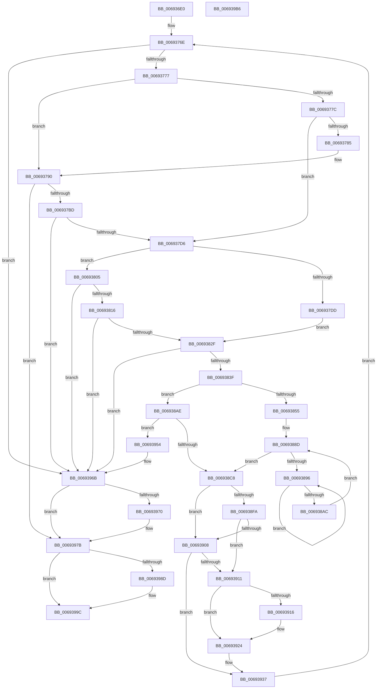

# MiMakeVaRangePhysicallyContiguous

- RVA: `0x006936E0`–`0x006939B7` (길이 `727` bytes)
- VA: `0x00000001406936E0`
- 실행 섹션: `.text`
- PDB 이름 있음: `예`; PDB Function 태그: `아니요`
- unwind 정보 RVA: `0x000D2A38`
- 디코드: `189`개 명령, `727/727` bytes 표시
- 미해석 바이트: `0` (있으면 어셈블리에 `.byte`로 보존)

> 이 문서는 커널 이미지의 기계어와 PDB 기호를 분석해 생성했습니다. 4번과 5번은 함수 원형과 자료형을 바이너리 사용 방식에서 추정한 C 해석이며 원본 소스 복구 결과는 아닙니다.

## 1. Dependencies

- 직접 호출 지점: **20**; 고유 호출 대상: **16**
- 직접 호출자로 확인된 함수: **1**
- RIP 상대 이미지 참조: **2**

### Outgoing calls
- `0x00693766` → [MiLockWorkingSetShared](../27/MiLockWorkingSetShared_function_0027CBF0.md) (function, `0x0027CBF0`)
- `0x0069378B` → [MiUnlockPageTable](../21/MiUnlockPageTable_function_00216EC0.md) (function, `0x00216EC0`)
- `0x006937AC` → [MiGetNextPageTable](../2C/MiGetNextPageTable_function_002C2EE0.md) (function, `0x002C2EE0`)
- `0x0069381E` → [MiLockTransitionLeafPageEx](../40/MiLockTransitionLeafPageEx_function_00405884.md) (function, `0x00405884`)
- `0x00693832` → [MiCheckContiguityTradeEligible](../68/MiCheckContiguityTradeEligible_function_00687300.md) (function, `0x00687300`)
- `0x00693844` → [MiUnlinkPageChainHead](../36/MiUnlinkPageChainHead_function_00365C40.md) (function, `0x00365C40`)
- `0x00693881` → [MiTradeActivePage](../37/MiTradeActivePage_function_00374424.md) (function, `0x00374424`)
- `0x0069389E` → [KeYieldProcessorEx](../3F/KeYieldProcessorEx_function_003FBD00.md) (function, `0x003FBD00`)
- `0x006938BB` → [MiReplaceTransitionPage](../2B/MiReplaceTransitionPage_function_002B1120.md) (function, `0x002B1120`)
- `0x006938D6` → [MiSetOriginalPtePfnFromFreeList](../28/MiSetOriginalPtePfnFromFreeList_function_0028A99C.md) (function, `0x0028A99C`)
- `0x006938E0` → [MiReturnFreeZeroPage](../33/MiReturnFreeZeroPage_function_00334BD0.md) (function, `0x00334BD0`)
- `0x006938FF` → [MiWorkingSetIsContended](../2A/MiWorkingSetIsContended_function_002AE520.md) (function, `0x002AE520`)
- `0x00693908` → [KeShouldYieldProcessor](../27/KeShouldYieldProcessor_function_002773E0.md) (function, `0x002773E0`)
- `0x0069391C` → [MiUnlockPageTable](../21/MiUnlockPageTable_function_00216EC0.md) (function, `0x00216EC0`)
- `0x0069392A` → [MiUnlockWorkingSetShared](../27/MiUnlockWorkingSetShared_function_0027D690.md) (function, `0x0027D690`)
- `0x00693932` → [MiLockWorkingSetShared](../27/MiLockWorkingSetShared_function_0027CBF0.md) (function, `0x0027CBF0`)
- `0x00693966` → [MiReleaseFreshPageAtDpc](../33/MiReleaseFreshPageAtDpc_function_00334B50.md) (function, `0x00334B50`)
- `0x00693976` → [MiUnlockPageTable](../21/MiUnlockPageTable_function_00216EC0.md) (function, `0x00216EC0`)
- `0x00693981` → [MiUnlockWorkingSetShared](../27/MiUnlockWorkingSetShared_function_0027D690.md) (function, `0x0027D690`)
- `0x00693992` → [MiFreePageChain](../37/MiFreePageChain_function_00377D9C.md) (function, `0x00377D9C`)

### Direct callers
- [MiProcessVaContiguityInformation](MiProcessVaContiguityInformation_function_006939C0.md) at `0x00693C7D`

### Static image references
- `0x006936FC` → RVA `0x00011C60` (`.rdata`; read)
- `0x006938C8` → RVA `0x00010880` (`.rdata`; read)

## 2. Other-region calls and transfers

- 다른 실행 섹션으로 향하는 call: **0**
- 별도 외부 분기/꼬리 이동을 확인하지 못했습니다.

## 3. Assembly (complete function range)

```asm
006936E0  4C 8B DC                        mov r11, rsp
006936E3  49 89 5B 08                     mov qword ptr [r11 + 8], rbx
006936E7  55                              push rbp
006936E8  56                              push rsi
006936E9  57                              push rdi
006936EA  41 54                           push r12
006936EC  41 55                           push r13
006936EE  41 56                           push r14
006936F0  41 57                           push r15
006936F2  48 83 EC 50                     sub rsp, 0x50
006936F6  41 8B C0                        mov eax, r8d
006936F9  4C 8B F2                        mov r14, rdx
006936FC  4C 8D 05 5D E5 97 FF            lea r8, [rip - 0x681aa3]
00693703  4D 89 4B A8                     mov qword ptr [r11 - 0x58], r9
00693707  49 83 C1 D0                     add r9, -0x30
0069370B  49 C1 EE 09                     shr r14, 9
0069370F  33 FF                           xor edi, edi
00693711  48 BB 00 00 00 00 80 F6 FF FF   movabs rbx, 0xfffff68000000000
0069371B  4D 8B 04 C0                     mov r8, qword ptr [r8 + rax*8]
0069371F  49 BF F8 FF FF FF 7F 00 00 00   movabs r15, 0x7ffffffff8
00693729  48 8B E9                        mov rbp, rcx
0069372C  41 89 7B 18                     mov dword ptr [r11 + 0x18], edi
00693730  4D 89 43 B8                     mov qword ptr [r11 - 0x48], r8
00693734  4D 23 F7                        and r14, r15
00693737  4B 8D 04 40                     lea rax, [r8 + r8*2]
0069373B  48 C1 E0 04                     shl rax, 4
0069373F  49 03 C1                        add rax, r9
00693742  49 89 43 B0                     mov qword ptr [r11 - 0x50], rax
00693746  48 8B C3                        mov rax, rbx
00693749  49 C1 E0 0C                     shl r8, 0xc
0069374D  4C 8D 6A FF                     lea r13, [rdx - 1]
00693751  4D 03 E8                        add r13, r8
00693754  4C 03 F0                        add r14, rax
00693757  49 C1 ED 09                     shr r13, 9
0069375B  4D 23 EF                        and r13, r15
0069375E  48 8B C3                        mov rax, rbx
00693761  4C 03 E8                        add r13, rax
00693764  8B F7                           mov esi, edi
00693766  E8 85 94 BE FF                  call 0x14027cbf0
0069376B  44 8A E0                        mov r12b, al
0069376E  4D 3B F5                        cmp r14, r13
00693771  0F 87 F4 01 00 00               ja 0x14069396b
00693777  48 85 F6                        test rsi, rsi
0069377A  74 14                           je 0x140693790
0069377C  49 F7 C6 FF 0F 00 00            test r14, 0xfff
00693783  75 51                           jne 0x1406937d6
00693785  48 8B D6                        mov rdx, rsi
00693788  48 8B CD                        mov rcx, rbp
0069378B  E8 30 37 B8 FF                  call 0x140216ec0
00693790  48 8D 84 24 A0 00 00 00         lea rax, [rsp + 0xa0]
00693798  41 B9 01 00 00 00               mov r9d, 1
0069379E  45 8A C4                        mov r8b, r12b
006937A1  48 89 44 24 20                  mov qword ptr [rsp + 0x20], rax
006937A6  49 8B D5                        mov rdx, r13
006937A9  49 8B CE                        mov rcx, r14
006937AC  E8 2F F7 C2 FF                  call 0x1402c2ee0
006937B1  48 8B C8                        mov rcx, rax
006937B4  48 85 C0                        test rax, rax
006937B7  0F 84 BE 01 00 00               je 0x14069397b
006937BD  48 8B F0                        mov rsi, rax
006937C0  48 C1 EE 09                     shr rsi, 9
006937C4  49 23 F7                        and rsi, r15
006937C7  48 8B C3                        mov rax, rbx
006937CA  48 03 F0                        add rsi, rax
006937CD  49 3B CE                        cmp rcx, r14
006937D0  0F 85 95 01 00 00               jne 0x14069396b
006937D6  49 8B 06                        mov rax, qword ptr [r14]
006937D9  A8 01                           test al, 1
006937DB  74 28                           je 0x140693805
006937DD  48 C1 E8 0C                     shr rax, 0xc
006937E1  48 B9 FF FF FF FF FF 00 00 00   movabs rcx, 0xffffffffff
006937EB  48 23 C1                        and rax, rcx
006937EE  48 8D 1C 40                     lea rbx, [rax + rax*2]
006937F2  48 C1 E3 04                     shl rbx, 4
006937F6  48 B8 00 00 00 00 00 DE FF FF   movabs rax, 0xffffde0000000000
00693800  48 03 D8                        add rbx, rax
00693803  EB 2A                           jmp 0x14069382f
00693805  25 00 0C 00 00                  and eax, 0xc00
0069380A  48 3D 00 08 00 00               cmp rax, 0x800
00693810  0F 85 55 01 00 00               jne 0x14069396b
00693816  45 33 C0                        xor r8d, r8d
00693819  33 D2                           xor edx, edx
0069381B  49 8B CE                        mov rcx, r14
0069381E  E8 61 20 D7 FF                  call 0x140405884
00693823  48 8B D8                        mov rbx, rax
00693826  48 85 C0                        test rax, rax
00693829  0F 84 3C 01 00 00               je 0x14069396b
0069382F  48 8B CB                        mov rcx, rbx
00693832  E8 C9 3A FF FF                  call 0x140687300
00693837  85 C0                           test eax, eax
00693839  0F 84 2C 01 00 00               je 0x14069396b
0069383F  48 8D 4C 24 30                  lea rcx, [rsp + 0x30]
00693844  E8 F7 23 CD FF                  call 0x140365c40
00693849  4C 8B F8                        mov r15, rax
0069384C  8A 43 22                        mov al, byte ptr [rbx + 0x22]
0069384F  24 07                           and al, 7
00693851  3C 06                           cmp al, 6
00693853  75 59                           jne 0x1406938ae
00693855  4D 8B C6                        mov r8, r14
00693858  48 B8 00 00 00 00 80 F6 FF FF   movabs rax, 0xfffff68000000000
00693862  49 C1 E0 19                     shl r8, 0x19
00693866  48 8B C0                        mov rax, rax
00693869  48 C1 E0 19                     shl rax, 0x19
0069386D  45 33 C9                        xor r9d, r9d
00693870  4C 2B C0                        sub r8, rax
00693873  89 7C 24 20                     mov dword ptr [rsp + 0x20], edi
00693877  49 C1 F8 10                     sar r8, 0x10
0069387B  49 8B D7                        mov rdx, r15
0069387E  48 8B CB                        mov rcx, rbx
00693881  E8 9E 0B CE FF                  call 0x140374424
00693886  89 BC 24 98 00 00 00            mov dword ptr [rsp + 0x98], edi
0069388D  F0 48 0F BA 6B 18 3F            lock bts qword ptr [rbx + 0x18], 0x3f
00693894  73 32                           jae 0x1406938c8
00693896  48 8D 8C 24 98 00 00 00         lea rcx, [rsp + 0x98]
0069389E  E8 5D 84 D6 FF                  call 0x1403fbd00
006938A3  48 8B 43 18                     mov rax, qword ptr [rbx + 0x18]
006938A7  48 85 C0                        test rax, rax
006938AA  78 EA                           js 0x140693896
006938AC  EB DF                           jmp 0x14069388d
006938AE  45 33 C9                        xor r9d, r9d
006938B1  49 8B D7                        mov rdx, r15
006938B4  48 8B CB                        mov rcx, rbx
006938B7  45 8D 41 09                     lea r8d, [r9 + 9]
006938BB  E8 60 D8 C1 FF                  call 0x1402b1120
006938C0  85 C0                           test eax, eax
006938C2  0F 84 8C 00 00 00               je 0x140693954
006938C8  48 8B 05 B1 CF 97 FF            mov rax, qword ptr [rip - 0x68304f]
006938CF  48 8D 4B 10                     lea rcx, [rbx + 0x10]
006938D3  48 89 01                        mov qword ptr [rcx], rax
006938D6  E8 C1 70 BF FF                  call 0x14028a99c
006938DB  33 D2                           xor edx, edx
006938DD  48 8B CB                        mov rcx, rbx
006938E0  E8 EB 12 CA FF                  call 0x140334bd0
006938E5  48 B8 FF FF FF FF FF FF FF 7F   movabs rax, 0x7fffffffffffffff
006938EF  F0 48 21 43 18                  lock and qword ptr [rbx + 0x18], rax
006938F4  41 F6 C6 78                     test r14b, 0x78
006938F8  75 0E                           jne 0x140693908
006938FA  33 D2                           xor edx, edx
006938FC  48 8B CD                        mov rcx, rbp
006938FF  E8 1C AC C1 FF                  call 0x1402ae520
00693904  85 C0                           test eax, eax
00693906  75 09                           jne 0x140693911
00693908  E8 D3 3A BE FF                  call 0x1402773e0
0069390D  85 C0                           test eax, eax
0069390F  74 26                           je 0x140693937
00693911  48 85 F6                        test rsi, rsi
00693914  74 0E                           je 0x140693924
00693916  48 8B D6                        mov rdx, rsi
00693919  48 8B CD                        mov rcx, rbp
0069391C  E8 9F 35 B8 FF                  call 0x140216ec0
00693921  48 8B F7                        mov rsi, rdi
00693924  41 8A D4                        mov dl, r12b
00693927  48 8B CD                        mov rcx, rbp
0069392A  E8 61 9D BE FF                  call 0x14027d690
0069392F  48 8B CD                        mov rcx, rbp
00693932  E8 B9 92 BE FF                  call 0x14027cbf0
00693937  49 83 C6 08                     add r14, 8
0069393B  48 BB 00 00 00 00 80 F6 FF FF   movabs rbx, 0xfffff68000000000
00693945  49 BF F8 FF FF FF 7F 00 00 00   movabs r15, 0x7ffffffff8
0069394F  E9 1A FE FF FF                  jmp 0x14069376e
00693954  48 B8 FF FF FF FF FF FF FF 7F   movabs rax, 0x7fffffffffffffff
0069395E  F0 48 21 43 18                  lock and qword ptr [rbx + 0x18], rax
00693963  49 8B CF                        mov rcx, r15
00693966  E8 E5 11 CA FF                  call 0x140334b50
0069396B  48 85 F6                        test rsi, rsi
0069396E  74 0B                           je 0x14069397b
00693970  48 8B D6                        mov rdx, rsi
00693973  48 8B CD                        mov rcx, rbp
00693976  E8 45 35 B8 FF                  call 0x140216ec0
0069397B  41 8A D4                        mov dl, r12b
0069397E  48 8B CD                        mov rcx, rbp
00693981  E8 0A 9D BE FF                  call 0x14027d690
00693986  48 39 7C 24 40                  cmp qword ptr [rsp + 0x40], rdi
0069398B  74 0F                           je 0x14069399c
0069398D  48 8D 4C 24 30                  lea rcx, [rsp + 0x30]
00693992  E8 05 44 CE FF                  call 0x140377d9c
00693997  BF 01 00 00 C0                  mov edi, 0xc0000001
0069399C  48 8B 9C 24 90 00 00 00         mov rbx, qword ptr [rsp + 0x90]
006939A4  8B C7                           mov eax, edi
006939A6  48 83 C4 50                     add rsp, 0x50
006939AA  41 5F                           pop r15
006939AC  41 5E                           pop r14
006939AE  41 5D                           pop r13
006939B0  41 5C                           pop r12
006939B2  5F                              pop rdi
006939B3  5E                              pop rsi
006939B4  5D                              pop rbp
006939B5  C3                              ret
006939B6  CC                              int3
```

## 4. C-style interpretation (structured pseudocode)

```c
__int64 __fastcall MiMakeVaRangePhysicallyContiguous(__int64 a1, __int64 a2, int a3, __int64 a4)
{
    __int64 result;
    __int64 v_r13;
    __int64 v_r14;
    __int64 v_rbx;
    __int64 v_rdi;
    __int64 v_rsi;
    __int64 v_rsp;
    unsigned __int64 v_stack_m48;
    unsigned __int64 v_stack_m58;
    unsigned __int64 v_stack_m68;
    unsigned int v_stack_p10;
    unsigned __int64 v_stack_p18;
    unsigned __int64 v_stack_p8;

    *(unsigned __int64 *)(v_rsp + 8) = v_rbx;
    v_rsp = (v_rsp) - (80);
    *(unsigned __int64 *)(v_rsp - 88) = a4;
    a4 = (a4) + (-48);
    v_r14 = (a2) >> (9);
    v_rdi = 0;
    *(unsigned int *)(v_rsp + 24) = 0;
    *(unsigned __int64 *)(v_rsp - 72) = *(unsigned __int64 *)(v_rip - 6822563 + (unsigned int)(a3) * 8);
    v_r14 = (v_r14) & (v_r15);
    result = (*(unsigned __int64 *)(v_rip - 6822563 + (unsigned int)(a3) * 8) + *(unsigned __int64 *)(v_rip - 6822563 + (unsigned int)(a3) * 8) * 2) << (4);
    result = (result) + (a4);
    *(unsigned __int64 *)(v_rsp - 80) = result;
    a3 = (*(unsigned __int64 *)(v_rip - 6822563 + (unsigned int)(a3) * 8)) << (12);
    v_r13 = (a2 - 1) + (a3);
    v_r14 = (v_r14) + (v_rbx);
    v_r13 = (v_r13) >> (9);
    v_r13 = (v_r13) & (v_r15);
    v_r13 = (v_r13) + (v_rbx);
    result = MiLockWorkingSetShared(a1, a2, a3, a4);
loc_0069376E:
    if (v_r14 > v_r13) goto loc_0069396B;
    if (0 == 0) goto loc_00693790;
    if (((v_r14) & (0xFFFULL)) != 0) goto loc_006937D6;
    result = MiUnlockPageTable(a1, 0, a3, a4);
loc_00693790:
    v_stack_m68 = v_stack_p18;
    result = MiGetNextPageTable(v_r14, v_r13, (unsigned __int8)((unsigned __int8)(result)), 1);
    if (result == 0) goto loc_0069397B;
    v_rsi = (result) >> (9);
    v_rsi = (v_rsi) & (v_r15);
    v_rsi = (v_rsi) + (v_rbx);
    if (result != v_r14) goto loc_0069396B;
loc_006937D6:
    if ((((unsigned __int8)(*(unsigned __int64 *)(v_r14))) & (1)) == 0) goto loc_00693805;
    result = (*(unsigned __int64 *)(v_r14)) >> (12);
    result = (result) & (result);
    v_rbx = (result + result * 2) << (4);
    v_rbx = (v_rbx) + (result);
    goto loc_0069382F;
loc_00693805:
    result = (unsigned int)((result) & (0xC00ULL));
    if (result != 0x800ULL) goto loc_0069396B;
    a3 = 0;
    a2 = 0;
    result = MiLockTransitionLeafPageEx(v_r14, a2, a3, 1);
    if (result == 0) goto loc_0069396B;
loc_0069382F:
    result = MiCheckContiguityTradeEligible(result, a2, a3, 1);
    if ((unsigned int)(result) == 0) goto loc_0069396B;
    result = MiUnlinkPageChainHead(v_stack_m58, a2, a3, 1);
    result = (unsigned __int8)((*(unsigned __int8 *)(result + 34)) & (7));
    if (((unsigned __int8)(result)) != 6) goto loc_006938AE;
    a3 = (v_r14) << (25);
    result = (result) << (25);
    a4 = 0;
    a3 = (a3) - (result);
    v_stack_m68 = 0;
    a3 = (a3) >> (16);
    result = MiTradeActivePage(result, result, a3, a4);
    v_stack_p10 = 0;
loc_0069388D:
    if (condition_is_above_or_equal) goto loc_006938C8;
loc_00693896:
    result = KeYieldProcessorEx(v_stack_p10, result, a3, a4);
    if (sign_flag) goto loc_00693896;
    goto loc_0069388D;
loc_006938AE:
    a4 = 0;
    result = MiReplaceTransitionPage(result, result, a4 + 9, a4);
    if ((unsigned int)(result) == 0) goto loc_00693954;
loc_006938C8:
    *(unsigned __int64 *)(result + 16) = *(unsigned __int64 *)(v_rip - 6828111);
    result = MiSetOriginalPtePfnFromFreeList(result + 16, result, a4 + 9, a4);
    a2 = 0;
    result = MiReturnFreeZeroPage(result, a2, a4 + 9, a4);
    if ((((unsigned __int8)(v_r14)) & (120)) != 0) goto loc_00693908;
    a2 = 0;
    result = MiWorkingSetIsContended(a1, a2, a4 + 9, a4);
    if ((unsigned int)(result) != 0) goto loc_00693911;
loc_00693908:
    result = KeShouldYieldProcessor(a1, a2, a4 + 9, a4);
    if ((unsigned int)(result) == 0) goto loc_00693937;
loc_00693911:
    if (v_rsi != 0) {
        a2 = v_rsi;
        a1 = a1;
        result = MiUnlockPageTable(a1, a2, a4 + 9, a4);
        v_rsi = 0;
    }
    result = MiUnlockWorkingSetShared(a1, (unsigned __int8)((unsigned __int8)(result)), a4 + 9, a4);
    result = MiLockWorkingSetShared(a1, (unsigned __int8)((unsigned __int8)(result)), a4 + 9, a4);
loc_00693937:
    v_r14 = (v_r14) + (8);
    goto loc_0069376E;
loc_00693954:
    result = MiReleaseFreshPageAtDpc(result, (unsigned __int8)((unsigned __int8)(result)), a4 + 9, a4);
loc_0069396B:
    if (v_rsi != 0) {
        a2 = v_rsi;
        a1 = a1;
        result = MiUnlockPageTable(a1, a2, a4 + 9, a4);
    }
    result = MiUnlockWorkingSetShared(a1, (unsigned __int8)((unsigned __int8)(result)), a4 + 9, a4);
    if (v_stack_m48 != 0) {
        a1 = v_stack_m58;
        result = MiFreePageChain(a1, (unsigned __int8)((unsigned __int8)(result)), a4 + 9, a4);
        v_rdi = 0xC0000001ULL;
    }
    v_rsp = (v_rsp) + (80);
    return (unsigned int)((unsigned int)(v_rdi));
}
```

## 5. (Beta) C Style

```c
int64_t MiMakeVaRangePhysicallyContiguous(int64_t Arg1, void *Arg2, int32_t Arg3, int64_t Arg4)
{
    uint8_t *arg2 = (uint8_t *)Arg2;

    int64_t result;
    int64_t local_r13;
    int64_t local_r14;
    int64_t local_rbx;
    int64_t local_rdi;
    int64_t local_rsi;
    int64_t local_rsp;
    uint64_t v_stack_m48;
    uint64_t v_stack_m58;
    uint64_t v_stack_m68;
    uint32_t v_stack_p10;
    uint64_t v_stack_p18;
    uint64_t v_stack_p8;

    *(uint64_t *)(local_rsp + 0x8) = local_rbx;
    local_rsp = (local_rsp) - (80);
    *(uint64_t *)(local_rsp - 0x58) = Arg4;
    Arg4 = (Arg4) + (-48);
    local_r14 = (Arg2) >> (9);
    local_rdi = 0;
    *(uint32_t *)(local_rsp + 0x18) = 0;
    *(uint64_t *)(local_rsp - 0x48) = *(uint64_t *)(v_rip - 0x681AA3 + (uint32_t)(Arg3) * 8);
    local_r14 = (local_r14) & (local_r15);
    result = (*(uint64_t *)(v_rip - 0x681AA3 + (uint32_t)(Arg3) * 8) + *(uint64_t *)(v_rip - 0x681AA3 + (uint32_t)(Arg3) * 8) * 2) << (4);
    result = (result) + (Arg4);
    *(uint64_t *)(local_rsp - 0x50) = result;
    Arg3 = (*(uint64_t *)(v_rip - 0x681AA3 + (uint32_t)(Arg3) * 8)) << (12);
    local_r13 = (Arg2 - 1) + (Arg3);
    local_r14 = (local_r14) + (local_rbx);
    local_r13 = (local_r13) >> (9);
    local_r13 = (local_r13) & (local_r15);
    local_r13 = (local_r13) + (local_rbx);
    result = MiLockWorkingSetShared(Arg1, Arg2, Arg3, Arg4);
loc_0069376E:
    if (local_r14 > local_r13) goto loc_0069396B;
    if (0 == 0) goto loc_00693790;
    if (((local_r14) & (0xFFFULL)) != 0) goto loc_006937D6;
    result = MiUnlockPageTable(Arg1, 0, Arg3, Arg4);
loc_00693790:
    v_stack_m68 = v_stack_p18;
    result = MiGetNextPageTable(local_r14, local_r13, (uint8_t)((uint8_t)(result)), 1);
    if (result == 0) goto loc_0069397B;
    local_rsi = (result) >> (9);
    local_rsi = (local_rsi) & (local_r15);
    local_rsi = (local_rsi) + (local_rbx);
    if (result != local_r14) goto loc_0069396B;
loc_006937D6:
    if ((((uint8_t)(*(uint64_t *)(local_r14))) & (1)) == 0) goto loc_00693805;
    result = (*(uint64_t *)(local_r14)) >> (12);
    result = (result) & (result);
    local_rbx = (result + result * 2) << (4);
    local_rbx = (local_rbx) + (result);
    goto loc_0069382F;
loc_00693805:
    result = (uint32_t)((result) & (0xC00ULL));
    if (result != 0x800ULL) goto loc_0069396B;
    Arg3 = 0;
    Arg2 = 0;
    result = MiLockTransitionLeafPageEx(local_r14, Arg2, Arg3, 1);
    if (result == 0) goto loc_0069396B;
loc_0069382F:
    result = MiCheckContiguityTradeEligible(result, Arg2, Arg3, 1);
    if ((uint32_t)(result) == 0) goto loc_0069396B;
    result = MiUnlinkPageChainHead(v_stack_m58, Arg2, Arg3, 1);
    result = (uint8_t)((*(uint8_t *)(result + 0x22)) & (7));
    if (((uint8_t)(result)) != 6) goto loc_006938AE;
    Arg3 = (local_r14) << (25);
    result = (result) << (25);
    Arg4 = 0;
    Arg3 = (Arg3) - (result);
    v_stack_m68 = 0;
    Arg3 = (Arg3) >> (16);
    result = MiTradeActivePage(result, result, Arg3, Arg4);
    v_stack_p10 = 0;
loc_0069388D:
    if (condition_is_above_or_equal) goto loc_006938C8;
loc_00693896:
    result = KeYieldProcessorEx(v_stack_p10, result, Arg3, Arg4);
    if (sign_flag) goto loc_00693896;
    goto loc_0069388D;
loc_006938AE:
    Arg4 = 0;
    result = MiReplaceTransitionPage(result, result, Arg4 + 9, Arg4);
    if ((uint32_t)(result) == 0) goto loc_00693954;
loc_006938C8:
    *(uint64_t *)(result + 0x10) = *(uint64_t *)(v_rip - 0x68304F);
    result = MiSetOriginalPtePfnFromFreeList(result + 16, result, Arg4 + 9, Arg4);
    Arg2 = 0;
    result = MiReturnFreeZeroPage(result, Arg2, Arg4 + 9, Arg4);
    if ((((uint8_t)(local_r14)) & (120)) != 0) goto loc_00693908;
    Arg2 = 0;
    result = MiWorkingSetIsContended(Arg1, Arg2, Arg4 + 9, Arg4);
    if ((uint32_t)(result) != 0) goto loc_00693911;
loc_00693908:
    result = KeShouldYieldProcessor(Arg1, Arg2, Arg4 + 9, Arg4);
    if ((uint32_t)(result) == 0) goto loc_00693937;
loc_00693911:
    if (local_rsi != 0) {
        Arg2 = local_rsi;
        Arg1 = Arg1;
        result = MiUnlockPageTable(Arg1, Arg2, Arg4 + 9, Arg4);
        local_rsi = 0;
    }
    result = MiUnlockWorkingSetShared(Arg1, (uint8_t)((uint8_t)(result)), Arg4 + 9, Arg4);
    result = MiLockWorkingSetShared(Arg1, (uint8_t)((uint8_t)(result)), Arg4 + 9, Arg4);
loc_00693937:
    local_r14 = (local_r14) + (8);
    goto loc_0069376E;
loc_00693954:
    result = MiReleaseFreshPageAtDpc(result, (uint8_t)((uint8_t)(result)), Arg4 + 9, Arg4);
loc_0069396B:
    if (local_rsi != 0) {
        Arg2 = local_rsi;
        Arg1 = Arg1;
        result = MiUnlockPageTable(Arg1, Arg2, Arg4 + 9, Arg4);
    }
    result = MiUnlockWorkingSetShared(Arg1, (uint8_t)((uint8_t)(result)), Arg4 + 9, Arg4);
    if (v_stack_m48 != 0) {
        Arg1 = v_stack_m58;
        result = MiFreePageChain(Arg1, (uint8_t)((uint8_t)(result)), Arg4 + 9, Arg4);
        local_rdi = 0xC0000001ULL;
    }
    local_rsp = (local_rsp) + (80);
    return (uint32_t)((uint32_t)(local_rdi));
}
```

### 관측된 메모리 오프셋

구조체 형식이 확인되지 않은 접근은 인자 기준의 오프셋으로만 기록했습니다.

| 기준 인자 | 오프셋 표현 | 폭 (bit) | 접근 |
|---|---:|---:|---|
| `Arg2` | `- 0x1` | `64` | `R` |

## 6. Execution-region graph

[열기: 2D/3D 그래프와 함수 탐색 컨트롤 패널](../../../control-panel.html?section=text&rva=0x006936E0&view=graph)

- 2D 그래프는 위에서 아래로 흐르고, 3D 그래프는 빈 공간을 드래그해 회전합니다. Shift+드래그는 이동, 휠은 확대·축소, 함수 노드 선택은 대상 보고서 이동입니다.

### Static fallback


