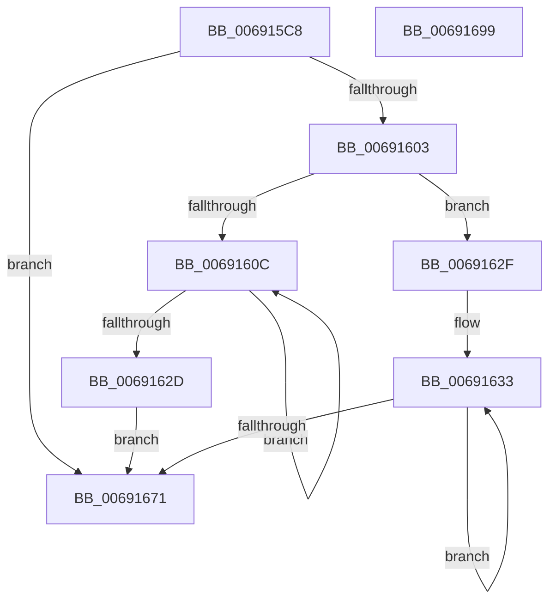

# MiManagePartitionCharges

- RVA: `0x006915C8`–`0x0069169A` (길이 `210` bytes)
- VA: `0x00000001406915C8`
- 실행 섹션: `.text`
- PDB 이름 있음: `예`; PDB Function 태그: `아니요`
- unwind 정보 RVA: `0x0005E6B4`
- 디코드: `60`개 명령, `210/210` bytes 표시
- 미해석 바이트: `0` (있으면 어셈블리에 `.byte`로 보존)

> 이 문서는 커널 이미지의 기계어와 PDB 기호를 분석해 생성했습니다. 4번과 5번은 함수 원형과 자료형을 바이너리 사용 방식에서 추정한 C 해석이며 원본 소스 복구 결과는 아닙니다.

## 1. Dependencies

- 직접 호출 지점: **2**; 고유 호출 대상: **2**
- 직접 호출자로 확인된 함수: **1**
- RIP 상대 이미지 참조: **0**

### Outgoing calls
- `0x006915F7` → [ExAcquireSpinLockExclusive](../24/ExAcquireSpinLockExclusive_function_00248690.md) (function, `0x00248690`)
- `0x00691677` → [MiReleaseSpinLockExclusive](../24/MiReleaseSpinLockExclusive_function_002482C0.md) (function, `0x002482C0`)

### Direct callers
- [MmManagePartitionCharges](../../page/80/MmManagePartitionCharges_function_0080DDAC.md) at `0x0080DF02`

### Static image references
- 디코드된 RIP-relative 메모리 참조가 없습니다.

## 2. Other-region calls and transfers

- 다른 실행 섹션으로 향하는 call: **0**
- 별도 외부 분기/꼬리 이동을 확인하지 못했습니다.

## 3. Assembly (complete function range)

```asm
006915C8  48 8B C4                        mov rax, rsp
006915CB  48 89 58 08                     mov qword ptr [rax + 8], rbx
006915CF  48 89 68 10                     mov qword ptr [rax + 0x10], rbp
006915D3  48 89 70 18                     mov qword ptr [rax + 0x18], rsi
006915D7  48 89 78 20                     mov qword ptr [rax + 0x20], rdi
006915DB  41 56                           push r14
006915DD  48 83 EC 20                     sub rsp, 0x20
006915E1  48 8D A9 C0 06 00 00            lea rbp, [rcx + 0x6c0]
006915E8  41 8B F8                        mov edi, r8d
006915EB  48 8B F1                        mov rsi, rcx
006915EE  49 8B D9                        mov rbx, r9
006915F1  48 8B CD                        mov rcx, rbp
006915F4  44 8B F2                        mov r14d, edx
006915F7  E8 94 70 BB FF                  call 0x140248690
006915FC  44 8A C8                        mov r9b, al
006915FF  85 FF                           test edi, edi
00691601  74 6E                           je 0x140691671
00691603  44 8B C7                        mov r8d, edi
00691606  41 F6 C6 02                     test r14b, 2
0069160A  74 23                           je 0x14069162f
0069160C  8B 03                           mov eax, dword ptr [rbx]
0069160E  48 8D 5B 28                     lea rbx, [rbx + 0x28]
00691612  F7 D8                           neg eax
00691614  48 8B 43 F0                     mov rax, qword ptr [rbx - 0x10]
00691618  48 1B C9                        sbb rcx, rcx
0069161B  48 83 E1 E0                     and rcx, 0xffffffffffffffe0
0069161F  48 89 84 31 D0 0A 00 00         mov qword ptr [rcx + rsi + 0xad0], rax
00691627  49 83 E8 01                     sub r8, 1
0069162B  75 DF                           jne 0x14069160c
0069162D  EB 42                           jmp 0x140691671
0069162F  48 83 C3 20                     add rbx, 0x20
00691633  8B 43 E0                        mov eax, dword ptr [rbx - 0x20]
00691636  F7 D8                           neg eax
00691638  48 1B D2                        sbb rdx, rdx
0069163B  48 83 E2 E0                     and rdx, 0xffffffffffffffe0
0069163F  48 81 C2 B8 0A 00 00            add rdx, 0xab8
00691646  48 03 D6                        add rdx, rsi
00691649  48 8B 42 18                     mov rax, qword ptr [rdx + 0x18]
0069164D  48 89 43 F8                     mov qword ptr [rbx - 8], rax
00691651  48 8B 42 08                     mov rax, qword ptr [rdx + 8]
00691655  48 89 03                        mov qword ptr [rbx], rax
00691658  48 8D 5B 28                     lea rbx, [rbx + 0x28]
0069165C  48 8B 42 10                     mov rax, qword ptr [rdx + 0x10]
00691660  48 89 43 C8                     mov qword ptr [rbx - 0x38], rax
00691664  48 8B 02                        mov rax, qword ptr [rdx]
00691667  48 89 43 C0                     mov qword ptr [rbx - 0x40], rax
0069166B  49 83 E8 01                     sub r8, 1
0069166F  75 C2                           jne 0x140691633
00691671  41 8A D1                        mov dl, r9b
00691674  48 8B CD                        mov rcx, rbp
00691677  E8 44 6C BB FF                  call 0x1402482c0
0069167C  48 8B 5C 24 30                  mov rbx, qword ptr [rsp + 0x30]
00691681  33 C0                           xor eax, eax
00691683  48 8B 6C 24 38                  mov rbp, qword ptr [rsp + 0x38]
00691688  48 8B 74 24 40                  mov rsi, qword ptr [rsp + 0x40]
0069168D  48 8B 7C 24 48                  mov rdi, qword ptr [rsp + 0x48]
00691692  48 83 C4 20                     add rsp, 0x20
00691696  41 5E                           pop r14
00691698  C3                              ret
00691699  CC                              int3
```

## 4. C-style interpretation (structured pseudocode)

```c
__int64 __fastcall MiManagePartitionCharges(__int64 a1, __int64 a2, int a3, __int64 a4)
{
    __int64 result;
    __int64 v_rbx;
    __int64 v_rsp;
    unsigned __int64 v_stack_p10;
    unsigned __int64 v_stack_p18;
    unsigned __int64 v_stack_p20;
    unsigned __int64 v_stack_p8;

    *(unsigned __int64 *)(v_rsp + 8) = v_rbx;
    *(unsigned __int64 *)(v_rsp + 16) = v_rbp;
    *(unsigned __int64 *)(v_rsp + 24) = v_rsi;
    *(unsigned __int64 *)(v_rsp + 32) = v_rdi;
    v_rsp = (v_rsp) - (32);
    result = ExAcquireSpinLockExclusive(a1 + 1728, a2, a3, a4);
    if ((unsigned int)((unsigned int)(a3)) == 0) goto loc_00691671;
    if ((((unsigned __int8)((unsigned int)((unsigned int)(a2)))) & (2)) == 0) goto loc_0069162F;
loc_0069160C:
    result = (unsigned int)(-((unsigned int)(*(unsigned int *)(a4))));
    a1 = (a1 + 1728) & (-32);
    *(unsigned __int64 *)(a1 + a1 * 1 + 2768) = *(unsigned __int64 *)(a4 + 40 - 16);
    a3 = ((unsigned int)((unsigned int)((unsigned int)(a3)))) - (1);
    if (condition_is_not_equal) goto loc_0069160C;
    goto loc_00691671;
loc_0069162F:
    v_rbx = (a4 + 40) + (32);
loc_00691633:
    result = (unsigned int)(-((unsigned int)(*(unsigned int *)(v_rbx - 32))));
    a2 = (a2) & (-32);
    a2 = (a2) + (0xAB8ULL);
    a2 = (a2) + (a1);
    *(unsigned __int64 *)(v_rbx - 8) = *(unsigned __int64 *)(a2 + 24);
    *(unsigned __int64 *)(v_rbx) = *(unsigned __int64 *)(a2 + 8);
    *(unsigned __int64 *)(v_rbx + 40 - 56) = *(unsigned __int64 *)(a2 + 16);
    *(unsigned __int64 *)(v_rbx + 40 - 64) = *(unsigned __int64 *)(a2);
    a3 = (a3) - (1);
    if (condition_is_not_equal) goto loc_00691633;
loc_00691671:
    result = MiReleaseSpinLockExclusive(a1 + 1728, (unsigned __int8)((unsigned __int8)(result)), a3, (unsigned __int8)(result));
    result = 0;
    v_rsp = (v_rsp) + (32);
    return result;
}
```

## 5. (Beta) C Style

```c
int64_t MiManagePartitionCharges(void *Arg1, int64_t Arg2, int32_t Arg3, void *Arg4)
{
    uint8_t *arg1 = (uint8_t *)Arg1;
    uint8_t *arg4 = (uint8_t *)Arg4;

    int64_t result;
    int64_t local_rbx;
    int64_t local_rsp;
    uint64_t v_stack_p10;
    uint64_t v_stack_p18;
    uint64_t v_stack_p20;
    uint64_t v_stack_p8;

    *(uint64_t *)(local_rsp + 0x8) = local_rbx;
    *(uint64_t *)(local_rsp + 0x10) = local_rbp;
    *(uint64_t *)(local_rsp + 0x18) = local_rsi;
    *(uint64_t *)(local_rsp + 0x20) = local_rdi;
    local_rsp = (local_rsp) - (32);
    result = ExAcquireSpinLockExclusive(Arg1 + 1728, Arg2, Arg3, Arg4);
    if ((uint32_t)((uint32_t)(Arg3)) == 0) goto loc_00691671;
    if ((((uint8_t)((uint32_t)((uint32_t)(Arg2)))) & (2)) == 0) goto loc_0069162F;
loc_0069160C:
    result = (uint32_t)(-((uint32_t)(*(uint32_t *)(arg4))));
    Arg1 = (Arg1 + 1728) & (-32);
    *(uint64_t *)(arg1 + arg1 * 1 + 0xAD0) = *(uint64_t *)(arg4 + 0x28 - 0x10);
    Arg3 = ((uint32_t)((uint32_t)((uint32_t)(Arg3)))) - (1);
    if (condition_is_not_equal) goto loc_0069160C;
    goto loc_00691671;
loc_0069162F:
    local_rbx = (Arg4 + 40) + (32);
loc_00691633:
    result = (uint32_t)(-((uint32_t)(*(uint32_t *)(local_rbx - 0x20))));
    Arg2 = (Arg2) & (-32);
    Arg2 = (Arg2) + (0xAB8ULL);
    Arg2 = (Arg2) + (Arg1);
    *(uint64_t *)(local_rbx - 0x8) = *(uint64_t *)(Arg2 + 0x18);
    *(uint64_t *)(local_rbx) = *(uint64_t *)(Arg2 + 0x8);
    *(uint64_t *)(local_rbx + 0x28 - 0x38) = *(uint64_t *)(Arg2 + 0x10);
    *(uint64_t *)(local_rbx + 0x28 - 0x40) = *(uint64_t *)(Arg2);
    Arg3 = (Arg3) - (1);
    if (condition_is_not_equal) goto loc_00691633;
loc_00691671:
    result = MiReleaseSpinLockExclusive(Arg1 + 1728, (uint8_t)((uint8_t)(result)), Arg3, (uint8_t)(result));
    result = 0;
    local_rsp = (local_rsp) + (32);
    return result;
}
```

### 관측된 메모리 오프셋

구조체 형식이 확인되지 않은 접근은 인자 기준의 오프셋으로만 기록했습니다.

| 기준 인자 | 오프셋 표현 | 폭 (bit) | 접근 |
|---|---:|---:|---|
| `Arg1` | `+ 0x6C0` | `64` | `R` |
| `Arg4` | `- 0x40` | `64` | `W` |
| `Arg4` | `- 0x38` | `64` | `W` |
| `Arg4` | `- 0x20` | `32` | `R` |
| `Arg4` | `- 0x10` | `64` | `R` |
| `Arg4` | `- 0x8` | `64` | `W` |
| `Arg4` | `+ 0x0` | `32` | `R` |
| `Arg4` | `+ 0x0` | `64` | `W` |
| `Arg4` | `+ 0x28` | `64` | `R` |

## 6. Execution-region graph

[열기: 2D/3D 그래프와 함수 탐색 컨트롤 패널](../../../control-panel.html?section=text&rva=0x006915C8&view=graph)

- 2D 그래프는 위에서 아래로 흐르고, 3D 그래프는 빈 공간을 드래그해 회전합니다. Shift+드래그는 이동, 휠은 확대·축소, 함수 노드 선택은 대상 보고서 이동입니다.

### Static fallback


