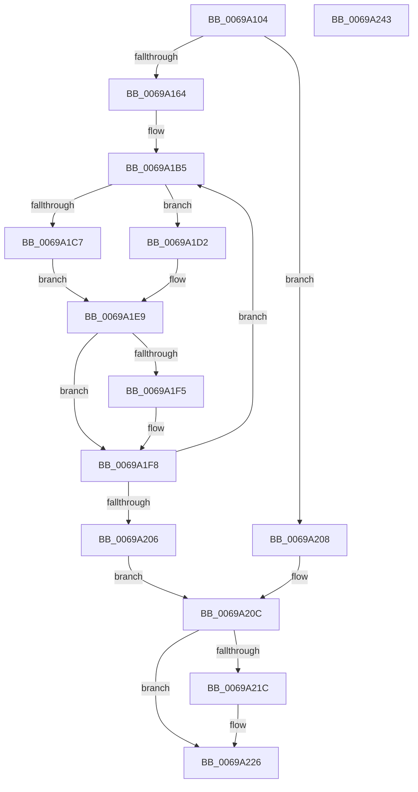

# MiMergeCalibrationResults

- RVA: `0x0069A104`–`0x0069A244` (길이 `320` bytes)
- VA: `0x000000014069A104`
- 실행 섹션: `.text`
- PDB 이름 있음: `예`; PDB Function 태그: `아니요`
- unwind 정보 RVA: `0x00075C18`
- 디코드: `92`개 명령, `320/320` bytes 표시
- 미해석 바이트: `0` (있으면 어셈블리에 `.byte`로 보존)

> 이 문서는 커널 이미지의 기계어와 PDB 기호를 분석해 생성했습니다. 4번과 5번은 함수 원형과 자료형을 바이너리 사용 방식에서 추정한 C 해석이며 원본 소스 복구 결과는 아닙니다.

## 1. Dependencies

- 직접 호출 지점: **4**; 고유 호출 대상: **4**
- 직접 호출자로 확인된 함수: **1**
- RIP 상대 이미지 참조: **1**

### Outgoing calls
- `0x0069A136` → [ExAcquireSpinLockExclusive](../24/ExAcquireSpinLockExclusive_function_00248690.md) (function, `0x00248690`)
- `0x0069A157` → [MiIsCalibrationWorthwhile](../4A/MiIsCalibrationWorthwhile_function_004A0770.md) (function, `0x004A0770`)
- `0x0069A212` → [MiReleaseSpinLockExclusive](../24/MiReleaseSpinLockExclusive_function_002482C0.md) (function, `0x002482C0`)
- `0x0069A221` → [ExFreePoolWithTag](../../poolcode/B8/ExFreePoolWithTag_function_00B82870.md) (function, `0x00B82870`)

### Direct callers
- [MiZeroPageCalibrate](MiZeroPageCalibrate_function_0069A69C.md) at `0x0069A9E2`

### Static image references
- `0x0069A1AE` → RVA `0x0003B000` (`.rdata`; read)

## 2. Other-region calls and transfers

- 다른 실행 섹션으로 향하는 call: **1**
  - `0x0069A221` → [ExFreePoolWithTag](../../poolcode/B8/ExFreePoolWithTag_function_00B82870.md) (`.text` → `POOLCODE`)
- 별도 외부 분기/꼬리 이동을 확인하지 못했습니다.

## 3. Assembly (complete function range)

```asm
0069A104  48 89 5C 24 08                  mov qword ptr [rsp + 8], rbx
0069A109  48 89 6C 24 10                  mov qword ptr [rsp + 0x10], rbp
0069A10E  48 89 74 24 18                  mov qword ptr [rsp + 0x18], rsi
0069A113  57                              push rdi
0069A114  41 54                           push r12
0069A116  41 55                           push r13
0069A118  41 56                           push r14
0069A11A  41 57                           push r15
0069A11C  48 83 EC 20                     sub rsp, 0x20
0069A120  41 8B 19                        mov ebx, dword ptr [r9]
0069A123  48 8D 6A 40                     lea rbp, [rdx + 0x40]
0069A127  4C 8B F9                        mov r15, rcx
0069A12A  49 8B F9                        mov rdi, r9
0069A12D  48 8B CD                        mov rcx, rbp
0069A130  49 8B F0                        mov rsi, r8
0069A133  4C 8B F2                        mov r14, rdx
0069A136  E8 55 E5 BA FF                  call 0x140248690
0069A13B  4D 8B 17                        mov r10, qword ptr [r15]
0069A13E  41 B9 01 00 00 00               mov r9d, 1
0069A144  8B D3                           mov edx, ebx
0069A146  48 8B CE                        mov rcx, rsi
0069A149  44 8A E0                        mov r12b, al
0069A14C  4D 8B 82 B0 00 00 00            mov r8, qword ptr [r10 + 0xb0]
0069A153  45 8B 40 38                     mov r8d, dword ptr [r8 + 0x38]
0069A157  E8 14 66 E0 FF                  call 0x1404a0770
0069A15C  85 C0                           test eax, eax
0069A15E  0F 84 A4 00 00 00               je 0x14069a208
0069A164  0F 28 07                        movaps xmm0, xmmword ptr [rdi]
0069A167  4C 8D 4E 10                     lea r9, [rsi + 0x10]
0069A16B  48 8B 5E 30                     mov rbx, qword ptr [rsi + 0x30]
0069A16F  4C 63 6C 24 70                  movsxd r13, dword ptr [rsp + 0x70]
0069A174  0F 11 06                        movups xmmword ptr [rsi], xmm0
0069A177  0F 28 4F 10                     movaps xmm1, xmmword ptr [rdi + 0x10]
0069A17B  0F 11 4E 10                     movups xmmword ptr [rsi + 0x10], xmm1
0069A17F  0F 28 47 20                     movaps xmm0, xmmword ptr [rdi + 0x20]
0069A183  0F 11 46 20                     movups xmmword ptr [rsi + 0x20], xmm0
0069A187  F2 0F 10 4F 30                  movsd xmm1, qword ptr [rdi + 0x30]
0069A18C  BF 02 00 00 00                  mov edi, 2
0069A191  F2 0F 11 4E 30                  movsd qword ptr [rsi + 0x30], xmm1
0069A196  49 8B 07                        mov rax, qword ptr [r15]
0069A199  8B 08                           mov ecx, dword ptr [rax]
0069A19B  F7 D9                           neg ecx
0069A19D  4D 1B C0                        sbb r8, r8
0069A1A0  49 81 C6 40 02 00 00            add r14, 0x240
0069A1A7  41 83 E0 08                     and r8d, 8
0069A1AB  4D 03 C6                        add r8, r14
0069A1AE  4C 8D 35 4B 0E 9A FF            lea r14, [rip - 0x65f1b5]
0069A1B5  4C 8B 56 30                     mov r10, qword ptr [rsi + 0x30]
0069A1B9  33 D2                           xor edx, edx
0069A1BB  41 8B 41 14                     mov eax, dword ptr [r9 + 0x14]
0069A1BF  44 8B D8                        mov r11d, eax
0069A1C2  4D 85 D2                        test r10, r10
0069A1C5  75 0B                           jne 0x14069a1d2
0069A1C7  B8 00 00 20 00                  mov eax, 0x200000
0069A1CC  4B F7 34 EE                     div qword ptr [r14 + r13*8]
0069A1D0  EB 17                           jmp 0x14069a1e9
0069A1D2  8D 48 FF                        lea ecx, [rax - 1]
0069A1D5  49 8B 87 18 01 00 00            mov rax, qword ptr [r15 + 0x118]
0069A1DC  49 F7 F3                        div r11
0069A1DF  48 03 C9                        add rcx, rcx
0069A1E2  33 D2                           xor edx, edx
0069A1E4  49 F7 74 CA 08                  div qword ptr [r10 + rcx*8 + 8]
0069A1E9  49 89 01                        mov qword ptr [r9], rax
0069A1EC  49 0F AF C3                     imul rax, r11
0069A1F0  49 39 00                        cmp qword ptr [r8], rax
0069A1F3  73 03                           jae 0x14069a1f8
0069A1F5  49 89 00                        mov qword ptr [r8], rax
0069A1F8  49 83 C0 10                     add r8, 0x10
0069A1FC  49 83 C1 08                     add r9, 8
0069A200  48 83 EF 01                     sub rdi, 1
0069A204  75 AF                           jne 0x14069a1b5
0069A206  EB 04                           jmp 0x14069a20c
0069A208  48 8B 5F 30                     mov rbx, qword ptr [rdi + 0x30]
0069A20C  41 8A D4                        mov dl, r12b
0069A20F  48 8B CD                        mov rcx, rbp
0069A212  E8 A9 E0 BA FF                  call 0x1402482c0
0069A217  48 85 DB                        test rbx, rbx
0069A21A  74 0A                           je 0x14069a226
0069A21C  33 D2                           xor edx, edx
0069A21E  48 8B CB                        mov rcx, rbx
0069A221  E8 4A 86 4E 00                  call 0x140b82870
0069A226  48 8B 5C 24 50                  mov rbx, qword ptr [rsp + 0x50]
0069A22B  48 8B 6C 24 58                  mov rbp, qword ptr [rsp + 0x58]
0069A230  48 8B 74 24 60                  mov rsi, qword ptr [rsp + 0x60]
0069A235  48 83 C4 20                     add rsp, 0x20
0069A239  41 5F                           pop r15
0069A23B  41 5E                           pop r14
0069A23D  41 5D                           pop r13
0069A23F  41 5C                           pop r12
0069A241  5F                              pop rdi
0069A242  C3                              ret
0069A243  CC                              int3
```

## 4. C-style interpretation (structured pseudocode)

```c
__int64 __fastcall MiMergeCalibrationResults(__int64 a1, __int64 a2, __int64 a3, __int64 a4, unsigned int a5)
{
    __int64 result;
    __int64 v_r14;
    __int64 v_rdi;
    __int64 v_rsp;
    unsigned __int64 v_stack_p10;
    unsigned __int64 v_stack_p18;
    unsigned __int64 v_stack_p8;

    v_stack_p8 = v_rbx;
    v_stack_p10 = v_rbp;
    v_stack_p18 = v_rsi;
    v_rsp = (v_rsp) - (32);
    result = ExAcquireSpinLockExclusive(a2 + 64, a2, a3, a4);
    result = MiIsCalibrationWorthwhile(a3, (unsigned int)((unsigned int)((unsigned int)(*(unsigned int *)(a4)))), (unsigned int)(*(unsigned int *)(*(unsigned __int64 *)(*(unsigned __int64 *)(a1) + 176) + 56)), 1);
    if ((unsigned int)(result) == 0) goto loc_0069A208;
    *(unsigned __int64 *)(a3) = v_xmm0;
    *(unsigned __int64 *)(a3 + 16) = v_xmm1;
    *(unsigned __int64 *)(a3 + 32) = v_xmm0;
    *(unsigned __int64 *)(a3 + 48) = v_xmm1;
    a1 = (unsigned int)(-((unsigned int)(*(unsigned int *)(*(unsigned __int64 *)(a1)))));
    v_r14 = (a2) + (576);
    a3 = (unsigned int)(((unsigned int)(*(unsigned int *)(*(unsigned __int64 *)(*(unsigned __int64 *)(a1) + 176) + 56))) & (8));
    a3 = (a3) + (v_r14);
loc_0069A1B5:
    a2 = 0;
    if (*(unsigned __int64 *)(a3 + 48) != 0) goto loc_0069A1D2;
    goto loc_0069A1E9;
loc_0069A1D2:
    a1 = ((unsigned int)(0x200000ULL) - 1) + ((unsigned int)(0x200000ULL) - 1);
    a2 = 0;
loc_0069A1E9:
    *(unsigned __int64 *)(a3 + 16) = *(unsigned __int64 *)(a1 + 280);
    result = (*(unsigned __int64 *)(a1 + 280)) * ((unsigned int)((unsigned int)((unsigned int)(*(unsigned int *)(a3 + 16 + 20)))));
    if ((*(unsigned __int64 *)(a3)) < result) {
        *(unsigned __int64 *)(a3) = result;
    }
    a3 = (a3) + (16);
    a4 = (a3 + 16) + (8);
    v_rdi = (2) - (1);
    if (condition_is_not_equal) goto loc_0069A1B5;
    goto loc_0069A20C;
loc_0069A208:
loc_0069A20C:
    result = MiReleaseSpinLockExclusive(a2 + 64, (unsigned __int8)((unsigned __int8)(result)), a3, a4);
    if (*(unsigned __int64 *)(v_rdi + 48) != 0) {
        a2 = 0;
        a1 = *(unsigned __int64 *)(v_rdi + 48);
        result = ExFreePoolWithTag(a1, a2, a3, a4);
    }
    v_rsp = (v_rsp) + (32);
    return result;
}
```

## 5. (Beta) C Style

```c
int64_t MiMergeCalibrationResults(void *Arg1, void *Arg2, void *Arg3, void *Arg4, uint32_t Arg5)
{
    uint8_t *arg1 = (uint8_t *)Arg1;
    uint8_t *arg2 = (uint8_t *)Arg2;
    uint8_t *arg3 = (uint8_t *)Arg3;
    uint8_t *arg4 = (uint8_t *)Arg4;

    int64_t result;
    int64_t local_r14;
    int64_t local_rdi;
    int64_t local_rsp;
    uint64_t v_stack_p10;
    uint64_t v_stack_p18;
    uint64_t v_stack_p8;

    v_stack_p8 = local_rbx;
    v_stack_p10 = local_rbp;
    v_stack_p18 = local_rsi;
    local_rsp = (local_rsp) - (32);
    result = ExAcquireSpinLockExclusive(Arg2 + 64, Arg2, Arg3, Arg4);
    result = MiIsCalibrationWorthwhile(Arg3, (uint32_t)((uint32_t)((uint32_t)(*(uint32_t *)(arg4)))), (uint32_t)(*(uint32_t *)(*(uint64_t *)(*(uint64_t *)(arg1) + 0xB0) + 0x38)), 1);
    if ((uint32_t)(result) == 0) goto loc_0069A208;
    *(uint64_t *)(arg3) = v_xmm0;
    *(uint64_t *)(arg3 + 0x10) = v_xmm1;
    *(uint64_t *)(arg3 + 0x20) = v_xmm0;
    *(uint64_t *)(arg3 + 0x30) = v_xmm1;
    Arg1 = (uint32_t)(-((uint32_t)(*(uint32_t *)(*(uint64_t *)(arg1)))));
    local_r14 = (Arg2) + (576);
    Arg3 = (uint32_t)(((uint32_t)(*(uint32_t *)(*(uint64_t *)(*(uint64_t *)(arg1) + 0xB0) + 0x38))) & (8));
    Arg3 = (Arg3) + (local_r14);
loc_0069A1B5:
    Arg2 = 0;
    if (*(uint64_t *)(arg3 + 0x30) != 0) goto loc_0069A1D2;
    goto loc_0069A1E9;
loc_0069A1D2:
    Arg1 = ((uint32_t)(0x200000ULL) - 1) + ((uint32_t)(0x200000ULL) - 1);
    Arg2 = 0;
loc_0069A1E9:
    *(uint64_t *)(arg3 + 0x10) = *(uint64_t *)(arg1 + 0x118);
    result = (*(uint64_t *)(arg1 + 0x118)) * ((uint32_t)((uint32_t)((uint32_t)(*(uint32_t *)(arg3 + 0x10 + 0x14)))));
    if ((*(uint64_t *)(arg3)) < result) {
        *(uint64_t *)(arg3) = result;
    }
    Arg3 = (Arg3) + (16);
    Arg4 = (Arg3 + 16) + (8);
    local_rdi = (2) - (1);
    if (condition_is_not_equal) goto loc_0069A1B5;
    goto loc_0069A20C;
loc_0069A208:
loc_0069A20C:
    result = MiReleaseSpinLockExclusive(Arg2 + 64, (uint8_t)((uint8_t)(result)), Arg3, Arg4);
    if (*(uint64_t *)(local_rdi + 0x30) != 0) {
        Arg2 = 0;
        Arg1 = *(uint64_t *)(local_rdi + 0x30);
        result = ExFreePoolWithTag(Arg1, Arg2, Arg3, Arg4);
    }
    local_rsp = (local_rsp) + (32);
    return result;
}
```

### 관측된 메모리 오프셋

구조체 형식이 확인되지 않은 접근은 인자 기준의 오프셋으로만 기록했습니다.

| 기준 인자 | 오프셋 표현 | 폭 (bit) | 접근 |
|---|---:|---:|---|
| `Arg1` | `+ 0x0` | `64` | `R` |
| `Arg1` | `+ 0x118` | `64` | `R` |
| `Arg2` | `+ 0x40` | `64` | `R` |
| `Arg3` | `+ 0x0` | `64` | `W` |
| `Arg3` | `+ 0x0` | `128` | `R` |
| `Arg3` | `+ 0x10` | `64` | `R` |
| `Arg3` | `+ 0x10` | `128` | `R` |
| `Arg3` | `+ 0x14` | `32` | `R` |
| `Arg3` | `+ 0x20` | `128` | `R` |
| `Arg3` | `+ 0x30` | `64` | `R` |
| `Arg3` | `+ 0x30` | `64` | `W` |
| `Arg4` | `+ 0x0` | `32` | `R` |
| `Arg4` | `+ 0x0` | `128` | `R` |
| `Arg4` | `+ 0x10` | `128` | `R` |
| `Arg4` | `+ 0x20` | `128` | `R` |
| `Arg4` | `+ 0x30` | `64` | `R` |

## 6. Execution-region graph

[열기: 2D/3D 그래프와 함수 탐색 컨트롤 패널](../../../control-panel.html?section=text&rva=0x0069A104&view=graph)

- 2D 그래프는 위에서 아래로 흐르고, 3D 그래프는 빈 공간을 드래그해 회전합니다. Shift+드래그는 이동, 휠은 확대·축소, 함수 노드 선택은 대상 보고서 이동입니다.

### Static fallback


