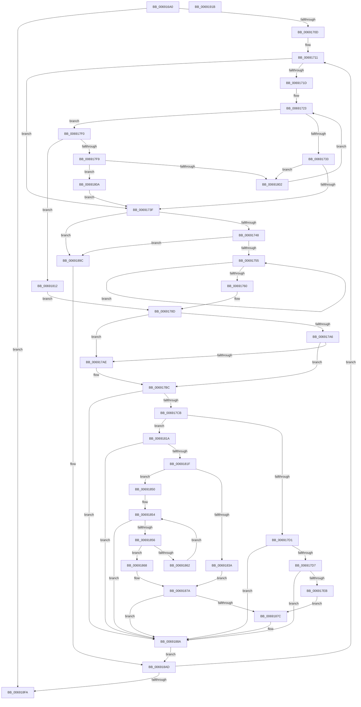

# MiMergePageNodes

- RVA: `0x006916A0`–`0x0069191C` (길이 `636` bytes)
- VA: `0x00000001406916A0`
- 실행 섹션: `.text`
- PDB 이름 있음: `예`; PDB Function 태그: `아니요`
- unwind 정보 RVA: `0x000D9068`
- 디코드: `165`개 명령, `636/636` bytes 표시
- 미해석 바이트: `0` (있으면 어셈블리에 `.byte`로 보존)

> 이 문서는 커널 이미지의 기계어와 PDB 기호를 분석해 생성했습니다. 4번과 5번은 함수 원형과 자료형을 바이너리 사용 방식에서 추정한 C 해석이며 원본 소스 복구 결과는 아닙니다.

## 1. Dependencies

- 직접 호출 지점: **4**; 고유 호출 대상: **3**
- 직접 호출자로 확인된 함수: **3**
- RIP 상대 이미지 참조: **0**

### Outgoing calls
- `0x00691766` → [RtlAvlRemoveNode](../29/RtlAvlRemoveNode_function_00296650.md) (function, `0x00296650`)
- `0x00691788` → [RtlAvlInsertNodeEx](../26/RtlAvlInsertNodeEx_function_00265790.md) (function, `0x00265790`)
- `0x00691799` → [RtlMergeBitMapsEx](../5E/RtlMergeBitMapsEx_function_005E62F0.md) (function, `0x005E62F0`)
- `0x006918A8` → [RtlAvlInsertNodeEx](../26/RtlAvlInsertNodeEx_function_00265790.md) (function, `0x00265790`)

### Direct callers
- [MiFinishChildPartitionHotAdd](MiFinishChildPartitionHotAdd_function_00690C00.md) at `0x00690CAC`
- [MiInsertPartitionPageNodes](MiInsertPartitionPageNodes_function_00690F94.md) at `0x006910FE`
- [MiReturnPartitionPagesToParent](MiReturnPartitionPagesToParent_function_00691B5C.md) at `0x00691CB2`

### Static image references
- 디코드된 RIP-relative 메모리 참조가 없습니다.

## 2. Other-region calls and transfers

- 다른 실행 섹션으로 향하는 call: **0**
- 별도 외부 분기/꼬리 이동을 확인하지 못했습니다.

## 3. Assembly (complete function range)

```asm
006916A0  4C 8B DC                        mov r11, rsp
006916A3  49 89 5B 08                     mov qword ptr [r11 + 8], rbx
006916A7  49 89 6B 18                     mov qword ptr [r11 + 0x18], rbp
006916AB  49 89 73 20                     mov qword ptr [r11 + 0x20], rsi
006916AF  57                              push rdi
006916B0  41 54                           push r12
006916B2  41 55                           push r13
006916B4  41 56                           push r14
006916B6  41 57                           push r15
006916B8  48 83 EC 50                     sub rsp, 0x50
006916BC  49 83 63 A8 00                  and qword ptr [r11 - 0x58], 0
006916C1  4D 8B E8                        mov r13, r8
006916C4  48 8B 42 20                     mov rax, qword ptr [rdx + 0x20]
006916C8  49 B8 FF FF FF FF FF FF FF 3F   movabs r8, 0x3fffffffffffffff
006916D2  48 8B 5A 18                     mov rbx, qword ptr [rdx + 0x18]
006916D6  0F 57 C0                        xorps xmm0, xmm0
006916D9  48 8B 72 28                     mov rsi, qword ptr [rdx + 0x28]
006916DD  49 23 D8                        and rbx, r8
006916E0  F3 0F 7F 44 24 28               movdqu xmmword ptr [rsp + 0x28], xmm0
006916E6  45 33 F6                        xor r14d, r14d
006916E9  48 89 84 24 88 00 00 00         mov qword ptr [rsp + 0x88], rax
006916F1  49 89 5B C0                     mov qword ptr [r11 - 0x40], rbx
006916F5  4C 8B FA                        mov r15, rdx
006916F8  49 89 73 D0                     mov qword ptr [r11 - 0x30], rsi
006916FC  49 C7 43 C8 00 00 04 00         mov qword ptr [r11 - 0x38], 0x40000
00691704  48 85 C0                        test rax, rax
00691707  0F 84 ED 01 00 00               je 0x1406918fa
0069170D  4C 8D 61 18                     lea r12, [rcx + 0x18]
00691711  49 8B 3C 24                     mov rdi, qword ptr [r12]
00691715  40 32 ED                        xor bpl, bpl
00691718  48 85 FF                        test rdi, rdi
0069171B  74 22                           je 0x14069173f
0069171D  48 8B D3                        mov rdx, rbx
00691720  49 23 D0                        and rdx, r8
00691723  48 8B 4F 18                     mov rcx, qword ptr [rdi + 0x18]
00691727  49 23 C8                        and rcx, r8
0069172A  48 3B D1                        cmp rdx, rcx
0069172D  0F 83 BD 00 00 00               jae 0x1406917f0
00691733  48 8B 07                        mov rax, qword ptr [rdi]
00691736  48 85 C0                        test rax, rax
00691739  0F 85 C3 00 00 00               jne 0x140691802
0069173F  4D 85 ED                        test r13, r13
00691742  0F 84 54 01 00 00               je 0x14069189c
00691748  49 8B 45 00                     mov rax, qword ptr [r13]
0069174C  48 85 C0                        test rax, rax
0069174F  0F 84 47 01 00 00               je 0x14069189c
00691755  48 8B F0                        mov rsi, rax
00691758  48 8B 00                        mov rax, qword ptr [rax]
0069175B  48 85 C0                        test rax, rax
0069175E  75 F5                           jne 0x140691755
00691760  48 8B D6                        mov rdx, rsi
00691763  49 8B CD                        mov rcx, r13
00691766  E8 E5 4E C0 FF                  call 0x140296650
0069176B  48 B8 FF FF FF FF FF FF FF 3F   movabs rax, 0x3fffffffffffffff
00691775  4C 8B CE                        mov r9, rsi
00691778  48 23 D8                        and rbx, rax
0069177B  44 8A C5                        mov r8b, bpl
0069177E  48 8B D7                        mov rdx, rdi
00691781  48 89 5E 18                     mov qword ptr [rsi + 0x18], rbx
00691785  49 8B CC                        mov rcx, r12
00691788  E8 03 40 BD FF                  call 0x140265790
0069178D  48 8D 5E 20                     lea rbx, [rsi + 0x20]
00691791  48 8B CB                        mov rcx, rbx
00691794  48 8D 54 24 40                  lea rdx, [rsp + 0x40]
00691799  E8 52 4B F5 FF                  call 0x1405e62f0
0069179E  49 0F BA 67 18 3E               bt qword ptr [r15 + 0x18], 0x3e
006917A4  73 08                           jae 0x1406917ae
006917A6  48 0F BA 66 18 3E               bt qword ptr [rsi + 0x18], 0x3e
006917AC  72 0E                           jb 0x1406917bc
006917AE  48 B8 FF FF FF FF FF FF FF BF   movabs rax, 0xbfffffffffffffff
006917B8  48 21 46 18                     and qword ptr [rsi + 0x18], rax
006917BC  48 8B 03                        mov rax, qword ptr [rbx]
006917BF  48 8B 13                        mov rdx, qword ptr [rbx]
006917C2  48 85 C0                        test rax, rax
006917C5  0F 84 BF 00 00 00               je 0x14069188a
006917CB  48 83 FA 01                     cmp rdx, 1
006917CF  77 49                           ja 0x14069181a
006917D1  0F 85 B3 00 00 00               jne 0x14069188a
006917D7  48 8B 43 08                     mov rax, qword ptr [rbx + 8]
006917DB  48 0F BA 20 00                  bt qword ptr [rax], 0
006917E0  0F 92 C0                        setb al
006917E3  84 C0                           test al, al
006917E5  0F 84 9F 00 00 00               je 0x14069188a
006917EB  E9 8C 00 00 00                  jmp 0x14069187c
006917F0  48 03 4F 20                     add rcx, qword ptr [rdi + 0x20]
006917F4  48 3B D1                        cmp rdx, rcx
006917F7  72 19                           jb 0x140691812
006917F9  48 8B 47 08                     mov rax, qword ptr [rdi + 8]
006917FD  48 85 C0                        test rax, rax
00691800  74 08                           je 0x14069180a
00691802  48 8B F8                        mov rdi, rax
00691805  E9 19 FF FF FF                  jmp 0x140691723
0069180A  40 B5 01                        mov bpl, 1
0069180D  E9 2D FF FF FF                  jmp 0x14069173f
00691812  48 8B F7                        mov rsi, rdi
00691815  E9 73 FF FF FF                  jmp 0x14069178d
0069181A  48 3B C2                        cmp rax, rdx
0069181D  72 6B                           jb 0x14069188a
0069181F  48 8B 4B 08                     mov rcx, qword ptr [rbx + 8]
00691823  4C 8D 52 FF                     lea r10, [rdx - 1]
00691827  49 8B C2                        mov rax, r10
0069182A  48 C1 E8 06                     shr rax, 6
0069182E  4C 8B 01                        mov r8, qword ptr [rcx]
00691831  4C 8D 0C C1                     lea r9, [rcx + rax*8]
00691835  49 3B C9                        cmp rcx, r9
00691838  75 16                           jne 0x140691850
0069183A  48 83 C8 FF                     or rax, 0xffffffffffffffff
0069183E  B9 40 00 00 00                  mov ecx, 0x40
00691843  2A CA                           sub cl, dl
00691845  48 D3 E8                        shr rax, cl
00691848  4C 23 C0                        and r8, rax
0069184B  4C 3B C0                        cmp r8, rax
0069184E  EB 2A                           jmp 0x14069187a
00691850  49 83 F8 FF                     cmp r8, -1
00691854  75 34                           jne 0x14069188a
00691856  48 83 C1 08                     add rcx, 8
0069185A  48 8B 11                        mov rdx, qword ptr [rcx]
0069185D  49 3B C9                        cmp rcx, r9
00691860  74 06                           je 0x140691868
00691862  48 83 FA FF                     cmp rdx, -1
00691866  EB EC                           jmp 0x140691854
00691868  48 83 C8 FF                     or rax, 0xffffffffffffffff
0069186C  41 8A CA                        mov cl, r10b
0069186F  F6 D1                           not cl
00691871  48 D3 E8                        shr rax, cl
00691874  48 23 D0                        and rdx, rax
00691877  48 3B D0                        cmp rdx, rax
0069187A  75 0E                           jne 0x14069188a
0069187C  48 B8 00 00 00 00 00 00 00 80   movabs rax, 0x8000000000000000
00691886  48 09 46 18                     or qword ptr [rsi + 0x18], rax
0069188A  48 8B 74 24 48                  mov rsi, qword ptr [rsp + 0x48]
0069188F  41 BE 01 00 00 00               mov r14d, 1
00691895  48 8B 5C 24 38                  mov rbx, qword ptr [rsp + 0x38]
0069189A  EB 11                           jmp 0x1406918ad
0069189C  4D 8B CF                        mov r9, r15
0069189F  44 8A C5                        mov r8b, bpl
006918A2  48 8B D7                        mov rdx, rdi
006918A5  49 8B CC                        mov rcx, r12
006918A8  E8 E3 3E BD FF                  call 0x140265790
006918AD  48 8D 93 00 00 04 00            lea rdx, [rbx + 0x40000]
006918B4  48 8B CB                        mov rcx, rbx
006918B7  48 81 C6 00 80 00 00            add rsi, 0x8000
006918BE  49 B8 FF FF FF FF FF FF FF 3F   movabs r8, 0x3fffffffffffffff
006918C8  49 23 D0                        and rdx, r8
006918CB  48 89 74 24 48                  mov qword ptr [rsp + 0x48], rsi
006918D0  48 B8 00 00 00 00 00 00 00 C0   movabs rax, 0xc000000000000000
006918DA  48 8B DA                        mov rbx, rdx
006918DD  48 23 C8                        and rcx, rax
006918E0  48 0B D9                        or rbx, rcx
006918E3  48 81 AC 24 88 00 00 00 00 00 04 00  sub qword ptr [rsp + 0x88], 0x40000
006918EF  48 89 5C 24 38                  mov qword ptr [rsp + 0x38], rbx
006918F4  0F 85 17 FE FF FF               jne 0x140691711
006918FA  4C 8D 5C 24 50                  lea r11, [rsp + 0x50]
006918FF  41 8B C6                        mov eax, r14d
00691902  49 8B 5B 30                     mov rbx, qword ptr [r11 + 0x30]
00691906  49 8B 6B 40                     mov rbp, qword ptr [r11 + 0x40]
0069190A  49 8B 73 48                     mov rsi, qword ptr [r11 + 0x48]
0069190E  49 8B E3                        mov rsp, r11
00691911  41 5F                           pop r15
00691913  41 5E                           pop r14
00691915  41 5D                           pop r13
00691917  41 5C                           pop r12
00691919  5F                              pop rdi
0069191A  C3                              ret
0069191B  CC                              int3
```

## 4. C-style interpretation (structured pseudocode)

```c
__int64 __fastcall MiMergePageNodes(__int64 a1, __int64 a2, __int64 a3)
{
    __int64 result;
    __int64 v_r14;
    __int64 v_rbp;
    __int64 v_rbx;
    __int64 v_rsi;
    __int64 v_rsp;
    unsigned __int64 v_stack_m28;
    unsigned __int64 v_stack_m30;
    unsigned __int64 v_stack_m38;
    unsigned __int64 v_stack_m40;
    unsigned __int64 v_stack_m50;
    unsigned __int64 v_stack_p10;

    *(unsigned __int64 *)(v_rsp + 8) = v_rbx;
    *(unsigned __int64 *)(v_rsp + 24) = v_rbp;
    *(unsigned __int64 *)(v_rsp + 32) = v_rsi;
    v_rsp = (v_rsp) - (80);
    v_rbx = (*(unsigned __int64 *)(a2 + 24)) & (a3);
    v_stack_m50 = v_xmm0;
    v_r14 = 0;
    v_stack_p10 = *(unsigned __int64 *)(a2 + 32);
    *(unsigned __int64 *)(v_rsp - 64) = v_rbx;
    *(unsigned __int64 *)(v_rsp - 48) = *(unsigned __int64 *)(a2 + 40);
    *(unsigned __int64 *)(v_rsp - 56) = 0x40000ULL;
    if (*(unsigned __int64 *)(a2 + 32) == 0) goto loc_006918FA;
loc_00691711:
    v_rbp = 0;
    if (*(unsigned __int64 *)(a1 + 24) == 0) goto loc_0069173F;
    a2 = (v_rbx) & (a3);
loc_00691723:
    a1 = (*(unsigned __int64 *)(*(unsigned __int64 *)(a1 + 24) + 24)) & (a3);
    if (a2 >= a1) goto loc_006917F0;
    if (*(unsigned __int64 *)(*(unsigned __int64 *)(a1 + 24)) != 0) goto loc_00691802;
loc_0069173F:
    if (a3 == 0) goto loc_0069189C;
    if (*(unsigned __int64 *)(a3) == 0) goto loc_0069189C;
loc_00691755:
    if (*(unsigned __int64 *)(*(unsigned __int64 *)(a3)) != 0) goto loc_00691755;
    result = RtlAvlRemoveNode(a3, *(unsigned __int64 *)(a3), a3, a4);
    v_rbx = (v_rbx) & (result);
    *(unsigned __int64 *)(*(unsigned __int64 *)(a3) + 24) = v_rbx;
    result = RtlAvlInsertNodeEx(a1 + 24, *(unsigned __int64 *)(a1 + 24), 0, *(unsigned __int64 *)(a3));
loc_0069178D:
    result = RtlMergeBitMapsEx(*(unsigned __int64 *)(a3) + 32, v_stack_m38, 0, *(unsigned __int64 *)(a3));
    if (condition_is_above_or_equal) goto loc_006917AE;
    if (!(condition_is_below)) {
    }
    if (*(unsigned __int64 *)(*(unsigned __int64 *)(a3) + 32) == 0) goto loc_0069188A;
    if ((*(unsigned __int64 *)(*(unsigned __int64 *)(a3) + 32)) > 1) goto loc_0069181A;
    if ((*(unsigned __int64 *)(*(unsigned __int64 *)(a3) + 32)) != 1) goto loc_0069188A;
    result = ((*(unsigned __int64 *)(*(unsigned __int64 *)(a3) + 32)) < 1) ? 1 : 0;
    if ((unsigned __int8)(result) == 0) goto loc_0069188A;
    goto loc_0069187C;
loc_006917F0:
    a1 = (*(unsigned __int64 *)(a3) + 32) + (*(unsigned __int64 *)(*(unsigned __int64 *)(a1 + 24) + 32));
    if ((*(unsigned __int64 *)(*(unsigned __int64 *)(a3) + 32)) < a1) goto loc_00691812;
    if (*(unsigned __int64 *)(*(unsigned __int64 *)(a1 + 24) + 8) == 0) goto loc_0069180A;
loc_00691802:
    goto loc_00691723;
loc_0069180A:
    goto loc_0069173F;
loc_00691812:
    goto loc_0069178D;
loc_0069181A:
    if ((*(unsigned __int64 *)(*(unsigned __int64 *)(a1 + 24) + 8)) < (*(unsigned __int64 *)(*(unsigned __int64 *)(a3) + 32))) goto loc_0069188A;
    result = (*(unsigned __int64 *)(*(unsigned __int64 *)(a3) + 32) - 1) >> (6);
    if ((*(unsigned __int64 *)(*(unsigned __int64 *)(a3) + 32 + 8)) != (*(unsigned __int64 *)(*(unsigned __int64 *)(a3) + 32 + 8) + result * 8)) goto loc_00691850;
    result = (result) | (-1);
    a1 = (unsigned __int8)((64) - ((unsigned __int8)(*(unsigned __int64 *)(*(unsigned __int64 *)(a3) + 32))));
    result = (result) >> ((unsigned __int8)(a1));
    a3 = (*(unsigned __int64 *)(*(unsigned __int64 *)(*(unsigned __int64 *)(a3) + 32 + 8))) & (result);
    goto loc_0069187A;
loc_00691850:
loc_00691854:
    if (a3 != -1) goto loc_0069188A;
    a1 = (a1) + (8);
    if (a1 == (*(unsigned __int64 *)(*(unsigned __int64 *)(a3) + 32 + 8) + result * 8)) goto loc_00691868;
    goto loc_00691854;
loc_00691868:
    result = (result) | (-1);
    a1 = (unsigned __int8)(~((unsigned __int8)(*(unsigned __int64 *)(*(unsigned __int64 *)(a3) + 32) - 1)));
    result = (result) >> ((unsigned __int8)(a1));
    a2 = (*(unsigned __int64 *)(a1)) & (result);
loc_0069187A:
    if (a2 == result) {
    }
    goto loc_006918AD;
loc_0069189C:
    result = RtlAvlInsertNodeEx(a1 + 24, *(unsigned __int64 *)(*(unsigned __int64 *)(a1 + 24) + 8), 1, a2);
loc_006918AD:
    v_rsi = (v_stack_m30) + (0x8000ULL);
    a2 = (v_stack_m40 + 262144) & (1);
    v_stack_m30 = v_rsi;
    a1 = (v_stack_m40) & (result);
    v_rbx = (a2) | (a1);
    v_stack_m40 = v_rbx;
    if (condition_is_not_equal) goto loc_00691711;
loc_006918FA:
    return 1;
}
```

## 5. (Beta) C Style

```c
int64_t MiMergePageNodes(void *Arg1, void *Arg2, int64_t Arg3)
{
    uint8_t *arg1 = (uint8_t *)Arg1;
    uint8_t *arg2 = (uint8_t *)Arg2;

    int64_t result;
    int64_t local_r14;
    int64_t local_rbp;
    int64_t local_rbx;
    int64_t local_rsi;
    int64_t local_rsp;
    uint64_t v_stack_m28;
    uint64_t v_stack_m30;
    uint64_t v_stack_m38;
    uint64_t v_stack_m40;
    uint64_t v_stack_m50;
    uint64_t v_stack_p10;

    *(uint64_t *)(local_rsp + 0x8) = local_rbx;
    *(uint64_t *)(local_rsp + 0x18) = local_rbp;
    *(uint64_t *)(local_rsp + 0x20) = local_rsi;
    local_rsp = (local_rsp) - (80);
    local_rbx = (*(uint64_t *)(arg2 + 0x18)) & (Arg3);
    v_stack_m50 = v_xmm0;
    local_r14 = 0;
    v_stack_p10 = *(uint64_t *)(arg2 + 0x20);
    *(uint64_t *)(local_rsp - 0x40) = local_rbx;
    *(uint64_t *)(local_rsp - 0x30) = *(uint64_t *)(arg2 + 0x28);
    *(uint64_t *)(local_rsp - 0x38) = 0x40000ULL;
    if (*(uint64_t *)(arg2 + 0x20) == 0) goto loc_006918FA;
loc_00691711:
    local_rbp = 0;
    if (*(uint64_t *)(arg1 + 0x18) == 0) goto loc_0069173F;
    Arg2 = (local_rbx) & (Arg3);
loc_00691723:
    Arg1 = (*(uint64_t *)(*(uint64_t *)(arg1 + 0x18) + 0x18)) & (Arg3);
    if (Arg2 >= Arg1) goto loc_006917F0;
    if (*(uint64_t *)(*(uint64_t *)(arg1 + 0x18)) != 0) goto loc_00691802;
loc_0069173F:
    if (Arg3 == 0) goto loc_0069189C;
    if (*(uint64_t *)(Arg3) == 0) goto loc_0069189C;
loc_00691755:
    if (*(uint64_t *)(*(uint64_t *)(Arg3)) != 0) goto loc_00691755;
    result = RtlAvlRemoveNode(Arg3, *(uint64_t *)(Arg3), Arg3, a4);
    local_rbx = (local_rbx) & (result);
    *(uint64_t *)(*(uint64_t *)(Arg3) + 0x18) = local_rbx;
    result = RtlAvlInsertNodeEx(Arg1 + 24, *(uint64_t *)(arg1 + 0x18), 0, *(uint64_t *)(Arg3));
loc_0069178D:
    result = RtlMergeBitMapsEx(*(uint64_t *)(Arg3) + 32, v_stack_m38, 0, *(uint64_t *)(Arg3));
    if (condition_is_above_or_equal) goto loc_006917AE;
    if (!(condition_is_below)) {
    }
    if (*(uint64_t *)(*(uint64_t *)(Arg3) + 0x20) == 0) goto loc_0069188A;
    if ((*(uint64_t *)(*(uint64_t *)(Arg3) + 0x20)) > 1) goto loc_0069181A;
    if ((*(uint64_t *)(*(uint64_t *)(Arg3) + 0x20)) != 1) goto loc_0069188A;
    result = ((*(uint64_t *)(*(uint64_t *)(Arg3) + 0x20)) < 1) ? 1 : 0;
    if ((uint8_t)(result) == 0) goto loc_0069188A;
    goto loc_0069187C;
loc_006917F0:
    Arg1 = (*(uint64_t *)(Arg3) + 32) + (*(uint64_t *)(*(uint64_t *)(arg1 + 0x18) + 0x20));
    if ((*(uint64_t *)(*(uint64_t *)(Arg3) + 0x20)) < Arg1) goto loc_00691812;
    if (*(uint64_t *)(*(uint64_t *)(arg1 + 0x18) + 0x8) == 0) goto loc_0069180A;
loc_00691802:
    goto loc_00691723;
loc_0069180A:
    goto loc_0069173F;
loc_00691812:
    goto loc_0069178D;
loc_0069181A:
    if ((*(uint64_t *)(*(uint64_t *)(arg1 + 0x18) + 0x8)) < (*(uint64_t *)(*(uint64_t *)(Arg3) + 0x20))) goto loc_0069188A;
    result = (*(uint64_t *)(*(uint64_t *)(Arg3) + 0x20) - 1) >> (6);
    if ((*(uint64_t *)(*(uint64_t *)(Arg3) + 0x20 + 0x8)) != (*(uint64_t *)(*(uint64_t *)(Arg3) + 0x20 + 0x8) + result * 8)) goto loc_00691850;
    result = (result) | (-1);
    Arg1 = (uint8_t)((64) - ((uint8_t)(*(uint64_t *)(*(uint64_t *)(Arg3) + 0x20))));
    result = (result) >> ((uint8_t)(Arg1));
    Arg3 = (*(uint64_t *)(*(uint64_t *)(*(uint64_t *)(Arg3) + 0x20 + 0x8))) & (result);
    goto loc_0069187A;
loc_00691850:
loc_00691854:
    if (Arg3 != -1) goto loc_0069188A;
    Arg1 = (Arg1) + (8);
    if (Arg1 == (*(uint64_t *)(*(uint64_t *)(Arg3) + 0x20 + 0x8) + result * 8)) goto loc_00691868;
    goto loc_00691854;
loc_00691868:
    result = (result) | (-1);
    Arg1 = (uint8_t)(~((uint8_t)(*(uint64_t *)(*(uint64_t *)(Arg3) + 0x20) - 1)));
    result = (result) >> ((uint8_t)(Arg1));
    Arg2 = (*(uint64_t *)(arg1)) & (result);
loc_0069187A:
    if (Arg2 == result) {
    }
    goto loc_006918AD;
loc_0069189C:
    result = RtlAvlInsertNodeEx(Arg1 + 24, *(uint64_t *)(*(uint64_t *)(arg1 + 0x18) + 0x8), 1, Arg2);
loc_006918AD:
    local_rsi = (v_stack_m30) + (0x8000ULL);
    Arg2 = (v_stack_m40 + 262144) & (1);
    v_stack_m30 = local_rsi;
    Arg1 = (v_stack_m40) & (result);
    local_rbx = (Arg2) | (Arg1);
    v_stack_m40 = local_rbx;
    if (condition_is_not_equal) goto loc_00691711;
loc_006918FA:
    return 1;
}
```

### 관측된 메모리 오프셋

구조체 형식이 확인되지 않은 접근은 인자 기준의 오프셋으로만 기록했습니다.

| 기준 인자 | 오프셋 표현 | 폭 (bit) | 접근 |
|---|---:|---:|---|
| `Arg1` | `+ 0x0` | `64` | `R` |
| `Arg1` | `+ 0x18` | `64` | `R` |
| `Arg2` | `+ 0x18` | `64` | `R` |
| `Arg2` | `+ 0x20` | `64` | `R` |
| `Arg2` | `+ 0x28` | `64` | `R` |

## 6. Execution-region graph

[열기: 2D/3D 그래프와 함수 탐색 컨트롤 패널](../../../control-panel.html?section=text&rva=0x006916A0&view=graph)

- 2D 그래프는 위에서 아래로 흐르고, 3D 그래프는 빈 공간을 드래그해 회전합니다. Shift+드래그는 이동, 휠은 확대·축소, 함수 노드 선택은 대상 보고서 이동입니다.

### Static fallback


