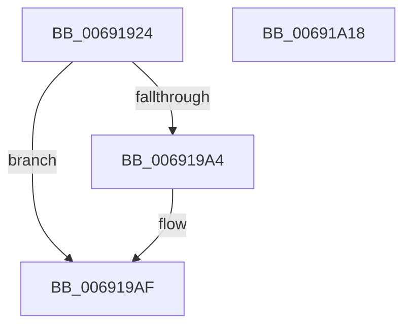

# MiMoveBadPagePartition

- RVA: `0x00691924`–`0x00691A19` (길이 `245` bytes)
- VA: `0x0000000140691924`
- 실행 섹션: `.text`
- PDB 이름 있음: `예`; PDB Function 태그: `아니요`
- unwind 정보 RVA: `0x0005C954`
- 디코드: `58`개 명령, `245/245` bytes 표시
- 미해석 바이트: `0` (있으면 어셈블리에 `.byte`로 보존)

> 이 문서는 커널 이미지의 기계어와 PDB 기호를 분석해 생성했습니다. 4번과 5번은 함수 원형과 자료형을 바이너리 사용 방식에서 추정한 C 해석이며 원본 소스 복구 결과는 아닙니다.

## 1. Dependencies

- 직접 호출 지점: **5**; 고유 호출 대상: **5**
- 직접 호출자로 확인된 함수: **1**
- RIP 상대 이미지 참조: **1**

### Outgoing calls
- `0x00691946` → [MiUnlinkPageFromBadList](../3B/MiUnlinkPageFromBadList_function_003BD620.md) (function, `0x003BD620`)
- `0x0069195B` → [MiAcquireNonPagedResources](../28/MiAcquireNonPagedResources_function_00286C60.md) (function, `0x00286C60`)
- `0x00691965` → [MiReleaseNonPagedResources](../32/MiReleaseNonPagedResources_function_0032299C.md) (function, `0x0032299C`)
- `0x006919C2` → [MiInsertPageInList](../2B/MiInsertPageInList_function_002BA000.md) (function, `0x002BA000`)
- `0x006919FE` → [MiUpdatePartitionChildPageCounts](MiUpdatePartitionChildPageCounts_function_006921D4.md) (function, `0x006921D4`)

### Direct callers
- [MiTransferPartitionPageRun](MiTransferPartitionPageRun_function_00691DCC.md) at `0x00691F82`

### Static image references
- `0x00691989` → RVA `0x00E38D00` (`.data`; read)

## 2. Other-region calls and transfers

- 다른 실행 섹션으로 향하는 call: **0**
- 별도 외부 분기/꼬리 이동을 확인하지 못했습니다.

## 3. Assembly (complete function range)

```asm
00691924  48 89 5C 24 08                  mov qword ptr [rsp + 8], rbx
00691929  48 89 6C 24 10                  mov qword ptr [rsp + 0x10], rbp
0069192E  48 89 74 24 18                  mov qword ptr [rsp + 0x18], rsi
00691933  57                              push rdi
00691934  48 83 EC 20                     sub rsp, 0x20
00691938  48 8B FA                        mov rdi, rdx
0069193B  48 8B F1                        mov rsi, rcx
0069193E  33 D2                           xor edx, edx
00691940  49 8B C8                        mov rcx, r8
00691943  49 8B D8                        mov rbx, r8
00691946  E8 D5 BC D2 FF                  call 0x1403bd620
0069194B  BD 01 00 00 00                  mov ebp, 1
00691950  45 33 C0                        xor r8d, r8d
00691953  44 8B CD                        mov r9d, ebp
00691956  8B D5                           mov edx, ebp
00691958  48 8B CF                        mov rcx, rdi
0069195B  E8 00 53 BF FF                  call 0x140286c60
00691960  8B D5                           mov edx, ebp
00691962  48 8B CE                        mov rcx, rsi
00691965  E8 32 10 C9 FF                  call 0x14032299c
0069196A  48 8B 43 28                     mov rax, qword ptr [rbx + 0x28]
0069196E  44 0F B7 07                     movzx r8d, word ptr [rdi]
00691972  49 C1 E0 2B                     shl r8, 0x2b
00691976  49 8B C8                        mov rcx, r8
00691979  48 33 C8                        xor rcx, rax
0069197C  48 B8 FF FF FF FF FF 07 E0 FF   movabs rax, 0xffe007ffffffffff
00691986  48 23 C8                        and rcx, rax
00691989  48 8D 05 70 73 7A 00            lea rax, [rip + 0x7a7370]
00691990  49 33 C8                        xor rcx, r8
00691993  48 89 4B 28                     mov qword ptr [rbx + 0x28], rcx
00691997  48 81 63 10 FF F3 FF F7         and qword ptr [rbx + 0x10], 0xfffffffff7fff3ff
0069199F  48 3B F8                        cmp rdi, rax
006919A2  74 0B                           je 0x1406919af
006919A4  48 01 AF 50 48 00 00            add qword ptr [rdi + 0x4850], rbp
006919AB  40 88 6F 0C                     mov byte ptr [rdi + 0xc], bpl
006919AF  48 FF 8E 50 48 00 00            dec qword ptr [rsi + 0x4850]
006919B6  BA 20 00 00 00                  mov edx, 0x20
006919BB  48 8B CB                        mov rcx, rbx
006919BE  40 88 6E 0C                     mov byte ptr [rsi + 0xc], bpl
006919C2  E8 39 86 C2 FF                  call 0x1402ba000
006919C7  48 B8 FF FF FF FF FF FF FF 7F   movabs rax, 0x7fffffffffffffff
006919D1  F0 48 21 43 18                  lock and qword ptr [rbx + 0x18], rax
006919D6  48 B8 00 00 00 00 00 DE FF FF   movabs rax, 0xffffde0000000000
006919E0  48 2B D8                        sub rbx, rax
006919E3  49 B8 AB AA AA AA AA AA AA AA   movabs r8, 0xaaaaaaaaaaaaaaab
006919ED  48 C1 FB 04                     sar rbx, 4
006919F1  4C 8B CD                        mov r9, rbp
006919F4  4C 0F AF C3                     imul r8, rbx
006919F8  48 8B D6                        mov rdx, rsi
006919FB  48 8B CF                        mov rcx, rdi
006919FE  E8 D1 07 00 00                  call 0x1406921d4
00691A03  48 8B 5C 24 30                  mov rbx, qword ptr [rsp + 0x30]
00691A08  48 8B 6C 24 38                  mov rbp, qword ptr [rsp + 0x38]
00691A0D  48 8B 74 24 40                  mov rsi, qword ptr [rsp + 0x40]
00691A12  48 83 C4 20                     add rsp, 0x20
00691A16  5F                              pop rdi
00691A17  C3                              ret
00691A18  CC                              int3
```

## 4. C-style interpretation (structured pseudocode)

```c
__int64 __fastcall MiMoveBadPagePartition(__int64 a1, __int64 a2, __int64 a3)
{
    __int64 result;
    __int64 v_rbx;
    __int64 v_rsp;
    unsigned __int64 v_stack_p10;
    unsigned __int64 v_stack_p18;
    unsigned __int64 v_stack_p8;

    v_stack_p8 = v_rbx;
    v_stack_p10 = v_rbp;
    v_stack_p18 = v_rsi;
    v_rsp = (v_rsp) - (32);
    a2 = 0;
    result = MiUnlinkPageFromBadList(a3, a2, a3, a4);
    a3 = 0;
    result = MiAcquireNonPagedResources(0, 1, a3, 1);
    result = MiReleaseNonPagedResources(a1, 1, a3, 1);
    a3 = (*(unsigned __int16 *)(a2)) << (43);
    a1 = (a3) ^ (*(unsigned __int64 *)(a3 + 40));
    a1 = (a1) & (*(unsigned __int64 *)(a3 + 40));
    a1 = (a1) ^ (a3);
    *(unsigned __int64 *)(a3 + 40) = a1;
    if (0 != (v_rip + 8024944)) {
        *(unsigned __int8 *)(a2 + 12) = 1;
    }
    *(unsigned __int8 *)(a1 + 12) = 1;
    result = MiInsertPageInList(a3, 32, a3, 1);
    v_rbx = (a3) - (result);
    v_rbx = (v_rbx) >> (4);
    a3 = (a3) * (v_rbx);
    result = MiUpdatePartitionChildPageCounts(0, a1, a3, 1);
    v_rsp = (v_rsp) + (32);
    return result;
}
```

## 5. (Beta) C Style

```c
int64_t MiMoveBadPagePartition(void *Arg1, void *Arg2, void *Arg3)
{
    uint8_t *arg1 = (uint8_t *)Arg1;
    uint8_t *arg2 = (uint8_t *)Arg2;
    uint8_t *arg3 = (uint8_t *)Arg3;

    int64_t result;
    int64_t local_rbx;
    int64_t local_rsp;
    uint64_t v_stack_p10;
    uint64_t v_stack_p18;
    uint64_t v_stack_p8;

    v_stack_p8 = local_rbx;
    v_stack_p10 = local_rbp;
    v_stack_p18 = local_rsi;
    local_rsp = (local_rsp) - (32);
    Arg2 = 0;
    result = MiUnlinkPageFromBadList(Arg3, Arg2, Arg3, a4);
    Arg3 = 0;
    result = MiAcquireNonPagedResources(0, 1, Arg3, 1);
    result = MiReleaseNonPagedResources(Arg1, 1, Arg3, 1);
    Arg3 = (*(uint16_t *)(arg2)) << (43);
    Arg1 = (Arg3) ^ (*(uint64_t *)(arg3 + 0x28));
    Arg1 = (Arg1) & (*(uint64_t *)(arg3 + 0x28));
    Arg1 = (Arg1) ^ (Arg3);
    *(void **)(arg3 + 0x28) = Arg1;
    if (0 != (v_rip + 8024944)) {
        *(uint8_t *)(arg2 + 0xC) = 1;
    }
    *(uint8_t *)(arg1 + 0xC) = 1;
    result = MiInsertPageInList(Arg3, 32, Arg3, 1);
    local_rbx = (Arg3) - (result);
    local_rbx = (local_rbx) >> (4);
    Arg3 = (Arg3) * (local_rbx);
    result = MiUpdatePartitionChildPageCounts(0, Arg1, Arg3, 1);
    local_rsp = (local_rsp) + (32);
    return result;
}
```

### 관측된 메모리 오프셋

구조체 형식이 확인되지 않은 접근은 인자 기준의 오프셋으로만 기록했습니다.

| 기준 인자 | 오프셋 표현 | 폭 (bit) | 접근 |
|---|---:|---:|---|
| `Arg1` | `+ 0xC` | `8` | `W` |
| `Arg1` | `+ 0x4850` | `64` | `R/W` |
| `Arg2` | `+ 0x0` | `16` | `R` |
| `Arg3` | `+ 0x10` | `64` | `R/W` |
| `Arg3` | `+ 0x18` | `64` | `R/W` |
| `Arg3` | `+ 0x28` | `64` | `R` |
| `Arg3` | `+ 0x28` | `64` | `W` |

## 6. Execution-region graph

[열기: 2D/3D 그래프와 함수 탐색 컨트롤 패널](../../../control-panel.html?section=text&rva=0x00691924&view=graph)

- 2D 그래프는 위에서 아래로 흐르고, 3D 그래프는 빈 공간을 드래그해 회전합니다. Shift+드래그는 이동, 휠은 확대·축소, 함수 노드 선택은 대상 보고서 이동입니다.

### Static fallback


