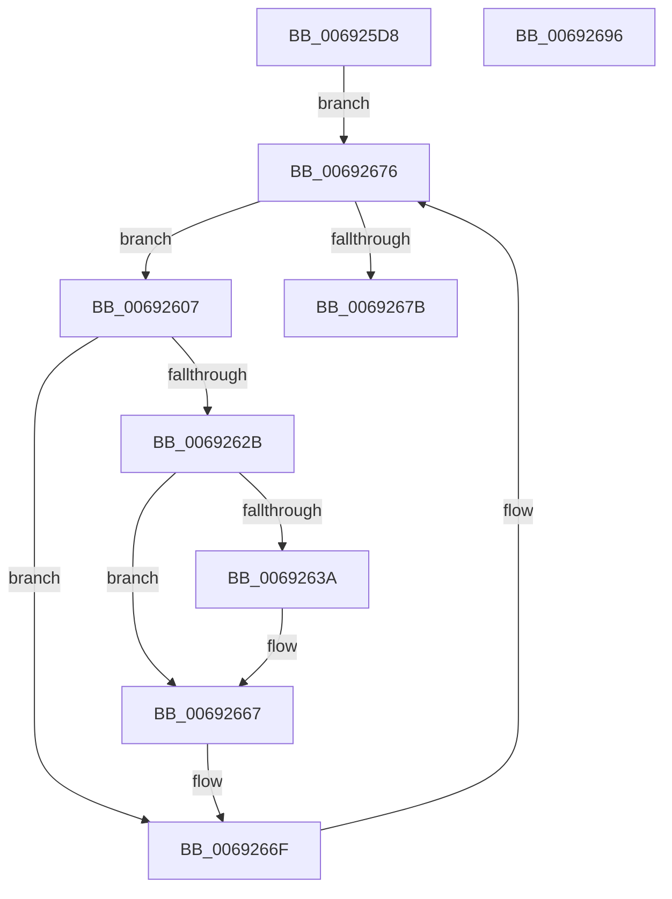

# MiMoveModifiedPagesToCompressList

- RVA: `0x006925D8`–`0x00692697` (길이 `191` bytes)
- VA: `0x00000001406925D8`
- 실행 섹션: `.text`
- PDB 이름 있음: `예`; PDB Function 태그: `아니요`
- unwind 정보 RVA: `0x0005E6B4`
- 디코드: `48`개 명령, `191/191` bytes 표시
- 미해석 바이트: `0` (있으면 어셈블리에 `.byte`로 보존)

> 이 문서는 커널 이미지의 기계어와 PDB 기호를 분석해 생성했습니다. 4번과 5번은 함수 원형과 자료형을 바이너리 사용 방식에서 추정한 C 해석이며 원본 소스 복구 결과는 아닙니다.

## 1. Dependencies

- 직접 호출 지점: **5**; 고유 호출 대상: **5**
- 직접 호출자로 확인된 함수: **1**
- RIP 상대 이미지 참조: **0**

### Outgoing calls
- `0x0069261F` → [MiSafeLockPage](../32/MiSafeLockPage_function_00321620.md) (function, `0x00321620`)
- `0x0069263C` → [MiUnlinkPageFromListEx](../28/MiUnlinkPageFromListEx_function_00287590.md) (function, `0x00287590`)
- `0x0069264E` → [MiSetStoreVirtualPagefileValue](../37/MiSetStoreVirtualPagefileValue_function_00373B80.md) (function, `0x00373B80`)
- `0x0069265F` → [MiInsertPageInList](../2B/MiInsertPageInList_function_002BA000.md) (function, `0x002BA000`)
- `0x0069266A` → [MiUnlockPage](../31/MiUnlockPage_function_0031A3E0.md) (function, `0x0031A3E0`)

### Direct callers
- [MmStoreRegister](../../page/80/MmStoreRegister_function_0080E6D8.md) at `0x0080E9B7`

### Static image references
- 디코드된 RIP-relative 메모리 참조가 없습니다.

## 2. Other-region calls and transfers

- 다른 실행 섹션으로 향하는 call: **0**
- 별도 외부 분기/꼬리 이동을 확인하지 못했습니다.

## 3. Assembly (complete function range)

```asm
006925D8  48 8B C4                        mov rax, rsp
006925DB  48 89 58 08                     mov qword ptr [rax + 8], rbx
006925DF  48 89 68 10                     mov qword ptr [rax + 0x10], rbp
006925E3  48 89 70 18                     mov qword ptr [rax + 0x18], rsi
006925E7  48 89 78 20                     mov qword ptr [rax + 0x20], rdi
006925EB  41 56                           push r14
006925ED  48 83 EC 20                     sub rsp, 0x20
006925F1  48 8B 99 90 0F 00 00            mov rbx, qword ptr [rcx + 0xf90]
006925F8  48 8B F1                        mov rsi, rcx
006925FB  49 BE FF FF FF FF 3F 00 00 00   movabs r14, 0x3fffffffff
00692605  EB 6F                           jmp 0x140692676
00692607  48 8D 3C 5B                     lea rdi, [rbx + rbx*2]
0069260B  48 C1 E7 04                     shl rdi, 4
0069260F  48 B8 00 00 00 00 00 DE FF FF   movabs rax, 0xffffde0000000000
00692619  48 8B CB                        mov rcx, rbx
0069261C  48 03 F8                        add rdi, rax
0069261F  E8 FC EF C8 FF                  call 0x140321620
00692624  40 8A E8                        mov bpl, al
00692627  3C 11                           cmp al, 0x11
00692629  74 44                           je 0x14069266f
0069262B  48 8B 96 90 0F 00 00            mov rdx, qword ptr [rsi + 0xf90]
00692632  48 8B CF                        mov rcx, rdi
00692635  48 3B DA                        cmp rbx, rdx
00692638  75 2D                           jne 0x140692667
0069263A  33 D2                           xor edx, edx
0069263C  E8 4F 4F BF FF                  call 0x140287590
00692641  48 8B 57 10                     mov rdx, qword ptr [rdi + 0x10]
00692645  41 B8 03 00 00 00               mov r8d, 3
0069264B  48 8B CE                        mov rcx, rsi
0069264E  E8 2D 15 CE FF                  call 0x140373b80
00692653  BA 08 00 00 00                  mov edx, 8
00692658  48 89 47 10                     mov qword ptr [rdi + 0x10], rax
0069265C  48 8B CF                        mov rcx, rdi
0069265F  E8 9C 79 C2 FF                  call 0x1402ba000
00692664  48 8B CF                        mov rcx, rdi
00692667  40 8A D5                        mov dl, bpl
0069266A  E8 71 7D C8 FF                  call 0x14031a3e0
0069266F  48 8B 9E 90 0F 00 00            mov rbx, qword ptr [rsi + 0xf90]
00692676  49 3B DE                        cmp rbx, r14
00692679  75 8C                           jne 0x140692607
0069267B  48 8B 5C 24 30                  mov rbx, qword ptr [rsp + 0x30]
00692680  48 8B 6C 24 38                  mov rbp, qword ptr [rsp + 0x38]
00692685  48 8B 74 24 40                  mov rsi, qword ptr [rsp + 0x40]
0069268A  48 8B 7C 24 48                  mov rdi, qword ptr [rsp + 0x48]
0069268F  48 83 C4 20                     add rsp, 0x20
00692693  41 5E                           pop r14
00692695  C3                              ret
00692696  CC                              int3
```

## 4. C-style interpretation (structured pseudocode)

```c
__int64 __fastcall MiMoveModifiedPagesToCompressList(__int64 a1)
{
    __int64 result;
    __int64 v_rdi;
    __int64 v_rsp;
    unsigned __int64 v_stack_p10;
    unsigned __int64 v_stack_p18;
    unsigned __int64 v_stack_p20;
    unsigned __int64 v_stack_p8;

    *(unsigned __int64 *)(v_rsp + 8) = v_rbx;
    *(unsigned __int64 *)(v_rsp + 16) = v_rbp;
    *(unsigned __int64 *)(v_rsp + 24) = v_rsi;
    *(unsigned __int64 *)(v_rsp + 32) = v_rdi;
    v_rsp = (v_rsp) - (32);
    goto loc_00692676;
loc_00692607:
    v_rdi = (*(unsigned __int64 *)(a1 + 3984) + *(unsigned __int64 *)(a1 + 3984) * 2) << (4);
    v_rdi = (v_rdi) + (v_rsp);
    result = MiSafeLockPage(*(unsigned __int64 *)(a1 + 3984), a2, a3, a4);
    if (((unsigned __int8)(result)) == 17) goto loc_0069266F;
    if ((*(unsigned __int64 *)(a1 + 3984)) == (*(unsigned __int64 *)(a1 + 3984))) {
        a2 = 0;
        result = MiUnlinkPageFromListEx(v_rdi, a2, a3, a4);
        a2 = *(unsigned __int64 *)(v_rdi + 16);
        a3 = 3;
        a1 = a1;
        result = MiSetStoreVirtualPagefileValue(a1, a2, a3, a4);
        a2 = 8;
        *(unsigned __int64 *)(v_rdi + 16) = result;
        a1 = v_rdi;
        result = MiInsertPageInList(a1, a2, a3, a4);
        a1 = v_rdi;
    }
    result = MiUnlockPage(a1, (unsigned __int8)((unsigned __int8)(result)), a3, a4);
loc_0069266F:
loc_00692676:
    if ((*(unsigned __int64 *)(a1 + 3984)) != v_r14) goto loc_00692607;
    v_rsp = (v_rsp) + (32);
    return result;
}
```

## 5. (Beta) C Style

```c
int64_t MiMoveModifiedPagesToCompressList(void *Arg1)
{
    uint8_t *arg1 = (uint8_t *)Arg1;

    int64_t result;
    int64_t local_rdi;
    int64_t local_rsp;
    uint64_t v_stack_p10;
    uint64_t v_stack_p18;
    uint64_t v_stack_p20;
    uint64_t v_stack_p8;

    *(uint64_t *)(local_rsp + 0x8) = local_rbx;
    *(uint64_t *)(local_rsp + 0x10) = local_rbp;
    *(uint64_t *)(local_rsp + 0x18) = local_rsi;
    *(uint64_t *)(local_rsp + 0x20) = local_rdi;
    local_rsp = (local_rsp) - (32);
    goto loc_00692676;
loc_00692607:
    local_rdi = (*(uint64_t *)(arg1 + 0xF90) + *(uint64_t *)(arg1 + 0xF90) * 2) << (4);
    local_rdi = (local_rdi) + (local_rsp);
    result = MiSafeLockPage(*(uint64_t *)(arg1 + 0xF90), a2, a3, a4);
    if (((uint8_t)(result)) == 17) goto loc_0069266F;
    if ((*(uint64_t *)(arg1 + 0xF90)) == (*(uint64_t *)(arg1 + 0xF90))) {
        a2 = 0;
        result = MiUnlinkPageFromListEx(local_rdi, a2, a3, a4);
        a2 = *(uint64_t *)(local_rdi + 0x10);
        a3 = 3;
        Arg1 = Arg1;
        result = MiSetStoreVirtualPagefileValue(Arg1, a2, a3, a4);
        a2 = 8;
        *(uint64_t *)(local_rdi + 0x10) = result;
        Arg1 = local_rdi;
        result = MiInsertPageInList(Arg1, a2, a3, a4);
        Arg1 = local_rdi;
    }
    result = MiUnlockPage(Arg1, (uint8_t)((uint8_t)(result)), a3, a4);
loc_0069266F:
loc_00692676:
    if ((*(uint64_t *)(arg1 + 0xF90)) != local_r14) goto loc_00692607;
    local_rsp = (local_rsp) + (32);
    return result;
}
```

### 관측된 메모리 오프셋

구조체 형식이 확인되지 않은 접근은 인자 기준의 오프셋으로만 기록했습니다.

| 기준 인자 | 오프셋 표현 | 폭 (bit) | 접근 |
|---|---:|---:|---|
| `Arg1` | `+ 0xF90` | `64` | `R` |

## 6. Execution-region graph

[열기: 2D/3D 그래프와 함수 탐색 컨트롤 패널](../../../control-panel.html?section=text&rva=0x006925D8&view=graph)

- 2D 그래프는 위에서 아래로 흐르고, 3D 그래프는 빈 공간을 드래그해 회전합니다. Shift+드래그는 이동, 휠은 확대·축소, 함수 노드 선택은 대상 보고서 이동입니다.

### Static fallback


