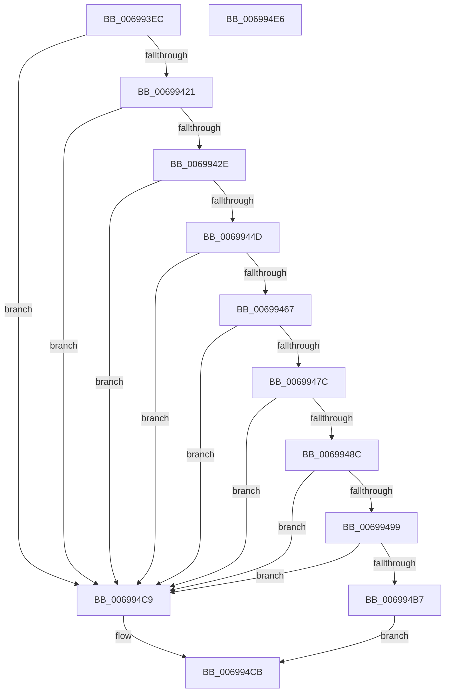

# MiNextPhysicallyContiguousPfnWorthTrying

- RVA: `0x006993EC`–`0x006994E7` (길이 `251` bytes)
- VA: `0x00000001406993EC`
- 실행 섹션: `.text`
- PDB 이름 있음: `예`; PDB Function 태그: `아니요`
- unwind 정보 RVA: `0x0005D7BC`
- 디코드: `65`개 명령, `251/251` bytes 표시
- 미해석 바이트: `0` (있으면 어셈블리에 `.byte`로 보존)

> 이 문서는 커널 이미지의 기계어와 PDB 기호를 분석해 생성했습니다. 4번과 5번은 함수 원형과 자료형을 바이너리 사용 방식에서 추정한 C 해석이며 원본 소스 복구 결과는 아닙니다.

## 1. Dependencies

- 직접 호출 지점: **2**; 고유 호출 대상: **2**
- 직접 호출자로 확인된 함수: **1**
- RIP 상대 이미지 참조: **4**

### Outgoing calls
- `0x0069945E` → [MiGetPfnPageSizeIndex](../31/MiGetPfnPageSizeIndex_function_0031C710.md) (function, `0x0031C710`)
- `0x0069948F` → [MiPageToNode](../33/MiPageToNode_function_00338CD0.md) (function, `0x00338CD0`)

### Direct callers
- [sub_006E7724](../6E/Unknown_function_006E7724.md) at `0x006E772E`

### Static image references
- `0x00699405` → RVA `0x00FC6A88` (`ALMOSTRO`; read)
- `0x00699421` → RVA `0x00E2DCE0` (`.data`; read)
- `0x0069946B` → RVA `0x00011C60` (`.rdata`; read)
- `0x0069949D` → RVA `0x00E30088` (`.data`; read)

## 2. Other-region calls and transfers

- 다른 실행 섹션으로 향하는 call: **0**
- 별도 외부 분기/꼬리 이동을 확인하지 못했습니다.

## 3. Assembly (complete function range)

```asm
006993EC  48 8B C4                        mov rax, rsp
006993EF  48 89 58 08                     mov qword ptr [rax + 8], rbx
006993F3  48 89 68 10                     mov qword ptr [rax + 0x10], rbp
006993F7  48 89 70 18                     mov qword ptr [rax + 0x18], rsi
006993FB  48 89 78 20                     mov qword ptr [rax + 0x20], rdi
006993FF  41 56                           push r14
00699401  48 83 EC 30                     sub rsp, 0x30
00699405  48 F7 05 78 D6 92 00 00 00 00 20  test qword ptr [rip + 0x92d678], 0x20000000
00699410  49 8B F9                        mov rdi, r9
00699413  45 8B F0                        mov r14d, r8d
00699416  8B EA                           mov ebp, edx
00699418  48 8B D9                        mov rbx, rcx
0069941B  0F 84 A8 00 00 00               je 0x1406994c9
00699421  4C 3B 0D B8 48 79 00            cmp r9, qword ptr [rip + 0x7948b8]
00699428  0F 87 9B 00 00 00               ja 0x1406994c9
0069942E  4B 8D 0C 49                     lea rcx, [r9 + r9*2]
00699432  48 03 C9                        add rcx, rcx
00699435  48 B8 28 00 00 00 00 DE FF FF   movabs rax, 0xffffde0000000028
0069943F  48 8B 04 C8                     mov rax, qword ptr [rax + rcx*8]
00699443  48 C1 E8 36                     shr rax, 0x36
00699447  0F BA E0 00                     bt eax, 0
0069944B  73 7C                           jae 0x1406994c9
0069944D  48 B8 00 00 00 00 00 DE FF FF   movabs rax, 0xffffde0000000000
00699457  48 8D 34 C8                     lea rsi, [rax + rcx*8]
0069945B  48 8B CE                        mov rcx, rsi
0069945E  E8 AD 32 C8 FF                  call 0x14031c710
00699463  3B C5                           cmp eax, ebp
00699465  75 62                           jne 0x1406994c9
00699467  48 8B 4B 10                     mov rcx, qword ptr [rbx + 0x10]
0069946B  48 8D 15 EE 87 97 FF            lea rdx, [rip - 0x687812]
00699472  48 2B 4B 48                     sub rcx, qword ptr [rbx + 0x48]
00699476  48 39 0C EA                     cmp qword ptr [rdx + rbp*8], rcx
0069947A  77 4D                           ja 0x1406994c9
0069947C  8B 46 20                        mov eax, dword ptr [rsi + 0x20]
0069947F  89 44 24 20                     mov dword ptr [rsp + 0x20], eax
00699483  C1 E8 10                        shr eax, 0x10
00699486  24 07                           and al, 7
00699488  3C 01                           cmp al, 1
0069948A  77 3D                           ja 0x1406994c9
0069948C  48 8B CF                        mov rcx, rdi
0069948F  E8 3C F8 C9 FF                  call 0x140338cd0
00699494  3B 43 20                        cmp eax, dword ptr [rbx + 0x20]
00699497  75 30                           jne 0x1406994c9
00699499  48 8B 46 28                     mov rax, qword ptr [rsi + 0x28]
0069949D  48 8B 0D E4 6B 79 00            mov rcx, qword ptr [rip + 0x796be4]
006994A4  48 8B 53 08                     mov rdx, qword ptr [rbx + 8]
006994A8  48 C1 E8 2B                     shr rax, 0x2b
006994AC  25 FF 03 00 00                  and eax, 0x3ff
006994B1  48 39 14 C1                     cmp qword ptr [rcx + rax*8], rdx
006994B5  75 12                           jne 0x1406994c9
006994B7  0F B6 4C 24 22                  movzx ecx, byte ptr [rsp + 0x22]
006994BC  33 C0                           xor eax, eax
006994BE  C1 E9 06                        shr ecx, 6
006994C1  41 3B CE                        cmp ecx, r14d
006994C4  0F 94 C0                        sete al
006994C7  EB 02                           jmp 0x1406994cb
006994C9  33 C0                           xor eax, eax
006994CB  48 8B 5C 24 40                  mov rbx, qword ptr [rsp + 0x40]
006994D0  48 8B 6C 24 48                  mov rbp, qword ptr [rsp + 0x48]
006994D5  48 8B 74 24 50                  mov rsi, qword ptr [rsp + 0x50]
006994DA  48 8B 7C 24 58                  mov rdi, qword ptr [rsp + 0x58]
006994DF  48 83 C4 30                     add rsp, 0x30
006994E3  41 5E                           pop r14
006994E5  C3                              ret
006994E6  CC                              int3
```

## 4. C-style interpretation (structured pseudocode)

```c
__int64 __fastcall MiNextPhysicallyContiguousPfnWorthTrying(__int64 a1, int a2, int a3, __int64 a4)
{
    __int64 result;
    __int64 v_rsp;
    unsigned __int8 v_stack_m16;
    unsigned int v_stack_m18;
    unsigned __int64 v_stack_p10;
    unsigned __int64 v_stack_p18;
    unsigned __int64 v_stack_p20;
    unsigned __int64 v_stack_p8;

    *(unsigned __int64 *)(v_rsp + 8) = v_rbx;
    *(unsigned __int64 *)(v_rsp + 16) = v_rbp;
    *(unsigned __int64 *)(v_rsp + 24) = v_rsi;
    *(unsigned __int64 *)(v_rsp + 32) = v_rdi;
    v_rsp = (v_rsp) - (48);
    if (((*(unsigned __int64 *)(v_rip + 9623160)) & (0x20000000ULL)) == 0) goto loc_006994C9;
    if (a4 > (*(unsigned __int64 *)(v_rip + 7948472))) goto loc_006994C9;
    a1 = (a4 + a4 * 2) + (a4 + a4 * 2);
    result = (*(unsigned __int64 *)(v_rsp + a1 * 8)) >> (54);
    if (condition_is_above_or_equal) goto loc_006994C9;
    result = MiGetPfnPageSizeIndex(result + a1 * 8, a2, a3, a4);
    if (((unsigned int)(result)) != ((unsigned int)((unsigned int)(a2)))) goto loc_006994C9;
    a1 = (*(unsigned __int64 *)(a1 + 16)) - (*(unsigned __int64 *)(a1 + 72));
    if ((*(unsigned __int64 *)(v_rip - 6846482 + (unsigned int)(a2) * 8)) > a1) goto loc_006994C9;
    v_stack_m18 = (unsigned int)((unsigned int)(*(unsigned int *)(result + a1 * 8 + 32)));
    result = (unsigned int)(((unsigned int)(*(unsigned int *)(result + a1 * 8 + 32))) >> (16));
    result = (unsigned __int8)((result) & (7));
    if (((unsigned __int8)(result)) > 1) goto loc_006994C9;
    result = MiPageToNode(a4, v_rip - 6846482, a3, a4);
    if (((unsigned int)(result)) != (*(unsigned int *)(a1 + 32))) goto loc_006994C9;
    result = (*(unsigned __int64 *)(result + a1 * 8 + 40)) >> (43);
    result = (unsigned int)((result) & (0x3FFULL));
    if ((*(unsigned __int64 *)(*(unsigned __int64 *)(v_rip + 7957476) + result * 8)) != (*(unsigned __int64 *)(a1 + 8))) goto loc_006994C9;
    result = 0;
    a1 = (unsigned int)((v_stack_m16) >> (6));
    result = (((unsigned int)(a1)) == ((unsigned int)((unsigned int)(a3)))) ? 1 : 0;
    goto loc_006994CB;
loc_006994C9:
    result = 0;
loc_006994CB:
    v_rsp = (v_rsp) + (48);
    return result;
}
```

## 5. (Beta) C Style

```c
int64_t MiNextPhysicallyContiguousPfnWorthTrying(void *Arg1, int32_t Arg2, int32_t Arg3, int64_t Arg4)
{
    uint8_t *arg1 = (uint8_t *)Arg1;

    int64_t result;
    int64_t local_rsp;
    uint8_t v_stack_m16;
    uint32_t v_stack_m18;
    uint64_t v_stack_p10;
    uint64_t v_stack_p18;
    uint64_t v_stack_p20;
    uint64_t v_stack_p8;

    *(uint64_t *)(local_rsp + 0x8) = local_rbx;
    *(uint64_t *)(local_rsp + 0x10) = local_rbp;
    *(uint64_t *)(local_rsp + 0x18) = local_rsi;
    *(uint64_t *)(local_rsp + 0x20) = local_rdi;
    local_rsp = (local_rsp) - (48);
    if (((*(uint64_t *)(v_rip + 0x92D678)) & (0x20000000ULL)) == 0) goto loc_006994C9;
    if (Arg4 > (*(uint64_t *)(v_rip + 0x7948B8))) goto loc_006994C9;
    Arg1 = (Arg4 + Arg4 * 2) + (Arg4 + Arg4 * 2);
    result = (*(uint64_t *)(local_rsp + arg1 * 8)) >> (54);
    if (condition_is_above_or_equal) goto loc_006994C9;
    result = MiGetPfnPageSizeIndex(result + Arg1 * 8, Arg2, Arg3, Arg4);
    if (((uint32_t)(result)) != ((uint32_t)((uint32_t)(Arg2)))) goto loc_006994C9;
    Arg1 = (*(uint64_t *)(arg1 + 0x10)) - (*(uint64_t *)(arg1 + 0x48));
    if ((*(uint64_t *)(v_rip - 0x687812 + (uint32_t)(Arg2) * 8)) > Arg1) goto loc_006994C9;
    v_stack_m18 = (uint32_t)((uint32_t)(*(uint32_t *)(result + arg1 * 8 + 0x20)));
    result = (uint32_t)(((uint32_t)(*(uint32_t *)(result + arg1 * 8 + 0x20))) >> (16));
    result = (uint8_t)((result) & (7));
    if (((uint8_t)(result)) > 1) goto loc_006994C9;
    result = MiPageToNode(Arg4, v_rip - 6846482, Arg3, Arg4);
    if (((uint32_t)(result)) != (*(uint32_t *)(arg1 + 0x20))) goto loc_006994C9;
    result = (*(uint64_t *)(result + arg1 * 8 + 0x28)) >> (43);
    result = (uint32_t)((result) & (0x3FFULL));
    if ((*(uint64_t *)(*(uint64_t *)(v_rip + 0x796BE4) + result * 8)) != (*(uint64_t *)(arg1 + 0x8))) goto loc_006994C9;
    result = 0;
    Arg1 = (uint32_t)((v_stack_m16) >> (6));
    result = (((uint32_t)(Arg1)) == ((uint32_t)((uint32_t)(Arg3)))) ? 1 : 0;
    goto loc_006994CB;
loc_006994C9:
    result = 0;
loc_006994CB:
    local_rsp = (local_rsp) + (48);
    return result;
}
```

### 관측된 메모리 오프셋

구조체 형식이 확인되지 않은 접근은 인자 기준의 오프셋으로만 기록했습니다.

| 기준 인자 | 오프셋 표현 | 폭 (bit) | 접근 |
|---|---:|---:|---|
| `Arg1` | `+ 0x8` | `64` | `R` |
| `Arg1` | `+ 0x10` | `64` | `R` |
| `Arg1` | `+ 0x20` | `32` | `R` |
| `Arg1` | `+ 0x48` | `64` | `R` |

## 6. Execution-region graph

[열기: 2D/3D 그래프와 함수 탐색 컨트롤 패널](../../../control-panel.html?section=text&rva=0x006993EC&view=graph)

- 2D 그래프는 위에서 아래로 흐르고, 3D 그래프는 빈 공간을 드래그해 회전합니다. Shift+드래그는 이동, 휠은 확대·축소, 함수 노드 선택은 대상 보고서 이동입니다.

### Static fallback


