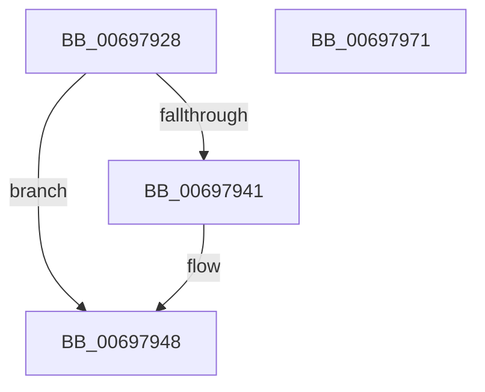

# MiOutSwapFreeSoftWslePxe

- RVA: `0x00697928`–`0x00697972` (길이 `74` bytes)
- VA: `0x0000000140697928`
- 실행 섹션: `.text`
- PDB 이름 있음: `예`; PDB Function 태그: `아니요`
- unwind 정보 RVA: `0x0005CF00`
- 디코드: `19`개 명령, `74/74` bytes 표시
- 미해석 바이트: `0` (있으면 어셈블리에 `.byte`로 보존)

> 이 문서는 커널 이미지의 기계어와 PDB 기호를 분석해 생성했습니다. 4번과 5번은 함수 원형과 자료형을 바이너리 사용 방식에서 추정한 C 해석이며 원본 소스 복구 결과는 아닙니다.

## 1. Dependencies

- 직접 호출 지점: **1**; 고유 호출 대상: **1**
- 직접 호출자로 확인된 함수: **1**
- RIP 상대 이미지 참조: **1**

### Outgoing calls
- `0x00697962` → [MiLockAndDecrementShareCount](../2A/MiLockAndDecrementShareCount_function_002A2854.md) (function, `0x002A2854`)

### Direct callers
- [sub_006E82CE](../6E/Unknown_function_006E82CE.md) at `0x006E848D`

### Static image references
- `0x00697934` → RVA `0x00E38878` (`.data`; read)

## 2. Other-region calls and transfers

- 다른 실행 섹션으로 향하는 call: **0**
- 별도 외부 분기/꼬리 이동을 확인하지 못했습니다.

## 3. Assembly (complete function range)

```asm
00697928  40 53                           push rbx
0069792A  48 83 EC 20                     sub rsp, 0x20
0069792E  8B 81 B8 04 00 00               mov eax, dword ptr [rcx + 0x4b8]
00697934  48 8D 1D 3D 0F 7A 00            lea rbx, [rip + 0x7a0f3d]
0069793B  24 0F                           and al, 0xf
0069793D  3C 01                           cmp al, 1
0069793F  74 07                           je 0x140697948
00697941  48 8D 99 F8 04 00 00            lea rbx, [rcx + 0x4f8]
00697948  48 8D 0C 52                     lea rcx, [rdx + rdx*2]
0069794C  48 C1 E1 04                     shl rcx, 4
00697950  48 B8 00 00 00 00 00 DE FF FF   movabs rax, 0xffffde0000000000
0069795A  48 03 C8                        add rcx, rax
0069795D  BA 03 00 00 00                  mov edx, 3
00697962  E8 ED AE C0 FF                  call 0x1402a2854
00697967  F0 48 FF 0B                     lock dec qword ptr [rbx]
0069796B  48 83 C4 20                     add rsp, 0x20
0069796F  5B                              pop rbx
00697970  C3                              ret
00697971  CC                              int3
```

## 4. C-style interpretation (structured pseudocode)

```c
__int64 __fastcall MiOutSwapFreeSoftWslePxe(__int64 a1, __int64 a2)
{
    __int64 result;
    __int64 v_rbx;
    __int64 v_rsp;

    v_rsp = (v_rsp) - (32);
    result = (unsigned __int8)(((unsigned int)(*(unsigned int *)(a1 + 1208))) & (15));
    v_rbx = v_rip + 7999293;
    if (((unsigned __int8)(result)) != 1) {
        v_rbx = a1 + 1272;
    }
    a1 = (a2 + a2 * 2) << (4);
    a1 = (a1) + (result);
    result = MiLockAndDecrementShareCount(a1, 3, a3, a4);
    v_rsp = (v_rsp) + (32);
    return result;
}
```

## 5. (Beta) C Style

```c
int64_t MiOutSwapFreeSoftWslePxe(void *Arg1, void *Arg2)
{
    uint8_t *arg1 = (uint8_t *)Arg1;
    uint8_t *arg2 = (uint8_t *)Arg2;

    int64_t result;
    int64_t local_rbx;
    int64_t local_rsp;

    local_rsp = (local_rsp) - (32);
    result = (uint8_t)(((uint32_t)(*(uint32_t *)(arg1 + 0x4B8))) & (15));
    local_rbx = v_rip + 7999293;
    if (((uint8_t)(result)) != 1) {
        local_rbx = Arg1 + 1272;
    }
    Arg1 = (Arg2 + Arg2 * 2) << (4);
    Arg1 = (Arg1) + (result);
    result = MiLockAndDecrementShareCount(Arg1, 3, a3, a4);
    local_rsp = (local_rsp) + (32);
    return result;
}
```

### 관측된 메모리 오프셋

구조체 형식이 확인되지 않은 접근은 인자 기준의 오프셋으로만 기록했습니다.

| 기준 인자 | 오프셋 표현 | 폭 (bit) | 접근 |
|---|---:|---:|---|
| `Arg1` | `+ 0x4B8` | `32` | `R` |
| `Arg1` | `+ 0x4F8` | `64` | `R` |
| `Arg2` | `+ 0x0 + rdx*2` | `64` | `R` |

## 6. Execution-region graph

[열기: 2D/3D 그래프와 함수 탐색 컨트롤 패널](../../../control-panel.html?section=text&rva=0x00697928&view=graph)

- 2D 그래프는 위에서 아래로 흐르고, 3D 그래프는 빈 공간을 드래그해 회전합니다. Shift+드래그는 이동, 휠은 확대·축소, 함수 노드 선택은 대상 보고서 이동입니다.

### Static fallback


