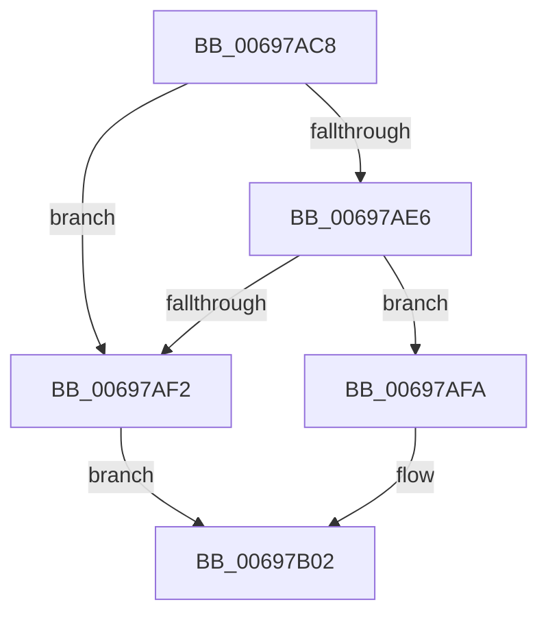

# MiPageHashBugCheck

- RVA: `0x00697AC8`–`0x00697B18` (길이 `80` bytes)
- VA: `0x0000000140697AC8`
- 실행 섹션: `.text`
- PDB 이름 있음: `예`; PDB Function 태그: `아니요`
- unwind 정보 RVA: `0x000622F0`
- 디코드: `24`개 명령, `80/80` bytes 표시
- 미해석 바이트: `0` (있으면 어셈블리에 `.byte`로 보존)

> 이 문서는 커널 이미지의 기계어와 PDB 기호를 분석해 생성했습니다. 4번과 5번은 함수 원형과 자료형을 바이너리 사용 방식에서 추정한 C 해석이며 원본 소스 복구 결과는 아닙니다.

## 1. Dependencies

- 직접 호출 지점: **1**; 고유 호출 대상: **1**
- 직접 호출자로 확인된 함수: **4**
- RIP 상대 이미지 참조: **0**

### Outgoing calls
- `0x00697B12` → [KeBugCheckEx](../4F/KeBugCheckEx_function_004FD660.md) (function, `0x004FD660`)

### Direct callers
- [MiReleasePageFileInfo](../28/MiReleasePageFileInfo_function_00283FD0.md) at `0x00284575`
- [MiReleasePageFileInfo](../28/MiReleasePageFileInfo_function_00283FD0.md) at `0x002845A8`
- [MiWritePageFileHash](../38/MiWritePageFileHash_function_00381DC8.md) at `0x003821BB`
- [sub_006D7254](../6D/Unknown_function_006D7254.md) at `0x006D7329`
- [sub_006E4766](../6E/Unknown_function_006E4766.md) at `0x006E477F`

### Static image references
- 디코드된 RIP-relative 메모리 참조가 없습니다.

## 2. Other-region calls and transfers

- 다른 실행 섹션으로 향하는 call: **0**
- 별도 외부 분기/꼬리 이동을 확인하지 못했습니다.

## 3. Assembly (complete function range)

```asm
00697AC8  48 83 EC 38                     sub rsp, 0x38
00697ACC  83 7C 24 60 00                  cmp dword ptr [rsp + 0x60], 0
00697AD1  44 8D 59 10                     lea r11d, [rcx + 0x10]
00697AD5  41 8B 00                        mov eax, dword ptr [r8]
00697AD8  4D 8B D1                        mov r10, r9
00697ADB  44 0F 45 D9                     cmovne r11d, ecx
00697ADF  41 8B 09                        mov ecx, dword ptr [r9]
00697AE2  3B C1                           cmp eax, ecx
00697AE4  75 0C                           jne 0x140697af2
00697AE6  41 8B 40 04                     mov eax, dword ptr [r8 + 4]
00697AEA  41 8B 49 04                     mov ecx, dword ptr [r9 + 4]
00697AEE  3B C1                           cmp eax, ecx
00697AF0  74 08                           je 0x140697afa
00697AF2  4C 8B C8                        mov r9, rax
00697AF5  48 8B C1                        mov rax, rcx
00697AF8  EB 08                           jmp 0x140697b02
00697AFA  4D 8B 48 08                     mov r9, qword ptr [r8 + 8]
00697AFE  49 8B 42 08                     mov rax, qword ptr [r10 + 8]
00697B02  44 8B C2                        mov r8d, edx
00697B05  B9 1A 00 00 00                  mov ecx, 0x1a
00697B0A  41 8B D3                        mov edx, r11d
00697B0D  48 89 44 24 20                  mov qword ptr [rsp + 0x20], rax
00697B12  E8 49 5B E6 FF                  call 0x1404fd660
00697B17  CC                              int3
```

## 4. C-style interpretation (structured pseudocode)

```c
__int64 __fastcall MiPageHashBugCheck(__int64 a1, int a2, __int64 a3, __int64 a4, unsigned int a5)
{
    __int64 result;
    __int64 v_r11;
    __int64 v_rsp;
    unsigned __int64 v_stack_m18;

    v_rsp = (v_rsp) - (56);
    v_r11 = a1 + 16;
    if (a5 != 0) { v_r11 = (unsigned int)(a1); }
    if (((unsigned int)((unsigned int)(*(unsigned int *)(a3)))) != ((unsigned int)((unsigned int)(*(unsigned int *)(a4))))) goto loc_00697AF2;
    if (((unsigned int)((unsigned int)(*(unsigned int *)(a3 + 4)))) == ((unsigned int)((unsigned int)(*(unsigned int *)(a4 + 4))))) goto loc_00697AFA;
loc_00697AF2:
    goto loc_00697B02;
loc_00697AFA:
loc_00697B02:
    v_stack_m18 = *(unsigned __int64 *)(a4 + 8);
    result = KeBugCheckEx(26, (unsigned int)((unsigned int)(v_r11)), (unsigned int)(a2), *(unsigned __int64 *)(a3 + 8));
    return result;
}
```

## 5. (Beta) C Style

```c
int64_t MiPageHashBugCheck(void *Arg1, int32_t Arg2, void *Arg3, void *Arg4, uint32_t Arg5)
{
    uint8_t *arg1 = (uint8_t *)Arg1;
    uint8_t *arg3 = (uint8_t *)Arg3;
    uint8_t *arg4 = (uint8_t *)Arg4;

    int64_t result;
    int64_t local_r11;
    int64_t local_rsp;
    uint64_t v_stack_m18;

    local_rsp = (local_rsp) - (56);
    local_r11 = Arg1 + 16;
    if (Arg5 != 0) { local_r11 = (uint32_t)(Arg1); }
    if (((uint32_t)((uint32_t)(*(uint32_t *)(arg3)))) != ((uint32_t)((uint32_t)(*(uint32_t *)(arg4))))) goto loc_00697AF2;
    if (((uint32_t)((uint32_t)(*(uint32_t *)(arg3 + 0x4)))) == ((uint32_t)((uint32_t)(*(uint32_t *)(arg4 + 0x4))))) goto loc_00697AFA;
loc_00697AF2:
    goto loc_00697B02;
loc_00697AFA:
loc_00697B02:
    v_stack_m18 = *(uint64_t *)(arg4 + 0x8);
    result = KeBugCheckEx(26, (uint32_t)((uint32_t)(local_r11)), (uint32_t)(Arg2), *(uint64_t *)(arg3 + 0x8));
    return result;
}
```

### 관측된 메모리 오프셋

구조체 형식이 확인되지 않은 접근은 인자 기준의 오프셋으로만 기록했습니다.

| 기준 인자 | 오프셋 표현 | 폭 (bit) | 접근 |
|---|---:|---:|---|
| `Arg1` | `+ 0x10` | `32` | `R` |
| `Arg3` | `+ 0x0` | `32` | `R` |
| `Arg3` | `+ 0x4` | `32` | `R` |
| `Arg3` | `+ 0x8` | `64` | `R` |
| `Arg4` | `+ 0x0` | `32` | `R` |
| `Arg4` | `+ 0x4` | `32` | `R` |
| `Arg4` | `+ 0x8` | `64` | `R` |

## 6. Execution-region graph

[열기: 2D/3D 그래프와 함수 탐색 컨트롤 패널](../../../control-panel.html?section=text&rva=0x00697AC8&view=graph)

- 2D 그래프는 위에서 아래로 흐르고, 3D 그래프는 빈 공간을 드래그해 회전합니다. Shift+드래그는 이동, 휠은 확대·축소, 함수 노드 선택은 대상 보고서 이동입니다.

### Static fallback


