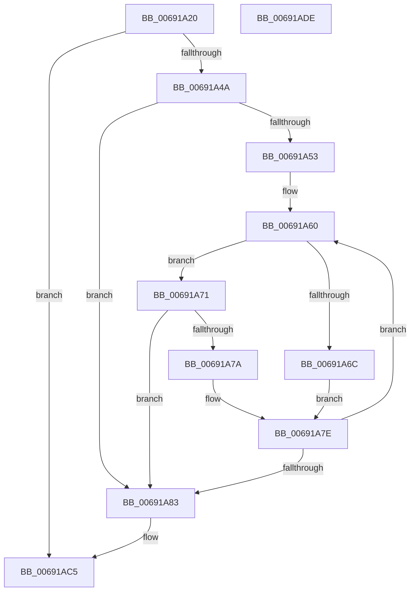

# MiPartitionDeleteMemoryNode

- RVA: `0x00691A20`–`0x00691ADF` (길이 `191` bytes)
- VA: `0x0000000140691A20`
- 실행 섹션: `.text`
- PDB 이름 있음: `예`; PDB Function 태그: `아니요`
- unwind 정보 RVA: `0x00060300`
- 디코드: `54`개 명령, `191/191` bytes 표시
- 미해석 바이트: `0` (있으면 어셈블리에 `.byte`로 보존)

> 이 문서는 커널 이미지의 기계어와 PDB 기호를 분석해 생성했습니다. 4번과 5번은 함수 원형과 자료형을 바이너리 사용 방식에서 추정한 C 해석이며 원본 소스 복구 결과는 아닙니다.

## 1. Dependencies

- 직접 호출 지점: **5**; 고유 호출 대상: **5**
- 직접 호출자로 확인된 함수: **1**
- RIP 상대 이미지 참조: **1**

### Outgoing calls
- `0x00691A8D` → [ExAcquireSpinLockExclusive](../24/ExAcquireSpinLockExclusive_function_00248690.md) (function, `0x00248690`)
- `0x00691A9B` → [RtlAvlRemoveNode](../29/RtlAvlRemoveNode_function_00296650.md) (function, `0x00296650`)
- `0x00691AB0` → [MiReleaseSpinLockExclusive](../24/MiReleaseSpinLockExclusive_function_002482C0.md) (function, `0x002482C0`)
- `0x00691AB8` → [MiMakePartitionMemoryBlock](../../page/80/MiMakePartitionMemoryBlock_function_0080D94C.md) (function, `0x0080D94C`)
- `0x00691AC0` → [MiDeletePartitionPageNode](MiDeletePartitionPageNode_function_006908C4.md) (function, `0x006908C4`)

### Direct callers
- [MiRemovePhysicalMemory](../../page/7F/MiRemovePhysicalMemory_function_007FAD3C.md) at `0x007FAFBE`

### Static image references
- `0x00691A38` → RVA `0x00E38D00` (`.data`; read)

## 2. Other-region calls and transfers

- 다른 실행 섹션으로 향하는 call: **1**
  - `0x00691AB8` → [MiMakePartitionMemoryBlock](../../page/80/MiMakePartitionMemoryBlock_function_0080D94C.md) (`.text` → `PAGE`)
- 별도 외부 분기/꼬리 이동을 확인하지 못했습니다.

## 3. Assembly (complete function range)

```asm
00691A20  48 89 5C 24 08                  mov qword ptr [rsp + 8], rbx
00691A25  48 89 6C 24 10                  mov qword ptr [rsp + 0x10], rbp
00691A2A  48 89 74 24 18                  mov qword ptr [rsp + 0x18], rsi
00691A2F  57                              push rdi
00691A30  41 56                           push r14
00691A32  41 57                           push r15
00691A34  48 83 EC 20                     sub rsp, 0x20
00691A38  48 8D 05 C1 72 7A 00            lea rax, [rip + 0x7a72c1]
00691A3F  4D 8B F8                        mov r15, r8
00691A42  48 8B E9                        mov rbp, rcx
00691A45  48 3B C8                        cmp rcx, rax
00691A48  74 7B                           je 0x140691ac5
00691A4A  48 8B 71 18                     mov rsi, qword ptr [rcx + 0x18]
00691A4E  48 85 F6                        test rsi, rsi
00691A51  74 30                           je 0x140691a83
00691A53  49 B8 FF FF FF FF FF FF FF 3F   movabs r8, 0x3fffffffffffffff
00691A5D  49 23 D0                        and rdx, r8
00691A60  48 8B 4E 18                     mov rcx, qword ptr [rsi + 0x18]
00691A64  49 23 C8                        and rcx, r8
00691A67  48 3B D1                        cmp rdx, rcx
00691A6A  73 05                           jae 0x140691a71
00691A6C  48 8B 36                        mov rsi, qword ptr [rsi]
00691A6F  EB 0D                           jmp 0x140691a7e
00691A71  48 03 4E 20                     add rcx, qword ptr [rsi + 0x20]
00691A75  48 3B D1                        cmp rdx, rcx
00691A78  72 09                           jb 0x140691a83
00691A7A  48 8B 76 08                     mov rsi, qword ptr [rsi + 8]
00691A7E  48 85 F6                        test rsi, rsi
00691A81  75 DD                           jne 0x140691a60
00691A83  48 8D BD C8 00 00 00            lea rdi, [rbp + 0xc8]
00691A8A  48 8B CF                        mov rcx, rdi
00691A8D  E8 FE 6B BB FF                  call 0x140248690
00691A92  48 8B D6                        mov rdx, rsi
00691A95  48 8D 4D 18                     lea rcx, [rbp + 0x18]
00691A99  8A D8                           mov bl, al
00691A9B  E8 B0 4B C0 FF                  call 0x140296650
00691AA0  4C 29 BD 50 48 00 00            sub qword ptr [rbp + 0x4850], r15
00691AA7  8A D3                           mov dl, bl
00691AA9  48 8B CF                        mov rcx, rdi
00691AAC  C6 45 0C 01                     mov byte ptr [rbp + 0xc], 1
00691AB0  E8 0B 68 BB FF                  call 0x1402482c0
00691AB5  48 8B CD                        mov rcx, rbp
00691AB8  E8 8F BE 17 00                  call 0x14080d94c
00691ABD  48 8B CE                        mov rcx, rsi
00691AC0  E8 FF ED FF FF                  call 0x1406908c4
00691AC5  48 8B 5C 24 40                  mov rbx, qword ptr [rsp + 0x40]
00691ACA  48 8B 6C 24 48                  mov rbp, qword ptr [rsp + 0x48]
00691ACF  48 8B 74 24 50                  mov rsi, qword ptr [rsp + 0x50]
00691AD4  48 83 C4 20                     add rsp, 0x20
00691AD8  41 5F                           pop r15
00691ADA  41 5E                           pop r14
00691ADC  5F                              pop rdi
00691ADD  C3                              ret
00691ADE  CC                              int3
```

## 4. C-style interpretation (structured pseudocode)

```c
__int64 __fastcall MiPartitionDeleteMemoryNode(__int64 a1, __int64 a2, __int64 a3)
{
    __int64 result;
    __int64 v_rsp;
    unsigned __int64 v_stack_p10;
    unsigned __int64 v_stack_p18;
    unsigned __int64 v_stack_p8;

    v_stack_p8 = v_rbx;
    v_stack_p10 = v_rbp;
    v_stack_p18 = v_rsi;
    v_rsp = (v_rsp) - (32);
    if (a1 == (v_rip + 8024769)) goto loc_00691AC5;
    if (*(unsigned __int64 *)(a1 + 24) == 0) goto loc_00691A83;
    a2 = (a2) & (a3);
loc_00691A60:
    a1 = (*(unsigned __int64 *)(*(unsigned __int64 *)(a1 + 24) + 24)) & (a3);
    if (a2 >= a1) goto loc_00691A71;
    goto loc_00691A7E;
loc_00691A71:
    a1 = (a1) + (*(unsigned __int64 *)(*(unsigned __int64 *)(*(unsigned __int64 *)(a1 + 24)) + 32));
    if (a2 < a1) goto loc_00691A83;
loc_00691A7E:
    if (*(unsigned __int64 *)(*(unsigned __int64 *)(*(unsigned __int64 *)(a1 + 24)) + 8) != 0) goto loc_00691A60;
loc_00691A83:
    result = ExAcquireSpinLockExclusive(a1 + 200, a2, a3, a4);
    result = RtlAvlRemoveNode(a1 + 24, *(unsigned __int64 *)(*(unsigned __int64 *)(*(unsigned __int64 *)(a1 + 24)) + 8), a3, a4);
    *(unsigned __int8 *)(a1 + 12) = 1;
    result = MiReleaseSpinLockExclusive(a1 + 200, (unsigned __int8)((unsigned __int8)(result)), a3, a4);
    result = MiMakePartitionMemoryBlock(a1, (unsigned __int8)((unsigned __int8)(result)), a3, a4);
    result = MiDeletePartitionPageNode(*(unsigned __int64 *)(*(unsigned __int64 *)(*(unsigned __int64 *)(a1 + 24)) + 8), (unsigned __int8)((unsigned __int8)(result)), a3, a4);
loc_00691AC5:
    v_rsp = (v_rsp) + (32);
    return result;
}
```

## 5. (Beta) C Style

```c
int64_t MiPartitionDeleteMemoryNode(void *Arg1, int64_t Arg2, int64_t Arg3)
{
    uint8_t *arg1 = (uint8_t *)Arg1;

    int64_t result;
    int64_t local_rsp;
    uint64_t v_stack_p10;
    uint64_t v_stack_p18;
    uint64_t v_stack_p8;

    v_stack_p8 = local_rbx;
    v_stack_p10 = local_rbp;
    v_stack_p18 = local_rsi;
    local_rsp = (local_rsp) - (32);
    if (Arg1 == (v_rip + 8024769)) goto loc_00691AC5;
    if (*(uint64_t *)(arg1 + 0x18) == 0) goto loc_00691A83;
    Arg2 = (Arg2) & (Arg3);
loc_00691A60:
    Arg1 = (*(uint64_t *)(*(uint64_t *)(arg1 + 0x18) + 0x18)) & (Arg3);
    if (Arg2 >= Arg1) goto loc_00691A71;
    goto loc_00691A7E;
loc_00691A71:
    Arg1 = (Arg1) + (*(uint64_t *)(*(uint64_t *)(*(uint64_t *)(arg1 + 0x18)) + 0x20));
    if (Arg2 < Arg1) goto loc_00691A83;
loc_00691A7E:
    if (*(uint64_t *)(*(uint64_t *)(*(uint64_t *)(arg1 + 0x18)) + 0x8) != 0) goto loc_00691A60;
loc_00691A83:
    result = ExAcquireSpinLockExclusive(Arg1 + 200, Arg2, Arg3, a4);
    result = RtlAvlRemoveNode(Arg1 + 24, *(uint64_t *)(*(uint64_t *)(*(uint64_t *)(arg1 + 0x18)) + 0x8), Arg3, a4);
    *(uint8_t *)(arg1 + 0xC) = 1;
    result = MiReleaseSpinLockExclusive(Arg1 + 200, (uint8_t)((uint8_t)(result)), Arg3, a4);
    result = MiMakePartitionMemoryBlock(Arg1, (uint8_t)((uint8_t)(result)), Arg3, a4);
    result = MiDeletePartitionPageNode(*(uint64_t *)(*(uint64_t *)(*(uint64_t *)(arg1 + 0x18)) + 0x8), (uint8_t)((uint8_t)(result)), Arg3, a4);
loc_00691AC5:
    local_rsp = (local_rsp) + (32);
    return result;
}
```

### 관측된 메모리 오프셋

구조체 형식이 확인되지 않은 접근은 인자 기준의 오프셋으로만 기록했습니다.

| 기준 인자 | 오프셋 표현 | 폭 (bit) | 접근 |
|---|---:|---:|---|
| `Arg1` | `+ 0xC` | `8` | `W` |
| `Arg1` | `+ 0x18` | `64` | `R` |
| `Arg1` | `+ 0xC8` | `64` | `R` |
| `Arg1` | `+ 0x4850` | `64` | `R/W` |

## 6. Execution-region graph

[열기: 2D/3D 그래프와 함수 탐색 컨트롤 패널](../../../control-panel.html?section=text&rva=0x00691A20&view=graph)

- 2D 그래프는 위에서 아래로 흐르고, 3D 그래프는 빈 공간을 드래그해 회전합니다. Shift+드래그는 이동, 휠은 확대·축소, 함수 노드 선택은 대상 보고서 이동입니다.

### Static fallback


