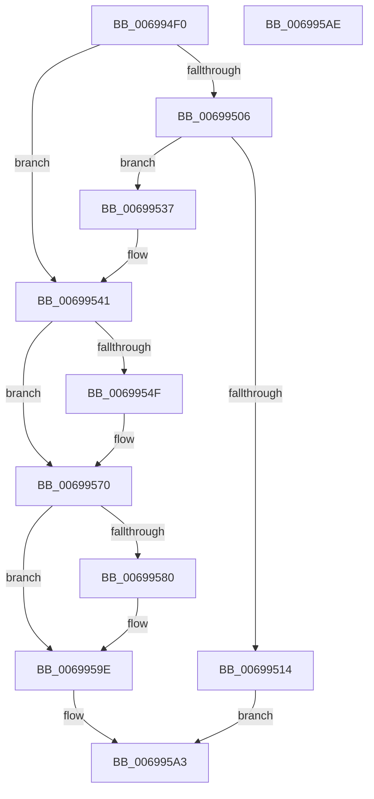

# MiPrepareLargePageSubPageForFree

- RVA: `0x006994F0`–`0x006995AF` (길이 `191` bytes)
- VA: `0x00000001406994F0`
- 실행 섹션: `.text`
- PDB 이름 있음: `예`; PDB Function 태그: `아니요`
- unwind 정보 RVA: `0x0005CAAC`
- 디코드: `57`개 명령, `191/191` bytes 표시
- 미해석 바이트: `0` (있으면 어셈블리에 `.byte`로 보존)

> 이 문서는 커널 이미지의 기계어와 PDB 기호를 분석해 생성했습니다. 4번과 5번은 함수 원형과 자료형을 바이너리 사용 방식에서 추정한 C 해석이며 원본 소스 복구 결과는 아닙니다.

## 1. Dependencies

- 직접 호출 지점: **9**; 고유 호출 대상: **4**
- 직접 호출자로 확인된 함수: **1**
- RIP 상대 이미지 참조: **0**

### Outgoing calls
- `0x00699506` → [MiLockPageInline](../31/MiLockPageInline_function_0031A340.md) (function, `0x0031A340`)
- `0x0069952E` → [MiUnlockPage](../31/MiUnlockPage_function_0031A3E0.md) (function, `0x0031A3E0`)
- `0x0069953C` → [MiUnlockPage](../31/MiUnlockPage_function_0031A3E0.md) (function, `0x0031A3E0`)
- `0x00699552` → [MiLockPageInline](../31/MiLockPageInline_function_0031A340.md) (function, `0x0031A340`)
- `0x00699561` → [MiClearPfnImageVerified](../40/MiClearPfnImageVerified_function_00407000.md) (function, `0x00407000`)
- `0x0069956B` → [MiUnlockPage](../31/MiUnlockPage_function_0031A3E0.md) (function, `0x0031A3E0`)
- `0x00699583` → [MiLockPageInline](../31/MiLockPageInline_function_0031A340.md) (function, `0x0031A340`)
- `0x0069958F` → [MiSetPfnIdentity](../2A/MiSetPfnIdentity_function_002A2350.md) (function, `0x002A2350`)
- `0x00699599` → [MiUnlockPage](../31/MiUnlockPage_function_0031A3E0.md) (function, `0x0031A3E0`)

### Direct callers
- [MiReadyLargePageToFree](../37/MiReadyLargePageToFree_function_00377A68.md) at `0x00377B70`

### Static image references
- 디코드된 RIP-relative 메모리 참조가 없습니다.

## 2. Other-region calls and transfers

- 다른 실행 섹션으로 향하는 call: **0**
- 별도 외부 분기/꼬리 이동을 확인하지 못했습니다.

## 3. Assembly (complete function range)

```asm
006994F0  48 89 5C 24 08                  mov qword ptr [rsp + 8], rbx
006994F5  57                              push rdi
006994F6  48 83 EC 20                     sub rsp, 0x20
006994FA  8B 41 20                        mov eax, dword ptr [rcx + 0x20]
006994FD  48 8B F9                        mov rdi, rcx
00699500  66 83 F8 02                     cmp ax, 2
00699504  74 3B                           je 0x140699541
00699506  E8 35 0E C8 FF                  call 0x14031a340
0069950B  8B 57 20                        mov edx, dword ptr [rdi + 0x20]
0069950E  66 83 FA 02                     cmp dx, 2
00699512  74 23                           je 0x140699537
00699514  48 8B 4F 18                     mov rcx, qword ptr [rdi + 0x18]
00699518  48 BA 00 00 00 00 00 00 00 40   movabs rdx, 0x4000000000000000
00699522  48 0B CA                        or rcx, rdx
00699525  8A D0                           mov dl, al
00699527  48 89 4F 18                     mov qword ptr [rdi + 0x18], rcx
0069952B  48 8B CF                        mov rcx, rdi
0069952E  E8 AD 0E C8 FF                  call 0x14031a3e0
00699533  33 C0                           xor eax, eax
00699535  EB 6C                           jmp 0x1406995a3
00699537  8A D0                           mov dl, al
00699539  48 8B CF                        mov rcx, rdi
0069953C  E8 9F 0E C8 FF                  call 0x14031a3e0
00699541  48 8B 47 28                     mov rax, qword ptr [rdi + 0x28]
00699545  48 C1 E8 3C                     shr rax, 0x3c
00699549  24 07                           and al, 7
0069954B  3C 03                           cmp al, 3
0069954D  75 21                           jne 0x140699570
0069954F  48 8B CF                        mov rcx, rdi
00699552  E8 E9 0D C8 FF                  call 0x14031a340
00699557  BA 0C 00 00 00                  mov edx, 0xc
0069955C  48 8B CF                        mov rcx, rdi
0069955F  8A D8                           mov bl, al
00699561  E8 9A DA D6 FF                  call 0x140407000
00699566  8A D3                           mov dl, bl
00699568  48 8B CF                        mov rcx, rdi
0069956B  E8 70 0E C8 FF                  call 0x14031a3e0
00699570  48 8B 4F 28                     mov rcx, qword ptr [rdi + 0x28]
00699574  48 C1 E9 3C                     shr rcx, 0x3c
00699578  80 E1 07                        and cl, 7
0069957B  80 F9 01                        cmp cl, 1
0069957E  75 1E                           jne 0x14069959e
00699580  48 8B CF                        mov rcx, rdi
00699583  E8 B8 0D C8 FF                  call 0x14031a340
00699588  33 D2                           xor edx, edx
0069958A  48 8B CF                        mov rcx, rdi
0069958D  8A D8                           mov bl, al
0069958F  E8 BC 8D C0 FF                  call 0x1402a2350
00699594  8A D3                           mov dl, bl
00699596  48 8B CF                        mov rcx, rdi
00699599  E8 42 0E C8 FF                  call 0x14031a3e0
0069959E  B8 01 00 00 00                  mov eax, 1
006995A3  48 8B 5C 24 30                  mov rbx, qword ptr [rsp + 0x30]
006995A8  48 83 C4 20                     add rsp, 0x20
006995AC  5F                              pop rdi
006995AD  C3                              ret
006995AE  CC                              int3
```

## 4. C-style interpretation (structured pseudocode)

```c
__int64 __fastcall MiPrepareLargePageSubPageForFree(__int64 a1)
{
    __int64 result;
    __int64 v_rbx;
    __int64 v_rsp;
    unsigned __int64 v_stack_p8;

    v_stack_p8 = v_rbx;
    v_rsp = (v_rsp) - (32);
    if (((unsigned __int16)((unsigned int)(*(unsigned int *)(a1 + 32)))) == 2) goto loc_00699541;
    result = MiLockPageInline(a1, a2, a3, a4);
    if (((unsigned __int16)((unsigned int)(*(unsigned int *)(a1 + 32)))) == 2) goto loc_00699537;
    a1 = (*(unsigned __int64 *)(a1 + 24)) | ((unsigned int)(*(unsigned int *)(a1 + 32)));
    *(unsigned __int64 *)(a1 + 24) = a1;
    result = MiUnlockPage(a1, (unsigned __int8)(result), a3, a4);
    result = 0;
    goto loc_006995A3;
loc_00699537:
    result = MiUnlockPage(a1, 0, a3, a4);
loc_00699541:
    result = (*(unsigned __int64 *)(a1 + 40)) >> (60);
    result = (unsigned __int8)((result) & (7));
    if (((unsigned __int8)(result)) == 3) {
        a1 = a1;
        result = MiLockPageInline(a1, 0, a3, a4);
        a2 = 12;
        a1 = a1;
        v_rbx = (unsigned __int8)(result);
        result = MiClearPfnImageVerified(a1, a2, a3, a4);
        a2 = (unsigned __int8)(v_rbx);
        a1 = a1;
        result = MiUnlockPage(a1, a2, a3, a4);
    }
    a1 = (*(unsigned __int64 *)(a1 + 40)) >> (60);
    a1 = (unsigned __int8)((a1) & (7));
    if (((unsigned __int8)(a1)) == 1) {
        a1 = a1;
        result = MiLockPageInline(a1, a2, a3, a4);
        a2 = 0;
        a1 = a1;
        v_rbx = (unsigned __int8)(result);
        result = MiSetPfnIdentity(a1, a2, a3, a4);
        a2 = (unsigned __int8)(v_rbx);
        a1 = a1;
        result = MiUnlockPage(a1, a2, a3, a4);
    }
loc_006995A3:
    v_rsp = (v_rsp) + (32);
    return 1;
}
```

## 5. (Beta) C Style

```c
int64_t MiPrepareLargePageSubPageForFree(void *Arg1)
{
    uint8_t *arg1 = (uint8_t *)Arg1;

    int64_t result;
    int64_t local_rbx;
    int64_t local_rsp;
    uint64_t v_stack_p8;

    v_stack_p8 = local_rbx;
    local_rsp = (local_rsp) - (32);
    if (((uint16_t)((uint32_t)(*(uint32_t *)(arg1 + 0x20)))) == 2) goto loc_00699541;
    result = MiLockPageInline(Arg1, a2, a3, a4);
    if (((uint16_t)((uint32_t)(*(uint32_t *)(arg1 + 0x20)))) == 2) goto loc_00699537;
    Arg1 = (*(uint64_t *)(arg1 + 0x18)) | ((uint32_t)(*(uint32_t *)(arg1 + 0x20)));
    *(void **)(arg1 + 0x18) = Arg1;
    result = MiUnlockPage(Arg1, (uint8_t)(result), a3, a4);
    result = 0;
    goto loc_006995A3;
loc_00699537:
    result = MiUnlockPage(Arg1, 0, a3, a4);
loc_00699541:
    result = (*(uint64_t *)(arg1 + 0x28)) >> (60);
    result = (uint8_t)((result) & (7));
    if (((uint8_t)(result)) == 3) {
        Arg1 = Arg1;
        result = MiLockPageInline(Arg1, 0, a3, a4);
        a2 = 12;
        Arg1 = Arg1;
        local_rbx = (uint8_t)(result);
        result = MiClearPfnImageVerified(Arg1, a2, a3, a4);
        a2 = (uint8_t)(local_rbx);
        Arg1 = Arg1;
        result = MiUnlockPage(Arg1, a2, a3, a4);
    }
    Arg1 = (*(uint64_t *)(arg1 + 0x28)) >> (60);
    Arg1 = (uint8_t)((Arg1) & (7));
    if (((uint8_t)(Arg1)) == 1) {
        Arg1 = Arg1;
        result = MiLockPageInline(Arg1, a2, a3, a4);
        a2 = 0;
        Arg1 = Arg1;
        local_rbx = (uint8_t)(result);
        result = MiSetPfnIdentity(Arg1, a2, a3, a4);
        a2 = (uint8_t)(local_rbx);
        Arg1 = Arg1;
        result = MiUnlockPage(Arg1, a2, a3, a4);
    }
loc_006995A3:
    local_rsp = (local_rsp) + (32);
    return 1;
}
```

### 관측된 메모리 오프셋

구조체 형식이 확인되지 않은 접근은 인자 기준의 오프셋으로만 기록했습니다.

| 기준 인자 | 오프셋 표현 | 폭 (bit) | 접근 |
|---|---:|---:|---|
| `Arg1` | `+ 0x18` | `64` | `R` |
| `Arg1` | `+ 0x18` | `64` | `W` |
| `Arg1` | `+ 0x20` | `32` | `R` |
| `Arg1` | `+ 0x28` | `64` | `R` |

## 6. Execution-region graph

[열기: 2D/3D 그래프와 함수 탐색 컨트롤 패널](../../../control-panel.html?section=text&rva=0x006994F0&view=graph)

- 2D 그래프는 위에서 아래로 흐르고, 3D 그래프는 빈 공간을 드래그해 회전합니다. Shift+드래그는 이동, 휠은 확대·축소, 함수 노드 선택은 대상 보고서 이동입니다.

### Static fallback


