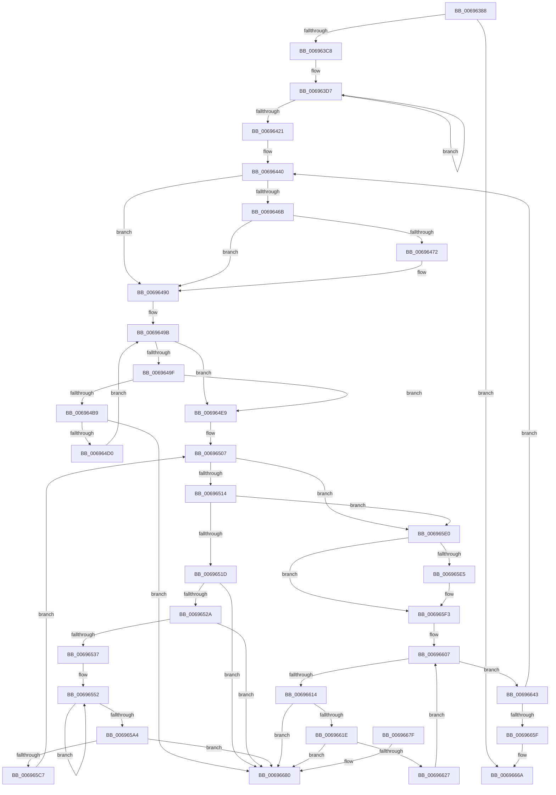

# MiPreserveBootDecisions

- RVA: `0x00696388`–`0x00696687` (길이 `767` bytes)
- VA: `0x0000000140696388`
- 실행 섹션: `.text`
- PDB 이름 있음: `예`; PDB Function 태그: `아니요`
- unwind 정보 RVA: `0x000D94C4`
- 디코드: `203`개 명령, `767/767` bytes 표시
- 미해석 바이트: `0` (있으면 어셈블리에 `.byte`로 보존)

> 이 문서는 커널 이미지의 기계어와 PDB 기호를 분석해 생성했습니다. 4번과 5번은 함수 원형과 자료형을 바이너리 사용 방식에서 추정한 C 해석이며 원본 소스 복구 결과는 아닙니다.

## 1. Dependencies

- 직접 호출 지점: **7**; 고유 호출 대상: **5**
- 직접 호출자로 확인된 함수: **1**
- RIP 상대 이미지 참조: **0**

### Outgoing calls
- `0x006963B7` → [MiAllocatePool](../35/MiAllocatePool_function_0035B540.md) (function, `0x0035B540`)
- `0x00696488` → [MiAllocatePool](../35/MiAllocatePool_function_0035B540.md) (function, `0x0035B540`)
- `0x006964AF` → [MiAllocatePool](../35/MiAllocatePool_function_0035B540.md) (function, `0x0035B540`)
- `0x006964F4` → [ExAcquireSpinLockExclusive](../24/ExAcquireSpinLockExclusive_function_00248690.md) (function, `0x00248690`)
- `0x006965EE` → [memcpy](../6C/memcpy_function_006C6840.md) (function, `0x006C6840`)
- `0x00696602` → [MiReleaseSpinLockExclusive](../24/MiReleaseSpinLockExclusive_function_002482C0.md) (function, `0x002482C0`)
- `0x0069663C` → [ExFreePoolWithTag](../../poolcode/B8/ExFreePoolWithTag_function_00B82870.md) (function, `0x00B82870`)

### Direct callers
- [MiNodeZeroConductor](../../page/81/MiNodeZeroConductor_function_00810AC0.md) at `0x00810C32`

### Static image references
- 디코드된 RIP-relative 메모리 참조가 없습니다.

## 2. Other-region calls and transfers

- 다른 실행 섹션으로 향하는 call: **1**
  - `0x0069663C` → [ExFreePoolWithTag](../../poolcode/B8/ExFreePoolWithTag_function_00B82870.md) (`.text` → `POOLCODE`)
- 별도 외부 분기/꼬리 이동을 확인하지 못했습니다.

## 3. Assembly (complete function range)

```asm
00696388  48 89 5C 24 10                  mov qword ptr [rsp + 0x10], rbx
0069638D  48 89 4C 24 08                  mov qword ptr [rsp + 8], rcx
00696392  55                              push rbp
00696393  56                              push rsi
00696394  57                              push rdi
00696395  41 54                           push r12
00696397  41 55                           push r13
00696399  41 56                           push r14
0069639B  41 57                           push r15
0069639D  48 8B EC                        mov rbp, rsp
006963A0  48 83 EC 30                     sub rsp, 0x30
006963A4  48 8B FA                        mov rdi, rdx
006963A7  B9 40 00 00 00                  mov ecx, 0x40
006963AC  BA 18 04 00 00                  mov edx, 0x418
006963B1  41 B8 4D 6D 20 20               mov r8d, 0x20206d4d
006963B7  E8 84 51 CC FF                  call 0x14035b540
006963BC  4C 8B F0                        mov r14, rax
006963BF  48 85 C0                        test rax, rax
006963C2  0F 84 A2 02 00 00               je 0x14069666a
006963C8  B9 08 00 00 00                  mov ecx, 8
006963CD  48 8B D0                        mov rdx, rax
006963D0  48 8B C7                        mov rax, rdi
006963D3  44 8D 41 78                     lea r8d, [rcx + 0x78]
006963D7  0F 10 00                        movups xmm0, xmmword ptr [rax]
006963DA  0F 11 02                        movups xmmword ptr [rdx], xmm0
006963DD  0F 10 48 10                     movups xmm1, xmmword ptr [rax + 0x10]
006963E1  0F 11 4A 10                     movups xmmword ptr [rdx + 0x10], xmm1
006963E5  0F 10 40 20                     movups xmm0, xmmword ptr [rax + 0x20]
006963E9  0F 11 42 20                     movups xmmword ptr [rdx + 0x20], xmm0
006963ED  0F 10 48 30                     movups xmm1, xmmword ptr [rax + 0x30]
006963F1  0F 11 4A 30                     movups xmmword ptr [rdx + 0x30], xmm1
006963F5  0F 10 40 40                     movups xmm0, xmmword ptr [rax + 0x40]
006963F9  0F 11 42 40                     movups xmmword ptr [rdx + 0x40], xmm0
006963FD  0F 10 48 50                     movups xmm1, xmmword ptr [rax + 0x50]
00696401  0F 11 4A 50                     movups xmmword ptr [rdx + 0x50], xmm1
00696405  0F 10 40 60                     movups xmm0, xmmword ptr [rax + 0x60]
00696409  0F 11 42 60                     movups xmmword ptr [rdx + 0x60], xmm0
0069640D  49 03 D0                        add rdx, r8
00696410  0F 10 48 70                     movups xmm1, xmmword ptr [rax + 0x70]
00696414  49 03 C0                        add rax, r8
00696417  0F 11 4A F0                     movups xmmword ptr [rdx - 0x10], xmm1
0069641B  48 83 E9 01                     sub rcx, 1
0069641F  75 B6                           jne 0x1406963d7
00696421  0F 10 00                        movups xmm0, xmmword ptr [rax]
00696424  48 21 4D 58                     and qword ptr [rbp + 0x58], rcx
00696428  48 8D 9F 48 01 00 00            lea rbx, [rdi + 0x148]
0069642F  49 8B F6                        mov rsi, r14
00696432  0F 11 02                        movups xmmword ptr [rdx], xmm0
00696435  48 8B 40 10                     mov rax, qword ptr [rax + 0x10]
00696439  48 2B F7                        sub rsi, rdi
0069643C  48 89 42 10                     mov qword ptr [rdx + 0x10], rax
00696440  48 8D 45 F0                     lea rax, [rbp - 0x10]
00696444  45 33 FF                        xor r15d, r15d
00696447  48 89 45 F8                     mov qword ptr [rbp - 8], rax
0069644B  45 33 E4                        xor r12d, r12d
0069644E  48 8D 45 F0                     lea rax, [rbp - 0x10]
00696452  48 89 45 F0                     mov qword ptr [rbp - 0x10], rax
00696456  48 8D 04 33                     lea rax, [rbx + rsi]
0069645A  48 89 44 1E 08                  mov qword ptr [rsi + rbx + 8], rax
0069645F  48 89 00                        mov qword ptr [rax], rax
00696462  4C 8B 6B 68                     mov r13, qword ptr [rbx + 0x68]
00696466  4D 85 ED                        test r13, r13
00696469  74 25                           je 0x140696490
0069646B  41 83 7D 08 01                  cmp dword ptr [r13 + 8], 1
00696470  76 1E                           jbe 0x140696490
00696472  45 8B 7D 00                     mov r15d, dword ptr [r13]
00696476  41 8D 4C 24 40                  lea ecx, [r12 + 0x40]
0069647B  49 C1 E7 04                     shl r15, 4
0069647F  41 B8 4D 6D 20 20               mov r8d, 0x20206d4d
00696485  49 8B D7                        mov rdx, r15
00696488  E8 B3 50 CC FF                  call 0x14035b540
0069648D  4C 8B E0                        mov r12, rax
00696490  8B 83 44 FF FF FF               mov eax, dword ptr [rbx - 0xbc]
00696496  33 FF                           xor edi, edi
00696498  89 45 50                        mov dword ptr [rbp + 0x50], eax
0069649B  3B F8                           cmp edi, eax
0069649D  73 4A                           jae 0x1406964e9
0069649F  BA B0 02 00 00                  mov edx, 0x2b0
006964A4  B9 40 00 00 00                  mov ecx, 0x40
006964A9  41 B8 4D 6D 20 20               mov r8d, 0x20206d4d
006964AF  E8 8C 50 CC FF                  call 0x14035b540
006964B4  48 85 C0                        test rax, rax
006964B7  74 30                           je 0x1406964e9
006964B9  48 8B 4D F8                     mov rcx, qword ptr [rbp - 8]
006964BD  48 8D 55 F0                     lea rdx, [rbp - 0x10]
006964C1  48 05 A0 01 00 00               add rax, 0x1a0
006964C7  48 39 11                        cmp qword ptr [rcx], rdx
006964CA  0F 85 B0 01 00 00               jne 0x140696680
006964D0  48 89 48 08                     mov qword ptr [rax + 8], rcx
006964D4  48 8D 55 F0                     lea rdx, [rbp - 0x10]
006964D8  48 89 10                        mov qword ptr [rax], rdx
006964DB  FF C7                           inc edi
006964DD  48 89 01                        mov qword ptr [rcx], rax
006964E0  48 89 45 F8                     mov qword ptr [rbp - 8], rax
006964E4  8B 45 50                        mov eax, dword ptr [rbp + 0x50]
006964E7  EB B2                           jmp 0x14069649b
006964E9  48 8B 7D 40                     mov rdi, qword ptr [rbp + 0x40]
006964ED  48 8D 8F B0 3B 00 00            lea rcx, [rdi + 0x3bb0]
006964F4  E8 97 21 BB FF                  call 0x140248690
006964F9  4C 8B 03                        mov r8, qword ptr [rbx]
006964FC  4C 8D 14 33                     lea r10, [rbx + rsi]
00696500  48 8B 4D F0                     mov rcx, qword ptr [rbp - 0x10]
00696504  88 45 50                        mov byte ptr [rbp + 0x50], al
00696507  48 8D 45 F0                     lea rax, [rbp - 0x10]
0069650B  48 3B C8                        cmp rcx, rax
0069650E  0F 84 CC 00 00 00               je 0x1406965e0
00696514  4C 3B C3                        cmp r8, rbx
00696517  0F 84 C3 00 00 00               je 0x1406965e0
0069651D  4C 8B 09                        mov r9, qword ptr [rcx]
00696520  49 39 49 08                     cmp qword ptr [r9 + 8], rcx
00696524  0F 85 56 01 00 00               jne 0x140696680
0069652A  48 8B 41 08                     mov rax, qword ptr [rcx + 8]
0069652E  48 39 08                        cmp qword ptr [rax], rcx
00696531  0F 85 49 01 00 00               jne 0x140696680
00696537  4C 89 08                        mov qword ptr [rax], r9
0069653A  49 8D 90 60 FE FF FF            lea rdx, [r8 - 0x1a0]
00696541  49 89 41 08                     mov qword ptr [r9 + 8], rax
00696545  41 BB 05 00 00 00               mov r11d, 5
0069654B  48 8D 81 60 FE FF FF            lea rax, [rcx - 0x1a0]
00696552  0F 10 02                        movups xmm0, xmmword ptr [rdx]
00696555  48 8D 92 80 00 00 00            lea rdx, [rdx + 0x80]
0069655C  0F 11 00                        movups xmmword ptr [rax], xmm0
0069655F  48 8D 80 80 00 00 00            lea rax, [rax + 0x80]
00696566  0F 10 4A 90                     movups xmm1, xmmword ptr [rdx - 0x70]
0069656A  0F 11 48 90                     movups xmmword ptr [rax - 0x70], xmm1
0069656E  0F 10 42 A0                     movups xmm0, xmmword ptr [rdx - 0x60]
00696572  0F 11 40 A0                     movups xmmword ptr [rax - 0x60], xmm0
00696576  0F 10 4A B0                     movups xmm1, xmmword ptr [rdx - 0x50]
0069657A  0F 11 48 B0                     movups xmmword ptr [rax - 0x50], xmm1
0069657E  0F 10 42 C0                     movups xmm0, xmmword ptr [rdx - 0x40]
00696582  0F 11 40 C0                     movups xmmword ptr [rax - 0x40], xmm0
00696586  0F 10 4A D0                     movups xmm1, xmmword ptr [rdx - 0x30]
0069658A  0F 11 48 D0                     movups xmmword ptr [rax - 0x30], xmm1
0069658E  0F 10 42 E0                     movups xmm0, xmmword ptr [rdx - 0x20]
00696592  0F 11 40 E0                     movups xmmword ptr [rax - 0x20], xmm0
00696596  0F 10 4A F0                     movups xmm1, xmmword ptr [rdx - 0x10]
0069659A  0F 11 48 F0                     movups xmmword ptr [rax - 0x10], xmm1
0069659E  49 83 EB 01                     sub r11, 1
006965A2  75 AE                           jne 0x140696552
006965A4  0F 10 02                        movups xmm0, xmmword ptr [rdx]
006965A7  0F 11 00                        movups xmmword ptr [rax], xmm0
006965AA  0F 10 4A 10                     movups xmm1, xmmword ptr [rdx + 0x10]
006965AE  0F 11 48 10                     movups xmmword ptr [rax + 0x10], xmm1
006965B2  0F 10 42 20                     movups xmm0, xmmword ptr [rdx + 0x20]
006965B6  0F 11 40 20                     movups xmmword ptr [rax + 0x20], xmm0
006965BA  49 8B 42 08                     mov rax, qword ptr [r10 + 8]
006965BE  4C 39 10                        cmp qword ptr [rax], r10
006965C1  0F 85 B9 00 00 00               jne 0x140696680
006965C7  4C 89 11                        mov qword ptr [rcx], r10
006965CA  48 89 41 08                     mov qword ptr [rcx + 8], rax
006965CE  48 89 08                        mov qword ptr [rax], rcx
006965D1  49 89 4A 08                     mov qword ptr [r10 + 8], rcx
006965D5  49 8B C9                        mov rcx, r9
006965D8  4D 8B 00                        mov r8, qword ptr [r8]
006965DB  E9 27 FF FF FF                  jmp 0x140696507
006965E0  4D 85 E4                        test r12, r12
006965E3  74 0E                           je 0x1406965f3
006965E5  4D 8B C7                        mov r8, r15
006965E8  49 8B D5                        mov rdx, r13
006965EB  49 8B CC                        mov rcx, r12
006965EE  E8 4D 02 03 00                  call 0x1406c6840
006965F3  8A 55 50                        mov dl, byte ptr [rbp + 0x50]
006965F6  48 8D 8F B0 3B 00 00            lea rcx, [rdi + 0x3bb0]
006965FD  4C 89 64 1E 68                  mov qword ptr [rsi + rbx + 0x68], r12
00696602  E8 B9 1C BB FF                  call 0x1402482c0
00696607  48 8B 4D F0                     mov rcx, qword ptr [rbp - 0x10]
0069660B  48 8D 45 F0                     lea rax, [rbp - 0x10]
0069660F  48 3B C8                        cmp rcx, rax
00696612  74 2F                           je 0x140696643
00696614  48 8D 45 F0                     lea rax, [rbp - 0x10]
00696618  48 39 41 08                     cmp qword ptr [rcx + 8], rax
0069661C  75 62                           jne 0x140696680
0069661E  48 8B 01                        mov rax, qword ptr [rcx]
00696621  48 39 48 08                     cmp qword ptr [rax + 8], rcx
00696625  75 59                           jne 0x140696680
00696627  48 8D 55 F0                     lea rdx, [rbp - 0x10]
0069662B  48 89 45 F0                     mov qword ptr [rbp - 0x10], rax
0069662F  48 89 50 08                     mov qword ptr [rax + 8], rdx
00696633  48 81 C1 60 FE FF FF            add rcx, -0x1a0
0069663A  33 D2                           xor edx, edx
0069663C  E8 2F C2 4E 00                  call 0x140b82870
00696641  EB C4                           jmp 0x140696607
00696643  48 8B 4D 58                     mov rcx, qword ptr [rbp + 0x58]
00696647  48 81 C3 30 01 00 00            add rbx, 0x130
0069664E  48 FF C1                        inc rcx
00696651  48 89 4D 58                     mov qword ptr [rbp + 0x58], rcx
00696655  48 83 F9 03                     cmp rcx, 3
00696659  0F 8C E1 FD FF FF               jl 0x140696440
0069665F  48 8B 45 40                     mov rax, qword ptr [rbp + 0x40]
00696663  4C 89 B0 A0 3B 00 00            mov qword ptr [rax + 0x3ba0], r14
0069666A  48 8B 5C 24 78                  mov rbx, qword ptr [rsp + 0x78]
0069666F  48 83 C4 30                     add rsp, 0x30
00696673  41 5F                           pop r15
00696675  41 5E                           pop r14
00696677  41 5D                           pop r13
00696679  41 5C                           pop r12
0069667B  5F                              pop rdi
0069667C  5E                              pop rsi
0069667D  5D                              pop rbp
0069667E  C3                              ret
0069667F  CC                              int3
00696680  B9 03 00 00 00                  mov ecx, 3
00696685  CD 29                           int 0x29
```

## 4. C-style interpretation (structured pseudocode)

```c
__int64 __fastcall MiPreserveBootDecisions(__int64 a1, __int64 a2)
{
    __int64 result;
    __int64 v_r11;
    __int64 v_r12;
    __int64 v_r15;
    __int64 v_rbx;
    __int64 v_rdi;
    __int64 v_rsi;
    __int64 v_rsp;
    unsigned __int64 v_stack_m40;
    unsigned __int64 v_stack_m48;
    unsigned __int64 v_stack_p10;
    unsigned int v_stack_p18;
    unsigned __int64 v_stack_p20;
    unsigned __int64 v_stack_p8;

    v_stack_p10 = v_rbx;
    v_stack_p8 = a1;
    v_rsp = (v_rsp) - (48);
    result = MiAllocatePool(64, (unsigned int)(0x418ULL), (unsigned int)(0x20206D4DULL), a4);
    if (result == 0) goto loc_0069666A;
loc_006963D7:
    *(unsigned __int64 *)(result) = v_xmm0;
    *(unsigned __int64 *)(result + 16) = v_xmm1;
    *(unsigned __int64 *)(result + 32) = v_xmm0;
    *(unsigned __int64 *)(result + 48) = v_xmm1;
    *(unsigned __int64 *)(result + 64) = v_xmm0;
    *(unsigned __int64 *)(result + 80) = v_xmm1;
    *(unsigned __int64 *)(result + 96) = v_xmm0;
    a2 = (result) + (8 + 120);
    result = (a2) + (8 + 120);
    *(unsigned __int64 *)(a2 - 16) = v_xmm1;
    a1 = (8) - (1);
    if (condition_is_not_equal) goto loc_006963D7;
    *(unsigned __int64 *)(a2) = v_xmm0;
    v_rsi = (result) - (a2);
    *(unsigned __int64 *)(a2 + 16) = *(unsigned __int64 *)(result + 16);
loc_00696440:
    v_r15 = 0;
    v_stack_m40 = v_stack_m48;
    v_r12 = 0;
    v_stack_m48 = v_stack_m48;
    *(unsigned __int64 *)(v_rsi + a2 + 328 * 1 + 8) = a2 + 328 + v_rsi * 1;
    *(unsigned __int64 *)(a2 + 328 + v_rsi * 1) = a2 + 328 + v_rsi * 1;
    if (*(unsigned __int64 *)(a2 + 328 + 104) == 0) goto loc_00696490;
    result = a2 + 328 + v_rsi * 1;
    if ((*(unsigned int *)(*(unsigned __int64 *)(a2 + 328 + 104) + 8)) >= = 1) {
        v_r15 = *(unsigned int *)(*(unsigned __int64 *)(a2 + 328 + 104));
        a1 = v_r12 + 64;
        v_r15 = (v_r15) << (4);
        a3 = 0x20206D4DULL;
        a2 = v_r15;
        result = MiAllocatePool(a1, a2, a3, a4);
        v_r12 = result;
    }
    v_rdi = 0;
    v_stack_p18 = (unsigned int)((unsigned int)(*(unsigned int *)(a2 + 328 - 188)));
loc_0069649B:
    if (0 >= ((unsigned int)((unsigned int)(*(unsigned int *)(a2 + 328 - 188))))) goto loc_006964E9;
    result = MiAllocatePool(64, 688, (unsigned int)(0x20206D4DULL), a4);
    if (result == 0) goto loc_006964E9;
    result = (result) + (416);
    if ((*(unsigned __int64 *)(v_stack_m40)) != v_stack_m48) goto loc_00696680;
    *(unsigned __int64 *)(result + 8) = v_stack_m40;
    *(unsigned __int64 *)(result) = v_stack_m48;
    v_rdi = (unsigned int)((v_rdi) + 1);
    *(unsigned __int64 *)(v_stack_m40) = result;
    v_stack_m40 = result;
    goto loc_0069649B;
loc_006964E9:
    result = ExAcquireSpinLockExclusive(v_stack_p8 + 15280, v_stack_m48, (unsigned int)(0x20206D4DULL), a4);
    v_stack_p18 = (unsigned __int8)(result);
loc_00696507:
    if (v_stack_m48 == v_stack_m48) goto loc_006965E0;
    if ((*(unsigned __int64 *)(a2 + 328)) == (a2 + 328)) goto loc_006965E0;
    if ((*(unsigned __int64 *)(*(unsigned __int64 *)(v_stack_m48) + 8)) != v_stack_m48) goto loc_00696680;
    if ((*(unsigned __int64 *)(*(unsigned __int64 *)(v_stack_m48 + 8))) != v_stack_m48) goto loc_00696680;
    *(unsigned __int64 *)(*(unsigned __int64 *)(v_stack_m48 + 8)) = *(unsigned __int64 *)(v_stack_m48);
    *(unsigned __int64 *)(*(unsigned __int64 *)(v_stack_m48) + 8) = *(unsigned __int64 *)(v_stack_m48 + 8);
loc_00696552:
    *(unsigned __int64 *)(v_stack_m48 - 416) = v_xmm0;
    *(unsigned __int64 *)(v_stack_m48 - 416 + 128 - 112) = v_xmm1;
    *(unsigned __int64 *)(v_stack_m48 - 416 + 128 - 96) = v_xmm0;
    *(unsigned __int64 *)(v_stack_m48 - 416 + 128 - 80) = v_xmm1;
    *(unsigned __int64 *)(v_stack_m48 - 416 + 128 - 64) = v_xmm0;
    *(unsigned __int64 *)(v_stack_m48 - 416 + 128 - 48) = v_xmm1;
    *(unsigned __int64 *)(v_stack_m48 - 416 + 128 - 32) = v_xmm0;
    *(unsigned __int64 *)(v_stack_m48 - 416 + 128 - 16) = v_xmm1;
    v_r11 = (5) - (1);
    if (condition_is_not_equal) goto loc_00696552;
    *(unsigned __int64 *)(v_stack_m48 - 416 + 128) = v_xmm0;
    *(unsigned __int64 *)(v_stack_m48 - 416 + 128 + 16) = v_xmm1;
    *(unsigned __int64 *)(v_stack_m48 - 416 + 128 + 32) = v_xmm0;
    if ((*(unsigned __int64 *)(*(unsigned __int64 *)(a2 + 328 + v_rsi * 1 + 8))) != (a2 + 328 + v_rsi * 1)) goto loc_00696680;
    *(unsigned __int64 *)(v_stack_m48) = a2 + 328 + v_rsi * 1;
    *(unsigned __int64 *)(v_stack_m48 + 8) = *(unsigned __int64 *)(a2 + 328 + v_rsi * 1 + 8);
    *(unsigned __int64 *)(*(unsigned __int64 *)(a2 + 328 + v_rsi * 1 + 8)) = v_stack_m48;
    *(unsigned __int64 *)(a2 + 328 + v_rsi * 1 + 8) = v_stack_m48;
    goto loc_00696507;
loc_006965E0:
    result = *(unsigned __int64 *)(a2 + 328 + v_rsi * 1 + 8);
    if (v_r12 != 0) {
        a3 = v_r15;
        a2 = *(unsigned __int64 *)(a2 + 328 + 104);
        a1 = v_r12;
        result = memcpy(a1, a2, a3, *(unsigned __int64 *)(v_stack_m48));
    }
    *(unsigned __int64 *)(v_rsi + a2 + 328 * 1 + 104) = v_r12;
    result = MiReleaseSpinLockExclusive(v_stack_p8 + 15280, v_stack_p18, a3, *(unsigned __int64 *)(v_stack_m48));
loc_00696607:
    if (v_stack_m48 == v_stack_m48) goto loc_00696643;
    if ((*(unsigned __int64 *)(v_stack_m48 + 8)) != v_stack_m48) goto loc_00696680;
    if ((*(unsigned __int64 *)(*(unsigned __int64 *)(v_stack_m48) + 8)) != v_stack_m48) goto loc_00696680;
    v_stack_m48 = *(unsigned __int64 *)(v_stack_m48);
    *(unsigned __int64 *)(*(unsigned __int64 *)(v_stack_m48) + 8) = v_stack_m48;
    a1 = (v_stack_m48) + (-416);
    a2 = 0;
    result = ExFreePoolWithTag(a1, a2, a3, *(unsigned __int64 *)(v_stack_m48));
    goto loc_00696607;
loc_00696643:
    v_rbx = (a2 + 328) + (304);
    a1 = (v_stack_p20) + 1;
    v_stack_p20 = a1;
    if (a1 < 3) goto loc_00696440;
    *(unsigned __int64 *)(v_stack_p8 + 15264) = result;
loc_0069666A:
    v_rsp = (v_rsp) + (48);
    return v_stack_p8;
loc_00696680:
    return v_stack_p8;
}
```

## 5. (Beta) C Style

```c
int64_t MiPreserveBootDecisions(int64_t Arg1, void *Arg2)
{
    uint8_t *arg2 = (uint8_t *)Arg2;

    int64_t result;
    int64_t local_r11;
    int64_t local_r12;
    int64_t local_r15;
    int64_t local_rbx;
    int64_t local_rdi;
    int64_t local_rsi;
    int64_t local_rsp;
    uint64_t v_stack_m40;
    uint64_t v_stack_m48;
    uint64_t v_stack_p10;
    uint32_t v_stack_p18;
    uint64_t v_stack_p20;
    uint64_t v_stack_p8;

    v_stack_p10 = local_rbx;
    v_stack_p8 = Arg1;
    local_rsp = (local_rsp) - (48);
    result = MiAllocatePool(64, (uint32_t)(0x418ULL), (uint32_t)(0x20206D4DULL), a4);
    if (result == 0) goto loc_0069666A;
loc_006963D7:
    *(uint64_t *)(result) = v_xmm0;
    *(uint64_t *)(result + 0x10) = v_xmm1;
    *(uint64_t *)(result + 0x20) = v_xmm0;
    *(uint64_t *)(result + 0x30) = v_xmm1;
    *(uint64_t *)(result + 0x40) = v_xmm0;
    *(uint64_t *)(result + 0x50) = v_xmm1;
    *(uint64_t *)(result + 0x60) = v_xmm0;
    Arg2 = (result) + (8 + 120);
    result = (Arg2) + (8 + 120);
    *(uint64_t *)(arg2 - 0x10) = v_xmm1;
    Arg1 = (8) - (1);
    if (condition_is_not_equal) goto loc_006963D7;
    *(uint64_t *)(arg2) = v_xmm0;
    local_rsi = (result) - (Arg2);
    *(uint64_t *)(arg2 + 0x10) = *(uint64_t *)(result + 0x10);
loc_00696440:
    local_r15 = 0;
    v_stack_m40 = v_stack_m48;
    local_r12 = 0;
    v_stack_m48 = v_stack_m48;
    *(void **)(local_rsi + arg2 + 0x148 * 1 + 0x8) = Arg2 + 328 + local_rsi * 1;
    *(void **)(arg2 + 0x148 + local_rsi * 1) = Arg2 + 328 + local_rsi * 1;
    if (*(uint64_t *)(arg2 + 0x148 + 0x68) == 0) goto loc_00696490;
    result = Arg2 + 328 + local_rsi * 1;
    if ((*(uint32_t *)(*(uint64_t *)(arg2 + 0x148 + 0x68) + 0x8)) >= = 1) {
        local_r15 = *(uint32_t *)(*(uint64_t *)(arg2 + 0x148 + 0x68));
        Arg1 = local_r12 + 64;
        local_r15 = (local_r15) << (4);
        a3 = 0x20206D4DULL;
        Arg2 = local_r15;
        result = MiAllocatePool(Arg1, Arg2, a3, a4);
        local_r12 = result;
    }
    local_rdi = 0;
    v_stack_p18 = (uint32_t)((uint32_t)(*(uint32_t *)(arg2 + 0x148 - 0xBC)));
loc_0069649B:
    if (0 >= ((uint32_t)((uint32_t)(*(uint32_t *)(arg2 + 0x148 - 0xBC))))) goto loc_006964E9;
    result = MiAllocatePool(64, 688, (uint32_t)(0x20206D4DULL), a4);
    if (result == 0) goto loc_006964E9;
    result = (result) + (416);
    if ((*(uint64_t *)(v_stack_m40)) != v_stack_m48) goto loc_00696680;
    *(uint64_t *)(result + 0x8) = v_stack_m40;
    *(uint64_t *)(result) = v_stack_m48;
    local_rdi = (uint32_t)((local_rdi) + 1);
    *(uint64_t *)(v_stack_m40) = result;
    v_stack_m40 = result;
    goto loc_0069649B;
loc_006964E9:
    result = ExAcquireSpinLockExclusive(v_stack_p8 + 15280, v_stack_m48, (uint32_t)(0x20206D4DULL), a4);
    v_stack_p18 = (uint8_t)(result);
loc_00696507:
    if (v_stack_m48 == v_stack_m48) goto loc_006965E0;
    if ((*(uint64_t *)(arg2 + 0x148)) == (Arg2 + 328)) goto loc_006965E0;
    if ((*(uint64_t *)(*(uint64_t *)(v_stack_m48) + 0x8)) != v_stack_m48) goto loc_00696680;
    if ((*(uint64_t *)(*(uint64_t *)(v_stack_m48 + 0x8))) != v_stack_m48) goto loc_00696680;
    *(uint64_t *)(*(uint64_t *)(v_stack_m48 + 0x8)) = *(uint64_t *)(v_stack_m48);
    *(uint64_t *)(*(uint64_t *)(v_stack_m48) + 0x8) = *(uint64_t *)(v_stack_m48 + 0x8);
loc_00696552:
    *(uint64_t *)(v_stack_m48 - 0x1A0) = v_xmm0;
    *(uint64_t *)(v_stack_m48 - 0x1A0 + 0x80 - 0x70) = v_xmm1;
    *(uint64_t *)(v_stack_m48 - 0x1A0 + 0x80 - 0x60) = v_xmm0;
    *(uint64_t *)(v_stack_m48 - 0x1A0 + 0x80 - 0x50) = v_xmm1;
    *(uint64_t *)(v_stack_m48 - 0x1A0 + 0x80 - 0x40) = v_xmm0;
    *(uint64_t *)(v_stack_m48 - 0x1A0 + 0x80 - 0x30) = v_xmm1;
    *(uint64_t *)(v_stack_m48 - 0x1A0 + 0x80 - 0x20) = v_xmm0;
    *(uint64_t *)(v_stack_m48 - 0x1A0 + 0x80 - 0x10) = v_xmm1;
    local_r11 = (5) - (1);
    if (condition_is_not_equal) goto loc_00696552;
    *(uint64_t *)(v_stack_m48 - 0x1A0 + 0x80) = v_xmm0;
    *(uint64_t *)(v_stack_m48 - 0x1A0 + 0x80 + 0x10) = v_xmm1;
    *(uint64_t *)(v_stack_m48 - 0x1A0 + 0x80 + 0x20) = v_xmm0;
    if ((*(uint64_t *)(*(uint64_t *)(arg2 + 0x148 + local_rsi * 1 + 0x8))) != (Arg2 + 328 + local_rsi * 1)) goto loc_00696680;
    *(void **)(v_stack_m48) = Arg2 + 328 + local_rsi * 1;
    *(uint64_t *)(v_stack_m48 + 0x8) = *(uint64_t *)(arg2 + 0x148 + local_rsi * 1 + 0x8);
    *(uint64_t *)(*(uint64_t *)(arg2 + 0x148 + local_rsi * 1 + 0x8)) = v_stack_m48;
    *(uint64_t *)(arg2 + 0x148 + local_rsi * 1 + 0x8) = v_stack_m48;
    goto loc_00696507;
loc_006965E0:
    result = *(uint64_t *)(arg2 + 0x148 + local_rsi * 1 + 0x8);
    if (local_r12 != 0) {
        a3 = local_r15;
        Arg2 = *(uint64_t *)(arg2 + 0x148 + 0x68);
        Arg1 = local_r12;
        result = memcpy(Arg1, Arg2, a3, *(uint64_t *)(v_stack_m48));
    }
    *(uint64_t *)(local_rsi + arg2 + 0x148 * 1 + 0x68) = local_r12;
    result = MiReleaseSpinLockExclusive(v_stack_p8 + 15280, v_stack_p18, a3, *(uint64_t *)(v_stack_m48));
loc_00696607:
    if (v_stack_m48 == v_stack_m48) goto loc_00696643;
    if ((*(uint64_t *)(v_stack_m48 + 0x8)) != v_stack_m48) goto loc_00696680;
    if ((*(uint64_t *)(*(uint64_t *)(v_stack_m48) + 0x8)) != v_stack_m48) goto loc_00696680;
    v_stack_m48 = *(uint64_t *)(v_stack_m48);
    *(uint64_t *)(*(uint64_t *)(v_stack_m48) + 0x8) = v_stack_m48;
    Arg1 = (v_stack_m48) + (-416);
    Arg2 = 0;
    result = ExFreePoolWithTag(Arg1, Arg2, a3, *(uint64_t *)(v_stack_m48));
    goto loc_00696607;
loc_00696643:
    local_rbx = (Arg2 + 328) + (304);
    Arg1 = (v_stack_p20) + 1;
    v_stack_p20 = Arg1;
    if (Arg1 < 3) goto loc_00696440;
    *(uint64_t *)(v_stack_p8 + 0x3BA0) = result;
loc_0069666A:
    local_rsp = (local_rsp) + (48);
    return v_stack_p8;
loc_00696680:
    return v_stack_p8;
}
```

### 관측된 메모리 오프셋

구조체 형식이 확인되지 않은 접근은 인자 기준의 오프셋으로만 기록했습니다.

| 기준 인자 | 오프셋 표현 | 폭 (bit) | 접근 |
|---|---:|---:|---|
| `Arg2` | `- 0xBC` | `32` | `R` |
| `Arg2` | `+ 0x0` | `64` | `R` |
| `Arg2` | `+ 0x0` | `64` | `W` |
| `Arg2` | `+ 0x0` | `128` | `R` |
| `Arg2` | `+ 0x0 + rsi*1` | `64` | `R` |
| `Arg2` | `+ 0x8` | `64` | `R` |
| `Arg2` | `+ 0x8` | `64` | `W` |
| `Arg2` | `+ 0x10` | `64` | `R` |
| `Arg2` | `+ 0x10` | `128` | `R` |
| `Arg2` | `+ 0x20` | `128` | `R` |
| `Arg2` | `+ 0x30` | `128` | `R` |
| `Arg2` | `+ 0x40` | `128` | `R` |
| `Arg2` | `+ 0x50` | `128` | `R` |
| `Arg2` | `+ 0x60` | `128` | `R` |
| `Arg2` | `+ 0x68` | `64` | `R` |
| `Arg2` | `+ 0x70` | `128` | `R` |
| `Arg2` | `+ 0x148` | `64` | `R` |

## 6. Execution-region graph

[열기: 2D/3D 그래프와 함수 탐색 컨트롤 패널](../../../control-panel.html?section=text&rva=0x00696388&view=graph)

- 2D 그래프는 위에서 아래로 흐르고, 3D 그래프는 빈 공간을 드래그해 회전합니다. Shift+드래그는 이동, 휠은 확대·축소, 함수 노드 선택은 대상 보고서 이동입니다.

### Static fallback


