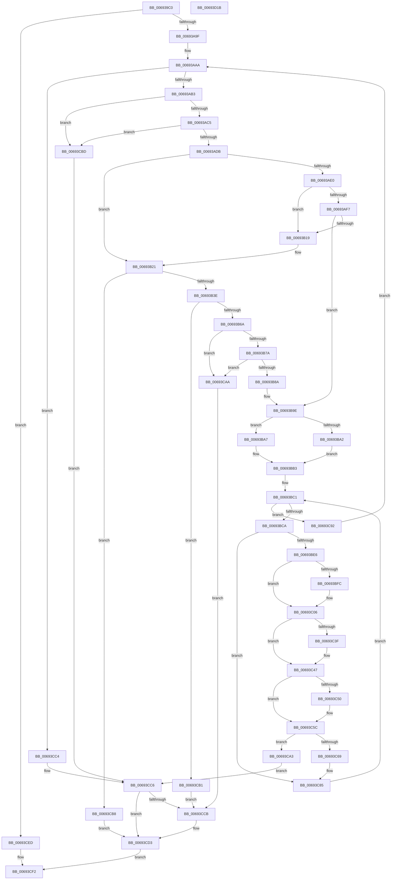

# MiProcessVaContiguityInformation

- RVA: `0x006939C0`–`0x00693D1C` (길이 `860` bytes)
- VA: `0x00000001406939C0`
- 실행 섹션: `.text`
- PDB 이름 있음: `예`; PDB Function 태그: `아니요`
- unwind 정보 RVA: `0x000CBB58`
- 디코드: `228`개 명령, `860/860` bytes 표시
- 미해석 바이트: `0` (있으면 어셈블리에 `.byte`로 보존)

> 이 문서는 커널 이미지의 기계어와 PDB 기호를 분석해 생성했습니다. 4번과 5번은 함수 원형과 자료형을 바이너리 사용 방식에서 추정한 C 해석이며 원본 소스 복구 결과는 아닙니다.

## 1. Dependencies

- 직접 호출 지점: **17**; 고유 호출 대상: **16**
- 직접 호출자로 확인된 함수: **1**
- RIP 상대 이미지 참조: **4**

### Outgoing calls
- `0x00693A74` → [MiInitializeDemandCoalesceContext](../3D/MiInitializeDemandCoalesceContext_function_003D3350.md) (function, `0x003D3350`)
- `0x00693A92` → [MiAcquireNonPagedResources](../28/MiAcquireNonPagedResources_function_00286C60.md) (function, `0x00286C60`)
- `0x00693B1C` → [MiUnlockAndDereferenceVadShared](../2A/MiUnlockAndDereferenceVadShared_function_002AEF10.md) (function, `0x002AEF10`)
- `0x00693B2D` → [MiObtainReferencedVadEx](../31/MiObtainReferencedVadEx_function_00316690.md) (function, `0x00316690`)
- `0x00693B6D` → [MiVadSupportsPhysicalContiguityQuery](../../page/80/MiVadSupportsPhysicalContiguityQuery_function_008093D0.md) (function, `0x008093D0`)
- `0x00693B7D` → [MiVadPagesTradable](../40/MiVadPagesTradable_function_00409360.md) (function, `0x00409360`)
- `0x00693B8D` → [MiGetVadCacheAttribute](../4A/MiGetVadCacheAttribute_function_004AF624.md) (function, `0x004AF624`)
- `0x00693BAC` → [MiThreadIdealNode](../3D/MiThreadIdealNode_function_003D3480.md) (function, `0x003D3480`)
- `0x00693BD9` → [MiQueryVaPhysicalContiguity](../68/MiQueryVaPhysicalContiguity_function_006875B8.md) (function, `0x006875B8`)
- `0x00693C01` → [KiRaiseIrqlProcessIrqlFlags](../4F/KiRaiseIrqlProcessIrqlFlags_function_004F56FC.md) (function, `0x004F56FC`)
- `0x00693C32` → [MiGetLargePage](../31/MiGetLargePage_function_0031E210.md) (function, `0x0031E210`)
- `0x00693C42` → [MiConvertLargeActivePageToChain](../31/MiConvertLargeActivePageToChain_function_0031D980.md) (function, `0x0031D980`)
- `0x00693C57` → [KiLowerIrqlProcessIrqlFlags](../4F/KiLowerIrqlProcessIrqlFlags_function_004F5698.md) (function, `0x004F5698`)
- `0x00693C7D` → [MiMakeVaRangePhysicallyContiguous](MiMakeVaRangePhysicallyContiguous_function_006936E0.md) (function, `0x006936E0`)
- `0x00693CCE` → [MiUnlockAndDereferenceVadShared](../2A/MiUnlockAndDereferenceVadShared_function_002AEF10.md) (function, `0x002AEF10`)
- `0x00693CE6` → [MiReleaseNonPagedResources](../32/MiReleaseNonPagedResources_function_0032299C.md) (function, `0x0032299C`)
- `0x00693CFB` → [_security_check_cookie](../6A/_security_check_cookie_function_006AC640.md) (function, `0x006AC640`)

### Direct callers
- [sub_00B31388](../../page/B3/Unknown_function_00B31388.md) at `0x00B31481`

### Static image references
- `0x006939DC` → RVA `0x00E0A740` (`.data`; read)
- `0x00693A2E` → RVA `0x00E30088` (`.data`; read)
- `0x00693A4D` → RVA `0x00011C60` (`.rdata`; read)
- `0x00693BF3` → RVA `0x00FC6D20` (`ALMOSTRO`; read)

## 2. Other-region calls and transfers

- 다른 실행 섹션으로 향하는 call: **1**
  - `0x00693B6D` → [MiVadSupportsPhysicalContiguityQuery](../../page/80/MiVadSupportsPhysicalContiguityQuery_function_008093D0.md) (`.text` → `PAGE`)
- 별도 외부 분기/꼬리 이동을 확인하지 못했습니다.

## 3. Assembly (complete function range)

```asm
006939C0  48 89 5C 24 10                  mov qword ptr [rsp + 0x10], rbx
006939C5  55                              push rbp
006939C6  56                              push rsi
006939C7  57                              push rdi
006939C8  41 54                           push r12
006939CA  41 55                           push r13
006939CC  41 56                           push r14
006939CE  41 57                           push r15
006939D0  48 8D 6C 24 D9                  lea rbp, [rsp - 0x27]
006939D5  48 81 EC D0 00 00 00            sub rsp, 0xd0
006939DC  48 8B 05 5D 6D 77 00            mov rax, qword ptr [rip + 0x776d5d]
006939E3  48 33 C4                        xor rax, rsp
006939E6  48 89 45 17                     mov qword ptr [rbp + 0x17], rax
006939EA  83 65 97 00                     and dword ptr [rbp - 0x69], 0
006939EE  33 C0                           xor eax, eax
006939F0  48 89 45 07                     mov qword ptr [rbp + 7], rax
006939F4  4C 8B F1                        mov r14, rcx
006939F7  89 45 0F                        mov dword ptr [rbp + 0xf], eax
006939FA  0F 57 C0                        xorps xmm0, xmm0
006939FD  0F 11 45 D7                     movups xmmword ptr [rbp - 0x29], xmm0
00693A01  45 8B E8                        mov r13d, r8d
00693A04  48 8B FA                        mov rdi, rdx
00693A07  0F 11 45 E7                     movups xmmword ptr [rbp - 0x19], xmm0
00693A0B  33 F6                           xor esi, esi
00693A0D  33 DB                           xor ebx, ebx
00693A0F  21 5D 9B                        and dword ptr [rbp - 0x65], ebx
00693A12  0F 11 45 F7                     movups xmmword ptr [rbp - 9], xmm0
00693A16  65 48 8B 04 25 88 01 00 00      mov rax, qword ptr gs:[0x188]
00693A1F  44 89 6D 9F                     mov dword ptr [rbp - 0x61], r13d
00693A23  4C 89 6D CF                     mov qword ptr [rbp - 0x31], r13
00693A27  4C 8B A0 B8 00 00 00            mov r12, qword ptr [rax + 0xb8]
00693A2E  48 8B 05 53 C6 79 00            mov rax, qword ptr [rip + 0x79c653]
00693A35  49 81 C4 00 04 00 00            add r12, 0x400
00693A3C  4C 89 65 B7                     mov qword ptr [rbp - 0x49], r12
00693A40  41 0F B7 8C 24 AE 00 00 00      movzx ecx, word ptr [r12 + 0xae]
00693A49  48 8B 04 C8                     mov rax, qword ptr [rax + rcx*8]
00693A4D  48 8D 0D 0C E2 97 FF            lea rcx, [rip - 0x681df4]
00693A54  4A 8B 14 E9                     mov rdx, qword ptr [rcx + r13*8]
00693A58  48 8D 4D D7                     lea rcx, [rbp - 0x29]
00693A5C  4C 8B FA                        mov r15, rdx
00693A5F  48 89 45 A7                     mov qword ptr [rbp - 0x59], rax
00693A63  8D 46 01                        lea eax, [rsi + 1]
00693A66  49 C1 E7 0C                     shl r15, 0xc
00693A6A  44 8B C8                        mov r9d, eax
00693A6D  4C 89 7D AF                     mov qword ptr [rbp - 0x51], r15
00693A71  44 8B C0                        mov r8d, eax
00693A74  E8 D7 F8 D3 FF                  call 0x1403d3350
00693A79  48 8B 4D A7                     mov rcx, qword ptr [rbp - 0x59]
00693A7D  48 8D 05 DC E1 97 FF            lea rax, [rip - 0x681e24]
00693A84  4A 8B 14 E8                     mov rdx, qword ptr [rax + r13*8]
00693A88  44 8D 4E 06                     lea r9d, [rsi + 6]
00693A8C  41 B8 00 04 00 00               mov r8d, 0x400
00693A92  E8 C9 31 BF FF                  call 0x140286c60
00693A97  85 C0                           test eax, eax
00693A99  0F 88 4E 02 00 00               js 0x140693ced
00693A9F  48 C1 E7 04                     shl rdi, 4
00693AA3  49 03 FE                        add rdi, r14
00693AA6  48 89 7D C7                     mov qword ptr [rbp - 0x39], rdi
00693AAA  4C 3B F7                        cmp r14, rdi
00693AAD  0F 83 11 02 00 00               jae 0x140693cc4
00693AB3  49 8B 46 08                     mov rax, qword ptr [r14 + 8]
00693AB7  33 D2                           xor edx, edx
00693AB9  49 F7 F7                        div r15
00693ABC  48 85 D2                        test rdx, rdx
00693ABF  0F 85 F8 01 00 00               jne 0x140693cbd
00693AC5  4D 8B 06                        mov r8, qword ptr [r14]
00693AC8  49 8D 47 FF                     lea rax, [r15 - 1]
00693ACC  48 F7 D0                        not rax
00693ACF  49 23 C0                        and rax, r8
00693AD2  49 3B C0                        cmp rax, r8
00693AD5  0F 85 E2 01 00 00               jne 0x140693cbd
00693ADB  48 85 F6                        test rsi, rsi
00693ADE  74 41                           je 0x140693b21
00693AE0  0F B6 4E 20                     movzx ecx, byte ptr [rsi + 0x20]
00693AE4  8B 46 18                        mov eax, dword ptr [rsi + 0x18]
00693AE7  48 C1 E1 20                     shl rcx, 0x20
00693AEB  48 0B C8                        or rcx, rax
00693AEE  48 C1 E1 0C                     shl rcx, 0xc
00693AF2  4C 3B C1                        cmp r8, rcx
00693AF5  72 22                           jb 0x140693b19
00693AF7  0F B6 56 21                     movzx edx, byte ptr [rsi + 0x21]
00693AFB  8B 46 1C                        mov eax, dword ptr [rsi + 0x1c]
00693AFE  48 C1 E2 20                     shl rdx, 0x20
00693B02  48 0B D0                        or rdx, rax
00693B05  48 C1 E2 0C                     shl rdx, 0xc
00693B09  48 81 CA FF 0F 00 00            or rdx, 0xfff
00693B10  4C 3B C2                        cmp r8, rdx
00693B13  0F 86 85 00 00 00               jbe 0x140693b9e
00693B19  48 8B CE                        mov rcx, rsi
00693B1C  E8 EF B3 C1 FF                  call 0x1402aef10
00693B21  49 8B 0E                        mov rcx, qword ptr [r14]
00693B24  4C 8D 45 97                     lea r8, [rbp - 0x69]
00693B28  BA 02 00 00 00                  mov edx, 2
00693B2D  E8 5E 2B C8 FF                  call 0x140316690
00693B32  48 8B F0                        mov rsi, rax
00693B35  48 85 C0                        test rax, rax
00693B38  0F 84 7A 01 00 00               je 0x140693cb8
00693B3E  0F B6 50 21                     movzx edx, byte ptr [rax + 0x21]
00693B42  8B 40 1C                        mov eax, dword ptr [rax + 0x1c]
00693B45  49 8B 4E 08                     mov rcx, qword ptr [r14 + 8]
00693B49  48 C1 E2 20                     shl rdx, 0x20
00693B4D  48 FF C9                        dec rcx
00693B50  49 03 0E                        add rcx, qword ptr [r14]
00693B53  48 0B D0                        or rdx, rax
00693B56  48 C1 E2 0C                     shl rdx, 0xc
00693B5A  48 81 CA FF 0F 00 00            or rdx, 0xfff
00693B61  48 3B CA                        cmp rcx, rdx
00693B64  0F 87 47 01 00 00               ja 0x140693cb1
00693B6A  48 8B CE                        mov rcx, rsi
00693B6D  E8 5E 58 17 00                  call 0x1408093d0
00693B72  85 C0                           test eax, eax
00693B74  0F 84 30 01 00 00               je 0x140693caa
00693B7A  48 8B CE                        mov rcx, rsi
00693B7D  E8 DE 57 D7 FF                  call 0x140409360
00693B82  85 C0                           test eax, eax
00693B84  0F 84 20 01 00 00               je 0x140693caa
00693B8A  48 8B CE                        mov rcx, rsi
00693B8D  E8 92 BA E1 FF                  call 0x1404af624
00693B92  8B 5E 30                        mov ebx, dword ptr [rsi + 0x30]
00693B95  C1 EB 0C                        shr ebx, 0xc
00693B98  83 E3 7F                        and ebx, 0x7f
00693B9B  89 45 9B                        mov dword ptr [rbp - 0x65], eax
00693B9E  85 DB                           test ebx, ebx
00693BA0  74 05                           je 0x140693ba7
00693BA2  8D 7B FF                        lea edi, [rbx - 1]
00693BA5  EB 0C                           jmp 0x140693bb3
00693BA7  33 D2                           xor edx, edx
00693BA9  49 8B CC                        mov rcx, r12
00693BAC  E8 CF F8 D3 FF                  call 0x1403d3480
00693BB1  8B F8                           mov edi, eax
00693BB3  4D 8B 3E                        mov r15, qword ptr [r14]
00693BB6  49 8B 46 08                     mov rax, qword ptr [r14 + 8]
00693BBA  49 03 C7                        add rax, r15
00693BBD  48 89 45 BF                     mov qword ptr [rbp - 0x41], rax
00693BC1  4C 3B F8                        cmp r15, rax
00693BC4  0F 83 C8 00 00 00               jae 0x140693c92
00693BCA  41 B9 01 00 00 00               mov r9d, 1
00693BD0  45 8B C5                        mov r8d, r13d
00693BD3  49 8B D7                        mov rdx, r15
00693BD6  49 8B CC                        mov rcx, r12
00693BD9  E8 DA 39 FF FF                  call 0x1406875b8
00693BDE  85 C0                           test eax, eax
00693BE0  0F 85 9F 00 00 00               jne 0x140693c85
00693BE6  45 0F 20 C5                     mov r13, cr8
00693BEA  B8 02 00 00 00                  mov eax, 2
00693BEF  44 0F 22 C0                     mov cr8, rax
00693BF3  83 3D 26 31 93 00 00            cmp dword ptr [rip + 0x933126], 0
00693BFA  74 0A                           je 0x140693c06
00693BFC  8A D0                           mov dl, al
00693BFE  41 8A CD                        mov cl, r13b
00693C01  E8 F6 1A E6 FF                  call 0x1404f56fc
00693C06  48 83 64 24 38 00               and qword ptr [rsp + 0x38], 0
00693C0C  48 8D 45 D7                     lea rax, [rbp - 0x29]
00693C10  44 8B 45 9F                     mov r8d, dword ptr [rbp - 0x61]
00693C14  44 8B CF                        mov r9d, edi
00693C17  48 8B 4D A7                     mov rcx, qword ptr [rbp - 0x59]
00693C1B  49 8B D7                        mov rdx, r15
00693C1E  48 89 44 24 30                  mov qword ptr [rsp + 0x30], rax
00693C23  8B 45 9B                        mov eax, dword ptr [rbp - 0x65]
00693C26  C7 44 24 28 14 00 00 00         mov dword ptr [rsp + 0x28], 0x14
00693C2E  89 44 24 20                     mov dword ptr [rsp + 0x20], eax
00693C32  E8 D9 A5 C8 FF                  call 0x14031e210
00693C37  4C 8B E0                        mov r12, rax
00693C3A  48 85 C0                        test rax, rax
00693C3D  74 08                           je 0x140693c47
00693C3F  48 8B C8                        mov rcx, rax
00693C42  E8 39 9D C8 FF                  call 0x14031d980
00693C47  83 3D D2 30 93 00 00            cmp dword ptr [rip + 0x9330d2], 0
00693C4E  74 0C                           je 0x140693c5c
00693C50  44 0F 20 C1                     mov rcx, cr8
00693C54  41 8A D5                        mov dl, r13b
00693C57  E8 3C 1A E6 FF                  call 0x1404f5698
00693C5C  41 0F B6 C5                     movzx eax, r13b
00693C60  44 0F 22 C0                     mov cr8, rax
00693C64  4D 85 E4                        test r12, r12
00693C67  74 3A                           je 0x140693ca3
00693C69  44 8B 6D 9F                     mov r13d, dword ptr [rbp - 0x61]
00693C6D  4D 8B CC                        mov r9, r12
00693C70  4C 8B 65 B7                     mov r12, qword ptr [rbp - 0x49]
00693C74  45 8B C5                        mov r8d, r13d
00693C77  49 8B CC                        mov rcx, r12
00693C7A  49 8B D7                        mov rdx, r15
00693C7D  E8 5E FA FF FF                  call 0x1406936e0
00693C82  89 45 97                        mov dword ptr [rbp - 0x69], eax
00693C85  4C 03 7D AF                     add r15, qword ptr [rbp - 0x51]
00693C89  48 8B 45 BF                     mov rax, qword ptr [rbp - 0x41]
00693C8D  E9 2F FF FF FF                  jmp 0x140693bc1
00693C92  48 8B 7D C7                     mov rdi, qword ptr [rbp - 0x39]
00693C96  49 83 C6 10                     add r14, 0x10
00693C9A  4C 8B 7D AF                     mov r15, qword ptr [rbp - 0x51]
00693C9E  E9 07 FE FF FF                  jmp 0x140693aaa
00693CA3  BB 17 00 00 C0                  mov ebx, 0xc0000017
00693CA8  EB 1C                           jmp 0x140693cc6
00693CAA  BB BB 00 00 C0                  mov ebx, 0xc00000bb
00693CAF  EB 1A                           jmp 0x140693ccb
00693CB1  BB 18 00 00 C0                  mov ebx, 0xc0000018
00693CB6  EB 13                           jmp 0x140693ccb
00693CB8  8B 5D 97                        mov ebx, dword ptr [rbp - 0x69]
00693CBB  EB 16                           jmp 0x140693cd3
00693CBD  BB 0D 00 00 C0                  mov ebx, 0xc000000d
00693CC2  EB 02                           jmp 0x140693cc6
00693CC4  33 DB                           xor ebx, ebx
00693CC6  48 85 F6                        test rsi, rsi
00693CC9  74 08                           je 0x140693cd3
00693CCB  48 8B CE                        mov rcx, rsi
00693CCE  E8 3D B2 C1 FF                  call 0x1402aef10
00693CD3  48 8B 45 CF                     mov rax, qword ptr [rbp - 0x31]
00693CD7  48 8D 15 82 DF 97 FF            lea rdx, [rip - 0x68207e]
00693CDE  48 8B 4D A7                     mov rcx, qword ptr [rbp - 0x59]
00693CE2  48 8B 14 C2                     mov rdx, qword ptr [rdx + rax*8]
00693CE6  E8 B1 EC C8 FF                  call 0x14032299c
00693CEB  EB 05                           jmp 0x140693cf2
00693CED  BB 9A 00 00 C0                  mov ebx, 0xc000009a
00693CF2  8B C3                           mov eax, ebx
00693CF4  48 8B 4D 17                     mov rcx, qword ptr [rbp + 0x17]
00693CF8  48 33 CC                        xor rcx, rsp
00693CFB  E8 40 89 01 00                  call 0x1406ac640
00693D00  48 8B 9C 24 18 01 00 00         mov rbx, qword ptr [rsp + 0x118]
00693D08  48 81 C4 D0 00 00 00            add rsp, 0xd0
00693D0F  41 5F                           pop r15
00693D11  41 5E                           pop r14
00693D13  41 5D                           pop r13
00693D15  41 5C                           pop r12
00693D17  5F                              pop rdi
00693D18  5E                              pop rsi
00693D19  5D                              pop rbp
00693D1A  C3                              ret
00693D1B  CC                              int3
```

## 4. C-style interpretation (structured pseudocode)

```c
__int64 __fastcall MiProcessVaContiguityInformation(__int64 a1, __int64 a2, int a3)
{
    __int64 result;
    __int64 v_r12;
    __int64 v_r14;
    __int64 v_r15;
    __int64 v_rbx;
    __int64 v_rdi;
    __int64 v_rsi;
    __int64 v_rsp;
    unsigned __int64 v_stack_m48;
    unsigned int v_stack_m50;
    unsigned __int64 v_stack_m58;
    unsigned __int64 v_stack_m5F;
    unsigned __int64 v_stack_m68;
    unsigned __int64 v_stack_m78;
    unsigned __int64 v_stack_m88;
    unsigned __int64 v_stack_m90;
    unsigned __int64 v_stack_m98;
    unsigned __int64 v_stack_mA0;
    unsigned __int64 v_stack_mA8;
    unsigned __int64 v_stack_mB0;
    unsigned __int64 v_stack_mB8;
    unsigned int v_stack_mC0;
    unsigned int v_stack_mC4;
    unsigned int v_stack_mC8;
    unsigned __int64 v_stack_mD0;
    unsigned __int64 v_stack_mD8;
    unsigned int v_stack_mE0;
    unsigned int v_stack_mE8;
    unsigned __int64 v_stack_p10;

    v_stack_p10 = v_rbx;
    v_rsp = (v_rsp) - (208);
    result = (*(unsigned __int64 *)(v_rip + 7826781)) ^ (v_rsp);
    v_stack_m48 = result;
    result = 0;
    v_stack_m58 = 0;
    v_stack_m50 = 0;
    v_stack_m88 = v_xmm0;
    v_stack_m78 = v_xmm0;
    v_rsi = 0;
    v_rbx = 0;
    v_stack_m68 = v_xmm0;
    v_stack_mC0 = (unsigned int)((unsigned int)(a3));
    v_stack_m90 = (unsigned int)(a3);
    v_r12 = (*(unsigned __int64 *)(*(unsigned __int64 *)(gs_base + (0 + 392)) + 184)) + (0x400ULL);
    v_stack_mA8 = v_r12;
    v_stack_mB8 = *(unsigned __int64 *)(*(unsigned __int64 *)(v_rip + 7980627) + *(unsigned __int16 *)(v_r12 + 174) * 8);
    v_r15 = (*(unsigned __int64 *)(v_rip - 6823412 + (unsigned int)(a3) * 8)) << (12);
    v_stack_mB0 = v_r15;
    result = MiInitializeDemandCoalesceContext(v_stack_m88, *(unsigned __int64 *)(v_rip - 6823412 + (unsigned int)(a3) * 8), (unsigned int)((unsigned int)(v_rsi + 1)), (unsigned int)((unsigned int)(v_rsi + 1)));
    result = MiAcquireNonPagedResources(v_stack_mB8, *(unsigned __int64 *)(v_rip - 6823460 + (unsigned int)(a3) * 8), (unsigned int)(0x400ULL), v_rsi + 6);
    if (sign_flag) goto loc_00693CED;
    v_rdi = (a2) << (4);
    v_rdi = (v_rdi) + (a1);
    v_stack_m98 = v_rdi;
loc_00693AAA:
    if (a1 >= v_rdi) goto loc_00693CC4;
    a2 = 0;
    if (0 != 0) goto loc_00693CBD;
    result = ~(v_r15 - 1);
    result = (result) & (*(unsigned __int64 *)(a1));
    if (result != (*(unsigned __int64 *)(a1))) goto loc_00693CBD;
    if (0 == 0) goto loc_00693B21;
    a1 = (*(unsigned __int8 *)(v_rsi + 32)) << (32);
    a1 = (a1) | ((unsigned int)(*(unsigned int *)(v_rsi + 24)));
    a1 = (a1) << (12);
    if ((*(unsigned __int64 *)(a1)) < a1) goto loc_00693B19;
    a2 = (*(unsigned __int8 *)(v_rsi + 33)) << (32);
    a2 = (a2) | ((unsigned int)(*(unsigned int *)(v_rsi + 28)));
    a2 = (a2) << (12);
    a2 = (a2) | (0xFFFULL);
    if ((*(unsigned __int64 *)(a1)) <= a2) goto loc_00693B9E;
loc_00693B19:
    result = MiUnlockAndDereferenceVadShared(0, a2, *(unsigned __int64 *)(a1), v_rsi + 6);
loc_00693B21:
    result = MiObtainReferencedVadEx(*(unsigned __int64 *)(a1), 2, v_stack_mC8, v_rsi + 6);
    if (result == 0) goto loc_00693CB8;
    a2 = (*(unsigned __int8 *)(result + 33)) << (32);
    a1 = (*(unsigned __int64 *)(a1 + 8)) - 1;
    a1 = (a1) + (*(unsigned __int64 *)(a1));
    a2 = (a2) | ((unsigned int)(*(unsigned int *)(result + 28)));
    a2 = (a2) << (12);
    a2 = (a2) | (0xFFFULL);
    if (a1 > a2) goto loc_00693CB1;
    result = MiVadSupportsPhysicalContiguityQuery(result, a2, v_stack_mC8, v_rsi + 6);
    if ((unsigned int)(result) == 0) goto loc_00693CAA;
    result = MiVadPagesTradable(result, a2, v_stack_mC8, v_rsi + 6);
    if ((unsigned int)(result) == 0) goto loc_00693CAA;
    result = MiGetVadCacheAttribute(result, a2, v_stack_mC8, v_rsi + 6);
    v_rbx = (unsigned int)(((unsigned int)(*(unsigned int *)(result + 48))) >> (12));
    v_rbx = (unsigned int)((v_rbx) & (127));
    v_stack_mC4 = (unsigned int)(result);
loc_00693B9E:
    if ((unsigned int)(v_rbx) == 0) goto loc_00693BA7;
    goto loc_00693BB3;
loc_00693BA7:
    a2 = 0;
    result = MiThreadIdealNode(v_r12, a2, v_stack_mC8, v_rsi + 6);
loc_00693BB3:
    result = (*(unsigned __int64 *)(a1 + 8)) + (*(unsigned __int64 *)(a1));
    v_stack_mA0 = result;
loc_00693BC1:
    if ((*(unsigned __int64 *)(a1)) >= result) goto loc_00693C92;
    result = MiQueryVaPhysicalContiguity(v_r12, *(unsigned __int64 *)(a1), (unsigned int)((unsigned int)((unsigned int)(a3))), 1);
    if ((unsigned int)(result) != 0) goto loc_00693C85;
    result = 2;
    if ((*(unsigned int *)(v_rip + 9646374)) != 0) {
        a2 = 2;
        a1 = (unsigned __int8)(v_cr8);
        result = KiRaiseIrqlProcessIrqlFlags(a1, a2, (unsigned int)((unsigned int)((unsigned int)(a3))), 1);
    }
    v_stack_mD8 = v_stack_m88;
    v_stack_mE0 = 20;
    v_stack_mE8 = (unsigned int)((unsigned int)(v_stack_mC4));
    result = MiGetLargePage(v_stack_mB8, *(unsigned __int64 *)(a1), (unsigned int)(v_stack_mC0), (unsigned int)((unsigned int)((unsigned int)((unsigned int)(result)))));
    if (result != 0) {
        a1 = result;
        result = MiConvertLargeActivePageToChain(a1, *(unsigned __int64 *)(a1), (unsigned int)(v_stack_mC0), (unsigned int)((unsigned int)((unsigned int)((unsigned int)(result)))));
    }
    if ((*(unsigned int *)(v_rip + 9646290)) != 0) {
        a1 = 2;
        a2 = (unsigned __int8)(v_cr8);
        result = KiLowerIrqlProcessIrqlFlags(a1, a2, (unsigned int)(v_stack_mC0), (unsigned int)((unsigned int)((unsigned int)((unsigned int)(result)))));
    }
    if (result == 0) goto loc_00693CA3;
    result = MiMakeVaRangePhysicallyContiguous(v_stack_mA8, *(unsigned __int64 *)(a1), (unsigned int)((unsigned int)((unsigned int)(v_stack_mC0))), result);
    v_stack_mC8 = (unsigned int)(result);
loc_00693C85:
    v_r15 = (*(unsigned __int64 *)(a1)) + (v_stack_mB0);
    goto loc_00693BC1;
loc_00693C92:
    v_r14 = (a1) + (16);
    goto loc_00693AAA;
loc_00693CA3:
    goto loc_00693CC6;
loc_00693CAA:
    goto loc_00693CCB;
loc_00693CB1:
    goto loc_00693CCB;
loc_00693CB8:
    goto loc_00693CD3;
loc_00693CBD:
    goto loc_00693CC6;
loc_00693CC4:
    v_rbx = 0;
loc_00693CC6:
    result = v_stack_mA0;
    if (result != 0) {
        a1 = result;
        result = MiUnlockAndDereferenceVadShared(a1, *(unsigned __int64 *)(a1), (unsigned int)((unsigned int)((unsigned int)(v_stack_mC0))), result);
    }
    result = MiReleaseNonPagedResources(v_stack_mB8, *(unsigned __int64 *)(v_rip - 6824062 + v_stack_m90 * 8), (unsigned int)((unsigned int)((unsigned int)(v_stack_mC0))), result);
    goto loc_00693CF2;
loc_00693CED:
loc_00693CF2:
    a1 = (v_stack_m48) ^ (v_rsp);
    result = _security_check_cookie(a1, *(unsigned __int64 *)(v_rip - 6824062 + v_stack_m90 * 8), (unsigned int)((unsigned int)((unsigned int)(v_stack_mC0))), result);
    v_rsp = (v_rsp) + (208);
    return result;
}
```

## 5. (Beta) C Style

```c
int64_t MiProcessVaContiguityInformation(int64_t Arg1, int64_t Arg2, int32_t Arg3)
{
    int64_t result;
    int64_t local_r12;
    int64_t local_r14;
    int64_t local_r15;
    int64_t local_rbx;
    int64_t local_rdi;
    int64_t local_rsi;
    int64_t local_rsp;
    uint64_t v_stack_m48;
    uint32_t v_stack_m50;
    uint64_t v_stack_m58;
    uint64_t v_stack_m5F;
    uint64_t v_stack_m68;
    uint64_t v_stack_m78;
    uint64_t v_stack_m88;
    uint64_t v_stack_m90;
    uint64_t v_stack_m98;
    uint64_t v_stack_mA0;
    uint64_t v_stack_mA8;
    uint64_t v_stack_mB0;
    uint64_t v_stack_mB8;
    uint32_t v_stack_mC0;
    uint32_t v_stack_mC4;
    uint32_t v_stack_mC8;
    uint64_t v_stack_mD0;
    uint64_t v_stack_mD8;
    uint32_t v_stack_mE0;
    uint32_t v_stack_mE8;
    uint64_t v_stack_p10;

    v_stack_p10 = local_rbx;
    local_rsp = (local_rsp) - (208);
    result = (*(uint64_t *)(v_rip + 0x776D5D)) ^ (local_rsp);
    v_stack_m48 = result;
    result = 0;
    v_stack_m58 = 0;
    v_stack_m50 = 0;
    v_stack_m88 = v_xmm0;
    v_stack_m78 = v_xmm0;
    local_rsi = 0;
    local_rbx = 0;
    v_stack_m68 = v_xmm0;
    v_stack_mC0 = (uint32_t)((uint32_t)(Arg3));
    v_stack_m90 = (uint32_t)(Arg3);
    local_r12 = (*(uint64_t *)(*(uint64_t *)(gs_base + (0 + 0x188)) + 0xB8)) + (0x400ULL);
    v_stack_mA8 = local_r12;
    v_stack_mB8 = *(uint64_t *)(*(uint64_t *)(v_rip + 0x79C653) + *(uint16_t *)(local_r12 + 0xAE) * 8);
    local_r15 = (*(uint64_t *)(v_rip - 0x681DF4 + (uint32_t)(Arg3) * 8)) << (12);
    v_stack_mB0 = local_r15;
    result = MiInitializeDemandCoalesceContext(v_stack_m88, *(uint64_t *)(v_rip - 0x681DF4 + (uint32_t)(Arg3) * 8), (uint32_t)((uint32_t)(local_rsi + 1)), (uint32_t)((uint32_t)(local_rsi + 1)));
    result = MiAcquireNonPagedResources(v_stack_mB8, *(uint64_t *)(v_rip - 0x681E24 + (uint32_t)(Arg3) * 8), (uint32_t)(0x400ULL), local_rsi + 6);
    if (sign_flag) goto loc_00693CED;
    local_rdi = (Arg2) << (4);
    local_rdi = (local_rdi) + (Arg1);
    v_stack_m98 = local_rdi;
loc_00693AAA:
    if (Arg1 >= local_rdi) goto loc_00693CC4;
    Arg2 = 0;
    if (0 != 0) goto loc_00693CBD;
    result = ~(local_r15 - 1);
    result = (result) & (*(uint64_t *)(Arg1));
    if (result != (*(uint64_t *)(Arg1))) goto loc_00693CBD;
    if (0 == 0) goto loc_00693B21;
    Arg1 = (*(uint8_t *)(local_rsi + 0x20)) << (32);
    Arg1 = (Arg1) | ((uint32_t)(*(uint32_t *)(local_rsi + 0x18)));
    Arg1 = (Arg1) << (12);
    if ((*(uint64_t *)(Arg1)) < Arg1) goto loc_00693B19;
    Arg2 = (*(uint8_t *)(local_rsi + 0x21)) << (32);
    Arg2 = (Arg2) | ((uint32_t)(*(uint32_t *)(local_rsi + 0x1C)));
    Arg2 = (Arg2) << (12);
    Arg2 = (Arg2) | (0xFFFULL);
    if ((*(uint64_t *)(Arg1)) <= Arg2) goto loc_00693B9E;
loc_00693B19:
    result = MiUnlockAndDereferenceVadShared(0, Arg2, *(uint64_t *)(Arg1), local_rsi + 6);
loc_00693B21:
    result = MiObtainReferencedVadEx(*(uint64_t *)(Arg1), 2, v_stack_mC8, local_rsi + 6);
    if (result == 0) goto loc_00693CB8;
    Arg2 = (*(uint8_t *)(result + 0x21)) << (32);
    Arg1 = (*(uint64_t *)(Arg1 + 0x8)) - 1;
    Arg1 = (Arg1) + (*(uint64_t *)(Arg1));
    Arg2 = (Arg2) | ((uint32_t)(*(uint32_t *)(result + 0x1C)));
    Arg2 = (Arg2) << (12);
    Arg2 = (Arg2) | (0xFFFULL);
    if (Arg1 > Arg2) goto loc_00693CB1;
    result = MiVadSupportsPhysicalContiguityQuery(result, Arg2, v_stack_mC8, local_rsi + 6);
    if ((uint32_t)(result) == 0) goto loc_00693CAA;
    result = MiVadPagesTradable(result, Arg2, v_stack_mC8, local_rsi + 6);
    if ((uint32_t)(result) == 0) goto loc_00693CAA;
    result = MiGetVadCacheAttribute(result, Arg2, v_stack_mC8, local_rsi + 6);
    local_rbx = (uint32_t)(((uint32_t)(*(uint32_t *)(result + 0x30))) >> (12));
    local_rbx = (uint32_t)((local_rbx) & (127));
    v_stack_mC4 = (uint32_t)(result);
loc_00693B9E:
    if ((uint32_t)(local_rbx) == 0) goto loc_00693BA7;
    goto loc_00693BB3;
loc_00693BA7:
    Arg2 = 0;
    result = MiThreadIdealNode(local_r12, Arg2, v_stack_mC8, local_rsi + 6);
loc_00693BB3:
    result = (*(uint64_t *)(Arg1 + 0x8)) + (*(uint64_t *)(Arg1));
    v_stack_mA0 = result;
loc_00693BC1:
    if ((*(uint64_t *)(Arg1)) >= result) goto loc_00693C92;
    result = MiQueryVaPhysicalContiguity(local_r12, *(uint64_t *)(Arg1), (uint32_t)((uint32_t)((uint32_t)(Arg3))), 1);
    if ((uint32_t)(result) != 0) goto loc_00693C85;
    result = 2;
    if ((*(uint32_t *)(v_rip + 0x933126)) != 0) {
        Arg2 = 2;
        Arg1 = (uint8_t)(v_cr8);
        result = KiRaiseIrqlProcessIrqlFlags(Arg1, Arg2, (uint32_t)((uint32_t)((uint32_t)(Arg3))), 1);
    }
    v_stack_mD8 = v_stack_m88;
    v_stack_mE0 = 20;
    v_stack_mE8 = (uint32_t)((uint32_t)(v_stack_mC4));
    result = MiGetLargePage(v_stack_mB8, *(uint64_t *)(Arg1), (uint32_t)(v_stack_mC0), (uint32_t)((uint32_t)((uint32_t)((uint32_t)(result)))));
    if (result != 0) {
        Arg1 = result;
        result = MiConvertLargeActivePageToChain(Arg1, *(uint64_t *)(Arg1), (uint32_t)(v_stack_mC0), (uint32_t)((uint32_t)((uint32_t)((uint32_t)(result)))));
    }
    if ((*(uint32_t *)(v_rip + 0x9330D2)) != 0) {
        Arg1 = 2;
        Arg2 = (uint8_t)(v_cr8);
        result = KiLowerIrqlProcessIrqlFlags(Arg1, Arg2, (uint32_t)(v_stack_mC0), (uint32_t)((uint32_t)((uint32_t)((uint32_t)(result)))));
    }
    if (result == 0) goto loc_00693CA3;
    result = MiMakeVaRangePhysicallyContiguous(v_stack_mA8, *(uint64_t *)(Arg1), (uint32_t)((uint32_t)((uint32_t)(v_stack_mC0))), result);
    v_stack_mC8 = (uint32_t)(result);
loc_00693C85:
    local_r15 = (*(uint64_t *)(Arg1)) + (v_stack_mB0);
    goto loc_00693BC1;
loc_00693C92:
    local_r14 = (Arg1) + (16);
    goto loc_00693AAA;
loc_00693CA3:
    goto loc_00693CC6;
loc_00693CAA:
    goto loc_00693CCB;
loc_00693CB1:
    goto loc_00693CCB;
loc_00693CB8:
    goto loc_00693CD3;
loc_00693CBD:
    goto loc_00693CC6;
loc_00693CC4:
    local_rbx = 0;
loc_00693CC6:
    result = v_stack_mA0;
    if (result != 0) {
        Arg1 = result;
        result = MiUnlockAndDereferenceVadShared(Arg1, *(uint64_t *)(Arg1), (uint32_t)((uint32_t)((uint32_t)(v_stack_mC0))), result);
    }
    result = MiReleaseNonPagedResources(v_stack_mB8, *(uint64_t *)(v_rip - 0x68207E + v_stack_m90 * 8), (uint32_t)((uint32_t)((uint32_t)(v_stack_mC0))), result);
    goto loc_00693CF2;
loc_00693CED:
loc_00693CF2:
    Arg1 = (v_stack_m48) ^ (local_rsp);
    result = _security_check_cookie(Arg1, *(uint64_t *)(v_rip - 0x68207E + v_stack_m90 * 8), (uint32_t)((uint32_t)((uint32_t)(v_stack_mC0))), result);
    local_rsp = (local_rsp) + (208);
    return result;
}
```

## 6. Execution-region graph

[열기: 2D/3D 그래프와 함수 탐색 컨트롤 패널](../../../control-panel.html?section=text&rva=0x006939C0&view=graph)

- 2D 그래프는 위에서 아래로 흐르고, 3D 그래프는 빈 공간을 드래그해 회전합니다. Shift+드래그는 이동, 휠은 확대·축소, 함수 노드 선택은 대상 보고서 이동입니다.

### Static fallback


