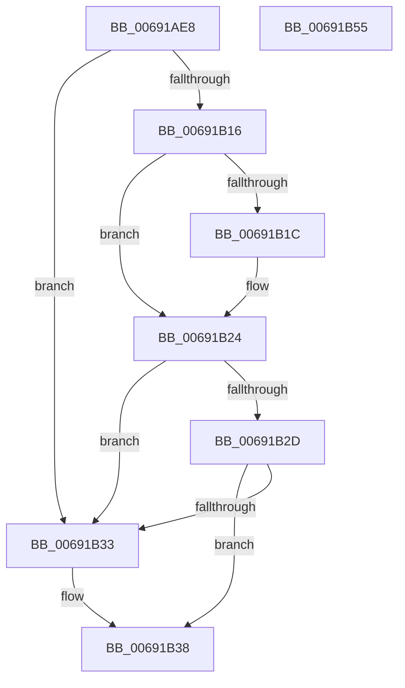

# MiRebuildPartitionMemoryBlock

- RVA: `0x00691AE8`–`0x00691B56` (길이 `110` bytes)
- VA: `0x0000000140691AE8`
- 실행 섹션: `.text`
- PDB 이름 있음: `예`; PDB Function 태그: `아니요`
- unwind 정보 RVA: `0x00060BC4`
- 디코드: `30`개 명령, `110/110` bytes 표시
- 미해석 바이트: `0` (있으면 어셈블리에 `.byte`로 보존)

> 이 문서는 커널 이미지의 기계어와 PDB 기호를 분석해 생성했습니다. 4번과 5번은 함수 원형과 자료형을 바이너리 사용 방식에서 추정한 C 해석이며 원본 소스 복구 결과는 아닙니다.

## 1. Dependencies

- 직접 호출 지점: **3**; 고유 호출 대상: **3**
- 직접 호출자로 확인된 함수: **1**
- RIP 상대 이미지 참조: **0**

### Outgoing calls
- `0x00691B06` → [MiLockDynamicMemoryExclusive](../67/MiLockDynamicMemoryExclusive_function_006730F8.md) (function, `0x006730F8`)
- `0x00691B1F` → [MiMakePartitionMemoryBlock](../../page/80/MiMakePartitionMemoryBlock_function_0080D94C.md) (function, `0x0080D94C`)
- `0x00691B3E` → [MiUnlockDynamicMemoryExclusive](../67/MiUnlockDynamicMemoryExclusive_function_00673C5C.md) (function, `0x00673C5C`)

### Direct callers
- [MiGetPhysicalMemoryRanges](../../page/AC/MiGetPhysicalMemoryRanges_function_00ACAE08.md) at `0x00ACAE74`

### Static image references
- 디코드된 RIP-relative 메모리 참조가 없습니다.

## 2. Other-region calls and transfers

- 다른 실행 섹션으로 향하는 call: **1**
  - `0x00691B1F` → [MiMakePartitionMemoryBlock](../../page/80/MiMakePartitionMemoryBlock_function_0080D94C.md) (`.text` → `PAGE`)
- 별도 외부 분기/꼬리 이동을 확인하지 못했습니다.

## 3. Assembly (complete function range)

```asm
00691AE8  48 89 5C 24 08                  mov qword ptr [rsp + 8], rbx
00691AED  48 89 74 24 10                  mov qword ptr [rsp + 0x10], rsi
00691AF2  57                              push rdi
00691AF3  48 83 EC 20                     sub rsp, 0x20
00691AF7  65 48 8B 34 25 88 01 00 00      mov rsi, qword ptr gs:[0x188]
00691B00  48 8B D9                        mov rbx, rcx
00691B03  48 8B D6                        mov rdx, rsi
00691B06  E8 ED 15 FE FF                  call 0x1406730f8
00691B0B  33 FF                           xor edi, edi
00691B0D  48 39 BB 50 48 00 00            cmp qword ptr [rbx + 0x4850], rdi
00691B14  74 1D                           je 0x140691b33
00691B16  48 39 7B 50                     cmp qword ptr [rbx + 0x50], rdi
00691B1A  75 08                           jne 0x140691b24
00691B1C  48 8B CB                        mov rcx, rbx
00691B1F  E8 28 BE 17 00                  call 0x14080d94c
00691B24  48 39 BB 50 48 00 00            cmp qword ptr [rbx + 0x4850], rdi
00691B2B  74 06                           je 0x140691b33
00691B2D  48 39 7B 50                     cmp qword ptr [rbx + 0x50], rdi
00691B31  74 05                           je 0x140691b38
00691B33  BF 01 00 00 00                  mov edi, 1
00691B38  48 8B D6                        mov rdx, rsi
00691B3B  48 8B CB                        mov rcx, rbx
00691B3E  E8 19 21 FE FF                  call 0x140673c5c
00691B43  48 8B 5C 24 30                  mov rbx, qword ptr [rsp + 0x30]
00691B48  8B C7                           mov eax, edi
00691B4A  48 8B 74 24 38                  mov rsi, qword ptr [rsp + 0x38]
00691B4F  48 83 C4 20                     add rsp, 0x20
00691B53  5F                              pop rdi
00691B54  C3                              ret
00691B55  CC                              int3
```

## 4. C-style interpretation (structured pseudocode)

```c
__int64 __fastcall MiRebuildPartitionMemoryBlock(__int64 a1)
{
    __int64 result;
    __int64 v_rdi;
    __int64 v_rsp;
    unsigned __int64 v_stack_p10;
    unsigned __int64 v_stack_p8;

    v_stack_p8 = v_rbx;
    v_stack_p10 = v_rsi;
    v_rsp = (v_rsp) - (32);
    result = MiLockDynamicMemoryExclusive(a1, *(unsigned __int64 *)(gs_base + (0 + 392)), a3, a4);
    v_rdi = 0;
    if ((*(unsigned __int64 *)(a1 + 18512)) == 0) goto loc_00691B33;
    if ((*(unsigned __int64 *)(a1 + 80)) == 0) {
        a1 = a1;
        result = MiMakePartitionMemoryBlock(a1, *(unsigned __int64 *)(gs_base + (0 + 392)), a3, a4);
    }
    if ((*(unsigned __int64 *)(a1 + 18512)) == 0) goto loc_00691B33;
    if ((*(unsigned __int64 *)(a1 + 80)) != 0) {
        v_rdi = 1;
    }
    result = MiUnlockDynamicMemoryExclusive(a1, *(unsigned __int64 *)(gs_base + (0 + 392)), a3, a4);
    v_rsp = (v_rsp) + (32);
    return (unsigned int)((unsigned int)(v_rdi));
}
```

## 5. (Beta) C Style

```c
int64_t MiRebuildPartitionMemoryBlock(void *Arg1)
{
    uint8_t *arg1 = (uint8_t *)Arg1;

    int64_t result;
    int64_t local_rdi;
    int64_t local_rsp;
    uint64_t v_stack_p10;
    uint64_t v_stack_p8;

    v_stack_p8 = local_rbx;
    v_stack_p10 = local_rsi;
    local_rsp = (local_rsp) - (32);
    result = MiLockDynamicMemoryExclusive(Arg1, *(uint64_t *)(gs_base + (0 + 0x188)), a3, a4);
    local_rdi = 0;
    if ((*(uint64_t *)(arg1 + 0x4850)) == 0) goto loc_00691B33;
    if ((*(uint64_t *)(arg1 + 0x50)) == 0) {
        Arg1 = Arg1;
        result = MiMakePartitionMemoryBlock(Arg1, *(uint64_t *)(gs_base + (0 + 0x188)), a3, a4);
    }
    if ((*(uint64_t *)(arg1 + 0x4850)) == 0) goto loc_00691B33;
    if ((*(uint64_t *)(arg1 + 0x50)) != 0) {
        local_rdi = 1;
    }
    result = MiUnlockDynamicMemoryExclusive(Arg1, *(uint64_t *)(gs_base + (0 + 0x188)), a3, a4);
    local_rsp = (local_rsp) + (32);
    return (uint32_t)((uint32_t)(local_rdi));
}
```

### 관측된 메모리 오프셋

구조체 형식이 확인되지 않은 접근은 인자 기준의 오프셋으로만 기록했습니다.

| 기준 인자 | 오프셋 표현 | 폭 (bit) | 접근 |
|---|---:|---:|---|
| `Arg1` | `+ 0x50` | `64` | `R` |
| `Arg1` | `+ 0x4850` | `64` | `R` |

## 6. Execution-region graph

[열기: 2D/3D 그래프와 함수 탐색 컨트롤 패널](../../../control-panel.html?section=text&rva=0x00691AE8&view=graph)

- 2D 그래프는 위에서 아래로 흐르고, 3D 그래프는 빈 공간을 드래그해 회전합니다. Shift+드래그는 이동, 휠은 확대·축소, 함수 노드 선택은 대상 보고서 이동입니다.

### Static fallback


