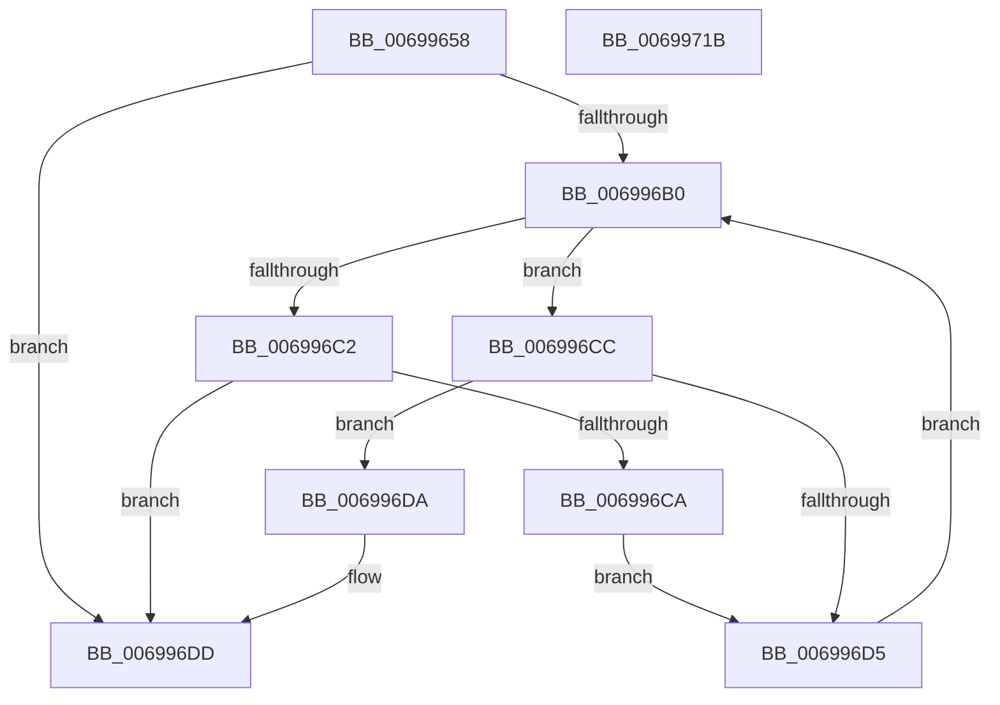

# MiReplaceSystemProtoPtesNode

- RVA: `0x00699658`–`0x0069971C` (길이 `196` bytes)
- VA: `0x0000000140699658`
- 실행 섹션: `.text`
- PDB 이름 있음: `예`; PDB Function 태그: `아니요`
- unwind 정보 RVA: `0x0006C8E8`
- 디코드: `53`개 명령, `196/196` bytes 표시
- 미해석 바이트: `0` (있으면 어셈블리에 `.byte`로 보존)

> 이 문서는 커널 이미지의 기계어와 PDB 기호를 분석해 생성했습니다. 4번과 5번은 함수 원형과 자료형을 바이너리 사용 방식에서 추정한 C 해석이며 원본 소스 복구 결과는 아닙니다.

## 1. Dependencies

- 직접 호출 지점: **6**; 고유 호출 대상: **5**
- 직접 호출자로 확인된 함수: **1**
- RIP 상대 이미지 참조: **2**

### Outgoing calls
- `0x00699676` → [MiObtainProtoBaseFromNode](../3E/MiObtainProtoBaseFromNode_function_003E09C0.md) (function, `0x003E09C0`)
- `0x00699685` → [ExAcquireSpinLockExclusive](../24/ExAcquireSpinLockExclusive_function_00248690.md) (function, `0x00248690`)
- `0x00699697` → [RtlAvlRemoveNode](../29/RtlAvlRemoveNode_function_00296650.md) (function, `0x00296650`)
- `0x006996B8` → [MiObtainProtoBaseFromNode](../3E/MiObtainProtoBaseFromNode_function_003E09C0.md) (function, `0x003E09C0`)
- `0x006996ED` → [RtlAvlInsertNodeEx](../26/RtlAvlInsertNodeEx_function_00265790.md) (function, `0x00265790`)
- `0x00699701` → [MiReleaseSpinLockExclusive](../24/MiReleaseSpinLockExclusive_function_002482C0.md) (function, `0x002482C0`)

### Direct callers
- [MiAllocateFileExtents](../../page/AB/MiAllocateFileExtents_function_00ABDF54.md) at `0x00ABE41E`

### Static image references
- `0x0069967B` → RVA `0x00E2D710` (`.data`; read)
- `0x0069968D` → RVA `0x00E2D708` (`.data`; read)

## 2. Other-region calls and transfers

- 다른 실행 섹션으로 향하는 call: **0**
- 별도 외부 분기/꼬리 이동을 확인하지 못했습니다.

## 3. Assembly (complete function range)

```asm
00699658  48 8B C4                        mov rax, rsp
0069965B  48 89 58 10                     mov qword ptr [rax + 0x10], rbx
0069965F  48 89 68 18                     mov qword ptr [rax + 0x18], rbp
00699663  48 89 70 20                     mov qword ptr [rax + 0x20], rsi
00699667  57                              push rdi
00699668  48 83 EC 20                     sub rsp, 0x20
0069966C  48 8B FA                        mov rdi, rdx
0069966F  48 8B D9                        mov rbx, rcx
00699672  48 8D 50 08                     lea rdx, [rax + 8]
00699676  E8 45 73 D4 FF                  call 0x1403e09c0
0069967B  48 8D 0D 8E 40 79 00            lea rcx, [rip + 0x79408e]
00699682  48 8B F0                        mov rsi, rax
00699685  E8 06 F0 BA FF                  call 0x140248690
0069968A  48 8B D3                        mov rdx, rbx
0069968D  48 8D 0D 74 40 79 00            lea rcx, [rip + 0x794074]
00699694  40 8A E8                        mov bpl, al
00699697  E8 B4 CF BF FF                  call 0x140296650
0069969C  48 83 63 18 F7                  and qword ptr [rbx + 0x18], 0xfffffffffffffff7
006996A1  45 33 D2                        xor r10d, r10d
006996A4  4C 8B 1D 5D 40 79 00            mov r11, qword ptr [rip + 0x79405d]
006996AB  4D 85 DB                        test r11, r11
006996AE  74 2D                           je 0x1406996dd
006996B0  48 8D 54 24 30                  lea rdx, [rsp + 0x30]
006996B5  49 8B CB                        mov rcx, r11
006996B8  E8 03 73 D4 FF                  call 0x1403e09c0
006996BD  48 3B F0                        cmp rsi, rax
006996C0  73 0A                           jae 0x1406996cc
006996C2  49 8B 03                        mov rax, qword ptr [r11]
006996C5  48 85 C0                        test rax, rax
006996C8  74 13                           je 0x1406996dd
006996CA  EB 09                           jmp 0x1406996d5
006996CC  49 8B 43 08                     mov rax, qword ptr [r11 + 8]
006996D0  48 85 C0                        test rax, rax
006996D3  74 05                           je 0x1406996da
006996D5  4C 8B D8                        mov r11, rax
006996D8  EB D6                           jmp 0x1406996b0
006996DA  41 B2 01                        mov r10b, 1
006996DD  4C 8B CF                        mov r9, rdi
006996E0  48 8D 0D 21 40 79 00            lea rcx, [rip + 0x794021]
006996E7  45 8A C2                        mov r8b, r10b
006996EA  49 8B D3                        mov rdx, r11
006996ED  E8 9E C0 BC FF                  call 0x140265790
006996F2  48 83 4F 18 08                  or qword ptr [rdi + 0x18], 8
006996F7  48 8D 0D 12 40 79 00            lea rcx, [rip + 0x794012]
006996FE  40 8A D5                        mov dl, bpl
00699701  E8 BA EB BA FF                  call 0x1402482c0
00699706  48 8B 5C 24 38                  mov rbx, qword ptr [rsp + 0x38]
0069970B  48 8B 6C 24 40                  mov rbp, qword ptr [rsp + 0x40]
00699710  48 8B 74 24 48                  mov rsi, qword ptr [rsp + 0x48]
00699715  48 83 C4 20                     add rsp, 0x20
00699719  5F                              pop rdi
0069971A  C3                              ret
0069971B  CC                              int3
```

## 4. C-style interpretation (structured pseudocode)

```c
__int64 __fastcall MiReplaceSystemProtoPtesNode(__int64 a1, __int64 a2)
{
    __int64 result;
    __int64 v_r10;
    __int64 v_rsp;
    unsigned __int64 v_stack_p10;
    unsigned __int64 v_stack_p18;
    unsigned __int64 v_stack_p20;
    unsigned __int64 v_stack_p8;

    *(unsigned __int64 *)(v_rsp + 16) = v_rbx;
    *(unsigned __int64 *)(v_rsp + 24) = v_rbp;
    *(unsigned __int64 *)(v_rsp + 32) = v_rsi;
    v_rsp = (v_rsp) - (32);
    result = MiObtainProtoBaseFromNode(a1, v_rsp + 8, a3, a4);
    result = ExAcquireSpinLockExclusive(v_rip + 7946382, v_rsp + 8, a3, a4);
    result = RtlAvlRemoveNode(v_rip + 7946356, a1, a3, a4);
    v_r10 = 0;
    if (*(unsigned __int64 *)(v_rip + 7946333) == 0) goto loc_006996DD;
loc_006996B0:
    result = MiObtainProtoBaseFromNode(*(unsigned __int64 *)(v_rip + 7946333), v_stack_p8, a3, a4);
    if (result >= result) goto loc_006996CC;
    if (*(unsigned __int64 *)(*(unsigned __int64 *)(v_rip + 7946333)) == 0) goto loc_006996DD;
    goto loc_006996D5;
loc_006996CC:
    if (*(unsigned __int64 *)(*(unsigned __int64 *)(v_rip + 7946333) + 8) == 0) goto loc_006996DA;
loc_006996D5:
    goto loc_006996B0;
loc_006996DA:
loc_006996DD:
    result = RtlAvlInsertNodeEx(v_rip + 7946273, *(unsigned __int64 *)(*(unsigned __int64 *)(v_rip + 7946333) + 8), 1, a2);
    result = MiReleaseSpinLockExclusive(v_rip + 7946258, (unsigned __int8)((unsigned __int8)(result)), 1, a2);
    v_rsp = (v_rsp) + (32);
    return result;
}
```

## 5. (Beta) C Style

```c
int64_t MiReplaceSystemProtoPtesNode(void *Arg1, void *Arg2)
{
    uint8_t *arg1 = (uint8_t *)Arg1;
    uint8_t *arg2 = (uint8_t *)Arg2;

    int64_t result;
    int64_t local_r10;
    int64_t local_rsp;
    uint64_t v_stack_p10;
    uint64_t v_stack_p18;
    uint64_t v_stack_p20;
    uint64_t v_stack_p8;

    *(uint64_t *)(local_rsp + 0x10) = local_rbx;
    *(uint64_t *)(local_rsp + 0x18) = local_rbp;
    *(uint64_t *)(local_rsp + 0x20) = local_rsi;
    local_rsp = (local_rsp) - (32);
    result = MiObtainProtoBaseFromNode(Arg1, local_rsp + 8, a3, a4);
    result = ExAcquireSpinLockExclusive(v_rip + 7946382, local_rsp + 8, a3, a4);
    result = RtlAvlRemoveNode(v_rip + 7946356, Arg1, a3, a4);
    local_r10 = 0;
    if (*(uint64_t *)(v_rip + 0x79405D) == 0) goto loc_006996DD;
loc_006996B0:
    result = MiObtainProtoBaseFromNode(*(uint64_t *)(v_rip + 0x79405D), v_stack_p8, a3, a4);
    if (result >= result) goto loc_006996CC;
    if (*(uint64_t *)(*(uint64_t *)(v_rip + 0x79405D)) == 0) goto loc_006996DD;
    goto loc_006996D5;
loc_006996CC:
    if (*(uint64_t *)(*(uint64_t *)(v_rip + 0x79405D) + 0x8) == 0) goto loc_006996DA;
loc_006996D5:
    goto loc_006996B0;
loc_006996DA:
loc_006996DD:
    result = RtlAvlInsertNodeEx(v_rip + 7946273, *(uint64_t *)(*(uint64_t *)(v_rip + 0x79405D) + 0x8), 1, Arg2);
    result = MiReleaseSpinLockExclusive(v_rip + 7946258, (uint8_t)((uint8_t)(result)), 1, Arg2);
    local_rsp = (local_rsp) + (32);
    return result;
}
```

### 관측된 메모리 오프셋

구조체 형식이 확인되지 않은 접근은 인자 기준의 오프셋으로만 기록했습니다.

| 기준 인자 | 오프셋 표현 | 폭 (bit) | 접근 |
|---|---:|---:|---|
| `Arg1` | `+ 0x18` | `64` | `R/W` |
| `Arg2` | `+ 0x18` | `64` | `R/W` |

## 6. Execution-region graph

[열기: 2D/3D 그래프와 함수 탐색 컨트롤 패널](../../../control-panel.html?section=text&rva=0x00699658&view=graph)

- 2D 그래프는 위에서 아래로 흐르고, 3D 그래프는 빈 공간을 드래그해 회전합니다. Shift+드래그는 이동, 휠은 확대·축소, 함수 노드 선택은 대상 보고서 이동입니다.

### Static fallback


