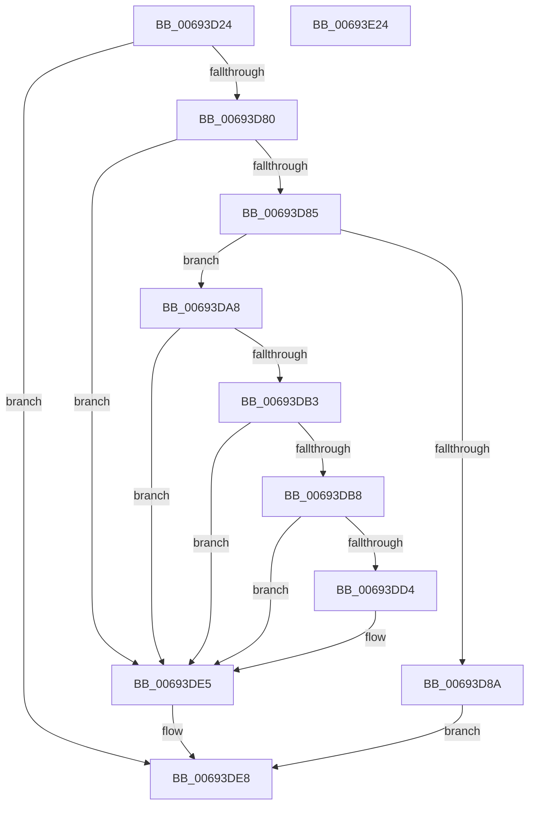

# MiReplicatePteChangeToProcess

- RVA: `0x00693D24`–`0x00693E25` (길이 `257` bytes)
- VA: `0x0000000140693D24`
- 실행 섹션: `.text`
- PDB 이름 있음: `예`; PDB Function 태그: `아니요`
- unwind 정보 RVA: `0x0005D7BC`
- 디코드: `66`개 명령, `257/257` bytes 표시
- 미해석 바이트: `0` (있으면 어셈블리에 `.byte`로 보존)

> 이 문서는 커널 이미지의 기계어와 PDB 기호를 분석해 생성했습니다. 4번과 5번은 함수 원형과 자료형을 바이너리 사용 방식에서 추정한 C 해석이며 원본 소스 복구 결과는 아닙니다.

## 1. Dependencies

- 직접 호출 지점: **7**; 고유 호출 대상: **7**
- 직접 호출자로 확인된 함수: **1**
- RIP 상대 이미지 참조: **1**

### Outgoing calls
- `0x00693D43` → [MI_GET_DIRECTORY_FRAME_FROM_PROCESS_PDE](../68/MI_GET_DIRECTORY_FRAME_FROM_PROCESS_PDE_function_0068A278.md) (function, `0x0068A278`)
- `0x00693D53` → [MiMapPageInHyperSpaceWorker](../33/MiMapPageInHyperSpaceWorker_function_00332B10.md) (function, `0x00332B10`)
- `0x00693D70` → [MI_READ_PTE_LOCK_FREE](../28/MI_READ_PTE_LOCK_FREE_function_002828A0.md) (function, `0x002828A0`)
- `0x00693DA1` → [MiTransformValidPteInPlace](../37/MiTransformValidPteInPlace_function_003765E0.md) (function, `0x003765E0`)
- `0x00693DE0` → [MiCheckLinearProtectedPteAccessedBit](../29/MiCheckLinearProtectedPteAccessedBit_function_00292D80.md) (function, `0x00292D80`)
- `0x00693DF3` → [MiUnmapPageInHyperSpaceWorker](../43/MiUnmapPageInHyperSpaceWorker_function_00432800.md) (function, `0x00432800`)
- `0x00693E04` → [MiShadowTopLevelPxes](../46/MiShadowTopLevelPxes_function_0046C6B0.md) (function, `0x0046C6B0`)

### Direct callers
- [MiReplicatePteChange](../4F/MiReplicatePteChange_function_004F8A24.md) at `0x004F8ABA`

### Static image references
- `0x00693DA8` → RVA `0x00FC6A88` (`ALMOSTRO`; read)

## 2. Other-region calls and transfers

- 다른 실행 섹션으로 향하는 call: **0**
- 별도 외부 분기/꼬리 이동을 확인하지 못했습니다.

## 3. Assembly (complete function range)

```asm
00693D24  48 8B C4                        mov rax, rsp
00693D27  48 89 58 08                     mov qword ptr [rax + 8], rbx
00693D2B  48 89 68 10                     mov qword ptr [rax + 0x10], rbp
00693D2F  48 89 70 18                     mov qword ptr [rax + 0x18], rsi
00693D33  48 89 78 20                     mov qword ptr [rax + 0x20], rdi
00693D37  41 56                           push r14
00693D39  48 83 EC 30                     sub rsp, 0x30
00693D3D  48 8B F2                        mov rsi, rdx
00693D40  48 8B E9                        mov rbp, rcx
00693D43  E8 30 65 FF FF                  call 0x14068a278
00693D48  33 D2                           xor edx, edx
00693D4A  41 B8 00 00 00 80               mov r8d, 0x80000000
00693D50  48 8B C8                        mov rcx, rax
00693D53  E8 B8 ED C9 FF                  call 0x140332b10
00693D58  4C 8B C6                        mov r8, rsi
00693D5B  48 8B CE                        mov rcx, rsi
00693D5E  49 C1 E8 03                     shr r8, 3
00693D62  4C 8B F0                        mov r14, rax
00693D65  41 81 E0 FF 01 00 00            and r8d, 0x1ff
00693D6C  4A 8D 3C C0                     lea rdi, [rax + r8*8]
00693D70  E8 2B EB BE FF                  call 0x1402828a0
00693D75  48 8B 17                        mov rdx, qword ptr [rdi]
00693D78  48 8B D8                        mov rbx, rax
00693D7B  48 3B C2                        cmp rax, rdx
00693D7E  74 68                           je 0x140693de8
00693D80  F6 C3 01                        test bl, 1
00693D83  74 60                           je 0x140693de5
00693D85  F6 C2 01                        test dl, 1
00693D88  74 1E                           je 0x140693da8
00693D8A  41 B9 60 00 00 00               mov r9d, 0x60
00693D90  C7 44 24 20 03 00 00 00         mov dword ptr [rsp + 0x20], 3
00693D98  4C 8B C0                        mov r8, rax
00693D9B  48 8B D6                        mov rdx, rsi
00693D9E  48 8B CF                        mov rcx, rdi
00693DA1  E8 3A 28 CE FF                  call 0x1403765e0
00693DA6  EB 40                           jmp 0x140693de8
00693DA8  48 0F BA 25 D7 2C 93 00 24      bt qword ptr [rip + 0x932cd7], 0x24
00693DB1  73 32                           jae 0x140693de5
00693DB3  F6 C3 20                        test bl, 0x20
00693DB6  75 2D                           jne 0x140693de5
00693DB8  48 B8 00 00 00 00 80 F6 FF FF   movabs rax, 0xfffff68000000000
00693DC2  48 B9 00 00 00 00 40 00 00 00   movabs rcx, 0x4000000000
00693DCC  48 03 C1                        add rax, rcx
00693DCF  48 3B F8                        cmp rdi, rax
00693DD2  72 11                           jb 0x140693de5
00693DD4  41 B8 80 00 00 00               mov r8d, 0x80
00693DDA  48 8B D3                        mov rdx, rbx
00693DDD  48 8B CF                        mov rcx, rdi
00693DE0  E8 9B EF BF FF                  call 0x140292d80
00693DE5  48 89 1F                        mov qword ptr [rdi], rbx
00693DE8  41 B8 00 00 00 80               mov r8d, 0x80000000
00693DEE  B2 11                           mov dl, 0x11
00693DF0  49 8B CE                        mov rcx, r14
00693DF3  E8 08 EA D9 FF                  call 0x140432800
00693DF8  41 B8 01 00 00 00               mov r8d, 1
00693DFE  48 8B D6                        mov rdx, rsi
00693E01  48 8B CD                        mov rcx, rbp
00693E04  E8 A7 88 DD FF                  call 0x14046c6b0
00693E09  48 8B 5C 24 40                  mov rbx, qword ptr [rsp + 0x40]
00693E0E  48 8B 6C 24 48                  mov rbp, qword ptr [rsp + 0x48]
00693E13  48 8B 74 24 50                  mov rsi, qword ptr [rsp + 0x50]
00693E18  48 8B 7C 24 58                  mov rdi, qword ptr [rsp + 0x58]
00693E1D  48 83 C4 30                     add rsp, 0x30
00693E21  41 5E                           pop r14
00693E23  C3                              ret
00693E24  CC                              int3
```

## 4. C-style interpretation (structured pseudocode)

```c
__int64 __fastcall MiReplicatePteChangeToProcess(__int64 a1, __int64 a2)
{
    __int64 result;
    __int64 v_rsp;
    unsigned int v_stack_m18;
    unsigned __int64 v_stack_p10;
    unsigned __int64 v_stack_p18;
    unsigned __int64 v_stack_p20;
    unsigned __int64 v_stack_p8;

    *(unsigned __int64 *)(v_rsp + 8) = v_rbx;
    *(unsigned __int64 *)(v_rsp + 16) = v_rbp;
    *(unsigned __int64 *)(v_rsp + 24) = v_rsi;
    *(unsigned __int64 *)(v_rsp + 32) = v_rdi;
    v_rsp = (v_rsp) - (48);
    result = MI_GET_DIRECTORY_FRAME_FROM_PROCESS_PDE(a1, a2, a3, a4);
    a2 = 0;
    result = MiMapPageInHyperSpaceWorker(result, a2, (unsigned int)(0x80000000ULL), a4);
    a3 = (0) >> (3);
    a3 = (unsigned int)((a3) & (511));
    result = MI_READ_PTE_LOCK_FREE(0, a2, a3, a4);
    if (result == (*(unsigned __int64 *)(result + a3 * 8))) goto loc_00693DE8;
    if ((((unsigned __int8)(result)) & (1)) == 0) goto loc_00693DE5;
    if ((((unsigned __int8)(*(unsigned __int64 *)(result + a3 * 8))) & (1)) == 0) goto loc_00693DA8;
    v_stack_m18 = 3;
    result = MiTransformValidPteInPlace(result + a3 * 8, 0, result, 96);
    goto loc_00693DE8;
loc_00693DA8:
    if (condition_is_above_or_equal) goto loc_00693DE5;
    if ((((unsigned __int8)(result)) & (32)) != 0) goto loc_00693DE5;
    result = (result) + (result + a3 * 8);
    if ((result + a3 * 8) >= result) {
        a3 = 128;
        a2 = result;
        a1 = result + a3 * 8;
        result = MiCheckLinearProtectedPteAccessedBit(a1, a2, a3, 96);
    }
    *(unsigned __int64 *)(result + a3 * 8) = result;
loc_00693DE8:
    result = MiUnmapPageInHyperSpaceWorker(result, 17, (unsigned int)(0x80000000ULL), 96);
    result = MiShadowTopLevelPxes(a1, a2, 1, 96);
    v_rsp = (v_rsp) + (48);
    return result;
}
```

## 5. (Beta) C Style

```c
int64_t MiReplicatePteChangeToProcess(int64_t Arg1, int64_t Arg2)
{
    int64_t result;
    int64_t local_rsp;
    uint32_t v_stack_m18;
    uint64_t v_stack_p10;
    uint64_t v_stack_p18;
    uint64_t v_stack_p20;
    uint64_t v_stack_p8;

    *(uint64_t *)(local_rsp + 0x8) = local_rbx;
    *(uint64_t *)(local_rsp + 0x10) = local_rbp;
    *(uint64_t *)(local_rsp + 0x18) = local_rsi;
    *(uint64_t *)(local_rsp + 0x20) = local_rdi;
    local_rsp = (local_rsp) - (48);
    result = MI_GET_DIRECTORY_FRAME_FROM_PROCESS_PDE(Arg1, Arg2, a3, a4);
    Arg2 = 0;
    result = MiMapPageInHyperSpaceWorker(result, Arg2, (uint32_t)(0x80000000ULL), a4);
    a3 = (0) >> (3);
    a3 = (uint32_t)((a3) & (511));
    result = MI_READ_PTE_LOCK_FREE(0, Arg2, a3, a4);
    if (result == (*(uint64_t *)(result + a3 * 8))) goto loc_00693DE8;
    if ((((uint8_t)(result)) & (1)) == 0) goto loc_00693DE5;
    if ((((uint8_t)(*(uint64_t *)(result + a3 * 8))) & (1)) == 0) goto loc_00693DA8;
    v_stack_m18 = 3;
    result = MiTransformValidPteInPlace(result + a3 * 8, 0, result, 96);
    goto loc_00693DE8;
loc_00693DA8:
    if (condition_is_above_or_equal) goto loc_00693DE5;
    if ((((uint8_t)(result)) & (32)) != 0) goto loc_00693DE5;
    result = (result) + (result + a3 * 8);
    if ((result + a3 * 8) >= result) {
        a3 = 128;
        Arg2 = result;
        Arg1 = result + a3 * 8;
        result = MiCheckLinearProtectedPteAccessedBit(Arg1, Arg2, a3, 96);
    }
    *(uint64_t *)(result + a3 * 8) = result;
loc_00693DE8:
    result = MiUnmapPageInHyperSpaceWorker(result, 17, (uint32_t)(0x80000000ULL), 96);
    result = MiShadowTopLevelPxes(Arg1, Arg2, 1, 96);
    local_rsp = (local_rsp) + (48);
    return result;
}
```

## 6. Execution-region graph

[열기: 2D/3D 그래프와 함수 탐색 컨트롤 패널](../../../control-panel.html?section=text&rva=0x00693D24&view=graph)

- 2D 그래프는 위에서 아래로 흐르고, 3D 그래프는 빈 공간을 드래그해 회전합니다. Shift+드래그는 이동, 휠은 확대·축소, 함수 노드 선택은 대상 보고서 이동입니다.

### Static fallback


