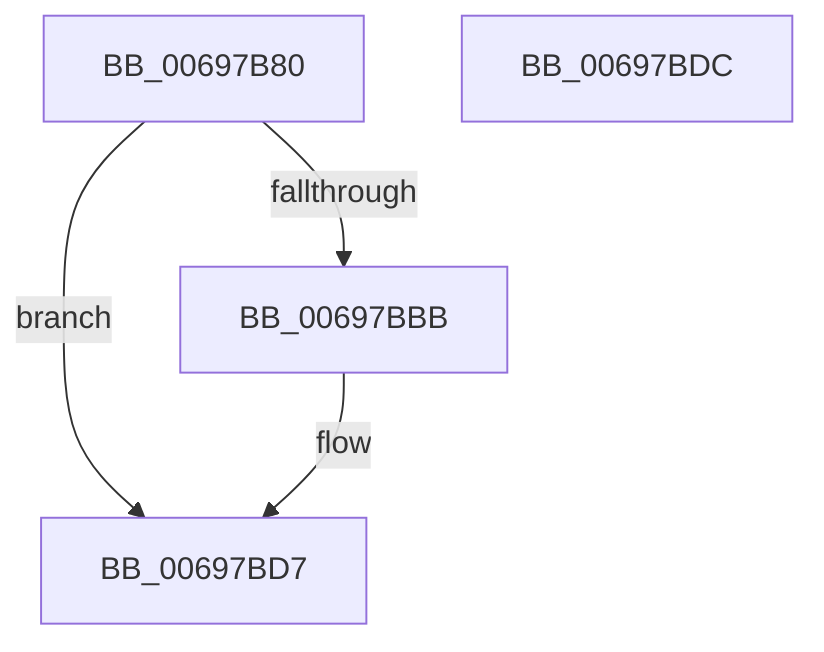

# MiReservePageHash

- RVA: `0x00697B80`–`0x00697BDD` (길이 `93` bytes)
- VA: `0x0000000140697B80`
- 실행 섹션: `.text`
- PDB 이름 있음: `예`; PDB Function 태그: `아니요`
- unwind 정보 RVA: `0x0005C788`
- 디코드: `23`개 명령, `93/93` bytes 표시
- 미해석 바이트: `0` (있으면 어셈블리에 `.byte`로 보존)

> 이 문서는 커널 이미지의 기계어와 PDB 기호를 분석해 생성했습니다. 4번과 5번은 함수 원형과 자료형을 바이너리 사용 방식에서 추정한 C 해석이며 원본 소스 복구 결과는 아닙니다.

## 1. Dependencies

- 직접 호출 지점: **1**; 고유 호출 대상: **1**
- 직접 호출자로 확인된 함수: **2**
- RIP 상대 이미지 참조: **2**

### Outgoing calls
- `0x00697BAE` → [MiReservePtes](../31/MiReservePtes_function_00318D20.md) (function, `0x00318D20`)

### Direct callers
- [MiAttemptChangePagingFileMaximum](../67/MiAttemptChangePagingFileMaximum_function_0067FE7C.md) at `0x0067FE9D`
- [MiCreatePagefile](../../page/7F/MiCreatePagefile_function_007FEC30.md) at `0x007FEF05`

### Static image references
- `0x00697B84` → RVA `0x00E3738C` (`.data`; read)
- `0x00697B92` → RVA `0x00E37668` (`.data`; read)

## 2. Other-region calls and transfers

- 다른 실행 섹션으로 향하는 call: **0**
- 별도 외부 분기/꼬리 이동을 확인하지 못했습니다.

## 3. Assembly (complete function range)

```asm
00697B80  48 83 EC 28                     sub rsp, 0x28
00697B84  44 8B 05 01 F8 79 00            mov r8d, dword ptr [rip + 0x79f801]
00697B8B  BA 00 00 00 00                  mov edx, 0
00697B90  8B C1                           mov eax, ecx
00697B92  48 8D 0D CF FA 79 00            lea rcx, [rip + 0x79facf]
00697B99  4C 0F AF C0                     imul r8, rax
00697B9D  49 F7 C0 FF 0F 00 00            test r8, 0xfff
00697BA4  0F 95 C2                        setne dl
00697BA7  49 C1 E8 0C                     shr r8, 0xc
00697BAB  41 03 D0                        add edx, r8d
00697BAE  E8 6D 11 C8 FF                  call 0x140318d20
00697BB3  48 8B C8                        mov rcx, rax
00697BB6  48 85 C0                        test rax, rax
00697BB9  74 1C                           je 0x140697bd7
00697BBB  48 C1 E1 19                     shl rcx, 0x19
00697BBF  48 B8 00 00 00 00 80 F6 FF FF   movabs rax, 0xfffff68000000000
00697BC9  48 C1 E0 19                     shl rax, 0x19
00697BCD  48 2B C8                        sub rcx, rax
00697BD0  48 C1 F9 10                     sar rcx, 0x10
00697BD4  48 8B C1                        mov rax, rcx
00697BD7  48 83 C4 28                     add rsp, 0x28
00697BDB  C3                              ret
00697BDC  CC                              int3
```

## 4. C-style interpretation (structured pseudocode)

```c
__int64 __fastcall MiReservePageHash(int a1)
{
    __int64 result;
    __int64 v_rsp;

    v_rsp = (v_rsp) - (40);
    a3 = ((unsigned int)(*(unsigned int *)(v_rip + 7993345))) * ((unsigned int)(a1));
    a2 = (((a3) & (0xFFFULL)) != 0) ? 1 : 0;
    a3 = (a3) >> (12);
    a2 = (unsigned int)((a2) + ((unsigned int)(a3)));
    result = MiReservePtes(v_rip + 7994063, a2, a3, a4);
    if (result != 0) {
        a1 = (result) << (25);
        result = (result) << (25);
        a1 = (a1) - (result);
        a1 = (a1) >> (16);
        result = a1;
    }
    v_rsp = (v_rsp) + (40);
    return result;
}
```

## 5. (Beta) C Style

```c
int64_t MiReservePageHash(int32_t Arg1)
{
    int64_t result;
    int64_t local_rsp;

    local_rsp = (local_rsp) - (40);
    a3 = ((uint32_t)(*(uint32_t *)(v_rip + 0x79F801))) * ((uint32_t)(Arg1));
    a2 = (((a3) & (0xFFFULL)) != 0) ? 1 : 0;
    a3 = (a3) >> (12);
    a2 = (uint32_t)((a2) + ((uint32_t)(a3)));
    result = MiReservePtes(v_rip + 7994063, a2, a3, a4);
    if (result != 0) {
        Arg1 = (result) << (25);
        result = (result) << (25);
        Arg1 = (Arg1) - (result);
        Arg1 = (Arg1) >> (16);
        result = Arg1;
    }
    local_rsp = (local_rsp) + (40);
    return result;
}
```

## 6. Execution-region graph

[열기: 2D/3D 그래프와 함수 탐색 컨트롤 패널](../../../control-panel.html?section=text&rva=0x00697B80&view=graph)

- 2D 그래프는 위에서 아래로 흐르고, 3D 그래프는 빈 공간을 드래그해 회전합니다. Shift+드래그는 이동, 휠은 확대·축소, 함수 노드 선택은 대상 보고서 이동입니다.

### Static fallback


