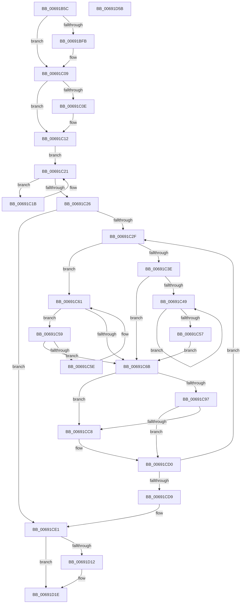

# MiReturnPartitionPagesToParent

- RVA: `0x00691B5C`–`0x00691D5C` (길이 `512` bytes)
- VA: `0x0000000140691B5C`
- 실행 섹션: `.text`
- PDB 이름 있음: `예`; PDB Function 태그: `아니요`
- unwind 정보 RVA: `0x000D9088`
- 디코드: `141`개 명령, `512/512` bytes 표시
- 미해석 바이트: `0` (있으면 어셈블리에 `.byte`로 보존)

> 이 문서는 커널 이미지의 기계어와 PDB 기호를 분석해 생성했습니다. 4번과 5번은 함수 원형과 자료형을 바이너리 사용 방식에서 추정한 C 해석이며 원본 소스 복구 결과는 아닙니다.

## 1. Dependencies

- 직접 호출 지점: **17**; 고유 호출 대상: **16**
- 직접 호출자로 확인된 함수: **1**
- RIP 상대 이미지 참조: **1**

### Outgoing calls
- `0x00691B85` → [memset](../6C/memset_function_006C6C40.md) (function, `0x006C6C40`)
- `0x00691BB4` → [MiDrainZeroLookasides](../44/MiDrainZeroLookasides_function_0044D818.md) (function, `0x0044D818`)
- `0x00691BC9` → [MiLockDynamicMemoryExclusive](../67/MiLockDynamicMemoryExclusive_function_006730F8.md) (function, `0x006730F8`)
- `0x00691BEB` → [KeAbPreAcquire](../21/KeAbPreAcquire_function_00210230.md) (function, `0x00210230`)
- `0x00691C04` → [ExfAcquirePushLockExclusiveEx](../20/ExfAcquirePushLockExclusiveEx_function_0020FC90.md) (function, `0x0020FC90`)
- `0x00691C7A` → [MiActOnPartitionNodePages](../68/MiActOnPartitionNodePages_function_0068F7F4.md) (function, `0x0068F7F4`)
- `0x00691C86` → [RtlAvlRemoveNode](../29/RtlAvlRemoveNode_function_00296650.md) (function, `0x00296650`)
- `0x00691CA1` → [ExAcquireSpinLockExclusive](../24/ExAcquireSpinLockExclusive_function_00248690.md) (function, `0x00248690`)
- `0x00691CB2` → [MiMergePageNodes](MiMergePageNodes_function_006916A0.md) (function, `0x006916A0`)
- `0x00691CBF` → [MiReleaseSpinLockExclusive](../24/MiReleaseSpinLockExclusive_function_002482C0.md) (function, `0x002482C0`)
- `0x00691CCB` → [MiDeletePartitionPageNode](MiDeletePartitionPageNode_function_006908C4.md) (function, `0x006908C4`)
- `0x00691CE4` → [MiMakePartitionMemoryBlock](../../page/80/MiMakePartitionMemoryBlock_function_0080D94C.md) (function, `0x0080D94C`)
- `0x00691CEC` → [MiMakePartitionMemoryBlock](../../page/80/MiMakePartitionMemoryBlock_function_0080D94C.md) (function, `0x0080D94C`)
- `0x00691D19` → [ExfTryToWakePushLock](../26/ExfTryToWakePushLock_function_00265DD0.md) (function, `0x00265DD0`)
- `0x00691D25` → [KeAbPostRelease](../2E/KeAbPostRelease_function_002E1600.md) (function, `0x002E1600`)
- `0x00691D30` → [MiUnlockDynamicMemoryExclusive](../67/MiUnlockDynamicMemoryExclusive_function_00673C5C.md) (function, `0x00673C5C`)
- `0x00691D38` → [MiReleasePartitionHugeIoSpace](../67/MiReleasePartitionHugeIoSpace_function_00677038.md) (function, `0x00677038`)

### Direct callers
- [MiFreePartitionPhysicalPages](../../page/80/MiFreePartitionPhysicalPages_function_0080D42C.md) at `0x0080D448`

### Static image references
- `0x00691C8B` → RVA `0x00E38D00` (`.data`; read)

## 2. Other-region calls and transfers

- 다른 실행 섹션으로 향하는 call: **2**
  - `0x00691CE4` → [MiMakePartitionMemoryBlock](../../page/80/MiMakePartitionMemoryBlock_function_0080D94C.md) (`.text` → `PAGE`)
  - `0x00691CEC` → [MiMakePartitionMemoryBlock](../../page/80/MiMakePartitionMemoryBlock_function_0080D94C.md) (`.text` → `PAGE`)
- 별도 외부 분기/꼬리 이동을 확인하지 못했습니다.

## 3. Assembly (complete function range)

```asm
00691B5C  48 8B C4                        mov rax, rsp
00691B5F  48 89 58 10                     mov qword ptr [rax + 0x10], rbx
00691B63  48 89 68 18                     mov qword ptr [rax + 0x18], rbp
00691B67  48 89 70 20                     mov qword ptr [rax + 0x20], rsi
00691B6B  57                              push rdi
00691B6C  41 54                           push r12
00691B6E  41 55                           push r13
00691B70  41 56                           push r14
00691B72  41 57                           push r15
00691B74  48 83 EC 70                     sub rsp, 0x70
00691B78  33 D2                           xor edx, edx
00691B7A  48 8B E9                        mov rbp, rcx
00691B7D  48 8D 48 88                     lea rcx, [rax - 0x78]
00691B81  44 8D 42 48                     lea r8d, [rdx + 0x48]
00691B85  E8 B6 50 03 00                  call 0x1406c6c40
00691B8A  65 48 8B 34 25 88 01 00 00      mov rsi, qword ptr gs:[0x188]
00691B93  45 33 C9                        xor r9d, r9d
00691B96  48 8B 85 B8 00 00 00            mov rax, qword ptr [rbp + 0xb8]
00691B9D  45 33 C0                        xor r8d, r8d
00691BA0  48 8B CD                        mov rcx, rbp
00691BA3  48 89 B4 24 A0 00 00 00         mov qword ptr [rsp + 0xa0], rsi
00691BAB  48 8B 50 48                     mov rdx, qword ptr [rax + 0x48]
00691BAF  4C 8B 2A                        mov r13, qword ptr [rdx]
00691BB2  33 D2                           xor edx, edx
00691BB4  E8 5F BC DB FF                  call 0x14044d818
00691BB9  48 8B D6                        mov rdx, rsi
00691BBC  4C 89 6C 24 20                  mov qword ptr [rsp + 0x20], r13
00691BC1  48 8B CD                        mov rcx, rbp
00691BC4  48 89 6C 24 28                  mov qword ptr [rsp + 0x28], rbp
00691BC9  E8 2A 15 FE FF                  call 0x1406730f8
00691BCE  48 8B 85 B8 00 00 00            mov rax, qword ptr [rbp + 0xb8]
00691BD5  45 33 C0                        xor r8d, r8d
00691BD8  33 D2                           xor edx, edx
00691BDA  48 8B 48 48                     mov rcx, qword ptr [rax + 0x48]
00691BDE  48 8B 39                        mov rdi, qword ptr [rcx]
00691BE1  48 81 C7 C0 00 00 00            add rdi, 0xc0
00691BE8  48 8B CF                        mov rcx, rdi
00691BEB  E8 40 E6 B7 FF                  call 0x140210230
00691BF0  F0 48 0F BA 2F 00               lock bts qword ptr [rdi], 0
00691BF6  48 8B D8                        mov rbx, rax
00691BF9  73 0E                           jae 0x140691c09
00691BFB  4C 8B C7                        mov r8, rdi
00691BFE  48 8B D0                        mov rdx, rax
00691C01  48 8B CF                        mov rcx, rdi
00691C04  E8 87 E0 B7 FF                  call 0x14020fc90
00691C09  48 85 DB                        test rbx, rbx
00691C0C  74 04                           je 0x140691c12
00691C0E  C6 43 0A 01                     mov byte ptr [rbx + 0xa], 1
00691C12  48 8B 45 18                     mov rax, qword ptr [rbp + 0x18]
00691C16  45 33 F6                        xor r14d, r14d
00691C19  EB 06                           jmp 0x140691c21
00691C1B  4C 8B F0                        mov r14, rax
00691C1E  48 8B 00                        mov rax, qword ptr [rax]
00691C21  48 85 C0                        test rax, rax
00691C24  75 F5                           jne 0x140691c1b
00691C26  4D 85 F6                        test r14, r14
00691C29  0F 84 B2 00 00 00               je 0x140691ce1
00691C2F  49 8B 46 08                     mov rax, qword ptr [r14 + 8]
00691C33  4D 8B FE                        mov r15, r14
00691C36  49 8B CE                        mov rcx, r14
00691C39  48 85 C0                        test rax, rax
00691C3C  74 23                           je 0x140691c61
00691C3E  48 8B 08                        mov rcx, qword ptr [rax]
00691C41  4C 8B F0                        mov r14, rax
00691C44  48 85 C9                        test rcx, rcx
00691C47  74 22                           je 0x140691c6b
00691C49  48 8B 01                        mov rax, qword ptr [rcx]
00691C4C  4C 8B F1                        mov r14, rcx
00691C4F  48 8B C8                        mov rcx, rax
00691C52  48 85 C0                        test rax, rax
00691C55  75 F2                           jne 0x140691c49
00691C57  EB 12                           jmp 0x140691c6b
00691C59  49 39 0E                        cmp qword ptr [r14], rcx
00691C5C  74 0D                           je 0x140691c6b
00691C5E  49 8B CE                        mov rcx, r14
00691C61  4D 8B 76 10                     mov r14, qword ptr [r14 + 0x10]
00691C65  49 83 E6 FC                     and r14, 0xfffffffffffffffc
00691C69  75 EE                           jne 0x140691c59
00691C6B  45 33 C0                        xor r8d, r8d
00691C6E  4C 8D 4C 24 20                  lea r9, [rsp + 0x20]
00691C73  49 8B CF                        mov rcx, r15
00691C76  41 8D 50 06                     lea edx, [r8 + 6]
00691C7A  E8 75 DB FF FF                  call 0x14068f7f4
00691C7F  49 8B D7                        mov rdx, r15
00691C82  48 8D 4D 18                     lea rcx, [rbp + 0x18]
00691C86  E8 C5 49 C0 FF                  call 0x140296650
00691C8B  48 8D 05 6E 70 7A 00            lea rax, [rip + 0x7a706e]
00691C92  4C 3B E8                        cmp r13, rax
00691C95  74 31                           je 0x140691cc8
00691C97  49 8D B5 C8 00 00 00            lea rsi, [r13 + 0xc8]
00691C9E  48 8B CE                        mov rcx, rsi
00691CA1  E8 EA 69 BB FF                  call 0x140248690
00691CA6  45 33 C0                        xor r8d, r8d
00691CA9  49 8B D7                        mov rdx, r15
00691CAC  49 8B CD                        mov rcx, r13
00691CAF  40 8A F8                        mov dil, al
00691CB2  E8 E9 F9 FF FF                  call 0x1406916a0
00691CB7  40 8A D7                        mov dl, dil
00691CBA  48 8B CE                        mov rcx, rsi
00691CBD  8B D8                           mov ebx, eax
00691CBF  E8 FC 65 BB FF                  call 0x1402482c0
00691CC4  85 DB                           test ebx, ebx
00691CC6  74 08                           je 0x140691cd0
00691CC8  49 8B CF                        mov rcx, r15
00691CCB  E8 F4 EB FF FF                  call 0x1406908c4
00691CD0  4D 85 F6                        test r14, r14
00691CD3  0F 85 56 FF FF FF               jne 0x140691c2f
00691CD9  48 8B B4 24 A0 00 00 00         mov rsi, qword ptr [rsp + 0xa0]
00691CE1  49 8B CD                        mov rcx, r13
00691CE4  E8 63 BC 17 00                  call 0x14080d94c
00691CE9  48 8B CD                        mov rcx, rbp
00691CEC  E8 5B BC 17 00                  call 0x14080d94c
00691CF1  48 8B 85 B8 00 00 00            mov rax, qword ptr [rbp + 0xb8]
00691CF8  48 8B 48 48                     mov rcx, qword ptr [rax + 0x48]
00691CFC  48 83 C8 FF                     or rax, 0xffffffffffffffff
00691D00  48 8B 19                        mov rbx, qword ptr [rcx]
00691D03  F0 48 0F C1 83 C0 00 00 00      lock xadd qword ptr [rbx + 0xc0], rax
00691D0C  24 06                           and al, 6
00691D0E  3C 02                           cmp al, 2
00691D10  75 0C                           jne 0x140691d1e
00691D12  48 8D 8B C0 00 00 00            lea rcx, [rbx + 0xc0]
00691D19  E8 B2 40 BD FF                  call 0x140265dd0
00691D1E  48 8D 8B C0 00 00 00            lea rcx, [rbx + 0xc0]
00691D25  E8 D6 F8 C4 FF                  call 0x1402e1600
00691D2A  48 8B D6                        mov rdx, rsi
00691D2D  48 8B CD                        mov rcx, rbp
00691D30  E8 27 1F FE FF                  call 0x140673c5c
00691D35  48 8B CD                        mov rcx, rbp
00691D38  E8 FB 52 FE FF                  call 0x140677038
00691D3D  4C 8D 5C 24 70                  lea r11, [rsp + 0x70]
00691D42  49 8B 5B 38                     mov rbx, qword ptr [r11 + 0x38]
00691D46  49 8B 6B 40                     mov rbp, qword ptr [r11 + 0x40]
00691D4A  49 8B 73 48                     mov rsi, qword ptr [r11 + 0x48]
00691D4E  49 8B E3                        mov rsp, r11
00691D51  41 5F                           pop r15
00691D53  41 5E                           pop r14
00691D55  41 5D                           pop r13
00691D57  41 5C                           pop r12
00691D59  5F                              pop rdi
00691D5A  C3                              ret
00691D5B  CC                              int3
```

## 4. C-style interpretation (structured pseudocode)

```c
__int64 __fastcall MiReturnPartitionPagesToParent(__int64 a1, int a2, __int64 a3, int a4)
{
    __int64 result;
    __int64 v_r14;
    __int64 v_rdi;
    __int64 v_rsp;
    unsigned __int64 v_stack_m28;
    unsigned __int64 v_stack_m70;
    unsigned __int64 v_stack_m78;
    unsigned __int64 v_stack_p8;

    *(unsigned __int64 *)(v_rsp + 16) = v_rbx;
    *(unsigned __int64 *)(v_rsp + 24) = v_rbp;
    *(unsigned __int64 *)(v_rsp + 32) = v_rsi;
    v_rsp = (v_rsp) - (112);
    a2 = 0;
    result = memset(v_rsp - 120, a2, a2 + 72, a4);
    a4 = 0;
    a3 = 0;
    v_stack_p8 = *(unsigned __int64 *)(gs_base + (0 + 392));
    a2 = 0;
    result = MiDrainZeroLookasides(a1, a2, a3, a4);
    v_stack_m78 = *(unsigned __int64 *)(*(unsigned __int64 *)(*(unsigned __int64 *)(a1 + 184) + 72));
    v_stack_m70 = a1;
    result = MiLockDynamicMemoryExclusive(a1, *(unsigned __int64 *)(gs_base + (0 + 392)), a3, a4);
    a3 = 0;
    a2 = 0;
    v_rdi = (*(unsigned __int64 *)(*(unsigned __int64 *)(*(unsigned __int64 *)(a1 + 184) + 72))) + (192);
    result = KeAbPreAcquire(v_rdi, a2, a3, a4);
    if (!(condition_is_above_or_equal)) {
        a3 = v_rdi;
        a2 = result;
        a1 = v_rdi;
        result = ExfAcquirePushLockExclusiveEx(a1, a2, a3, a4);
    }
    if (result != 0) {
        *(unsigned __int8 *)(result + 10) = 1;
    }
    v_r14 = 0;
    goto loc_00691C21;
loc_00691C1B:
loc_00691C21:
    if (*(unsigned __int64 *)(*(unsigned __int64 *)(a1 + 24)) != 0) goto loc_00691C1B;
    if (*(unsigned __int64 *)(a1 + 24) == 0) goto loc_00691CE1;
loc_00691C2F:
    if (*(unsigned __int64 *)(*(unsigned __int64 *)(a1 + 24) + 8) == 0) goto loc_00691C61;
    if (*(unsigned __int64 *)(*(unsigned __int64 *)(*(unsigned __int64 *)(a1 + 24) + 8)) == 0) goto loc_00691C6B;
loc_00691C49:
    if (*(unsigned __int64 *)(*(unsigned __int64 *)(*(unsigned __int64 *)(*(unsigned __int64 *)(a1 + 24) + 8))) != 0) goto loc_00691C49;
    goto loc_00691C6B;
loc_00691C59:
    if ((*(unsigned __int64 *)(*(unsigned __int64 *)(*(unsigned __int64 *)(*(unsigned __int64 *)(a1 + 24) + 8)))) == (*(unsigned __int64 *)(*(unsigned __int64 *)(*(unsigned __int64 *)(*(unsigned __int64 *)(a1 + 24) + 8))))) goto loc_00691C6B;
loc_00691C61:
    v_r14 = (*(unsigned __int64 *)(*(unsigned __int64 *)(*(unsigned __int64 *)(*(unsigned __int64 *)(a1 + 24) + 8)) + 16)) & (-4);
    if (condition_is_not_equal) goto loc_00691C59;
loc_00691C6B:
    a3 = 0;
    result = MiActOnPartitionNodePages(*(unsigned __int64 *)(a1 + 24), a3 + 6, a3, v_stack_m78);
    result = RtlAvlRemoveNode(a1 + 24, *(unsigned __int64 *)(a1 + 24), a3, v_stack_m78);
    if ((*(unsigned __int64 *)(*(unsigned __int64 *)(*(unsigned __int64 *)(a1 + 184) + 72))) == (v_rip + 8024174)) goto loc_00691CC8;
    result = ExAcquireSpinLockExclusive(*(unsigned __int64 *)(*(unsigned __int64 *)(*(unsigned __int64 *)(a1 + 184) + 72)) + 200, *(unsigned __int64 *)(a1 + 24), a3, v_stack_m78);
    a3 = 0;
    result = MiMergePageNodes(*(unsigned __int64 *)(*(unsigned __int64 *)(*(unsigned __int64 *)(a1 + 184) + 72)), *(unsigned __int64 *)(a1 + 24), a3, v_stack_m78);
    result = MiReleaseSpinLockExclusive(*(unsigned __int64 *)(*(unsigned __int64 *)(*(unsigned __int64 *)(a1 + 184) + 72)) + 200, (unsigned __int8)((unsigned __int8)(result)), a3, v_stack_m78);
    if ((unsigned int)((unsigned int)((unsigned int)(result))) != 0) {
        a1 = *(unsigned __int64 *)(a1 + 24);
        result = MiDeletePartitionPageNode(a1, (unsigned __int8)((unsigned __int8)(result)), a3, v_stack_m78);
    }
    if (v_r14 != 0) goto loc_00691C2F;
loc_00691CE1:
    result = MiMakePartitionMemoryBlock(*(unsigned __int64 *)(*(unsigned __int64 *)(*(unsigned __int64 *)(a1 + 184) + 72)), (unsigned __int8)((unsigned __int8)(result)), a3, v_stack_m78);
    result = MiMakePartitionMemoryBlock(a1, (unsigned __int8)((unsigned __int8)(result)), a3, v_stack_m78);
    result = (*(unsigned __int64 *)(a1 + 184)) | (-1);
    result = (unsigned __int8)((result) & (6));
    if (((unsigned __int8)(result)) == 2) {
        a1 = *(unsigned __int64 *)(*(unsigned __int64 *)(*(unsigned __int64 *)(a1 + 184) + 72)) + 192;
        result = ExfTryToWakePushLock(a1, (unsigned __int8)((unsigned __int8)(result)), a3, v_stack_m78);
    }
    result = KeAbPostRelease(*(unsigned __int64 *)(*(unsigned __int64 *)(*(unsigned __int64 *)(a1 + 184) + 72)) + 192, (unsigned __int8)((unsigned __int8)(result)), a3, v_stack_m78);
    result = MiUnlockDynamicMemoryExclusive(a1, v_stack_p8, a3, v_stack_m78);
    result = MiReleasePartitionHugeIoSpace(a1, v_stack_p8, a3, v_stack_m78);
    return result;
}
```

## 5. (Beta) C Style

```c
int64_t MiReturnPartitionPagesToParent(void *Arg1, int32_t Arg2, int64_t Arg3, int32_t Arg4)
{
    uint8_t *arg1 = (uint8_t *)Arg1;

    int64_t result;
    int64_t local_r14;
    int64_t local_rdi;
    int64_t local_rsp;
    uint64_t v_stack_m28;
    uint64_t v_stack_m70;
    uint64_t v_stack_m78;
    uint64_t v_stack_p8;

    *(uint64_t *)(local_rsp + 0x10) = local_rbx;
    *(uint64_t *)(local_rsp + 0x18) = local_rbp;
    *(uint64_t *)(local_rsp + 0x20) = local_rsi;
    local_rsp = (local_rsp) - (112);
    Arg2 = 0;
    result = memset(local_rsp - 120, Arg2, Arg2 + 72, Arg4);
    Arg4 = 0;
    Arg3 = 0;
    v_stack_p8 = *(uint64_t *)(gs_base + (0 + 0x188));
    Arg2 = 0;
    result = MiDrainZeroLookasides(Arg1, Arg2, Arg3, Arg4);
    v_stack_m78 = *(uint64_t *)(*(uint64_t *)(*(uint64_t *)(arg1 + 0xB8) + 0x48));
    v_stack_m70 = Arg1;
    result = MiLockDynamicMemoryExclusive(Arg1, *(uint64_t *)(gs_base + (0 + 0x188)), Arg3, Arg4);
    Arg3 = 0;
    Arg2 = 0;
    local_rdi = (*(uint64_t *)(*(uint64_t *)(*(uint64_t *)(arg1 + 0xB8) + 0x48))) + (192);
    result = KeAbPreAcquire(local_rdi, Arg2, Arg3, Arg4);
    if (!(condition_is_above_or_equal)) {
        Arg3 = local_rdi;
        Arg2 = result;
        Arg1 = local_rdi;
        result = ExfAcquirePushLockExclusiveEx(Arg1, Arg2, Arg3, Arg4);
    }
    if (result != 0) {
        *(uint8_t *)(result + 0xA) = 1;
    }
    local_r14 = 0;
    goto loc_00691C21;
loc_00691C1B:
loc_00691C21:
    if (*(uint64_t *)(*(uint64_t *)(arg1 + 0x18)) != 0) goto loc_00691C1B;
    if (*(uint64_t *)(arg1 + 0x18) == 0) goto loc_00691CE1;
loc_00691C2F:
    if (*(uint64_t *)(*(uint64_t *)(arg1 + 0x18) + 0x8) == 0) goto loc_00691C61;
    if (*(uint64_t *)(*(uint64_t *)(*(uint64_t *)(arg1 + 0x18) + 0x8)) == 0) goto loc_00691C6B;
loc_00691C49:
    if (*(uint64_t *)(*(uint64_t *)(*(uint64_t *)(*(uint64_t *)(arg1 + 0x18) + 0x8))) != 0) goto loc_00691C49;
    goto loc_00691C6B;
loc_00691C59:
    if ((*(uint64_t *)(*(uint64_t *)(*(uint64_t *)(*(uint64_t *)(arg1 + 0x18) + 0x8)))) == (*(uint64_t *)(*(uint64_t *)(*(uint64_t *)(*(uint64_t *)(arg1 + 0x18) + 0x8))))) goto loc_00691C6B;
loc_00691C61:
    local_r14 = (*(uint64_t *)(*(uint64_t *)(*(uint64_t *)(*(uint64_t *)(arg1 + 0x18) + 0x8)) + 0x10)) & (-4);
    if (condition_is_not_equal) goto loc_00691C59;
loc_00691C6B:
    Arg3 = 0;
    result = MiActOnPartitionNodePages(*(uint64_t *)(arg1 + 0x18), Arg3 + 6, Arg3, v_stack_m78);
    result = RtlAvlRemoveNode(Arg1 + 24, *(uint64_t *)(arg1 + 0x18), Arg3, v_stack_m78);
    if ((*(uint64_t *)(*(uint64_t *)(*(uint64_t *)(arg1 + 0xB8) + 0x48))) == (v_rip + 8024174)) goto loc_00691CC8;
    result = ExAcquireSpinLockExclusive(*(uint64_t *)(*(uint64_t *)(*(uint64_t *)(arg1 + 0xB8) + 0x48)) + 200, *(uint64_t *)(arg1 + 0x18), Arg3, v_stack_m78);
    Arg3 = 0;
    result = MiMergePageNodes(*(uint64_t *)(*(uint64_t *)(*(uint64_t *)(arg1 + 0xB8) + 0x48)), *(uint64_t *)(arg1 + 0x18), Arg3, v_stack_m78);
    result = MiReleaseSpinLockExclusive(*(uint64_t *)(*(uint64_t *)(*(uint64_t *)(arg1 + 0xB8) + 0x48)) + 200, (uint8_t)((uint8_t)(result)), Arg3, v_stack_m78);
    if ((uint32_t)((uint32_t)((uint32_t)(result))) != 0) {
        Arg1 = *(uint64_t *)(arg1 + 0x18);
        result = MiDeletePartitionPageNode(Arg1, (uint8_t)((uint8_t)(result)), Arg3, v_stack_m78);
    }
    if (local_r14 != 0) goto loc_00691C2F;
loc_00691CE1:
    result = MiMakePartitionMemoryBlock(*(uint64_t *)(*(uint64_t *)(*(uint64_t *)(arg1 + 0xB8) + 0x48)), (uint8_t)((uint8_t)(result)), Arg3, v_stack_m78);
    result = MiMakePartitionMemoryBlock(Arg1, (uint8_t)((uint8_t)(result)), Arg3, v_stack_m78);
    result = (*(uint64_t *)(arg1 + 0xB8)) | (-1);
    result = (uint8_t)((result) & (6));
    if (((uint8_t)(result)) == 2) {
        Arg1 = *(uint64_t *)(*(uint64_t *)(*(uint64_t *)(arg1 + 0xB8) + 0x48)) + 192;
        result = ExfTryToWakePushLock(Arg1, (uint8_t)((uint8_t)(result)), Arg3, v_stack_m78);
    }
    result = KeAbPostRelease(*(uint64_t *)(*(uint64_t *)(*(uint64_t *)(arg1 + 0xB8) + 0x48)) + 192, (uint8_t)((uint8_t)(result)), Arg3, v_stack_m78);
    result = MiUnlockDynamicMemoryExclusive(Arg1, v_stack_p8, Arg3, v_stack_m78);
    result = MiReleasePartitionHugeIoSpace(Arg1, v_stack_p8, Arg3, v_stack_m78);
    return result;
}
```

### 관측된 메모리 오프셋

구조체 형식이 확인되지 않은 접근은 인자 기준의 오프셋으로만 기록했습니다.

| 기준 인자 | 오프셋 표현 | 폭 (bit) | 접근 |
|---|---:|---:|---|
| `Arg1` | `+ 0x18` | `64` | `R` |
| `Arg1` | `+ 0xB8` | `64` | `R` |

## 6. Execution-region graph

[열기: 2D/3D 그래프와 함수 탐색 컨트롤 패널](../../../control-panel.html?section=text&rva=0x00691B5C&view=graph)

- 2D 그래프는 위에서 아래로 흐르고, 3D 그래프는 빈 공간을 드래그해 회전합니다. Shift+드래그는 이동, 휠은 확대·축소, 함수 노드 선택은 대상 보고서 이동입니다.

### Static fallback


