# MiScrubLargeMappedPage

- RVA: `0x00693E2C`–`0x006942E1` (길이 `1,205` bytes)
- VA: `0x0000000140693E2C`
- 실행 섹션: `.text`
- PDB 이름 있음: `예`; PDB Function 태그: `아니요`
- unwind 정보 RVA: `0x000D92FC`
- 디코드: `293`개 명령, `1,205/1,205` bytes 표시
- 미해석 바이트: `0` (있으면 어셈블리에 `.byte`로 보존)

> 이 문서는 커널 이미지의 기계어와 PDB 기호를 분석해 생성했습니다. 4번과 5번은 함수 원형과 자료형을 바이너리 사용 방식에서 추정한 C 해석이며 원본 소스 복구 결과는 아닙니다.

## 1. Dependencies

- 직접 호출 지점: **21**; 고유 호출 대상: **19**
- 직접 호출자로 확인된 함수: **1**
- RIP 상대 이미지 참조: **3**

### Outgoing calls
- `0x00693F3D` → [MiLockWorkingSetShared](../27/MiLockWorkingSetShared_function_0027CBF0.md) (function, `0x0027CBF0`)
- `0x00693F54` → [MiLockLowestValidPageTableEx](../28/MiLockLowestValidPageTableEx_function_00280D10.md) (function, `0x00280D10`)
- `0x00693FB6` → [MiIdentifyPfnWrapper](../31/MiIdentifyPfnWrapper_function_0031C8F0.md) (function, `0x0031C8F0`)
- `0x00694066` → [MiRewritePteWithLockBit](../32/MiRewritePteWithLockBit_function_00322FEC.md) (function, `0x00322FEC`)
- `0x00694093` → [MiGetProcessorFlushList](../24/MiGetProcessorFlushList_function_00242C90.md) (function, `0x00242C90`)
- `0x006940B0` → [MiInitializeTbFlushList](../29/MiInitializeTbFlushList_function_00294F00.md) (function, `0x00294F00`)
- `0x006940C3` → [MiInsertLargeTbFlushEntry](../37/MiInsertLargeTbFlushEntry_function_0037827C.md) (function, `0x0037827C`)
- `0x006940D5` → [MiInsertTbFlushEntry](../29/MiInsertTbFlushEntry_function_00293670.md) (function, `0x00293670`)
- `0x006940DD` → [MiFlushTbList](../31/MiFlushTbList_function_00311FC0.md) (function, `0x00311FC0`)
- `0x006940E2` → [MiReleaseProcessorFlushList](../31/MiReleaseProcessorFlushList_function_00313C70.md) (function, `0x00313C70`)
- `0x0069415E` → [MiScrubPage](../3F/MiScrubPage_function_003F954C.md) (function, `0x003F954C`)
- `0x00694181` → [MiMakePageBad](../48/MiMakePageBad_function_00486F04.md) (function, `0x00486F04`)
- `0x0069418B` → [MiWorkingSetIsContended](../2A/MiWorkingSetIsContended_function_002AE520.md) (function, `0x002AE520`)
- `0x0069419A` → [MiPageTableLockIsContended](../2A/MiPageTableLockIsContended_function_002AE650.md) (function, `0x002AE650`)
- `0x006941A3` → [KeShouldYieldProcessor](../27/KeShouldYieldProcessor_function_002773E0.md) (function, `0x002773E0`)
- `0x006941B4` → [MiScrubInterrupted](../49/MiScrubInterrupted_function_00495894.md) (function, `0x00495894`)
- `0x00694228` → [MiCheckLinearProtectedPteAccessedBit](../29/MiCheckLinearProtectedPteAccessedBit_function_00292D80.md) (function, `0x00292D80`)
- `0x00694293` → [MiUnlockPageTable](../21/MiUnlockPageTable_function_00216EC0.md) (function, `0x00216EC0`)
- `0x0069429F` → [MiUnlockWorkingSetShared](../27/MiUnlockWorkingSetShared_function_0027D690.md) (function, `0x0027D690`)
- `0x006942B9` → [MiUnlockPageTable](../21/MiUnlockPageTable_function_00216EC0.md) (function, `0x00216EC0`)
- `0x006942C5` → [MiUnlockWorkingSetShared](../27/MiUnlockWorkingSetShared_function_0027D690.md) (function, `0x0027D690`)

### Direct callers
- [MiScrubProcessLargePage](../../page/80/MiScrubProcessLargePage_function_0080EE70.md) at `0x0080EF6F`

### Static image references
- `0x00693E5B` → RVA `0x00011C60` (`.rdata`; read)
- `0x00694057` → RVA `0x00010880` (`.rdata`; read)
- `0x006941F3` → RVA `0x00FC6A88` (`ALMOSTRO`; read)

## 2. Other-region calls and transfers

- 다른 실행 섹션으로 향하는 call: **0**
- 별도 외부 분기/꼬리 이동을 확인하지 못했습니다.

## 3. Assembly (complete function range)

```asm
00693E2C  48 8B C4                        mov rax, rsp
00693E2F  4C 89 48 20                     mov qword ptr [rax + 0x20], r9
00693E33  44 89 40 18                     mov dword ptr [rax + 0x18], r8d
00693E37  48 89 50 10                     mov qword ptr [rax + 0x10], rdx
00693E3B  48 89 48 08                     mov qword ptr [rax + 8], rcx
00693E3F  53                              push rbx
00693E40  55                              push rbp
00693E41  56                              push rsi
00693E42  57                              push rdi
00693E43  41 54                           push r12
00693E45  41 55                           push r13
00693E47  41 56                           push r14
00693E49  41 57                           push r15
00693E4B  48 81 EC B8 00 00 00            sub rsp, 0xb8
00693E52  65 48 8B 04 25 88 01 00 00      mov rax, qword ptr gs:[0x188]
00693E5B  48 8D 0D FE DD 97 FF            lea rcx, [rip - 0x682202]
00693E62  33 F6                           xor esi, esi
00693E64  49 BA 00 00 00 00 80 F6 FF FF   movabs r10, 0xfffff68000000000
00693E6E  48 8B EA                        mov rbp, rdx
00693E71  48 89 74 24 70                  mov qword ptr [rsp + 0x70], rsi
00693E76  89 74 24 3C                     mov dword ptr [rsp + 0x3c], esi
00693E7A  4C 8B A0 B8 00 00 00            mov r12, qword ptr [rax + 0xb8]
00693E81  41 8B C0                        mov eax, r8d
00693E84  49 81 C4 00 04 00 00            add r12, 0x400
00693E8B  4C 89 A4 24 80 00 00 00         mov qword ptr [rsp + 0x80], r12
00693E93  48 89 74 24 50                  mov qword ptr [rsp + 0x50], rsi
00693E98  89 74 24 38                     mov dword ptr [rsp + 0x38], esi
00693E9C  48 8B 04 C1                     mov rax, qword ptr [rcx + rax*8]
00693EA0  48 89 44 24 60                  mov qword ptr [rsp + 0x60], rax
00693EA5  49 8B 41 10                     mov rax, qword ptr [r9 + 0x10]
00693EA9  49 B9 F8 FF FF FF 7F 00 00 00   movabs r9, 0x7ffffffff8
00693EB3  48 8B F8                        mov rdi, rax
00693EB6  48 89 44 24 78                  mov qword ptr [rsp + 0x78], rax
00693EBB  48 C1 EF 09                     shr rdi, 9
00693EBF  49 23 F9                        and rdi, r9
00693EC2  49 8B C2                        mov rax, r10
00693EC5  48 03 F8                        add rdi, rax
00693EC8  8D 46 02                        lea eax, [rsi + 2]
00693ECB  44 8B F8                        mov r15d, eax
00693ECE  45 2B F8                        sub r15d, r8d
00693ED1  44 89 7C 24 34                  mov dword ptr [rsp + 0x34], r15d
00693ED6  44 3B C0                        cmp r8d, eax
00693ED9  73 20                           jae 0x140693efb
00693EDB  44 89 7C 24 38                  mov dword ptr [rsp + 0x38], r15d
00693EE0  41 8B CF                        mov ecx, r15d
00693EE3  48 C1 EF 09                     shr rdi, 9
00693EE7  49 23 F9                        and rdi, r9
00693EEA  49 8B C2                        mov rax, r10
00693EED  48 03 F8                        add rdi, rax
00693EF0  48 83 E9 01                     sub rcx, 1
00693EF4  75 ED                           jne 0x140693ee3
00693EF6  44 89 7C 24 34                  mov dword ptr [rsp + 0x34], r15d
00693EFB  B8 10 00 00 00                  mov eax, 0x10
00693F00  48 8B DF                        mov rbx, rdi
00693F03  44 8D 68 F1                     lea r13d, [rax - 0xf]
00693F07  45 3B C5                        cmp r8d, r13d
00693F0A  44 0F 47 E8                     cmova r13d, eax
00693F0E  48 C1 EB 09                     shr rbx, 9
00693F12  49 23 D9                        and rbx, r9
00693F15  4C 89 6C 24 58                  mov qword ptr [rsp + 0x58], r13
00693F1A  49 8B C2                        mov rax, r10
00693F1D  48 03 D8                        add rbx, rax
00693F20  48 89 5C 24 68                  mov qword ptr [rsp + 0x68], rbx
00693F25  0F 57 C0                        xorps xmm0, xmm0
00693F28  33 C0                           xor eax, eax
00693F2A  49 8B CC                        mov rcx, r12
00693F2D  48 89 84 24 98 00 00 00         mov qword ptr [rsp + 0x98], rax
00693F35  0F 11 84 24 88 00 00 00         movups xmmword ptr [rsp + 0x88], xmm0
00693F3D  E8 AE 8C BE FF                  call 0x14027cbf0
00693F42  45 33 C9                        xor r9d, r9d
00693F45  88 44 24 30                     mov byte ptr [rsp + 0x30], al
00693F49  4C 8D 44 24 70                  lea r8, [rsp + 0x70]
00693F4E  48 8B D7                        mov rdx, rdi
00693F51  49 8B CC                        mov rcx, r12
00693F54  E8 B7 CD BE FF                  call 0x140280d10
00693F59  48 89 44 24 48                  mov qword ptr [rsp + 0x48], rax
00693F5E  4C 8B F0                        mov r14, rax
00693F61  48 3B C3                        cmp rax, rbx
00693F64  0F 85 49 03 00 00               jne 0x1406942b3
00693F6A  48 8B 1F                        mov rbx, qword ptr [rdi]
00693F6D  F6 C3 01                        test bl, 1
00693F70  0F 84 3D 03 00 00               je 0x1406942b3
00693F76  48 8B C3                        mov rax, rbx
00693F79  48 B9 FF FF FF FF FF 00 00 00   movabs rcx, 0xffffffffff
00693F83  48 C1 E8 0C                     shr rax, 0xc
00693F87  48 23 C1                        and rax, rcx
00693F8A  48 3B C5                        cmp rax, rbp
00693F8D  0F 85 20 03 00 00               jne 0x1406942b3
00693F93  48 8D 2C 40                     lea rbp, [rax + rax*2]
00693F97  48 B8 00 00 00 00 00 DE FF FF   movabs rax, 0xffffde0000000000
00693FA1  48 C1 E5 04                     shl rbp, 4
00693FA5  48 8B C0                        mov rax, rax
00693FA8  48 03 E8                        add rbp, rax
00693FAB  48 8D 94 24 88 00 00 00         lea rdx, [rsp + 0x88]
00693FB3  48 8B CD                        mov rcx, rbp
00693FB6  E8 35 89 C8 FF                  call 0x14031c8f0
00693FBB  48 3B 44 24 60                  cmp rax, qword ptr [rsp + 0x60]
00693FC0  0F 85 ED 02 00 00               jne 0x1406942b3
00693FC6  4C 8B 84 24 18 01 00 00         mov r8, qword ptr [rsp + 0x118]
00693FCE  48 8B 94 24 88 00 00 00         mov rdx, qword ptr [rsp + 0x88]
00693FD6  49 8B 08                        mov rcx, qword ptr [r8]
00693FD9  8A C1                           mov al, cl
00693FDB  32 C2                           xor al, dl
00693FDD  A8 70                           test al, 0x70
00693FDF  0F 85 CE 02 00 00               jne 0x1406942b3
00693FE5  8A C1                           mov al, cl
00693FE7  32 C2                           xor al, dl
00693FE9  A8 0F                           test al, 0xf
00693FEB  0F 85 C2 02 00 00               jne 0x1406942b3
00693FF1  49 8B 40 10                     mov rax, qword ptr [r8 + 0x10]
00693FF5  48 39 84 24 98 00 00 00         cmp qword ptr [rsp + 0x98], rax
00693FFD  0F 85 B0 02 00 00               jne 0x1406942b3
00694003  48 33 CA                        xor rcx, rdx
00694006  48 B8 00 FE FF FF FF FF FF 01   movabs rax, 0x1fffffffffffe00
00694010  48 85 C8                        test rax, rcx
00694013  0F 85 9A 02 00 00               jne 0x1406942b3
00694019  48 8B 45 18                     mov rax, qword ptr [rbp + 0x18]
0069401D  48 B9 FF FF FF FF FF FF FF 3F   movabs rcx, 0x3fffffffffffffff
00694027  48 23 C1                        and rax, rcx
0069402A  48 83 F8 01                     cmp rax, 1
0069402E  0F 85 7F 02 00 00               jne 0x1406942b3
00694034  8B 45 20                        mov eax, dword ptr [rbp + 0x20]
00694037  B9 02 00 00 00                  mov ecx, 2
0069403C  66 3B C1                        cmp ax, cx
0069403F  0F 85 6E 02 00 00               jne 0x1406942b3
00694045  83 BC 24 10 01 00 00 01         cmp dword ptr [rsp + 0x110], 1
0069404D  77 2B                           ja 0x14069407a
0069404F  84 DB                           test bl, bl
00694051  0F 89 5C 02 00 00               jns 0x1406942b3
00694057  4C 8B 0D 22 C8 97 FF            mov r9, qword ptr [rip - 0x6837de]
0069405E  4C 8B C7                        mov r8, rdi
00694061  33 D2                           xor edx, edx
00694063  49 8B CC                        mov rcx, r12
00694066  E8 81 EF C8 FF                  call 0x140322fec
0069406B  48 B8 FF FF FF FF FF FF FF CF   movabs rax, 0xcfffffffffffffff
00694075  48 23 D8                        and rbx, rax
00694078  EB 19                           jmp 0x140694093
0069407A  48 8B 05 FF C7 97 FF            mov rax, qword ptr [rip - 0x683801]
00694081  8B CE                           mov ecx, esi
00694083  48 8B D6                        mov rdx, rsi
00694086  FF C1                           inc ecx
00694088  48 89 04 D7                     mov qword ptr [rdi + rdx*8], rax
0069408C  8B D1                           mov edx, ecx
0069408E  49 3B D5                        cmp rdx, r13
00694091  72 F3                           jb 0x140694086
00694093  E8 F8 EB BA FF                  call 0x140242c90
00694098  45 33 C9                        xor r9d, r9d
0069409B  C7 44 24 20 01 00 00 00         mov dword ptr [rsp + 0x20], 1
006940A3  49 8B D4                        mov rdx, r12
006940A6  48 8B C8                        mov rcx, rax
006940A9  4C 8B F0                        mov r14, rax
006940AC  44 8B 40 0C                     mov r8d, dword ptr [rax + 0xc]
006940B0  E8 4B 0E C0 FF                  call 0x140294f00
006940B5  8B 44 24 38                     mov eax, dword ptr [rsp + 0x38]
006940B9  83 F8 01                        cmp eax, 1
006940BC  7C 0C                           jl 0x1406940ca
006940BE  4C 8B C7                        mov r8, rdi
006940C1  8B D0                           mov edx, eax
006940C3  E8 B4 41 CE FF                  call 0x14037827c
006940C8  EB 10                           jmp 0x1406940da
006940CA  48 8B 54 24 78                  mov rdx, qword ptr [rsp + 0x78]
006940CF  45 8B CF                        mov r9d, r15d
006940D2  4D 8B C5                        mov r8, r13
006940D5  E8 96 F5 BF FF                  call 0x140293670
006940DA  49 8B CE                        mov rcx, r14
006940DD  E8 DE DE C7 FF                  call 0x140311fc0
006940E2  E8 89 FB C7 FF                  call 0x140313c70
006940E7  48 8B 44 24 60                  mov rax, qword ptr [rsp + 0x60]
006940EC  48 8B 4C 24 50                  mov rcx, qword ptr [rsp + 0x50]
006940F1  89 74 24 40                     mov dword ptr [rsp + 0x40], esi
006940F5  4C 8D 2C 40                     lea r13, [rax + rax*2]
006940F9  48 8D 04 49                     lea rax, [rcx + rcx*2]
006940FD  49 C1 E5 04                     shl r13, 4
00694101  48 C1 E0 04                     shl rax, 4
00694105  4C 03 ED                        add r13, rbp
00694108  48 03 E8                        add rbp, rax
0069410B  48 B8 00 00 00 00 00 DE FF FF   movabs rax, 0xffffde0000000000
00694115  48 8B C0                        mov rax, rax
00694118  4C 8B 7C 24 48                  mov r15, qword ptr [rsp + 0x48]
0069411D  4C 8B F5                        mov r14, rbp
00694120  4C 2B F0                        sub r14, rax
00694123  49 3B ED                        cmp rbp, r13
00694126  0F 83 B3 00 00 00               jae 0x1406941df
0069412C  48 FF C1                        inc rcx
0069412F  48 89 4C 24 50                  mov qword ptr [rsp + 0x50], rcx
00694134  48 B8 20 00 00 00 00 DE FF FF   movabs rax, 0xffffde0000000020
0069413E  41 8B 04 06                     mov eax, dword ptr [r14 + rax]
00694142  BA 02 00 00 00                  mov edx, 2
00694147  66 3B C2                        cmp ax, dx
0069414A  75 7A                           jne 0x1406941c6
0069414C  48 8B 8C 24 00 01 00 00         mov rcx, qword ptr [rsp + 0x100]
00694154  44 8D 4A 01                     lea r9d, [rdx + 1]
00694158  48 8B D5                        mov rdx, rbp
0069415B  45 33 C0                        xor r8d, r8d
0069415E  E8 E9 53 D6 FF                  call 0x1403f954c
00694163  85 C0                           test eax, eax
00694165  79 1F                           jns 0x140694186
00694167  48 B8 AB AA AA AA AA AA AA AA   movabs rax, 0xaaaaaaaaaaaaaaab
00694171  49 8B CE                        mov rcx, r14
00694174  48 C1 F9 04                     sar rcx, 4
00694178  BA 01 00 00 00                  mov edx, 1
0069417D  48 0F AF C8                     imul rcx, rax
00694181  E8 7E 2D DF FF                  call 0x140486f04
00694186  33 D2                           xor edx, edx
00694188  49 8B CC                        mov rcx, r12
0069418B  E8 90 A3 C1 FF                  call 0x1402ae520
00694190  85 C0                           test eax, eax
00694192  75 3F                           jne 0x1406941d3
00694194  49 8B D7                        mov rdx, r15
00694197  49 8B CC                        mov rcx, r12
0069419A  E8 B1 A4 C1 FF                  call 0x1402ae650
0069419F  85 C0                           test eax, eax
006941A1  75 30                           jne 0x1406941d3
006941A3  E8 38 32 BE FF                  call 0x1402773e0
006941A8  85 C0                           test eax, eax
006941AA  75 27                           jne 0x1406941d3
006941AC  48 8B 8C 24 00 01 00 00         mov rcx, qword ptr [rsp + 0x100]
006941B4  E8 DB 16 E0 FF                  call 0x140495894
006941B9  89 44 24 3C                     mov dword ptr [rsp + 0x3c], eax
006941BD  85 C0                           test eax, eax
006941BF  75 1A                           jne 0x1406941db
006941C1  48 8B 4C 24 50                  mov rcx, qword ptr [rsp + 0x50]
006941C6  48 83 C5 30                     add rbp, 0x30
006941CA  49 83 C6 30                     add r14, 0x30
006941CE  E9 50 FF FF FF                  jmp 0x140694123
006941D3  C7 44 24 40 01 00 00 00         mov dword ptr [rsp + 0x40], 1
006941DB  48 83 C5 30                     add rbp, 0x30
006941DF  48 83 CB 20                     or rbx, 0x20
006941E3  49 BC 00 00 00 00 80 F6 FF FF   movabs r12, 0xfffff68000000000
006941ED  44 8B FE                        mov r15d, esi
006941F0  48 8B C6                        mov rax, rsi
006941F3  48 0F BA 25 8C 28 93 00 24      bt qword ptr [rip + 0x93288c], 0x24
006941FC  4C 8D 34 C7                     lea r14, [rdi + rax*8]
00694200  73 2B                           jae 0x14069422d
00694202  F6 C3 20                        test bl, 0x20
00694205  75 26                           jne 0x14069422d
00694207  49 8B C4                        mov rax, r12
0069420A  48 B9 00 00 00 00 40 00 00 00   movabs rcx, 0x4000000000
00694214  48 03 C1                        add rax, rcx
00694217  4C 3B F0                        cmp r14, rax
0069421A  72 11                           jb 0x14069422d
0069421C  41 B8 80 00 00 00               mov r8d, 0x80
00694222  48 8B D3                        mov rdx, rbx
00694225  49 8B CE                        mov rcx, r14
00694228  E8 53 EB BF FF                  call 0x140292d80
0069422D  48 8D 8B 00 10 00 00            lea rcx, [rbx + 0x1000]
00694234  49 89 1E                        mov qword ptr [r14], rbx
00694237  48 33 D9                        xor rbx, rcx
0069423A  41 FF C7                        inc r15d
0069423D  48 BA FF 0F 00 00 00 00 F0 FF   movabs rdx, 0xfff0000000000fff
00694247  41 8B C7                        mov eax, r15d
0069424A  48 23 DA                        and rbx, rdx
0069424D  48 33 D9                        xor rbx, rcx
00694250  48 3B 44 24 58                  cmp rax, qword ptr [rsp + 0x58]
00694255  72 9C                           jb 0x1406941f3
00694257  4C 8B A4 24 80 00 00 00         mov r12, qword ptr [rsp + 0x80]
0069425F  49 3B ED                        cmp rbp, r13
00694262  74 45                           je 0x1406942a9
00694264  39 74 24 3C                     cmp dword ptr [rsp + 0x3c], esi
00694268  75 44                           jne 0x1406942ae
0069426A  44 8B 7C 24 34                  mov r15d, dword ptr [rsp + 0x34]
0069426F  4C 8B 6C 24 58                  mov r13, qword ptr [rsp + 0x58]
00694274  48 8B 5C 24 68                  mov rbx, qword ptr [rsp + 0x68]
00694279  48 8B AC 24 08 01 00 00         mov rbp, qword ptr [rsp + 0x108]
00694281  39 74 24 40                     cmp dword ptr [rsp + 0x40], esi
00694285  0F 84 9A FC FF FF               je 0x140693f25
0069428B  48 8B 54 24 48                  mov rdx, qword ptr [rsp + 0x48]
00694290  49 8B CC                        mov rcx, r12
00694293  E8 28 2C B8 FF                  call 0x140216ec0
00694298  8A 54 24 30                     mov dl, byte ptr [rsp + 0x30]
0069429C  49 8B CC                        mov rcx, r12
0069429F  E8 EC 93 BE FF                  call 0x14027d690
006942A4  E9 7C FC FF FF                  jmp 0x140693f25
006942A9  BE 01 00 00 00                  mov esi, 1
006942AE  4C 8B 74 24 48                  mov r14, qword ptr [rsp + 0x48]
006942B3  49 8B D6                        mov rdx, r14
006942B6  49 8B CC                        mov rcx, r12
006942B9  E8 02 2C B8 FF                  call 0x140216ec0
006942BE  8A 54 24 30                     mov dl, byte ptr [rsp + 0x30]
006942C2  49 8B CC                        mov rcx, r12
006942C5  E8 C6 93 BE FF                  call 0x14027d690
006942CA  8B C6                           mov eax, esi
006942CC  48 81 C4 B8 00 00 00            add rsp, 0xb8
006942D3  41 5F                           pop r15
006942D5  41 5E                           pop r14
006942D7  41 5D                           pop r13
006942D9  41 5C                           pop r12
006942DB  5F                              pop rdi
006942DC  5E                              pop rsi
006942DD  5D                              pop rbp
006942DE  5B                              pop rbx
006942DF  C3                              ret
006942E0  CC                              int3
```

## 4. C-style interpretation (structured pseudocode)

```c
__int64 __fastcall MiScrubLargeMappedPage(__int64 a1, __int64 a2, int a3, __int64 a4)
{
    __int64 result;
    __int64 v_r12;
    __int64 v_r13;
    __int64 v_r14;
    __int64 v_r15;
    __int64 v_rbp;
    __int64 v_rbx;
    __int64 v_rdi;
    __int64 v_rsi;
    __int64 v_rsp;
    unsigned __int64 v_stack_m60;
    unsigned __int64 v_stack_m70;
    unsigned __int64 v_stack_m78;
    unsigned __int64 v_stack_m80;
    unsigned __int64 v_stack_m88;
    unsigned __int64 v_stack_m90;
    unsigned __int64 v_stack_m98;
    unsigned __int64 v_stack_mA0;
    unsigned __int64 v_stack_mA8;
    unsigned __int64 v_stack_mB0;
    unsigned int v_stack_mB8;
    unsigned int v_stack_mBC;
    unsigned int v_stack_mC0;
    unsigned int v_stack_mC4;
    unsigned __int8 v_stack_mC8;
    unsigned int v_stack_mD8;
    unsigned __int64 v_stack_p10;
    unsigned int v_stack_p18;
    unsigned __int64 v_stack_p20;
    unsigned __int64 v_stack_p8;

    *(unsigned __int64 *)(v_rsp + 32) = a4;
    *(unsigned int *)(v_rsp + 24) = a3;
    *(unsigned __int64 *)(v_rsp + 16) = a2;
    *(unsigned __int64 *)(v_rsp + 8) = a1;
    v_rsp = (v_rsp) - (184);
    v_rsi = 0;
    v_stack_m88 = 0;
    v_stack_mBC = 0;
    v_r12 = (*(unsigned __int64 *)(*(unsigned __int64 *)(gs_base + (0 + 392)) + 184)) + (0x400ULL);
    v_stack_m78 = v_r12;
    v_stack_mA8 = 0;
    v_stack_mC0 = 0;
    v_stack_m98 = *(unsigned __int64 *)(v_rip - 6824450 + (unsigned int)(a3) * 8);
    v_stack_m80 = *(unsigned __int64 *)(a4 + 16);
    v_rdi = (*(unsigned __int64 *)(a4 + 16)) >> (9);
    v_rdi = (v_rdi) & (a4);
    v_rdi = (v_rdi) + (v_r10);
    v_r15 = (unsigned int)(((unsigned int)((unsigned int)(v_rsi + 2))) - (a3));
    v_stack_mC4 = (unsigned int)(v_r15);
    if (a3 >= ((unsigned int)(v_rsi + 2))) goto loc_00693EFB;
    v_stack_mC0 = (unsigned int)(v_r15);
loc_00693EE3:
    v_rdi = (v_rdi) >> (9);
    v_rdi = (v_rdi) & (a4);
    v_rdi = (v_rdi) + (v_r10);
    a1 = ((unsigned int)((unsigned int)(v_r15))) - (1);
    if (condition_is_not_equal) goto loc_00693EE3;
    v_stack_mC4 = (unsigned int)(v_r15);
loc_00693EFB:
    v_r13 = 16 - 15;
    if (a3 > ((unsigned int)(16 - 15))) { v_r13 = 16; }
    v_rbx = (v_rdi) >> (9);
    v_rbx = (v_rbx) & (a4);
    v_stack_mA0 = v_r13;
    v_rbx = (v_rbx) + (v_r10);
    v_stack_m90 = v_rbx;
loc_00693F25:
    result = 0;
    v_stack_m60 = 0;
    v_stack_m70 = v_xmm0;
    result = MiLockWorkingSetShared(v_r12, a2, a3, a4);
    a4 = 0;
    v_stack_mC8 = (unsigned __int8)(result);
    result = MiLockLowestValidPageTableEx(v_r12, v_rdi, v_stack_m88, a4);
    v_stack_mB0 = result;
    if (result != v_rbx) goto loc_006942B3;
    if ((((unsigned __int8)(*(unsigned __int64 *)(v_rdi))) & (1)) == 0) goto loc_006942B3;
    result = (*(unsigned __int64 *)(v_rdi)) >> (12);
    result = (result) & (v_r12);
    if (result != a2) goto loc_006942B3;
    v_rbp = (result + result * 2) << (4);
    v_rbp = (v_rbp) + (result);
    result = MiIdentifyPfnWrapper(v_rbp, v_stack_m70, v_stack_m88, a4);
    if (result != v_stack_m98) goto loc_006942B3;
    result = (unsigned __int8)(((unsigned __int8)(*(unsigned __int64 *)(v_stack_p20))) ^ ((unsigned __int8)(v_stack_m70)));
    if ((((unsigned __int8)(result)) & (112)) != 0) goto loc_006942B3;
    result = (unsigned __int8)(((unsigned __int8)(*(unsigned __int64 *)(v_stack_p20))) ^ ((unsigned __int8)(v_stack_m70)));
    if ((((unsigned __int8)(result)) & (15)) != 0) goto loc_006942B3;
    if (v_stack_m60 != (*(unsigned __int64 *)(v_stack_p20 + 16))) goto loc_006942B3;
    a1 = (*(unsigned __int64 *)(v_stack_p20)) ^ (v_stack_m70);
    if (((*(unsigned __int64 *)(v_stack_p20 + 16)) & (a1)) != 0) goto loc_006942B3;
    result = (*(unsigned __int64 *)(v_rbp + 24)) & (a1);
    if (result != 1) goto loc_006942B3;
    if (((unsigned __int16)((unsigned int)(*(unsigned int *)(v_rbp + 32)))) != 2) goto loc_006942B3;
    if (v_stack_p18 > 1) goto loc_0069407A;
    if (!sign_flag) goto loc_006942B3;
    a2 = 0;
    result = MiRewritePteWithLockBit(v_r12, a2, v_rdi, *(unsigned __int64 *)(v_rip - 6830046));
    v_rbx = (*(unsigned __int64 *)(v_rdi)) & (result);
    goto loc_00694093;
loc_0069407A:
loc_00694086:
    a1 = (unsigned int)((0) + 1);
    *(unsigned __int64 *)(v_rdi + 0 * 8) = *(unsigned __int64 *)(v_rip - 6830081);
    if (((unsigned int)((unsigned int)(a1))) < v_r13) goto loc_00694086;
loc_00694093:
    result = MiGetProcessorFlushList(a1, (unsigned int)((unsigned int)(a1)), v_rdi, *(unsigned __int64 *)(v_rip - 6830046));
    a4 = 0;
    v_stack_mD8 = 1;
    result = MiInitializeTbFlushList(result, v_r12, (unsigned int)(*(unsigned int *)(result + 12)), a4);
    if (((unsigned int)((unsigned int)(v_stack_mC0))) < 1) goto loc_006940CA;
    result = MiInsertLargeTbFlushEntry(result, (unsigned int)((unsigned int)((unsigned int)(v_stack_mC0))), v_rdi, a4);
    goto loc_006940DA;
loc_006940CA:
    result = MiInsertTbFlushEntry(result, v_stack_m80, v_r13, (unsigned int)((unsigned int)(v_r15)));
loc_006940DA:
    result = MiFlushTbList(result, v_stack_m80, v_r13, (unsigned int)((unsigned int)(v_r15)));
    result = MiReleaseProcessorFlushList(result, v_stack_m80, v_r13, (unsigned int)((unsigned int)(v_r15)));
    v_stack_mB8 = 0;
    v_r13 = (v_stack_m98 + v_stack_m98 * 2) << (4);
    result = (v_stack_mA8 + v_stack_mA8 * 2) << (4);
    v_r13 = (v_r13) + (v_rbp);
    v_rbp = (v_rbp) + (result);
    v_r14 = (v_rbp) - (result);
loc_00694123:
    if (v_rbp >= v_r13) goto loc_006941DF;
    a1 = (v_stack_mA8) + 1;
    v_stack_mA8 = a1;
    if (((unsigned __int16)((unsigned int)(*(unsigned int *)(v_r14 + result * 1)))) != 2) goto loc_006941C6;
    a3 = 0;
    result = MiScrubPage(v_stack_p8, v_rbp, a3, 2 + 1);
    if (sign_flag) {
        a1 = v_r14;
        a1 = (a1) >> (4);
        a2 = 1;
        a1 = (a1) * (result);
        result = MiMakePageBad(a1, a2, a3, 2 + 1);
    }
    a2 = 0;
    result = MiWorkingSetIsContended(v_r12, a2, a3, 2 + 1);
    if ((unsigned int)(result) != 0) goto loc_006941D3;
    result = MiPageTableLockIsContended(v_r12, v_stack_mB0, a3, 2 + 1);
    if ((unsigned int)(result) != 0) goto loc_006941D3;
    result = KeShouldYieldProcessor(v_r12, v_stack_mB0, a3, 2 + 1);
    if ((unsigned int)(result) != 0) goto loc_006941D3;
    result = MiScrubInterrupted(v_stack_p8, v_stack_mB0, a3, 2 + 1);
    v_stack_mBC = (unsigned int)(result);
    if ((unsigned int)(result) != 0) goto loc_006941DB;
loc_006941C6:
    v_rbp = (v_rbp) + (48);
    v_r14 = (v_r14) + (48);
    goto loc_00694123;
loc_006941D3:
    v_stack_mB8 = 1;
loc_006941DB:
    v_rbp = (v_rbp) + (48);
loc_006941DF:
    v_rbx = (v_rbx) | (32);
loc_006941F3:
    if (condition_is_above_or_equal) goto loc_0069422D;
    if ((((unsigned __int8)(v_rbx)) & (32)) != 0) goto loc_0069422D;
    result = (v_r12) + (v_stack_mA8);
    if ((v_rdi + 0 * 8) >= result) {
        a3 = 128;
        a2 = v_rbx;
        a1 = v_rdi + 0 * 8;
        result = MiCheckLinearProtectedPteAccessedBit(a1, a2, a3, 2 + 1);
    }
    *(unsigned __int64 *)(v_rdi + 0 * 8) = v_rbx;
    v_rbx = (v_rbx) ^ (v_rbx + 4096);
    v_r15 = (unsigned int)((0) + 1);
    v_rbx = (v_rbx) & (a2);
    v_rbx = (v_rbx) ^ (v_rbx + 4096);
    if (((unsigned int)((unsigned int)(v_r15))) < v_stack_mA0) goto loc_006941F3;
    if (v_rbp == v_r13) goto loc_006942A9;
    if (v_stack_mBC != 0) goto loc_006942AE;
    if (v_stack_mB8 == 0) goto loc_00693F25;
    result = MiUnlockPageTable(v_stack_m78, v_stack_mB0, a3, 2 + 1);
    result = MiUnlockWorkingSetShared(v_stack_m78, v_stack_mC8, a3, 2 + 1);
    goto loc_00693F25;
loc_006942A9:
loc_006942AE:
loc_006942B3:
    result = MiUnlockPageTable(v_stack_m78, v_stack_mB0, a3, 2 + 1);
    result = MiUnlockWorkingSetShared(v_stack_m78, v_stack_mC8, a3, 2 + 1);
    v_rsp = (v_rsp) + (184);
    return 1;
}
```

## 5. (Beta) C Style

```c
int64_t MiScrubLargeMappedPage(int64_t Arg1, int64_t Arg2, int32_t Arg3, void *Arg4)
{
    uint8_t *arg4 = (uint8_t *)Arg4;

    int64_t result;
    int64_t local_r12;
    int64_t local_r13;
    int64_t local_r14;
    int64_t local_r15;
    int64_t local_rbp;
    int64_t local_rbx;
    int64_t local_rdi;
    int64_t local_rsi;
    int64_t local_rsp;
    uint64_t v_stack_m60;
    uint64_t v_stack_m70;
    uint64_t v_stack_m78;
    uint64_t v_stack_m80;
    uint64_t v_stack_m88;
    uint64_t v_stack_m90;
    uint64_t v_stack_m98;
    uint64_t v_stack_mA0;
    uint64_t v_stack_mA8;
    uint64_t v_stack_mB0;
    uint32_t v_stack_mB8;
    uint32_t v_stack_mBC;
    uint32_t v_stack_mC0;
    uint32_t v_stack_mC4;
    uint8_t v_stack_mC8;
    uint32_t v_stack_mD8;
    uint64_t v_stack_p10;
    uint32_t v_stack_p18;
    uint64_t v_stack_p20;
    uint64_t v_stack_p8;

    *(void **)(local_rsp + 0x20) = Arg4;
    *(uint32_t *)(local_rsp + 0x18) = Arg3;
    *(uint64_t *)(local_rsp + 0x10) = Arg2;
    *(uint64_t *)(local_rsp + 0x8) = Arg1;
    local_rsp = (local_rsp) - (184);
    local_rsi = 0;
    v_stack_m88 = 0;
    v_stack_mBC = 0;
    local_r12 = (*(uint64_t *)(*(uint64_t *)(gs_base + (0 + 0x188)) + 0xB8)) + (0x400ULL);
    v_stack_m78 = local_r12;
    v_stack_mA8 = 0;
    v_stack_mC0 = 0;
    v_stack_m98 = *(uint64_t *)(v_rip - 0x682202 + (uint32_t)(Arg3) * 8);
    v_stack_m80 = *(uint64_t *)(arg4 + 0x10);
    local_rdi = (*(uint64_t *)(arg4 + 0x10)) >> (9);
    local_rdi = (local_rdi) & (Arg4);
    local_rdi = (local_rdi) + (local_r10);
    local_r15 = (uint32_t)(((uint32_t)((uint32_t)(local_rsi + 2))) - (Arg3));
    v_stack_mC4 = (uint32_t)(local_r15);
    if (Arg3 >= ((uint32_t)(local_rsi + 2))) goto loc_00693EFB;
    v_stack_mC0 = (uint32_t)(local_r15);
loc_00693EE3:
    local_rdi = (local_rdi) >> (9);
    local_rdi = (local_rdi) & (Arg4);
    local_rdi = (local_rdi) + (local_r10);
    Arg1 = ((uint32_t)((uint32_t)(local_r15))) - (1);
    if (condition_is_not_equal) goto loc_00693EE3;
    v_stack_mC4 = (uint32_t)(local_r15);
loc_00693EFB:
    local_r13 = 16 - 15;
    if (Arg3 > ((uint32_t)(16 - 15))) { local_r13 = 16; }
    local_rbx = (local_rdi) >> (9);
    local_rbx = (local_rbx) & (Arg4);
    v_stack_mA0 = local_r13;
    local_rbx = (local_rbx) + (local_r10);
    v_stack_m90 = local_rbx;
loc_00693F25:
    result = 0;
    v_stack_m60 = 0;
    v_stack_m70 = v_xmm0;
    result = MiLockWorkingSetShared(local_r12, Arg2, Arg3, Arg4);
    Arg4 = 0;
    v_stack_mC8 = (uint8_t)(result);
    result = MiLockLowestValidPageTableEx(local_r12, local_rdi, v_stack_m88, Arg4);
    v_stack_mB0 = result;
    if (result != local_rbx) goto loc_006942B3;
    if ((((uint8_t)(*(uint64_t *)(local_rdi))) & (1)) == 0) goto loc_006942B3;
    result = (*(uint64_t *)(local_rdi)) >> (12);
    result = (result) & (local_r12);
    if (result != Arg2) goto loc_006942B3;
    local_rbp = (result + result * 2) << (4);
    local_rbp = (local_rbp) + (result);
    result = MiIdentifyPfnWrapper(local_rbp, v_stack_m70, v_stack_m88, Arg4);
    if (result != v_stack_m98) goto loc_006942B3;
    result = (uint8_t)(((uint8_t)(*(uint64_t *)(v_stack_p20))) ^ ((uint8_t)(v_stack_m70)));
    if ((((uint8_t)(result)) & (112)) != 0) goto loc_006942B3;
    result = (uint8_t)(((uint8_t)(*(uint64_t *)(v_stack_p20))) ^ ((uint8_t)(v_stack_m70)));
    if ((((uint8_t)(result)) & (15)) != 0) goto loc_006942B3;
    if (v_stack_m60 != (*(uint64_t *)(v_stack_p20 + 0x10))) goto loc_006942B3;
    Arg1 = (*(uint64_t *)(v_stack_p20)) ^ (v_stack_m70);
    if (((*(uint64_t *)(v_stack_p20 + 0x10)) & (Arg1)) != 0) goto loc_006942B3;
    result = (*(uint64_t *)(local_rbp + 0x18)) & (Arg1);
    if (result != 1) goto loc_006942B3;
    if (((uint16_t)((uint32_t)(*(uint32_t *)(local_rbp + 0x20)))) != 2) goto loc_006942B3;
    if (v_stack_p18 > 1) goto loc_0069407A;
    if (!sign_flag) goto loc_006942B3;
    Arg2 = 0;
    result = MiRewritePteWithLockBit(local_r12, Arg2, local_rdi, *(uint64_t *)(v_rip - 0x6837DE));
    local_rbx = (*(uint64_t *)(local_rdi)) & (result);
    goto loc_00694093;
loc_0069407A:
loc_00694086:
    Arg1 = (uint32_t)((0) + 1);
    *(uint64_t *)(local_rdi + 0x0 * 8) = *(uint64_t *)(v_rip - 0x683801);
    if (((uint32_t)((uint32_t)(Arg1))) < local_r13) goto loc_00694086;
loc_00694093:
    result = MiGetProcessorFlushList(Arg1, (uint32_t)((uint32_t)(Arg1)), local_rdi, *(uint64_t *)(v_rip - 0x6837DE));
    Arg4 = 0;
    v_stack_mD8 = 1;
    result = MiInitializeTbFlushList(result, local_r12, (uint32_t)(*(uint32_t *)(result + 0xC)), Arg4);
    if (((uint32_t)((uint32_t)(v_stack_mC0))) < 1) goto loc_006940CA;
    result = MiInsertLargeTbFlushEntry(result, (uint32_t)((uint32_t)((uint32_t)(v_stack_mC0))), local_rdi, Arg4);
    goto loc_006940DA;
loc_006940CA:
    result = MiInsertTbFlushEntry(result, v_stack_m80, local_r13, (uint32_t)((uint32_t)(local_r15)));
loc_006940DA:
    result = MiFlushTbList(result, v_stack_m80, local_r13, (uint32_t)((uint32_t)(local_r15)));
    result = MiReleaseProcessorFlushList(result, v_stack_m80, local_r13, (uint32_t)((uint32_t)(local_r15)));
    v_stack_mB8 = 0;
    local_r13 = (v_stack_m98 + v_stack_m98 * 2) << (4);
    result = (v_stack_mA8 + v_stack_mA8 * 2) << (4);
    local_r13 = (local_r13) + (local_rbp);
    local_rbp = (local_rbp) + (result);
    local_r14 = (local_rbp) - (result);
loc_00694123:
    if (local_rbp >= local_r13) goto loc_006941DF;
    Arg1 = (v_stack_mA8) + 1;
    v_stack_mA8 = Arg1;
    if (((uint16_t)((uint32_t)(*(uint32_t *)(local_r14 + result * 1)))) != 2) goto loc_006941C6;
    Arg3 = 0;
    result = MiScrubPage(v_stack_p8, local_rbp, Arg3, 2 + 1);
    if (sign_flag) {
        Arg1 = local_r14;
        Arg1 = (Arg1) >> (4);
        Arg2 = 1;
        Arg1 = (Arg1) * (result);
        result = MiMakePageBad(Arg1, Arg2, Arg3, 2 + 1);
    }
    Arg2 = 0;
    result = MiWorkingSetIsContended(local_r12, Arg2, Arg3, 2 + 1);
    if ((uint32_t)(result) != 0) goto loc_006941D3;
    result = MiPageTableLockIsContended(local_r12, v_stack_mB0, Arg3, 2 + 1);
    if ((uint32_t)(result) != 0) goto loc_006941D3;
    result = KeShouldYieldProcessor(local_r12, v_stack_mB0, Arg3, 2 + 1);
    if ((uint32_t)(result) != 0) goto loc_006941D3;
    result = MiScrubInterrupted(v_stack_p8, v_stack_mB0, Arg3, 2 + 1);
    v_stack_mBC = (uint32_t)(result);
    if ((uint32_t)(result) != 0) goto loc_006941DB;
loc_006941C6:
    local_rbp = (local_rbp) + (48);
    local_r14 = (local_r14) + (48);
    goto loc_00694123;
loc_006941D3:
    v_stack_mB8 = 1;
loc_006941DB:
    local_rbp = (local_rbp) + (48);
loc_006941DF:
    local_rbx = (local_rbx) | (32);
loc_006941F3:
    if (condition_is_above_or_equal) goto loc_0069422D;
    if ((((uint8_t)(local_rbx)) & (32)) != 0) goto loc_0069422D;
    result = (local_r12) + (v_stack_mA8);
    if ((local_rdi + 0 * 8) >= result) {
        Arg3 = 128;
        Arg2 = local_rbx;
        Arg1 = local_rdi + 0 * 8;
        result = MiCheckLinearProtectedPteAccessedBit(Arg1, Arg2, Arg3, 2 + 1);
    }
    *(uint64_t *)(local_rdi + 0x0 * 8) = local_rbx;
    local_rbx = (local_rbx) ^ (local_rbx + 4096);
    local_r15 = (uint32_t)((0) + 1);
    local_rbx = (local_rbx) & (Arg2);
    local_rbx = (local_rbx) ^ (local_rbx + 4096);
    if (((uint32_t)((uint32_t)(local_r15))) < v_stack_mA0) goto loc_006941F3;
    if (local_rbp == local_r13) goto loc_006942A9;
    if (v_stack_mBC != 0) goto loc_006942AE;
    if (v_stack_mB8 == 0) goto loc_00693F25;
    result = MiUnlockPageTable(v_stack_m78, v_stack_mB0, Arg3, 2 + 1);
    result = MiUnlockWorkingSetShared(v_stack_m78, v_stack_mC8, Arg3, 2 + 1);
    goto loc_00693F25;
loc_006942A9:
loc_006942AE:
loc_006942B3:
    result = MiUnlockPageTable(v_stack_m78, v_stack_mB0, Arg3, 2 + 1);
    result = MiUnlockWorkingSetShared(v_stack_m78, v_stack_mC8, Arg3, 2 + 1);
    local_rsp = (local_rsp) + (184);
    return 1;
}
```

### 관측된 메모리 오프셋

구조체 형식이 확인되지 않은 접근은 인자 기준의 오프셋으로만 기록했습니다.

| 기준 인자 | 오프셋 표현 | 폭 (bit) | 접근 |
|---|---:|---:|---|
| `Arg4` | `+ 0x10` | `64` | `R` |

## 6. Execution-region graph

[열기: 2D/3D 그래프와 함수 탐색 컨트롤 패널](../../../control-panel.html?section=text&rva=0x00693E2C&view=graph)

- 2D 그래프는 위에서 아래로 흐르고, 3D 그래프는 빈 공간을 드래그해 회전합니다. Shift+드래그는 이동, 휠은 확대·축소, 함수 노드 선택은 대상 보고서 이동입니다.

### Static fallback

```mermaid
flowchart TD
  bb_00693E2C[BB_00693E2C]
  bb_00693EDB[BB_00693EDB]
  bb_00693EE3[BB_00693EE3]
  bb_00693EF6[BB_00693EF6]
  bb_00693EFB[BB_00693EFB]
  bb_00693F25[BB_00693F25]
  bb_00693F6A[BB_00693F6A]
  bb_00693F76[BB_00693F76]
  bb_00693F93[BB_00693F93]
  bb_00693FC6[BB_00693FC6]
  bb_00693FE5[BB_00693FE5]
  bb_00693FF1[BB_00693FF1]
  bb_00694003[BB_00694003]
  bb_00694019[BB_00694019]
  bb_00694034[BB_00694034]
  bb_00694045[BB_00694045]
  bb_0069404F[BB_0069404F]
  bb_00694057[BB_00694057]
  bb_0069407A[BB_0069407A]
  bb_00694086[BB_00694086]
  bb_00694093[BB_00694093]
  bb_006940BE[BB_006940BE]
  bb_006940CA[BB_006940CA]
  bb_006940DA[BB_006940DA]
  bb_00694123[BB_00694123]
  bb_0069412C[BB_0069412C]
  bb_0069414C[BB_0069414C]
  bb_00694167[BB_00694167]
  bb_00694186[BB_00694186]
  bb_00694194[BB_00694194]
  bb_006941A3[BB_006941A3]
  bb_006941AC[BB_006941AC]
  bb_006941C1[BB_006941C1]
  bb_006941C6[BB_006941C6]
  bb_006941D3[BB_006941D3]
  bb_006941DB[BB_006941DB]
  bb_006941DF[BB_006941DF]
  bb_006941F3[BB_006941F3]
  bb_00694202[BB_00694202]
  bb_00694207[BB_00694207]
  bb_0069421C[BB_0069421C]
  bb_0069422D[BB_0069422D]
  bb_00694257[BB_00694257]
  bb_00694264[BB_00694264]
  bb_0069426A[BB_0069426A]
  bb_0069428B[BB_0069428B]
  bb_006942A9[BB_006942A9]
  bb_006942AE[BB_006942AE]
  bb_006942B3[BB_006942B3]
  bb_006942E0[BB_006942E0]
  bb_00693E2C -->|branch| bb_00693EFB
  bb_00693E2C -->|fallthrough| bb_00693EDB
  bb_00693EDB -->|flow| bb_00693EE3
  bb_00693EE3 -->|branch| bb_00693EE3
  bb_00693EE3 -->|fallthrough| bb_00693EF6
  bb_00693EF6 -->|flow| bb_00693EFB
  bb_00693EFB -->|flow| bb_00693F25
  bb_00693F25 -->|branch| bb_006942B3
  bb_00693F25 -->|fallthrough| bb_00693F6A
  bb_00693F6A -->|branch| bb_006942B3
  bb_00693F6A -->|fallthrough| bb_00693F76
  bb_00693F76 -->|branch| bb_006942B3
  bb_00693F76 -->|fallthrough| bb_00693F93
  bb_00693F93 -->|branch| bb_006942B3
  bb_00693F93 -->|fallthrough| bb_00693FC6
  bb_00693FC6 -->|branch| bb_006942B3
  bb_00693FC6 -->|fallthrough| bb_00693FE5
  bb_00693FE5 -->|branch| bb_006942B3
  bb_00693FE5 -->|fallthrough| bb_00693FF1
  bb_00693FF1 -->|branch| bb_006942B3
  bb_00693FF1 -->|fallthrough| bb_00694003
  bb_00694003 -->|branch| bb_006942B3
  bb_00694003 -->|fallthrough| bb_00694019
  bb_00694019 -->|branch| bb_006942B3
  bb_00694019 -->|fallthrough| bb_00694034
  bb_00694034 -->|branch| bb_006942B3
  bb_00694034 -->|fallthrough| bb_00694045
  bb_00694045 -->|branch| bb_0069407A
  bb_00694045 -->|fallthrough| bb_0069404F
  bb_0069404F -->|branch| bb_006942B3
  bb_0069404F -->|fallthrough| bb_00694057
  bb_00694057 -->|branch| bb_00694093
  bb_0069407A -->|flow| bb_00694086
  bb_00694086 -->|branch| bb_00694086
  bb_00694086 -->|fallthrough| bb_00694093
  bb_00694093 -->|branch| bb_006940CA
  bb_00694093 -->|fallthrough| bb_006940BE
  bb_006940BE -->|branch| bb_006940DA
  bb_006940CA -->|flow| bb_006940DA
  bb_006940DA -->|flow| bb_00694123
  bb_00694123 -->|branch| bb_006941DF
  bb_00694123 -->|fallthrough| bb_0069412C
  bb_0069412C -->|branch| bb_006941C6
  bb_0069412C -->|fallthrough| bb_0069414C
  bb_0069414C -->|branch| bb_00694186
  bb_0069414C -->|fallthrough| bb_00694167
  bb_00694167 -->|flow| bb_00694186
  bb_00694186 -->|branch| bb_006941D3
  bb_00694186 -->|fallthrough| bb_00694194
  bb_00694194 -->|branch| bb_006941D3
  bb_00694194 -->|fallthrough| bb_006941A3
  bb_006941A3 -->|branch| bb_006941D3
  bb_006941A3 -->|fallthrough| bb_006941AC
  bb_006941AC -->|branch| bb_006941DB
  bb_006941AC -->|fallthrough| bb_006941C1
  bb_006941C1 -->|flow| bb_006941C6
  bb_006941C6 -->|branch| bb_00694123
  bb_006941D3 -->|flow| bb_006941DB
  bb_006941DB -->|flow| bb_006941DF
  bb_006941DF -->|flow| bb_006941F3
  bb_006941F3 -->|branch| bb_0069422D
  bb_006941F3 -->|fallthrough| bb_00694202
  bb_00694202 -->|branch| bb_0069422D
  bb_00694202 -->|fallthrough| bb_00694207
  bb_00694207 -->|branch| bb_0069422D
  bb_00694207 -->|fallthrough| bb_0069421C
  bb_0069421C -->|flow| bb_0069422D
  bb_0069422D -->|branch| bb_006941F3
  bb_0069422D -->|fallthrough| bb_00694257
  bb_00694257 -->|branch| bb_006942A9
  bb_00694257 -->|fallthrough| bb_00694264
  bb_00694264 -->|branch| bb_006942AE
  bb_00694264 -->|fallthrough| bb_0069426A
  bb_0069426A -->|branch| bb_00693F25
  bb_0069426A -->|fallthrough| bb_0069428B
  bb_0069428B -->|branch| bb_00693F25
  bb_006942A9 -->|flow| bb_006942AE
  bb_006942AE -->|flow| bb_006942B3
```


