# MiScrubLargePage

- RVA: `0x006942E8`–`0x006948BE` (길이 `1,494` bytes)
- VA: `0x00000001406942E8`
- 실행 섹션: `.text`
- PDB 이름 있음: `예`; PDB Function 태그: `아니요`
- unwind 정보 RVA: `0x000D92C4`
- 디코드: `348`개 명령, `1,494/1,494` bytes 표시
- 미해석 바이트: `0` (있으면 어셈블리에 `.byte`로 보존)

> 이 문서는 커널 이미지의 기계어와 PDB 기호를 분석해 생성했습니다. 4번과 5번은 함수 원형과 자료형을 바이너리 사용 방식에서 추정한 C 해석이며 원본 소스 복구 결과는 아닙니다.

## 1. Dependencies

- 직접 호출 지점: **33**; 고유 호출 대상: **23**
- 직접 호출자로 확인된 함수: **1**
- RIP 상대 이미지 참조: **4**

### Outgoing calls
- `0x00694399` → [memset](../6C/memset_function_006C6C40.md) (function, `0x006C6C40`)
- `0x006943A6` → [MiPreparePageAccessor](../43/MiPreparePageAccessor_function_00438EC0.md) (function, `0x00438EC0`)
- `0x006943E9` → [MiSafeLockPage](../32/MiSafeLockPage_function_00321620.md) (function, `0x00321620`)
- `0x0069440B` → [MiGetPfnPageSizeIndex](../31/MiGetPfnPageSizeIndex_function_0031C710.md) (function, `0x0031C710`)
- `0x0069445C` → [KeBugCheckEx](../4F/KeBugCheckEx_function_004FD660.md) (function, `0x004FD660`)
- `0x0069446B` → [MI_NODE_FROM_PFN](../2B/MI_NODE_FROM_PFN_function_002B0F30.md) (function, `0x002B0F30`)
- `0x0069448F` → [MiUpdatePageMoveInProgressInternal](../43/MiUpdatePageMoveInProgressInternal_function_0043F5A0.md) (function, `0x0043F5A0`)
- `0x0069449C` → [MiUnlinkFreeOrZeroedPage](../33/MiUnlinkFreeOrZeroedPage_function_00336C40.md) (function, `0x00336C40`)
- `0x006944A9` → [MiInsertPageInFreeOrZeroedList](../33/MiInsertPageInFreeOrZeroedList_function_00334D20.md) (function, `0x00334D20`)
- `0x006944BA` → [MiUpdatePageMoveInProgressInternal](../43/MiUpdatePageMoveInProgressInternal_function_0043F5A0.md) (function, `0x0043F5A0`)
- `0x006944E2` → [MiBeginPageAccessor](../43/MiBeginPageAccessor_function_0043BBE0.md) (function, `0x0043BBE0`)
- `0x0069452A` → [MiGetUltraMapping](../32/MiGetUltraMapping_function_00323270.md) (function, `0x00323270`)
- `0x00694556` → [MiMakeProtectionPfnCompatible](../22/MiMakeProtectionPfnCompatible_function_00229CD0.md) (function, `0x00229CD0`)
- `0x0069457C` → [MiWriteLargePte](../2C/MiWriteLargePte_function_002C6DE0.md) (function, `0x002C6DE0`)
- `0x006945C5` → [MiMakeValidPte](../2C/MiMakeValidPte_function_002C5590.md) (function, `0x002C5590`)
- `0x00694630` → [MiCheckLinearProtectedPteAccessedBit](../29/MiCheckLinearProtectedPteAccessedBit_function_00292D80.md) (function, `0x00292D80`)
- `0x0069467F` → [MiUnlockPage](../31/MiUnlockPage_function_0031A3E0.md) (function, `0x0031A3E0`)
- `0x006946C7` → [MiScrubPage](../3F/MiScrubPage_function_003F954C.md) (function, `0x003F954C`)
- `0x00694715` → [MiScrubInterrupted](../49/MiScrubInterrupted_function_00495894.md) (function, `0x00495894`)
- `0x00694723` → [MiSafeLockPage](../32/MiSafeLockPage_function_00321620.md) (function, `0x00321620`)
- `0x0069475B` → [MiUnlockPage](../31/MiUnlockPage_function_0031A3E0.md) (function, `0x0031A3E0`)
- `0x00694785` → [MiStopPageAccessor](../43/MiStopPageAccessor_function_00436BB8.md) (function, `0x00436BB8`)
- `0x00694793` → [MiZeroPageWorkMapping](../43/MiZeroPageWorkMapping_function_00436CE0.md) (function, `0x00436CE0`)
- `0x006947A5` → [MiUnlockPage](../31/MiUnlockPage_function_0031A3E0.md) (function, `0x0031A3E0`)
- `0x006947B7` → [MiRemoveFaultNode](../4F/MiRemoveFaultNode_function_004FC440.md) (function, `0x004FC440`)
- `0x006947D8` → [MiSafeLockPage](../32/MiSafeLockPage_function_00321620.md) (function, `0x00321620`)
- `0x006947F8` → [MiStopPageAccessor](../43/MiStopPageAccessor_function_00436BB8.md) (function, `0x00436BB8`)
- `0x00694806` → [MiZeroPageWorkMapping](../43/MiZeroPageWorkMapping_function_00436CE0.md) (function, `0x00436CE0`)
- `0x00694817` → [MiUnlockPage](../31/MiUnlockPage_function_0031A3E0.md) (function, `0x0031A3E0`)
- `0x00694821` → [MiRemoveFaultNode](../4F/MiRemoveFaultNode_function_004FC440.md) (function, `0x004FC440`)
- `0x00694870` → [MmMarkPhysicalMemoryAsBad](../67/MmMarkPhysicalMemoryAsBad_function_0067AA50.md) (function, `0x0067AA50`)
- `0x0069487D` → [MiUnlockPage](../31/MiUnlockPage_function_0031A3E0.md) (function, `0x0031A3E0`)
- `0x006948A5` → [_security_check_cookie](../6A/_security_check_cookie_function_006AC640.md) (function, `0x006AC640`)

### Direct callers
- [MiScrubLargePageRegions](../../page/70/MiScrubLargePageRegions_function_007011B4.md) at `0x007012E2`

### Static image references
- `0x006942FB` → RVA `0x00E0A740` (`.data`; read)
- `0x00694361` → RVA `0x00011C60` (`.rdata`; read)
- `0x00694426` → RVA `0x00E30088` (`.data`; read)
- `0x006945FF` → RVA `0x00FC6A88` (`ALMOSTRO`; read)

## 2. Other-region calls and transfers

- 다른 실행 섹션으로 향하는 call: **0**
- 별도 외부 분기/꼬리 이동을 확인하지 못했습니다.

## 3. Assembly (complete function range)

```asm
006942E8  40 53                           push rbx
006942EA  56                              push rsi
006942EB  57                              push rdi
006942EC  41 54                           push r12
006942EE  41 55                           push r13
006942F0  41 56                           push r14
006942F2  41 57                           push r15
006942F4  48 81 EC 20 02 00 00            sub rsp, 0x220
006942FB  48 8B 05 3E 64 77 00            mov rax, qword ptr [rip + 0x77643e]
00694302  48 33 C4                        xor rax, rsp
00694305  48 89 84 24 10 02 00 00         mov qword ptr [rsp + 0x210], rax
0069430D  45 8B E8                        mov r13d, r8d
00694310  44 89 6C 24 38                  mov dword ptr [rsp + 0x38], r13d
00694315  48 8B F2                        mov rsi, rdx
00694318  48 89 54 24 68                  mov qword ptr [rsp + 0x68], rdx
0069431D  48 89 4C 24 60                  mov qword ptr [rsp + 0x60], rcx
00694322  48 89 8C 24 98 00 00 00         mov qword ptr [rsp + 0x98], rcx
0069432A  48 89 94 24 A0 00 00 00         mov qword ptr [rsp + 0xa0], rdx
00694332  44 89 6C 24 78                  mov dword ptr [rsp + 0x78], r13d
00694337  45 33 F6                        xor r14d, r14d
0069433A  4C 89 74 24 70                  mov qword ptr [rsp + 0x70], r14
0069433F  4C 89 74 24 48                  mov qword ptr [rsp + 0x48], r14
00694344  44 89 74 24 34                  mov dword ptr [rsp + 0x34], r14d
00694349  48 8B 01                        mov rax, qword ptr [rcx]
0069434C  48 8B 40 30                     mov rax, qword ptr [rax + 0x30]
00694350  48 89 44 24 40                  mov qword ptr [rsp + 0x40], rax
00694355  65 48 8B 1C 25 88 01 00 00      mov rbx, qword ptr gs:[0x188]
0069435E  45 8B F8                        mov r15d, r8d
00694361  48 8D 05 F8 D8 97 FF            lea rax, [rip - 0x682708]
00694368  4A 8D 04 E8                     lea rax, [rax + r13*8]
0069436C  48 89 44 24 58                  mov qword ptr [rsp + 0x58], rax
00694371  48 8B 00                        mov rax, qword ptr [rax]
00694374  48 89 44 24 50                  mov qword ptr [rsp + 0x50], rax
00694379  48 8D 84 24 C0 00 00 00         lea rax, [rsp + 0xc0]
00694381  48 89 84 24 88 00 00 00         mov qword ptr [rsp + 0x88], rax
00694389  33 D2                           xor edx, edx
0069438B  41 B8 48 01 00 00               mov r8d, 0x148
00694391  48 8D 8C 24 C0 00 00 00         lea rcx, [rsp + 0xc0]
00694399  E8 A2 28 03 00                  call 0x1406c6c40
0069439E  48 8D 8C 24 C0 00 00 00         lea rcx, [rsp + 0xc0]
006943A6  E8 15 4B DA FF                  call 0x140438ec0
006943AB  C6 84 24 06 02 00 00 01         mov byte ptr [rsp + 0x206], 1
006943B3  48 8D 8B A4 05 00 00            lea rcx, [rbx + 0x5a4]
006943BA  48 89 8C 24 A8 00 00 00         mov qword ptr [rsp + 0xa8], rcx
006943C2  0F BA 29 08                     bts dword ptr [rcx], 8
006943C6  48 8D 3C 76                     lea rdi, [rsi + rsi*2]
006943CA  48 C1 E7 04                     shl rdi, 4
006943CE  48 B8 00 00 00 00 00 DE FF FF   movabs rax, 0xffffde0000000000
006943D8  48 8B C0                        mov rax, rax
006943DB  48 03 F8                        add rdi, rax
006943DE  48 89 BC 24 80 00 00 00         mov qword ptr [rsp + 0x80], rdi
006943E6  48 8B CE                        mov rcx, rsi
006943E9  E8 32 D2 C8 FF                  call 0x140321620
006943EE  44 8A E0                        mov r12b, al
006943F1  3C 11                           cmp al, 0x11
006943F3  0F 84 89 04 00 00               je 0x140694882
006943F9  8A 4F 22                        mov cl, byte ptr [rdi + 0x22]
006943FC  80 E1 07                        and cl, 7
006943FF  80 F9 01                        cmp cl, 1
00694402  0F 87 6F 04 00 00               ja 0x140694877
00694408  48 8B CF                        mov rcx, rdi
0069440B  E8 00 83 C8 FF                  call 0x14031c710
00694410  41 3B C5                        cmp eax, r13d
00694413  0F 85 5E 04 00 00               jne 0x140694877
00694419  48 8B 47 28                     mov rax, qword ptr [rdi + 0x28]
0069441D  48 C1 E8 2B                     shr rax, 0x2b
00694421  25 FF 03 00 00                  and eax, 0x3ff
00694426  48 8B 0D 5B BC 79 00            mov rcx, qword ptr [rip + 0x79bc5b]
0069442D  48 8B 14 C1                     mov rdx, qword ptr [rcx + rax*8]
00694431  48 3B 54 24 40                  cmp rdx, qword ptr [rsp + 0x40]
00694436  0F 85 3B 04 00 00               jne 0x140694877
0069443C  8B 47 20                        mov eax, dword ptr [rdi + 0x20]
0069443F  66 85 C0                        test ax, ax
00694442  74 1E                           je 0x140694462
00694444  44 8B 4F 20                     mov r9d, dword ptr [rdi + 0x20]
00694448  48 8B 47 08                     mov rax, qword ptr [rdi + 8]
0069444C  48 89 44 24 20                  mov qword ptr [rsp + 0x20], rax
00694451  4C 8B C6                        mov r8, rsi
00694454  BA 8D 00 00 00                  mov edx, 0x8d
00694459  8D 4A C1                        lea ecx, [rdx - 0x3f]
0069445C  E8 FF 91 E6 FF                  call 0x1404fd660
00694461  CC                              int3
00694462  F6 47 22 07                     test byte ptr [rdi + 0x22], 7
00694466  75 69                           jne 0x1406944d1
00694468  48 8B CF                        mov rcx, rdi
0069446B  E8 C0 CA C1 FF                  call 0x1402b0f30
00694470  8B C8                           mov ecx, eax
00694472  48 69 D9 80 DF 00 00            imul rbx, rcx, 0xdf80
00694479  48 8B 44 24 40                  mov rax, qword ptr [rsp + 0x40]
0069447E  48 03 58 10                     add rbx, qword ptr [rax + 0x10]
00694482  45 33 C9                        xor r9d, r9d
00694485  45 8D 41 01                     lea r8d, [r9 + 1]
00694489  41 8B D5                        mov edx, r13d
0069448C  48 8B CB                        mov rcx, rbx
0069448F  E8 0C B1 DA FF                  call 0x14043f5a0
00694494  45 8B C6                        mov r8d, r14d
00694497  33 D2                           xor edx, edx
00694499  48 8B CE                        mov rcx, rsi
0069449C  E8 9F 27 CA FF                  call 0x140336c40
006944A1  BA 42 00 00 00                  mov edx, 0x42
006944A6  48 8B CE                        mov rcx, rsi
006944A9  E8 72 08 CA FF                  call 0x140334d20
006944AE  45 33 C9                        xor r9d, r9d
006944B1  45 33 C0                        xor r8d, r8d
006944B4  41 8B D5                        mov edx, r13d
006944B7  48 8B CB                        mov rcx, rbx
006944BA  E8 E1 B0 DA FF                  call 0x14043f5a0
006944BF  F0 44 09 34 24                  lock or dword ptr [rsp], r14d
006944C4  8A 47 22                        mov al, byte ptr [rdi + 0x22]
006944C7  24 07                           and al, 7
006944C9  3C 01                           cmp al, 1
006944CB  0F 85 A6 03 00 00               jne 0x140694877
006944D1  45 33 C9                        xor r9d, r9d
006944D4  4C 8B C7                        mov r8, rdi
006944D7  41 8B D5                        mov edx, r13d
006944DA  48 8D 8C 24 C0 00 00 00         lea rcx, [rsp + 0xc0]
006944E2  E8 F9 76 DA FF                  call 0x14043bbe0
006944E7  85 C0                           test eax, eax
006944E9  0F 84 88 03 00 00               je 0x140694877
006944EF  48 8D 84 24 D8 00 00 00         lea rax, [rsp + 0xd8]
006944F7  48 89 84 24 90 00 00 00         mov qword ptr [rsp + 0x90], rax
006944FF  48 8B 84 24 D8 00 00 00         mov rax, qword ptr [rsp + 0xd8]
00694507  49 C1 E7 05                     shl r15, 5
0069450B  48 8B 4C 24 60                  mov rcx, qword ptr [rsp + 0x60]
00694510  48 83 C1 30                     add rcx, 0x30
00694514  49 03 CF                        add rcx, r15
00694517  BB 04 00 00 00                  mov ebx, 4
0069451C  44 8B CB                        mov r9d, ebx
0069451F  4C 8B 44 24 58                  mov r8, qword ptr [rsp + 0x58]
00694524  4D 8B 00                        mov r8, qword ptr [r8]
00694527  41 8B D5                        mov edx, r13d
0069452A  E8 41 ED C8 FF                  call 0x140323270
0069452F  4C 8B F8                        mov r15, rax
00694532  48 89 84 24 E8 01 00 00         mov qword ptr [rsp + 0x1e8], rax
0069453A  48 8B 54 24 50                  mov rdx, qword ptr [rsp + 0x50]
0069453F  48 C1 E2 0C                     shl rdx, 0xc
00694543  48 FF CA                        dec rdx
00694546  48 03 D0                        add rdx, rax
00694549  48 89 94 24 F0 01 00 00         mov qword ptr [rsp + 0x1f0], rdx
00694551  48 8B D7                        mov rdx, rdi
00694554  8B CB                           mov ecx, ebx
00694556  E8 75 57 B9 FF                  call 0x140229cd0
0069455B  44 8B C0                        mov r8d, eax
0069455E  41 81 C8 00 00 00 A0            or r8d, 0xa0000000
00694565  41 83 FD 01                     cmp r13d, 1
00694569  77 26                           ja 0x140694591
0069456B  41 0F BA E8 1A                  bts r8d, 0x1a
00694570  45 8B C8                        mov r9d, r8d
00694573  45 8B C5                        mov r8d, r13d
00694576  48 8B D6                        mov rdx, rsi
00694579  49 8B CF                        mov rcx, r15
0069457C  E8 5F 28 C3 FF                  call 0x1402c6de0
00694581  48 8B F0                        mov rsi, rax
00694584  48 89 84 24 E0 01 00 00         mov qword ptr [rsp + 0x1e0], rax
0069458C  E9 E3 00 00 00                  jmp 0x140694674
00694591  49 8B F7                        mov rsi, r15
00694594  48 C1 EE 09                     shr rsi, 9
00694598  48 B8 F8 FF FF FF 7F 00 00 00   movabs rax, 0x7ffffffff8
006945A2  48 23 F0                        and rsi, rax
006945A5  48 B8 00 00 00 00 80 F6 FF FF   movabs rax, 0xfffff68000000000
006945AF  48 8B C0                        mov rax, rax
006945B2  48 03 F0                        add rsi, rax
006945B5  48 89 B4 24 E0 01 00 00         mov qword ptr [rsp + 0x1e0], rsi
006945BD  48 8B 54 24 68                  mov rdx, qword ptr [rsp + 0x68]
006945C2  48 8B CE                        mov rcx, rsi
006945C5  E8 C6 0F C3 FF                  call 0x1402c5590
006945CA  48 8B D8                        mov rbx, rax
006945CD  48 8B 44 24 50                  mov rax, qword ptr [rsp + 0x50]
006945D2  48 C1 E0 03                     shl rax, 3
006945D6  48 89 44 24 40                  mov qword ptr [rsp + 0x40], rax
006945DB  48 8D 0C 30                     lea rcx, [rax + rsi]
006945DF  48 89 4C 24 58                  mov qword ptr [rsp + 0x58], rcx
006945E4  48 3B F1                        cmp rsi, rcx
006945E7  0F 83 84 00 00 00               jae 0x140694671
006945ED  49 BD 00 00 00 00 80 F6 FF FF   movabs r13, 0xfffff68000000000
006945F7  48 89 9C 24 B0 00 00 00         mov qword ptr [rsp + 0xb0], rbx
006945FF  48 0F BA 25 80 24 93 00 24      bt qword ptr [rip + 0x932480], 0x24
00694608  73 2B                           jae 0x140694635
0069460A  F6 C3 20                        test bl, 0x20
0069460D  75 26                           jne 0x140694635
0069460F  49 8B C5                        mov rax, r13
00694612  48 B9 00 00 00 00 40 00 00 00   movabs rcx, 0x4000000000
0069461C  48 03 C1                        add rax, rcx
0069461F  48 3B F0                        cmp rsi, rax
00694622  72 11                           jb 0x140694635
00694624  41 B8 80 00 00 00               mov r8d, 0x80
0069462A  48 8B D3                        mov rdx, rbx
0069462D  48 8B CE                        mov rcx, rsi
00694630  E8 4B E7 BF FF                  call 0x140292d80
00694635  48 89 1E                        mov qword ptr [rsi], rbx
00694638  48 8B CB                        mov rcx, rbx
0069463B  48 81 E1 00 F0 FF FF            and rcx, 0xfffffffffffff000
00694642  48 81 C1 00 10 00 00            add rcx, 0x1000
00694649  48 33 D9                        xor rbx, rcx
0069464C  48 BA FF 0F 00 00 00 00 F0 FF   movabs rdx, 0xfff0000000000fff
00694656  48 23 DA                        and rbx, rdx
00694659  48 33 D9                        xor rbx, rcx
0069465C  48 83 C6 08                     add rsi, 8
00694660  48 3B 74 24 58                  cmp rsi, qword ptr [rsp + 0x58]
00694665  72 90                           jb 0x1406945f7
00694667  44 8B 6C 24 38                  mov r13d, dword ptr [rsp + 0x38]
0069466C  48 8B 44 24 40                  mov rax, qword ptr [rsp + 0x40]
00694671  48 2B F0                        sub rsi, rax
00694674  48 89 74 24 40                  mov qword ptr [rsp + 0x40], rsi
00694679  41 8A D4                        mov dl, r12b
0069467C  48 8B CF                        mov rcx, rdi
0069467F  E8 5C 5D C8 FF                  call 0x14031a3e0
00694684  44 89 74 24 38                  mov dword ptr [rsp + 0x38], r14d
00694689  44 89 74 24 34                  mov dword ptr [rsp + 0x34], r14d
0069468E  48 8B DF                        mov rbx, rdi
00694691  48 89 5C 24 58                  mov qword ptr [rsp + 0x58], rbx
00694696  48 8B 44 24 50                  mov rax, qword ptr [rsp + 0x50]
0069469B  4C 8D 24 40                     lea r12, [rax + rax*2]
0069469F  49 C1 E4 04                     shl r12, 4
006946A3  4C 03 E7                        add r12, rdi
006946A6  4C 89 64 24 70                  mov qword ptr [rsp + 0x70], r12
006946AB  4C 89 7C 24 50                  mov qword ptr [rsp + 0x50], r15
006946B0  49 3B FC                        cmp rdi, r12
006946B3  0F 83 0A 01 00 00               jae 0x1406947c3
006946B9  45 33 C9                        xor r9d, r9d
006946BC  4D 8B C7                        mov r8, r15
006946BF  48 8B D7                        mov rdx, rdi
006946C2  48 8B 4C 24 60                  mov rcx, qword ptr [rsp + 0x60]
006946C7  E8 80 4E D6 FF                  call 0x1403f954c
006946CC  89 44 24 34                     mov dword ptr [rsp + 0x34], eax
006946D0  EB 3E                           jmp 0x140694710
006946D2  45 33 F6                        xor r14d, r14d
006946D5  4C 8B 7C 24 50                  mov r15, qword ptr [rsp + 0x50]
006946DA  48 8B BC 24 80 00 00 00         mov rdi, qword ptr [rsp + 0x80]
006946E2  48 8B 5C 24 58                  mov rbx, qword ptr [rsp + 0x58]
006946E7  4C 8B 64 24 70                  mov r12, qword ptr [rsp + 0x70]
006946EC  48 8B 74 24 40                  mov rsi, qword ptr [rsp + 0x40]
006946F1  48 8B 84 24 98 00 00 00         mov rax, qword ptr [rsp + 0x98]
006946F9  48 89 44 24 60                  mov qword ptr [rsp + 0x60], rax
006946FE  48 8B 84 24 A0 00 00 00         mov rax, qword ptr [rsp + 0xa0]
00694706  48 89 44 24 68                  mov qword ptr [rsp + 0x68], rax
0069470B  44 8B 6C 24 78                  mov r13d, dword ptr [rsp + 0x78]
00694710  48 8B 4C 24 60                  mov rcx, qword ptr [rsp + 0x60]
00694715  E8 7A 11 E0 FF                  call 0x140495894
0069471A  89 44 24 48                     mov dword ptr [rsp + 0x48], eax
0069471E  48 8B 4C 24 68                  mov rcx, qword ptr [rsp + 0x68]
00694723  E8 F8 CE C8 FF                  call 0x140321620
00694728  88 44 24 30                     mov byte ptr [rsp + 0x30], al
0069472C  48 8B 8C 24 90 00 00 00         mov rcx, qword ptr [rsp + 0x90]
00694734  48 8B 09                        mov rcx, qword ptr [rcx]
00694737  F6 C1 02                        test cl, 2
0069473A  8B 54 24 34                     mov edx, dword ptr [rsp + 0x34]
0069473E  41 0F 45 D6                     cmovne edx, r14d
00694742  89 54 24 34                     mov dword ptr [rsp + 0x34], edx
00694746  83 E1 01                        and ecx, 1
00694749  75 2D                           jne 0x140694778
0069474B  44 39 74 24 48                  cmp dword ptr [rsp + 0x48], r14d
00694750  75 26                           jne 0x140694778
00694752  85 D2                           test edx, edx
00694754  78 22                           js 0x140694778
00694756  8A D0                           mov dl, al
00694758  48 8B CB                        mov rcx, rbx
0069475B  E8 80 5C C8 FF                  call 0x14031a3e0
00694760  48 83 C7 30                     add rdi, 0x30
00694764  48 89 BC 24 80 00 00 00         mov qword ptr [rsp + 0x80], rdi
0069476C  49 81 C7 00 10 00 00            add r15, 0x1000
00694773  E9 33 FF FF FF                  jmp 0x1406946ab
00694778  48 85 C9                        test rcx, rcx
0069477B  75 1F                           jne 0x14069479c
0069477D  45 33 C0                        xor r8d, r8d
00694780  33 D2                           xor edx, edx
00694782  48 8B CB                        mov rcx, rbx
00694785  E8 2E 24 DA FF                  call 0x140436bb8
0069478A  45 33 C0                        xor r8d, r8d
0069478D  48 8B D6                        mov rdx, rsi
00694790  41 8B CD                        mov ecx, r13d
00694793  E8 48 25 DA FF                  call 0x140436ce0
00694798  8A 44 24 30                     mov al, byte ptr [rsp + 0x30]
0069479C  3C 11                           cmp al, 0x11
0069479E  74 0A                           je 0x1406947aa
006947A0  8A D0                           mov dl, al
006947A2  48 8B CB                        mov rcx, rbx
006947A5  E8 36 5C C8 FF                  call 0x14031a3e0
006947AA  33 D2                           xor edx, edx
006947AC  4C 8B A4 24 88 00 00 00         mov r12, qword ptr [rsp + 0x88]
006947B4  49 8B CC                        mov rcx, r12
006947B7  E8 84 7C E6 FF                  call 0x1404fc440
006947BC  B8 01 00 00 00                  mov eax, 1
006947C1  EB 0C                           jmp 0x1406947cf
006947C3  8B 44 24 38                     mov eax, dword ptr [rsp + 0x38]
006947C7  4C 8B A4 24 88 00 00 00         mov r12, qword ptr [rsp + 0x88]
006947CF  85 C0                           test eax, eax
006947D1  75 53                           jne 0x140694826
006947D3  48 8B 4C 24 68                  mov rcx, qword ptr [rsp + 0x68]
006947D8  E8 43 CE C8 FF                  call 0x140321620
006947DD  44 8A F8                        mov r15b, al
006947E0  48 8B 84 24 90 00 00 00         mov rax, qword ptr [rsp + 0x90]
006947E8  48 8B 10                        mov rdx, qword ptr [rax]
006947EB  F6 C2 01                        test dl, 1
006947EE  75 1B                           jne 0x14069480b
006947F0  45 33 C0                        xor r8d, r8d
006947F3  33 D2                           xor edx, edx
006947F5  48 8B CB                        mov rcx, rbx
006947F8  E8 BB 23 DA FF                  call 0x140436bb8
006947FD  45 33 C0                        xor r8d, r8d
00694800  48 8B D6                        mov rdx, rsi
00694803  41 8B CD                        mov ecx, r13d
00694806  E8 D5 24 DA FF                  call 0x140436ce0
0069480B  41 80 FF 11                     cmp r15b, 0x11
0069480F  74 0B                           je 0x14069481c
00694811  41 8A D7                        mov dl, r15b
00694814  48 8B CB                        mov rcx, rbx
00694817  E8 C4 5B C8 FF                  call 0x14031a3e0
0069481C  33 D2                           xor edx, edx
0069481E  49 8B CC                        mov rcx, r12
00694821  E8 1A 7C E6 FF                  call 0x1404fc440
00694826  44 39 74 24 34                  cmp dword ptr [rsp + 0x34], r14d
0069482B  7D 55                           jge 0x140694882
0069482D  48 B8 00 00 00 00 00 DE FF FF   movabs rax, 0xffffde0000000000
00694837  48 8B C0                        mov rax, rax
0069483A  48 2B F8                        sub rdi, rax
0069483D  48 C1 FF 04                     sar rdi, 4
00694841  48 B8 AB AA AA AA AA AA AA AA   movabs rax, 0xaaaaaaaaaaaaaaab
0069484B  48 0F AF F8                     imul rdi, rax
0069484F  48 C1 E7 0C                     shl rdi, 0xc
00694853  48 89 7C 24 48                  mov qword ptr [rsp + 0x48], rdi
00694858  48 C7 44 24 70 00 10 00 00      mov qword ptr [rsp + 0x70], 0x1000
00694861  83 4C 24 48 01                  or dword ptr [rsp + 0x48], 1
00694866  48 8D 54 24 70                  lea rdx, [rsp + 0x70]
0069486B  48 8D 4C 24 48                  lea rcx, [rsp + 0x48]
00694870  E8 DB 61 FE FF                  call 0x14067aa50
00694875  EB 0B                           jmp 0x140694882
00694877  41 8A D4                        mov dl, r12b
0069487A  48 8B CF                        mov rcx, rdi
0069487D  E8 5E 5B C8 FF                  call 0x14031a3e0
00694882  48 8B 84 24 A8 00 00 00         mov rax, qword ptr [rsp + 0xa8]
0069488A  0F BA 30 08                     btr dword ptr [rax], 8
0069488E  44 39 74 24 34                  cmp dword ptr [rsp + 0x34], r14d
00694893  41 0F 9D C6                     setge r14b
00694897  41 8B C6                        mov eax, r14d
0069489A  48 8B 8C 24 10 02 00 00         mov rcx, qword ptr [rsp + 0x210]
006948A2  48 33 CC                        xor rcx, rsp
006948A5  E8 96 7D 01 00                  call 0x1406ac640
006948AA  48 81 C4 20 02 00 00            add rsp, 0x220
006948B1  41 5F                           pop r15
006948B3  41 5E                           pop r14
006948B5  41 5D                           pop r13
006948B7  41 5C                           pop r12
006948B9  5F                              pop rdi
006948BA  5E                              pop rsi
006948BB  5B                              pop rbx
006948BC  C3                              ret
006948BD  CC                              int3
```

## 4. C-style interpretation (structured pseudocode)

```c
__int64 __fastcall MiScrubLargePage(__int64 a1, __int64 a2, int a3)
{
    __int64 result;
    __int64 v_r12;
    __int64 v_r14;
    __int64 v_r15;
    __int64 v_rbx;
    __int64 v_rdi;
    __int64 v_rsi;
    __int64 v_rsp;
    unsigned __int64 v_stack_m180;
    unsigned __int64 v_stack_m198;
    unsigned __int64 v_stack_m1A8;
    unsigned __int64 v_stack_m1B0;
    unsigned __int64 v_stack_m1B8;
    unsigned __int64 v_stack_m1C0;
    unsigned __int64 v_stack_m1C8;
    unsigned __int64 v_stack_m1D0;
    unsigned __int64 v_stack_m1D8;
    unsigned int v_stack_m1E0;
    unsigned __int64 v_stack_m1E8;
    unsigned __int64 v_stack_m1F0;
    unsigned __int64 v_stack_m1F8;
    unsigned __int64 v_stack_m200;
    unsigned __int64 v_stack_m208;
    unsigned __int64 v_stack_m210;
    unsigned __int64 v_stack_m218;
    unsigned int v_stack_m220;
    unsigned int v_stack_m224;
    unsigned __int8 v_stack_m228;
    unsigned __int64 v_stack_m238;
    unsigned int v_stack_m258;
    unsigned __int64 v_stack_m48;
    unsigned __int8 v_stack_m52;
    unsigned __int64 v_stack_m68;
    unsigned __int64 v_stack_m70;
    unsigned __int64 v_stack_m78;

    v_rsp = (v_rsp) - (544);
    result = (*(unsigned __int64 *)(v_rip + 7824446)) ^ (v_rsp);
    v_stack_m48 = result;
    v_stack_m220 = (unsigned int)((unsigned int)(a3));
    v_stack_m1F0 = a2;
    v_stack_m1F8 = a1;
    v_stack_m1C0 = a1;
    v_stack_m1B8 = a2;
    v_stack_m1E0 = (unsigned int)((unsigned int)(a3));
    v_r14 = 0;
    v_stack_m1E8 = 0;
    v_stack_m210 = 0;
    v_stack_m224 = 0;
    v_stack_m218 = *(unsigned __int64 *)(*(unsigned __int64 *)(a1) + 48);
    v_stack_m200 = v_rip - 6825736 + (unsigned int)(a3) * 8;
    v_stack_m208 = *(unsigned __int64 *)(v_rip - 6825736 + (unsigned int)(a3) * 8);
    v_stack_m1D0 = v_stack_m198;
    a2 = 0;
    result = memset(v_stack_m198, a2, 328, a4);
    result = MiPreparePageAccessor(v_stack_m198, a2, 328, a4);
    v_stack_m52 = 1;
    v_stack_m1B0 = *(unsigned __int64 *)(gs_base + (0 + 392)) + 1444;
    v_rdi = (a2 + a2 * 2) << (4);
    v_rdi = (v_rdi) + (result);
    v_stack_m1D8 = v_rdi;
    result = MiSafeLockPage(0, a2, 328, a4);
    if (((unsigned __int8)(result)) == 17) goto loc_00694882;
    a1 = (unsigned __int8)((*(unsigned __int8 *)(v_rdi + 34)) & (7));
    if (((unsigned __int8)(a1)) > 1) goto loc_00694877;
    result = MiGetPfnPageSizeIndex(v_rdi, a2, 328, a4);
    if (((unsigned int)(result)) != ((unsigned int)((unsigned int)(a3)))) goto loc_00694877;
    result = (*(unsigned __int64 *)(v_rdi + 40)) >> (43);
    result = (unsigned int)((result) & (0x3FFULL));
    if ((*(unsigned __int64 *)(*(unsigned __int64 *)(v_rip + 7978075) + result * 8)) != v_stack_m218) goto loc_00694877;
    result = (unsigned int)(*(unsigned int *)(v_rdi + 32));
    if ((unsigned __int16)((unsigned int)(*(unsigned int *)(v_rdi + 32))) != 0) {
        a4 = *(unsigned int *)(v_rdi + 32);
        result = *(unsigned __int64 *)(v_rdi + 8);
        v_stack_m238 = result;
        a3 = 0;
        a2 = 141;
        a1 = a2 - 63;
        result = KeBugCheckEx(a1, a2, a3, a4);
    }
    if (((*(unsigned __int8 *)(v_rdi + 34)) & (7)) != 0) goto loc_006944D1;
    result = MI_NODE_FROM_PFN(v_rdi, a2, a3, a4);
    v_rbx = (*(unsigned __int64 *)(gs_base + (0 + 392))) * ((unsigned int)((unsigned int)(result)));
    v_rbx = (v_rbx) + (*(unsigned __int64 *)(v_stack_m218 + 16));
    a4 = 0;
    result = MiUpdatePageMoveInProgressInternal(v_rbx, (unsigned int)((unsigned int)((unsigned int)(a3))), a4 + 1, a4);
    a2 = 0;
    result = MiUnlinkFreeOrZeroedPage(0, a2, 0, a4);
    result = MiInsertPageInFreeOrZeroedList(0, 66, 0, a4);
    a4 = 0;
    a3 = 0;
    result = MiUpdatePageMoveInProgressInternal(v_rbx, (unsigned int)((unsigned int)((unsigned int)(a3))), a3, a4);
    result = (unsigned __int8)((*(unsigned __int8 *)(v_rdi + 34)) & (7));
    if (((unsigned __int8)(result)) != 1) goto loc_00694877;
loc_006944D1:
    a4 = 0;
    result = MiBeginPageAccessor(v_stack_m198, (unsigned int)((unsigned int)((unsigned int)(a3))), v_rdi, a4);
    if ((unsigned int)(result) == 0) goto loc_00694877;
    v_stack_m1C8 = v_stack_m180;
    v_r15 = ((unsigned int)(a3)) << (5);
    a1 = (v_stack_m1F8) + (48);
    a1 = (a1) + (v_r15);
    result = MiGetUltraMapping(a1, (unsigned int)((unsigned int)((unsigned int)(a3))), *(unsigned __int64 *)(v_stack_m200), 4);
    v_stack_m70 = result;
    a2 = (v_stack_m208) << (12);
    a2 = (a2) - 1;
    a2 = (a2) + (result);
    v_stack_m68 = a2;
    result = MiMakeProtectionPfnCompatible(4, v_rdi, *(unsigned __int64 *)(v_stack_m200), 4);
    a3 = (unsigned int)(((unsigned int)((unsigned int)(result))) | (0xA0000000ULL));
    if (((unsigned int)((unsigned int)(a3))) > 1) goto loc_00694591;
    result = MiWriteLargePte(result, a2, (unsigned int)((unsigned int)((unsigned int)(a3))), (unsigned int)(a3));
    v_stack_m78 = result;
    goto loc_00694674;
loc_00694591:
    v_rsi = (result) >> (9);
    v_rsi = (v_rsi) & (result);
    v_rsi = (v_rsi) + (result);
    v_stack_m78 = v_rsi;
    result = MiMakeValidPte(v_rsi, v_stack_m1F0, (unsigned int)((unsigned int)((unsigned int)(a3))), (unsigned int)(a3));
    result = (v_stack_m208) << (3);
    v_stack_m218 = result;
    v_stack_m200 = result + v_rsi * 1;
    if (v_rsi >= (result + v_rsi * 1)) goto loc_00694671;
loc_006945F7:
    v_stack_m1A8 = result;
    if (v_rsi >= (result + v_rsi * 1)) goto loc_00694635;
    if ((((unsigned __int8)(result)) & (32)) != 0) goto loc_00694635;
    result = ((unsigned int)(a3)) + (result + v_rsi * 1);
    if (v_rsi >= result) {
        a3 = 128;
        a2 = result;
        a1 = v_rsi;
        result = MiCheckLinearProtectedPteAccessedBit(a1, a2, a3, (unsigned int)(a3));
    }
    *(unsigned __int64 *)(v_rsi) = result;
    a1 = (result) & (0xFFFFFFFFFFFFF000ULL);
    a1 = (a1) + (0x1000ULL);
    v_rbx = (result) ^ (a1);
    v_rbx = (v_rbx) & (a2);
    v_rbx = (v_rbx) ^ (a1);
    v_rsi = (v_rsi) + (8);
    if (v_rsi < v_stack_m200) goto loc_006945F7;
loc_00694671:
    v_rsi = (v_rsi) - (v_stack_m218);
loc_00694674:
    v_stack_m218 = v_rsi;
    result = MiUnlockPage(v_rdi, (unsigned __int8)((unsigned __int8)(result)), a3, (unsigned int)(a3));
    v_stack_m220 = 0;
    v_stack_m224 = 0;
    v_stack_m200 = v_rdi;
    v_r12 = (v_stack_m208 + v_stack_m208 * 2) << (4);
    v_r12 = (v_r12) + (v_rdi);
    v_stack_m1E8 = v_r12;
loc_006946AB:
    v_stack_m208 = result;
    if (v_rdi >= v_r12) goto loc_006947C3;
    a4 = 0;
    result = MiScrubPage(v_stack_m1F8, v_rdi, result, a4);
    v_stack_m224 = (unsigned int)(result);
    goto loc_00694710;
loc_00694710:
    result = MiScrubInterrupted(v_stack_m1F8, v_rdi, result, a4);
    v_stack_m210 = (unsigned int)(result);
    result = MiSafeLockPage(v_stack_m1F0, v_rdi, result, a4);
    v_stack_m228 = (unsigned __int8)(result);
    a2 = (unsigned int)(v_stack_m224);
    if ((((unsigned __int8)(*(unsigned __int64 *)(v_stack_m1C8))) & (2)) != 0) { a2 = 0; }
    v_stack_m224 = (unsigned int)(a2);
    a1 = (unsigned int)((*(unsigned __int64 *)(v_stack_m1C8)) & (1));
    if (condition_is_not_equal) goto loc_00694778;
    if (v_stack_m210 != 0) goto loc_00694778;
    if (sign_flag) goto loc_00694778;
    result = MiUnlockPage(v_rdi, (unsigned __int8)(result), result, a4);
    v_rdi = (v_rdi) + (48);
    v_stack_m1D8 = v_rdi;
    v_r15 = (result) + (0x1000ULL);
    goto loc_006946AB;
loc_00694778:
    if (v_rdi == 0) {
        a3 = 0;
        a2 = 0;
        a1 = v_rdi;
        result = MiStopPageAccessor(a1, a2, a3, a4);
        a3 = 0;
        a2 = v_rsi;
        a1 = (unsigned int)((unsigned int)(v_stack_m220));
        result = MiZeroPageWorkMapping(a1, a2, a3, a4);
        result = v_stack_m228;
    }
    if (((unsigned __int8)(result)) != 17) {
        a2 = (unsigned __int8)(result);
        a1 = v_rdi;
        result = MiUnlockPage(a1, a2, a3, a4);
    }
    a2 = 0;
    result = MiRemoveFaultNode(v_stack_m1D0, a2, a3, a4);
    goto loc_006947CF;
loc_006947C3:
loc_006947CF:
    if ((unsigned int)((unsigned int)(v_stack_m220)) != 0) goto loc_00694826;
    result = MiSafeLockPage(v_stack_m1F0, a2, a3, a4);
    result = v_stack_m1C8;
    if ((((unsigned __int8)(*(unsigned __int64 *)(v_stack_m1C8))) & (1)) == 0) {
        a3 = 0;
        a2 = 0;
        a1 = v_rdi;
        result = MiStopPageAccessor(a1, a2, a3, a4);
        a3 = 0;
        a2 = v_rsi;
        a1 = (unsigned int)((unsigned int)(v_stack_m220));
        result = MiZeroPageWorkMapping(a1, a2, a3, a4);
    }
    if (((unsigned __int8)((unsigned __int8)(result))) != 17) {
        a2 = (unsigned __int8)((unsigned __int8)(result));
        a1 = v_rdi;
        result = MiUnlockPage(a1, a2, a3, a4);
    }
    a2 = 0;
    result = MiRemoveFaultNode(v_stack_m1D0, a2, a3, a4);
loc_00694826:
    if (v_stack_m224 >= 0) goto loc_00694882;
    v_rdi = (v_rdi) - (result);
    v_rdi = (v_rdi) >> (4);
    v_rdi = (v_rdi) * (result);
    v_rdi = (v_rdi) << (12);
    v_stack_m210 = v_rdi;
    v_stack_m1E8 = 0x1000ULL;
    result = MmMarkPhysicalMemoryAsBad(v_stack_m210, v_stack_m1E8, a3, a4);
    goto loc_00694882;
loc_00694877:
    result = MiUnlockPage(v_rdi, (unsigned __int8)(v_stack_m1D0), a3, a4);
loc_00694882:
    v_r14 = (v_stack_m224 >= 0) ? 1 : 0;
    a1 = (v_stack_m48) ^ (v_rsp);
    result = _security_check_cookie(a1, (unsigned __int8)(v_stack_m1D0), a3, a4);
    v_rsp = (v_rsp) + (544);
    return result;
}
```

## 5. (Beta) C Style

```c
int64_t MiScrubLargePage(void *Arg1, void *Arg2, int32_t Arg3)
{
    uint8_t *arg1 = (uint8_t *)Arg1;
    uint8_t *arg2 = (uint8_t *)Arg2;

    int64_t result;
    int64_t local_r12;
    int64_t local_r14;
    int64_t local_r15;
    int64_t local_rbx;
    int64_t local_rdi;
    int64_t local_rsi;
    int64_t local_rsp;
    uint64_t v_stack_m180;
    uint64_t v_stack_m198;
    uint64_t v_stack_m1A8;
    uint64_t v_stack_m1B0;
    uint64_t v_stack_m1B8;
    uint64_t v_stack_m1C0;
    uint64_t v_stack_m1C8;
    uint64_t v_stack_m1D0;
    uint64_t v_stack_m1D8;
    uint32_t v_stack_m1E0;
    uint64_t v_stack_m1E8;
    uint64_t v_stack_m1F0;
    uint64_t v_stack_m1F8;
    uint64_t v_stack_m200;
    uint64_t v_stack_m208;
    uint64_t v_stack_m210;
    uint64_t v_stack_m218;
    uint32_t v_stack_m220;
    uint32_t v_stack_m224;
    uint8_t v_stack_m228;
    uint64_t v_stack_m238;
    uint32_t v_stack_m258;
    uint64_t v_stack_m48;
    uint8_t v_stack_m52;
    uint64_t v_stack_m68;
    uint64_t v_stack_m70;
    uint64_t v_stack_m78;

    local_rsp = (local_rsp) - (544);
    result = (*(uint64_t *)(v_rip + 0x77643E)) ^ (local_rsp);
    v_stack_m48 = result;
    v_stack_m220 = (uint32_t)((uint32_t)(Arg3));
    v_stack_m1F0 = Arg2;
    v_stack_m1F8 = Arg1;
    v_stack_m1C0 = Arg1;
    v_stack_m1B8 = Arg2;
    v_stack_m1E0 = (uint32_t)((uint32_t)(Arg3));
    local_r14 = 0;
    v_stack_m1E8 = 0;
    v_stack_m210 = 0;
    v_stack_m224 = 0;
    v_stack_m218 = *(uint64_t *)(*(uint64_t *)(arg1) + 0x30);
    v_stack_m200 = v_rip - 6825736 + (uint32_t)(Arg3) * 8;
    v_stack_m208 = *(uint64_t *)(v_rip - 0x682708 + (uint32_t)(Arg3) * 8);
    v_stack_m1D0 = v_stack_m198;
    Arg2 = 0;
    result = memset(v_stack_m198, Arg2, 328, a4);
    result = MiPreparePageAccessor(v_stack_m198, Arg2, 328, a4);
    v_stack_m52 = 1;
    v_stack_m1B0 = *(uint64_t *)(gs_base + (0 + 0x188)) + 1444;
    local_rdi = (Arg2 + Arg2 * 2) << (4);
    local_rdi = (local_rdi) + (result);
    v_stack_m1D8 = local_rdi;
    result = MiSafeLockPage(0, Arg2, 328, a4);
    if (((uint8_t)(result)) == 17) goto loc_00694882;
    Arg1 = (uint8_t)((*(uint8_t *)(local_rdi + 0x22)) & (7));
    if (((uint8_t)(Arg1)) > 1) goto loc_00694877;
    result = MiGetPfnPageSizeIndex(local_rdi, Arg2, 328, a4);
    if (((uint32_t)(result)) != ((uint32_t)((uint32_t)(Arg3)))) goto loc_00694877;
    result = (*(uint64_t *)(local_rdi + 0x28)) >> (43);
    result = (uint32_t)((result) & (0x3FFULL));
    if ((*(uint64_t *)(*(uint64_t *)(v_rip + 0x79BC5B) + result * 8)) != v_stack_m218) goto loc_00694877;
    result = (uint32_t)(*(uint32_t *)(local_rdi + 0x20));
    if ((uint16_t)((uint32_t)(*(uint32_t *)(local_rdi + 0x20))) != 0) {
        a4 = *(uint32_t *)(local_rdi + 0x20);
        result = *(uint64_t *)(local_rdi + 0x8);
        v_stack_m238 = result;
        Arg3 = 0;
        Arg2 = 141;
        Arg1 = Arg2 - 63;
        result = KeBugCheckEx(Arg1, Arg2, Arg3, a4);
    }
    if (((*(uint8_t *)(local_rdi + 0x22)) & (7)) != 0) goto loc_006944D1;
    result = MI_NODE_FROM_PFN(local_rdi, Arg2, Arg3, a4);
    local_rbx = (*(uint64_t *)(gs_base + (0 + 0x188))) * ((uint32_t)((uint32_t)(result)));
    local_rbx = (local_rbx) + (*(uint64_t *)(v_stack_m218 + 0x10));
    a4 = 0;
    result = MiUpdatePageMoveInProgressInternal(local_rbx, (uint32_t)((uint32_t)((uint32_t)(Arg3))), a4 + 1, a4);
    Arg2 = 0;
    result = MiUnlinkFreeOrZeroedPage(0, Arg2, 0, a4);
    result = MiInsertPageInFreeOrZeroedList(0, 66, 0, a4);
    a4 = 0;
    Arg3 = 0;
    result = MiUpdatePageMoveInProgressInternal(local_rbx, (uint32_t)((uint32_t)((uint32_t)(Arg3))), Arg3, a4);
    result = (uint8_t)((*(uint8_t *)(local_rdi + 0x22)) & (7));
    if (((uint8_t)(result)) != 1) goto loc_00694877;
loc_006944D1:
    a4 = 0;
    result = MiBeginPageAccessor(v_stack_m198, (uint32_t)((uint32_t)((uint32_t)(Arg3))), local_rdi, a4);
    if ((uint32_t)(result) == 0) goto loc_00694877;
    v_stack_m1C8 = v_stack_m180;
    local_r15 = ((uint32_t)(Arg3)) << (5);
    Arg1 = (v_stack_m1F8) + (48);
    Arg1 = (Arg1) + (local_r15);
    result = MiGetUltraMapping(Arg1, (uint32_t)((uint32_t)((uint32_t)(Arg3))), *(uint64_t *)(v_stack_m200), 4);
    v_stack_m70 = result;
    Arg2 = (v_stack_m208) << (12);
    Arg2 = (Arg2) - 1;
    Arg2 = (Arg2) + (result);
    v_stack_m68 = Arg2;
    result = MiMakeProtectionPfnCompatible(4, local_rdi, *(uint64_t *)(v_stack_m200), 4);
    Arg3 = (uint32_t)(((uint32_t)((uint32_t)(result))) | (0xA0000000ULL));
    if (((uint32_t)((uint32_t)(Arg3))) > 1) goto loc_00694591;
    result = MiWriteLargePte(result, Arg2, (uint32_t)((uint32_t)((uint32_t)(Arg3))), (uint32_t)(Arg3));
    v_stack_m78 = result;
    goto loc_00694674;
loc_00694591:
    local_rsi = (result) >> (9);
    local_rsi = (local_rsi) & (result);
    local_rsi = (local_rsi) + (result);
    v_stack_m78 = local_rsi;
    result = MiMakeValidPte(local_rsi, v_stack_m1F0, (uint32_t)((uint32_t)((uint32_t)(Arg3))), (uint32_t)(Arg3));
    result = (v_stack_m208) << (3);
    v_stack_m218 = result;
    v_stack_m200 = result + local_rsi * 1;
    if (local_rsi >= (result + local_rsi * 1)) goto loc_00694671;
loc_006945F7:
    v_stack_m1A8 = result;
    if (local_rsi >= (result + local_rsi * 1)) goto loc_00694635;
    if ((((uint8_t)(result)) & (32)) != 0) goto loc_00694635;
    result = ((uint32_t)(Arg3)) + (result + local_rsi * 1);
    if (local_rsi >= result) {
        Arg3 = 128;
        Arg2 = result;
        Arg1 = local_rsi;
        result = MiCheckLinearProtectedPteAccessedBit(Arg1, Arg2, Arg3, (uint32_t)(Arg3));
    }
    *(uint64_t *)(local_rsi) = result;
    Arg1 = (result) & (0xFFFFFFFFFFFFF000ULL);
    Arg1 = (Arg1) + (0x1000ULL);
    local_rbx = (result) ^ (Arg1);
    local_rbx = (local_rbx) & (Arg2);
    local_rbx = (local_rbx) ^ (Arg1);
    local_rsi = (local_rsi) + (8);
    if (local_rsi < v_stack_m200) goto loc_006945F7;
loc_00694671:
    local_rsi = (local_rsi) - (v_stack_m218);
loc_00694674:
    v_stack_m218 = local_rsi;
    result = MiUnlockPage(local_rdi, (uint8_t)((uint8_t)(result)), Arg3, (uint32_t)(Arg3));
    v_stack_m220 = 0;
    v_stack_m224 = 0;
    v_stack_m200 = local_rdi;
    local_r12 = (v_stack_m208 + v_stack_m208 * 2) << (4);
    local_r12 = (local_r12) + (local_rdi);
    v_stack_m1E8 = local_r12;
loc_006946AB:
    v_stack_m208 = result;
    if (local_rdi >= local_r12) goto loc_006947C3;
    a4 = 0;
    result = MiScrubPage(v_stack_m1F8, local_rdi, result, a4);
    v_stack_m224 = (uint32_t)(result);
    goto loc_00694710;
loc_00694710:
    result = MiScrubInterrupted(v_stack_m1F8, local_rdi, result, a4);
    v_stack_m210 = (uint32_t)(result);
    result = MiSafeLockPage(v_stack_m1F0, local_rdi, result, a4);
    v_stack_m228 = (uint8_t)(result);
    Arg2 = (uint32_t)(v_stack_m224);
    if ((((uint8_t)(*(uint64_t *)(v_stack_m1C8))) & (2)) != 0) { Arg2 = 0; }
    v_stack_m224 = (uint32_t)(Arg2);
    Arg1 = (uint32_t)((*(uint64_t *)(v_stack_m1C8)) & (1));
    if (condition_is_not_equal) goto loc_00694778;
    if (v_stack_m210 != 0) goto loc_00694778;
    if (sign_flag) goto loc_00694778;
    result = MiUnlockPage(local_rdi, (uint8_t)(result), result, a4);
    local_rdi = (local_rdi) + (48);
    v_stack_m1D8 = local_rdi;
    local_r15 = (result) + (0x1000ULL);
    goto loc_006946AB;
loc_00694778:
    if (local_rdi == 0) {
        Arg3 = 0;
        Arg2 = 0;
        Arg1 = local_rdi;
        result = MiStopPageAccessor(Arg1, Arg2, Arg3, a4);
        Arg3 = 0;
        Arg2 = local_rsi;
        Arg1 = (uint32_t)((uint32_t)(v_stack_m220));
        result = MiZeroPageWorkMapping(Arg1, Arg2, Arg3, a4);
        result = v_stack_m228;
    }
    if (((uint8_t)(result)) != 17) {
        Arg2 = (uint8_t)(result);
        Arg1 = local_rdi;
        result = MiUnlockPage(Arg1, Arg2, Arg3, a4);
    }
    Arg2 = 0;
    result = MiRemoveFaultNode(v_stack_m1D0, Arg2, Arg3, a4);
    goto loc_006947CF;
loc_006947C3:
loc_006947CF:
    if ((uint32_t)((uint32_t)(v_stack_m220)) != 0) goto loc_00694826;
    result = MiSafeLockPage(v_stack_m1F0, Arg2, Arg3, a4);
    result = v_stack_m1C8;
    if ((((uint8_t)(*(uint64_t *)(v_stack_m1C8))) & (1)) == 0) {
        Arg3 = 0;
        Arg2 = 0;
        Arg1 = local_rdi;
        result = MiStopPageAccessor(Arg1, Arg2, Arg3, a4);
        Arg3 = 0;
        Arg2 = local_rsi;
        Arg1 = (uint32_t)((uint32_t)(v_stack_m220));
        result = MiZeroPageWorkMapping(Arg1, Arg2, Arg3, a4);
    }
    if (((uint8_t)((uint8_t)(result))) != 17) {
        Arg2 = (uint8_t)((uint8_t)(result));
        Arg1 = local_rdi;
        result = MiUnlockPage(Arg1, Arg2, Arg3, a4);
    }
    Arg2 = 0;
    result = MiRemoveFaultNode(v_stack_m1D0, Arg2, Arg3, a4);
loc_00694826:
    if (v_stack_m224 >= 0) goto loc_00694882;
    local_rdi = (local_rdi) - (result);
    local_rdi = (local_rdi) >> (4);
    local_rdi = (local_rdi) * (result);
    local_rdi = (local_rdi) << (12);
    v_stack_m210 = local_rdi;
    v_stack_m1E8 = 0x1000ULL;
    result = MmMarkPhysicalMemoryAsBad(v_stack_m210, v_stack_m1E8, Arg3, a4);
    goto loc_00694882;
loc_00694877:
    result = MiUnlockPage(local_rdi, (uint8_t)(v_stack_m1D0), Arg3, a4);
loc_00694882:
    local_r14 = (v_stack_m224 >= 0) ? 1 : 0;
    Arg1 = (v_stack_m48) ^ (local_rsp);
    result = _security_check_cookie(Arg1, (uint8_t)(v_stack_m1D0), Arg3, a4);
    local_rsp = (local_rsp) + (544);
    return result;
}
```

### 관측된 메모리 오프셋

구조체 형식이 확인되지 않은 접근은 인자 기준의 오프셋으로만 기록했습니다.

| 기준 인자 | 오프셋 표현 | 폭 (bit) | 접근 |
|---|---:|---:|---|
| `Arg1` | `+ 0x0` | `64` | `R` |
| `Arg2` | `+ 0x0 + rsi*2` | `64` | `R` |

## 6. Execution-region graph

[열기: 2D/3D 그래프와 함수 탐색 컨트롤 패널](../../../control-panel.html?section=text&rva=0x006942E8&view=graph)

- 2D 그래프는 위에서 아래로 흐르고, 3D 그래프는 빈 공간을 드래그해 회전합니다. Shift+드래그는 이동, 휠은 확대·축소, 함수 노드 선택은 대상 보고서 이동입니다.

### Static fallback

```mermaid
flowchart TD
  bb_006942E8[BB_006942E8]
  bb_006943F9[BB_006943F9]
  bb_00694408[BB_00694408]
  bb_00694419[BB_00694419]
  bb_0069443C[BB_0069443C]
  bb_00694444[BB_00694444]
  bb_00694462[BB_00694462]
  bb_00694468[BB_00694468]
  bb_006944D1[BB_006944D1]
  bb_006944EF[BB_006944EF]
  bb_0069456B[BB_0069456B]
  bb_00694591[BB_00694591]
  bb_006945ED[BB_006945ED]
  bb_006945F7[BB_006945F7]
  bb_0069460A[BB_0069460A]
  bb_0069460F[BB_0069460F]
  bb_00694624[BB_00694624]
  bb_00694635[BB_00694635]
  bb_00694667[BB_00694667]
  bb_00694671[BB_00694671]
  bb_00694674[BB_00694674]
  bb_006946AB[BB_006946AB]
  bb_006946B9[BB_006946B9]
  bb_006946D2[BB_006946D2]
  bb_00694710[BB_00694710]
  bb_0069474B[BB_0069474B]
  bb_00694752[BB_00694752]
  bb_00694756[BB_00694756]
  bb_00694778[BB_00694778]
  bb_0069477D[BB_0069477D]
  bb_0069479C[BB_0069479C]
  bb_006947A0[BB_006947A0]
  bb_006947AA[BB_006947AA]
  bb_006947C3[BB_006947C3]
  bb_006947CF[BB_006947CF]
  bb_006947D3[BB_006947D3]
  bb_006947F0[BB_006947F0]
  bb_0069480B[BB_0069480B]
  bb_00694811[BB_00694811]
  bb_0069481C[BB_0069481C]
  bb_00694826[BB_00694826]
  bb_0069482D[BB_0069482D]
  bb_00694877[BB_00694877]
  bb_00694882[BB_00694882]
  bb_006948BD[BB_006948BD]
  bb_006942E8 -->|branch| bb_00694882
  bb_006942E8 -->|fallthrough| bb_006943F9
  bb_006943F9 -->|branch| bb_00694877
  bb_006943F9 -->|fallthrough| bb_00694408
  bb_00694408 -->|branch| bb_00694877
  bb_00694408 -->|fallthrough| bb_00694419
  bb_00694419 -->|branch| bb_00694877
  bb_00694419 -->|fallthrough| bb_0069443C
  bb_0069443C -->|branch| bb_00694462
  bb_0069443C -->|fallthrough| bb_00694444
  bb_00694444 -->|flow| bb_00694462
  bb_00694462 -->|branch| bb_006944D1
  bb_00694462 -->|fallthrough| bb_00694468
  bb_00694468 -->|branch| bb_00694877
  bb_00694468 -->|fallthrough| bb_006944D1
  bb_006944D1 -->|branch| bb_00694877
  bb_006944D1 -->|fallthrough| bb_006944EF
  bb_006944EF -->|branch| bb_00694591
  bb_006944EF -->|fallthrough| bb_0069456B
  bb_0069456B -->|branch| bb_00694674
  bb_00694591 -->|branch| bb_00694671
  bb_00694591 -->|fallthrough| bb_006945ED
  bb_006945ED -->|flow| bb_006945F7
  bb_006945F7 -->|branch| bb_00694635
  bb_006945F7 -->|fallthrough| bb_0069460A
  bb_0069460A -->|branch| bb_00694635
  bb_0069460A -->|fallthrough| bb_0069460F
  bb_0069460F -->|branch| bb_00694635
  bb_0069460F -->|fallthrough| bb_00694624
  bb_00694624 -->|flow| bb_00694635
  bb_00694635 -->|branch| bb_006945F7
  bb_00694635 -->|fallthrough| bb_00694667
  bb_00694667 -->|flow| bb_00694671
  bb_00694671 -->|flow| bb_00694674
  bb_00694674 -->|flow| bb_006946AB
  bb_006946AB -->|branch| bb_006947C3
  bb_006946AB -->|fallthrough| bb_006946B9
  bb_006946B9 -->|branch| bb_00694710
  bb_006946D2 -->|flow| bb_00694710
  bb_00694710 -->|branch| bb_00694778
  bb_00694710 -->|fallthrough| bb_0069474B
  bb_0069474B -->|branch| bb_00694778
  bb_0069474B -->|fallthrough| bb_00694752
  bb_00694752 -->|branch| bb_00694778
  bb_00694752 -->|fallthrough| bb_00694756
  bb_00694756 -->|branch| bb_006946AB
  bb_00694778 -->|branch| bb_0069479C
  bb_00694778 -->|fallthrough| bb_0069477D
  bb_0069477D -->|flow| bb_0069479C
  bb_0069479C -->|branch| bb_006947AA
  bb_0069479C -->|fallthrough| bb_006947A0
  bb_006947A0 -->|flow| bb_006947AA
  bb_006947AA -->|branch| bb_006947CF
  bb_006947C3 -->|flow| bb_006947CF
  bb_006947CF -->|branch| bb_00694826
  bb_006947CF -->|fallthrough| bb_006947D3
  bb_006947D3 -->|branch| bb_0069480B
  bb_006947D3 -->|fallthrough| bb_006947F0
  bb_006947F0 -->|flow| bb_0069480B
  bb_0069480B -->|branch| bb_0069481C
  bb_0069480B -->|fallthrough| bb_00694811
  bb_00694811 -->|flow| bb_0069481C
  bb_0069481C -->|flow| bb_00694826
  bb_00694826 -->|branch| bb_00694882
  bb_00694826 -->|fallthrough| bb_0069482D
  bb_0069482D -->|branch| bb_00694882
  bb_00694877 -->|flow| bb_00694882
```


