# MiSignalNewAcceleratorsAvailable

- RVA: `0x006974E4`–`0x0069785A` (길이 `886` bytes)
- VA: `0x00000001406974E4`
- 실행 섹션: `.text`
- PDB 이름 있음: `예`; PDB Function 태그: `아니요`
- unwind 정보 RVA: `0x000D0410`
- 디코드: `236`개 명령, `886/886` bytes 표시
- 미해석 바이트: `0` (있으면 어셈블리에 `.byte`로 보존)

> 이 문서는 커널 이미지의 기계어와 PDB 기호를 분석해 생성했습니다. 4번과 5번은 함수 원형과 자료형을 바이너리 사용 방식에서 추정한 C 해석이며 원본 소스 복구 결과는 아닙니다.

## 1. Dependencies

- 직접 호출 지점: **13**; 고유 호출 대상: **8**
- 직접 호출자로 확인된 함수: **1**
- RIP 상대 이미지 참조: **12**

### Outgoing calls
- `0x0069753A` → [ExAcquireSpinLockExclusive](../24/ExAcquireSpinLockExclusive_function_00248690.md) (function, `0x00248690`)
- `0x006975B3` → [ExAcquireSpinLockExclusiveAtDpcLevel](../24/ExAcquireSpinLockExclusiveAtDpcLevel_function_00248E80.md) (function, `0x00248E80`)
- `0x0069762F` → [ExReleaseSpinLockExclusiveFromDpcLevel](../24/ExReleaseSpinLockExclusiveFromDpcLevel_function_002497E0.md) (function, `0x002497E0`)
- `0x0069763F` → [ExReleaseSpinLockExclusiveFromDpcLevel](../24/ExReleaseSpinLockExclusiveFromDpcLevel_function_002497E0.md) (function, `0x002497E0`)
- `0x0069766C` → [MiReleaseSpinLockExclusive](../24/MiReleaseSpinLockExclusive_function_002482C0.md) (function, `0x002482C0`)
- `0x00697691` → [ExFreePoolWithTag](../../poolcode/B8/ExFreePoolWithTag_function_00B82870.md) (function, `0x00B82870`)
- `0x006976AA` → [PsGetNextPartition](../3B/PsGetNextPartition_function_003B9D5C.md) (function, `0x003B9D5C`)
- `0x006976CC` → [KeSetEvent](../33/KeSetEvent_function_0033F310.md) (function, `0x0033F310`)
- `0x006977DD` → [ExAcquireSpinLockExclusive](../24/ExAcquireSpinLockExclusive_function_00248690.md) (function, `0x00248690`)
- `0x006977ED` → [KeSetEvent](../33/KeSetEvent_function_0033F310.md) (function, `0x0033F310`)
- `0x006977FB` → [MiReleaseSpinLockExclusive](../24/MiReleaseSpinLockExclusive_function_002482C0.md) (function, `0x002482C0`)
- `0x00697820` → [PsGetNextPartition](../3B/PsGetNextPartition_function_003B9D5C.md) (function, `0x003B9D5C`)
- `0x00697836` → [_security_check_cookie](../6A/_security_check_cookie_function_006AC640.md) (function, `0x006AC640`)

### Direct callers
- [MiAcceptNewAccelerators](../../page/81/MiAcceptNewAccelerators_function_00811364.md) at `0x0081144F`

### Static image references
- `0x00697503` → RVA `0x00E0A740` (`.data`; read)
- `0x00697525` → RVA `0x00E37568` (`.data`; read)
- `0x0069753F` → RVA `0x00E37554` (`.data`; read)
- `0x00697564` → RVA `0x00E2DBEA` (`.data`; read)
- `0x00697592` → RVA `0x00E2DBF8` (`.data`; read)
- `0x006975D9` → RVA `0x00E37540` (`.data`; read)
- `0x006975E0` → RVA `0x00E37548` (`.data`; read)
- `0x00697602` → RVA `0x00E37550` (`.data`; read)
- `0x00697608` → RVA `0x00E37548` (`.data`; write)
- `0x00697611` → RVA `0x00E37550` (`.data`; write)
- `0x00697621` → RVA `0x00E2DBEA` (`.data`; read/write)
- `0x00697628` → RVA `0x00E2DBF0` (`.data`; read/write)

## 2. Other-region calls and transfers

- 다른 실행 섹션으로 향하는 call: **1**
  - `0x00697691` → [ExFreePoolWithTag](../../poolcode/B8/ExFreePoolWithTag_function_00B82870.md) (`.text` → `POOLCODE`)
- 별도 외부 분기/꼬리 이동을 확인하지 못했습니다.

## 3. Assembly (complete function range)

```asm
006974E4  48 89 5C 24 10                  mov qword ptr [rsp + 0x10], rbx
006974E9  48 89 74 24 18                  mov qword ptr [rsp + 0x18], rsi
006974EE  48 89 7C 24 20                  mov qword ptr [rsp + 0x20], rdi
006974F3  55                              push rbp
006974F4  41 54                           push r12
006974F6  41 55                           push r13
006974F8  41 56                           push r14
006974FA  41 57                           push r15
006974FC  48 8B EC                        mov rbp, rsp
006974FF  48 83 EC 60                     sub rsp, 0x60
00697503  48 8B 05 36 32 77 00            mov rax, qword ptr [rip + 0x773236]
0069750A  48 33 C4                        xor rax, rsp
0069750D  48 89 45 F8                     mov qword ptr [rbp - 8], rax
00697511  33 C0                           xor eax, eax
00697513  48 C7 45 C8 40 00 00 00         mov qword ptr [rbp - 0x38], 0x40
0069751B  21 45 CC                        and dword ptr [rbp - 0x34], eax
0069751E  48 8B F9                        mov rdi, rcx
00697521  48 89 45 E8                     mov qword ptr [rbp - 0x18], rax
00697525  48 8D 0D 3C 00 7A 00            lea rcx, [rip + 0x7a003c]
0069752C  89 45 F0                        mov dword ptr [rbp - 0x10], eax
0069752F  45 33 ED                        xor r13d, r13d
00697532  48 8D 45 E8                     lea rax, [rbp - 0x18]
00697536  48 89 45 D0                     mov qword ptr [rbp - 0x30], rax
0069753A  E8 51 11 BB FF                  call 0x140248690
0069753F  44 38 2D 0E 00 7A 00            cmp byte ptr [rip + 0x7a000e], r13b
00697546  41 8D 5D 01                     lea ebx, [r13 + 1]
0069754A  88 45 C0                        mov byte ptr [rbp - 0x40], al
0069754D  0F 85 10 01 00 00               jne 0x140697663
00697553  48 8B 37                        mov rsi, qword ptr [rdi]
00697556  B8 FF FF 00 00                  mov eax, 0xffff
0069755B  48 3B F7                        cmp rsi, rdi
0069755E  0F 84 FC 00 00 00               je 0x140697660
00697564  66 39 05 7F 66 79 00            cmp word ptr [rip + 0x79667f], ax
0069756B  0F 84 EF 00 00 00               je 0x140697660
00697571  48 39 7E 08                     cmp qword ptr [rsi + 8], rdi
00697575  0F 85 1D 01 00 00               jne 0x140697698
0069757B  48 8B 06                        mov rax, qword ptr [rsi]
0069757E  48 39 70 08                     cmp qword ptr [rax + 8], rsi
00697582  0F 85 10 01 00 00               jne 0x140697698
00697588  48 89 07                        mov qword ptr [rdi], rax
0069758B  48 89 78 08                     mov qword ptr [rax + 8], rdi
0069758F  8B 5E 18                        mov ebx, dword ptr [rsi + 0x18]
00697592  48 8B 05 5F 66 79 00            mov rax, qword ptr [rip + 0x79665f]
00697599  44 8B FB                        mov r15d, ebx
0069759C  48 8D 0C 5B                     lea rcx, [rbx + rbx*2]
006975A0  48 C1 E1 07                     shl rcx, 7
006975A4  4C 8B B4 01 78 01 00 00         mov r14, qword ptr [rcx + rax + 0x178]
006975AC  4D 8D 66 40                     lea r12, [r14 + 0x40]
006975B0  49 8B CC                        mov rcx, r12
006975B3  E8 C8 18 BB FF                  call 0x140248e80
006975B8  B8 FF FF 00 00                  mov eax, 0xffff
006975BD  66 41 39 46 12                  cmp word ptr [r14 + 0x12], ax
006975C2  74 78                           je 0x14069763c
006975C4  49 C1 EF 03                     shr r15, 3
006975C8  83 E3 07                        and ebx, 7
006975CB  42 0F BE 44 3D E8               movsx eax, byte ptr [rbp + r15 - 0x18]
006975D1  0F AB D8                        bts eax, ebx
006975D4  42 88 44 3D E8                  mov byte ptr [rbp + r15 - 0x18], al
006975D9  4C 8D 3D 60 FF 79 00            lea r15, [rip + 0x79ff60]
006975E0  48 8B 05 61 FF 79 00            mov rax, qword ptr [rip + 0x79ff61]
006975E7  4C 39 38                        cmp qword ptr [rax], r15
006975EA  0F 85 A8 00 00 00               jne 0x140697698
006975F0  48 89 46 08                     mov qword ptr [rsi + 8], rax
006975F4  BB 01 00 00 00                  mov ebx, 1
006975F9  4C 89 3E                        mov qword ptr [rsi], r15
006975FC  49 8B CC                        mov rcx, r12
006975FF  48 89 30                        mov qword ptr [rax], rsi
00697602  8B 05 48 FF 79 00               mov eax, dword ptr [rip + 0x79ff48]
00697608  48 89 35 39 FF 79 00            mov qword ptr [rip + 0x79ff39], rsi
0069760F  FF C0                           inc eax
00697611  89 05 39 FF 79 00               mov dword ptr [rip + 0x79ff39], eax
00697617  66 41 01 5E 12                  add word ptr [r14 + 0x12], bx
0069761C  66 41 01 5E 18                  add word ptr [r14 + 0x18], bx
00697621  66 01 1D C2 65 79 00            add word ptr [rip + 0x7965c2], bx
00697628  66 01 1D C1 65 79 00            add word ptr [rip + 0x7965c1], bx
0069762F  E8 AC 21 BB FF                  call 0x1402497e0
00697634  44 8B EB                        mov r13d, ebx
00697637  E9 17 FF FF FF                  jmp 0x140697553
0069763C  49 8B CC                        mov rcx, r12
0069763F  E8 9C 21 BB FF                  call 0x1402497e0
00697644  48 8B 07                        mov rax, qword ptr [rdi]
00697647  48 39 78 08                     cmp qword ptr [rax + 8], rdi
0069764B  75 4B                           jne 0x140697698
0069764D  48 89 06                        mov qword ptr [rsi], rax
00697650  BB 01 00 00 00                  mov ebx, 1
00697655  48 89 7E 08                     mov qword ptr [rsi + 8], rdi
00697659  48 89 70 08                     mov qword ptr [rax + 8], rsi
0069765D  48 89 37                        mov qword ptr [rdi], rsi
00697660  8A 45 C0                        mov al, byte ptr [rbp - 0x40]
00697663  8A D0                           mov dl, al
00697665  48 8D 0D FC FE 79 00            lea rcx, [rip + 0x79fefc]
0069766C  E8 4F 0C BB FF                  call 0x1402482c0
00697671  48 8B 0F                        mov rcx, qword ptr [rdi]
00697674  48 3B CF                        cmp rcx, rdi
00697677  74 26                           je 0x14069769f
00697679  48 39 79 08                     cmp qword ptr [rcx + 8], rdi
0069767D  75 19                           jne 0x140697698
0069767F  48 8B 01                        mov rax, qword ptr [rcx]
00697682  48 39 48 08                     cmp qword ptr [rax + 8], rcx
00697686  75 10                           jne 0x140697698
00697688  48 89 07                        mov qword ptr [rdi], rax
0069768B  33 D2                           xor edx, edx
0069768D  48 89 78 08                     mov qword ptr [rax + 8], rdi
00697691  E8 DA B1 4E 00                  call 0x140b82870
00697696  EB D9                           jmp 0x140697671
00697698  B9 03 00 00 00                  mov ecx, 3
0069769D  CD 29                           int 0x29
0069769F  45 85 ED                        test r13d, r13d
006976A2  0F 84 87 01 00 00               je 0x14069782f
006976A8  33 C9                           xor ecx, ecx
006976AA  E8 AD 26 D2 FF                  call 0x1403b9d5c
006976AF  41 83 CD FF                     or r13d, 0xffffffff
006976B3  4C 8B F0                        mov r14, rax
006976B6  48 85 C0                        test rax, rax
006976B9  0F 84 70 01 00 00               je 0x14069782f
006976BF  4C 8B 20                        mov r12, qword ptr [rax]
006976C2  45 33 C0                        xor r8d, r8d
006976C5  33 D2                           xor edx, edx
006976C7  49 8D 4C 24 70                  lea rcx, [r12 + 0x70]
006976CC  E8 3F 7C CA FF                  call 0x14033f310
006976D1  48 8D 4D E8                     lea rcx, [rbp - 0x18]
006976D5  45 33 C0                        xor r8d, r8d
006976D8  83 E1 04                        and ecx, 4
006976DB  48 8D 7D E8                     lea rdi, [rbp - 0x18]
006976DF  8B C1                           mov eax, ecx
006976E1  48 F7 D8                        neg rax
006976E4  45 1B FF                        sbb r15d, r15d
006976E7  41 83 E7 20                     and r15d, 0x20
006976EB  48 F7 D9                        neg rcx
006976EE  48 1B C0                        sbb rax, rax
006976F1  48 83 E0 FC                     and rax, 0xfffffffffffffffc
006976F5  48 03 F8                        add rdi, rax
006976F8  48 89 7D E0                     mov qword ptr [rbp - 0x20], rdi
006976FC  44 8B 55 C8                     mov r10d, dword ptr [rbp - 0x38]
00697700  45 3B C2                        cmp r8d, r10d
00697703  45 1B C9                        sbb r9d, r9d
00697706  45 23 C8                        and r9d, r8d
00697709  41 8D 42 FF                     lea eax, [r10 - 1]
0069770D  83 65 D8 00                     and dword ptr [rbp - 0x28], 0
00697711  45 8D 1C 07                     lea r11d, [r15 + rax]
00697715  41 8B C3                        mov eax, r11d
00697718  43 8D 0C 0F                     lea ecx, [r15 + r9]
0069771C  2B C1                           sub eax, ecx
0069771E  03 C3                           add eax, ebx
00697720  3B C3                           cmp eax, ebx
00697722  73 05                           jae 0x140697729
00697724  41 8B F5                        mov esi, r13d
00697727  EB 6B                           jmp 0x140697794
00697729  41 8B C3                        mov eax, r11d
0069772C  BA 01 00 00 00                  mov edx, 1
00697731  48 C1 E8 06                     shr rax, 6
00697735  48 8D 1C C7                     lea rbx, [rdi + rax*8]
00697739  48 8B C1                        mov rax, rcx
0069773C  48 C1 E8 06                     shr rax, 6
00697740  80 E1 3F                        and cl, 0x3f
00697743  48 D3 E2                        shl rdx, cl
00697746  48 FF CA                        dec rdx
00697749  48 8D 34 C7                     lea rsi, [rdi + rax*8]
0069774D  48 8B 06                        mov rax, qword ptr [rsi]
00697750  48 F7 D0                        not rax
00697753  48 0B D0                        or rdx, rax
00697756  48 83 FA FF                     cmp rdx, -1
0069775A  75 16                           jne 0x140697772
0069775C  48 83 C6 08                     add rsi, 8
00697760  48 3B F3                        cmp rsi, rbx
00697763  77 08                           ja 0x14069776d
00697765  48 8B 16                        mov rdx, qword ptr [rsi]
00697768  48 F7 D2                        not rdx
0069776B  EB E9                           jmp 0x140697756
0069776D  41 8B F5                        mov esi, r13d
00697770  EB 1D                           jmp 0x14069778f
00697772  48 2B F7                        sub rsi, rdi
00697775  48 F7 D2                        not rdx
00697778  48 C1 FE 03                     sar rsi, 3
0069777C  48 0F BC C2                     bsf rax, rdx
00697780  C1 E6 06                        shl esi, 6
00697783  03 F0                           add esi, eax
00697785  41 3B F3                        cmp esi, r11d
00697788  77 E3                           ja 0x14069776d
0069778A  41 3B F5                        cmp esi, r13d
0069778D  75 20                           jne 0x1406977af
0069778F  BB 01 00 00 00                  mov ebx, 1
00697794  45 85 C9                        test r9d, r9d
00697797  74 19                           je 0x1406977b2
00697799  41 8D 40 01                     lea eax, [r8 + 1]
0069779D  41 3B C2                        cmp eax, r10d
006977A0  41 0F 47 C2                     cmova eax, r10d
006977A4  41 03 C5                        add eax, r13d
006977A7  45 33 C9                        xor r9d, r9d
006977AA  E9 5E FF FF FF                  jmp 0x14069770d
006977AF  41 2B F7                        sub esi, r15d
006977B2  41 3B F0                        cmp esi, r8d
006977B5  72 66                           jb 0x14069781d
006977B7  41 3B F5                        cmp esi, r13d
006977BA  74 61                           je 0x14069781d
006977BC  8B C6                           mov eax, esi
006977BE  48 69 F8 80 DF 00 00            imul rdi, rax, 0xdf80
006977C5  49 03 7C 24 10                  add rdi, qword ptr [r12 + 0x10]
006977CA  4C 8B AF A8 3B 00 00            mov r13, qword ptr [rdi + 0x3ba8]
006977D1  4D 85 ED                        test r13, r13
006977D4  74 2A                           je 0x140697800
006977D6  48 8D 8F B0 3B 00 00            lea rcx, [rdi + 0x3bb0]
006977DD  E8 AE 0E BB FF                  call 0x140248690
006977E2  49 8D 4D 58                     lea rcx, [r13 + 0x58]
006977E6  45 33 C0                        xor r8d, r8d
006977E9  33 D2                           xor edx, edx
006977EB  8A D8                           mov bl, al
006977ED  E8 1E 7B CA FF                  call 0x14033f310
006977F2  8A D3                           mov dl, bl
006977F4  48 8D 8F B0 3B 00 00            lea rcx, [rdi + 0x3bb0]
006977FB  E8 C0 0A BB FF                  call 0x1402482c0
00697800  48 8B 7D E0                     mov rdi, qword ptr [rbp - 0x20]
00697804  44 8D 46 01                     lea r8d, [rsi + 1]
00697808  BB 01 00 00 00                  mov ebx, 1
0069780D  41 BD FF FF FF FF               mov r13d, 0xffffffff
00697813  41 83 F8 40                     cmp r8d, 0x40
00697817  0F 82 DF FE FF FF               jb 0x1406976fc
0069781D  49 8B CE                        mov rcx, r14
00697820  E8 37 25 D2 FF                  call 0x1403b9d5c
00697825  BB 01 00 00 00                  mov ebx, 1
0069782A  E9 84 FE FF FF                  jmp 0x1406976b3
0069782F  48 8B 4D F8                     mov rcx, qword ptr [rbp - 8]
00697833  48 33 CC                        xor rcx, rsp
00697836  E8 05 4E 01 00                  call 0x1406ac640
0069783B  4C 8D 5C 24 60                  lea r11, [rsp + 0x60]
00697840  49 8B 5B 38                     mov rbx, qword ptr [r11 + 0x38]
00697844  49 8B 73 40                     mov rsi, qword ptr [r11 + 0x40]
00697848  49 8B 7B 48                     mov rdi, qword ptr [r11 + 0x48]
0069784C  49 8B E3                        mov rsp, r11
0069784F  41 5F                           pop r15
00697851  41 5E                           pop r14
00697853  41 5D                           pop r13
00697855  41 5C                           pop r12
00697857  5D                              pop rbp
00697858  C3                              ret
00697859  CC                              int3
```

## 4. C-style interpretation (structured pseudocode)

```c
__int64 __fastcall MiSignalNewAcceleratorsAvailable(__int64 a1, __int64 a2, int a3, int a4)
{
    __int64 result;
    __int64 v_r13;
    __int64 v_r15;
    __int64 v_rbx;
    __int64 v_rdi;
    __int64 v_rsi;
    __int64 v_rsp;
    unsigned __int64 v_stack_m28;
    unsigned __int64 v_stack_m30;
    unsigned int v_stack_m38;
    unsigned __int64 v_stack_m40;
    unsigned __int64 v_stack_m48;
    unsigned int v_stack_m50;
    unsigned __int64 v_stack_m58;
    unsigned int v_stack_m5C;
    unsigned __int64 v_stack_m60;
    unsigned __int8 v_stack_m68;
    unsigned __int64 v_stack_p10;
    unsigned __int64 v_stack_p18;
    unsigned __int64 v_stack_p20;

    v_stack_p10 = v_rbx;
    v_stack_p18 = v_rsi;
    v_stack_p20 = v_rdi;
    v_rsp = (v_rsp) - (96);
    result = (*(unsigned __int64 *)(v_rip + 7811638)) ^ (v_rsp);
    v_stack_m30 = result;
    result = 0;
    v_stack_m60 = 64;
    v_stack_m40 = 0;
    v_stack_m38 = 0;
    v_r13 = 0;
    v_stack_m58 = v_stack_m40;
    result = ExAcquireSpinLockExclusive(v_rip + 7995452, a2, a3, a4);
    v_stack_m68 = (unsigned __int8)(result);
    if ((*(unsigned __int8 *)(v_rip + 7995406)) != 0) goto loc_00697663;
loc_00697553:
    if ((*(unsigned __int64 *)(a1)) == a1) goto loc_00697660;
    if ((*(unsigned __int16 *)(v_rip + 7956095)) == ((unsigned __int16)((unsigned int)(0xFFFFULL)))) goto loc_00697660;
    if ((*(unsigned __int64 *)(*(unsigned __int64 *)(a1) + 8)) != a1) goto loc_00697698;
    if ((*(unsigned __int64 *)(*(unsigned __int64 *)(*(unsigned __int64 *)(a1)) + 8)) != (*(unsigned __int64 *)(a1))) goto loc_00697698;
    *(unsigned __int64 *)(a1) = *(unsigned __int64 *)(*(unsigned __int64 *)(a1));
    *(unsigned __int64 *)(*(unsigned __int64 *)(*(unsigned __int64 *)(a1)) + 8) = a1;
    a1 = ((unsigned int)(*(unsigned int *)(*(unsigned __int64 *)(a1) + 24)) + (unsigned int)(*(unsigned int *)(*(unsigned __int64 *)(a1) + 24)) * 2) << (7);
    result = ExAcquireSpinLockExclusiveAtDpcLevel(*(unsigned __int64 *)(a1 + *(unsigned __int64 *)(v_rip + 7956063) * 1 + 376) + 64, a2, a3, a4);
    if ((*(unsigned __int16 *)(*(unsigned __int64 *)(a1 + *(unsigned __int64 *)(v_rip + 7956063) * 1 + 376) + 18)) == ((unsigned __int16)((unsigned int)(0xFFFFULL)))) goto loc_0069763C;
    v_r15 = ((unsigned int)((unsigned int)((unsigned int)(*(unsigned int *)(*(unsigned __int64 *)(a1) + 24))))) >> (3);
    v_rbx = (unsigned int)(((unsigned int)(*(unsigned int *)(*(unsigned __int64 *)(a1) + 24))) & (7));
    *(unsigned __int8 *)(v_rsp + v_r15 * 1 - 24) = (unsigned __int8)((__int8)(*(unsigned __int8 *)(v_rsp + v_r15 * 1 - 24)));
    if ((*(unsigned __int64 *)(*(unsigned __int64 *)(v_rip + 7995233))) != (v_rip + 7995232)) goto loc_00697698;
    *(unsigned __int64 *)(*(unsigned __int64 *)(a1) + 8) = *(unsigned __int64 *)(v_rip + 7995233);
    *(unsigned __int64 *)(*(unsigned __int64 *)(a1)) = v_rip + 7995232;
    *(unsigned __int64 *)(*(unsigned __int64 *)(v_rip + 7995233)) = *(unsigned __int64 *)(a1);
    *(unsigned __int64 *)(v_rip + 7995193) = *(unsigned __int64 *)(a1);
    result = (unsigned int)(((unsigned int)(*(unsigned int *)(v_rip + 7995208))) + 1);
    *(unsigned int *)(v_rip + 7995193) = (unsigned int)(result);
    result = ExReleaseSpinLockExclusiveFromDpcLevel(*(unsigned __int64 *)(a1 + *(unsigned __int64 *)(v_rip + 7956063) * 1 + 376) + 64, a2, a3, a4);
    goto loc_00697553;
loc_0069763C:
    result = ExReleaseSpinLockExclusiveFromDpcLevel(*(unsigned __int64 *)(a1 + *(unsigned __int64 *)(v_rip + 7956063) * 1 + 376) + 64, a2, a3, a4);
    if ((*(unsigned __int64 *)(*(unsigned __int64 *)(a1) + 8)) != a1) goto loc_00697698;
    *(unsigned __int64 *)(*(unsigned __int64 *)(a1)) = *(unsigned __int64 *)(a1);
    *(unsigned __int64 *)(*(unsigned __int64 *)(a1) + 8) = a1;
    *(unsigned __int64 *)(*(unsigned __int64 *)(a1) + 8) = *(unsigned __int64 *)(a1);
    *(unsigned __int64 *)(a1) = *(unsigned __int64 *)(a1);
loc_00697660:
loc_00697663:
    result = MiReleaseSpinLockExclusive(v_rip + 7995132, (unsigned __int8)(v_stack_m68), a3, a4);
loc_00697671:
    if ((*(unsigned __int64 *)(a1)) == a1) goto loc_0069769F;
    if ((*(unsigned __int64 *)(*(unsigned __int64 *)(a1) + 8)) != a1) goto loc_00697698;
    if ((*(unsigned __int64 *)(*(unsigned __int64 *)(*(unsigned __int64 *)(a1)) + 8)) != (*(unsigned __int64 *)(a1))) goto loc_00697698;
    *(unsigned __int64 *)(a1) = *(unsigned __int64 *)(*(unsigned __int64 *)(a1));
    a2 = 0;
    *(unsigned __int64 *)(*(unsigned __int64 *)(*(unsigned __int64 *)(a1)) + 8) = a1;
    result = ExFreePoolWithTag(*(unsigned __int64 *)(a1), a2, a3, a4);
    goto loc_00697671;
loc_00697698:
loc_0069769F:
    if (1 == 0) goto loc_0069782F;
    a1 = 0;
    result = PsGetNextPartition(a1, a2, a3, a4);
    v_r13 = (unsigned int)((1) | (0xFFFFFFFFULL));
loc_006976B3:
    if (result == 0) goto loc_0069782F;
    a3 = 0;
    a2 = 0;
    result = KeSetEvent(*(unsigned __int64 *)(result) + 112, a2, a3, a4);
    a3 = 0;
    a1 = (unsigned int)((v_stack_m40) & (4));
    result = -((unsigned int)((unsigned int)(a1)));
    v_r15 = (unsigned int)((v_rip + 7995232) & (32));
    a1 = -(a1);
    result = (result) & (-4);
    v_rdi = (v_stack_m40) + (result);
    v_stack_m48 = v_rdi;
loc_006976FC:
    a4 = (unsigned int)((a4) & (0));
loc_0069770D:
    result = (unsigned int)(((unsigned int)((unsigned int)(v_r15 + (unsigned int)(v_stack_m60) - 1 * 1))) - ((unsigned int)(v_r15 + a4 * 1)));
    result = (unsigned int)((result) + (1));
    if (((unsigned int)(result)) >= 1) goto loc_00697729;
    goto loc_00697794;
loc_00697729:
    result = ((unsigned int)((unsigned int)(v_r15 + (unsigned int)(v_stack_m60) - 1 * 1))) >> (6);
    result = (v_r15 + a4 * 1) >> (6);
    a1 = (unsigned __int8)((v_r15 + a4 * 1) & (63));
    a2 = (1) << ((unsigned __int8)(a1));
    a2 = (a2) - 1;
    result = ~(*(unsigned __int64 *)(v_rdi + result * 8));
    a2 = (a2) | (result);
loc_00697756:
    if (a2 != -1) goto loc_00697772;
    v_rsi = (v_rdi + result * 8) + (8);
    if (v_rsi > (v_rdi + result * 8)) goto loc_0069776D;
    a2 = ~(*(unsigned __int64 *)(v_rsi));
    goto loc_00697756;
loc_0069776D:
    goto loc_0069778F;
loc_00697772:
    v_rsi = ((unsigned int)((unsigned int)(v_r13))) - (v_rdi);
    a2 = ~(a2);
    v_rsi = (v_rsi) >> (3);
    v_rsi = (unsigned int)((v_rsi) << (6));
    v_rsi = (unsigned int)((v_rsi) + ((unsigned int)(result)));
    if (((unsigned int)(v_rsi)) > ((unsigned int)(v_r15 + (unsigned int)(v_stack_m60) - 1 * 1))) goto loc_0069776D;
    if (((unsigned int)(v_rsi)) != ((unsigned int)(v_r13))) goto loc_006977AF;
loc_0069778F:
loc_00697794:
    if (a4 == 0) goto loc_006977B2;
    result = a3 + 1;
    if (((unsigned int)(a3 + 1)) > ((unsigned int)((unsigned int)(v_stack_m60)))) { result = (unsigned int)((unsigned int)(v_stack_m60)); }
    result = (unsigned int)((result) + ((unsigned int)(v_r13)));
    a4 = 0;
    goto loc_0069770D;
loc_006977AF:
    v_rsi = (unsigned int)((v_rsi) - ((unsigned int)(v_r15)));
loc_006977B2:
    if (((unsigned int)(v_rsi)) < 0) goto loc_0069781D;
    if (((unsigned int)(v_rsi)) == ((unsigned int)(v_r13))) goto loc_0069781D;
    v_rdi = (v_rdi) * ((unsigned int)((unsigned int)(v_rsi)));
    v_rdi = (v_rdi) + (*(unsigned __int64 *)(*(unsigned __int64 *)(result) + 16));
    result = (unsigned int)((unsigned int)(v_rsi));
    v_rbx = 1;
    if (*(unsigned __int64 *)(v_rdi + 15272) != 0) {
        a1 = v_rdi + 15280;
        result = ExAcquireSpinLockExclusive(a1, a2, a3, a4);
        a1 = *(unsigned __int64 *)(v_rdi + 15272) + 88;
        a3 = 0;
        a2 = 0;
        v_rbx = (unsigned __int8)(result);
        result = KeSetEvent(a1, a2, a3, a4);
        a2 = (unsigned __int8)(v_rbx);
        a1 = v_rdi + 15280;
        result = MiReleaseSpinLockExclusive(a1, a2, a3, a4);
    }
    if (((unsigned int)(v_rsi + 1)) < 64) goto loc_006976FC;
loc_0069781D:
    result = PsGetNextPartition(result, a2, v_rsi + 1, a4);
    goto loc_006976B3;
loc_0069782F:
    a1 = (v_stack_m30) ^ (v_rsp);
    result = _security_check_cookie(a1, a2, v_rsi + 1, a4);
    return result;
}
```

## 5. (Beta) C Style

```c
int64_t MiSignalNewAcceleratorsAvailable(void *Arg1, int64_t Arg2, int32_t Arg3, int32_t Arg4)
{
    uint8_t *arg1 = (uint8_t *)Arg1;

    int64_t result;
    int64_t local_r13;
    int64_t local_r15;
    int64_t local_rbx;
    int64_t local_rdi;
    int64_t local_rsi;
    int64_t local_rsp;
    uint64_t v_stack_m28;
    uint64_t v_stack_m30;
    uint32_t v_stack_m38;
    uint64_t v_stack_m40;
    uint64_t v_stack_m48;
    uint32_t v_stack_m50;
    uint64_t v_stack_m58;
    uint32_t v_stack_m5C;
    uint64_t v_stack_m60;
    uint8_t v_stack_m68;
    uint64_t v_stack_p10;
    uint64_t v_stack_p18;
    uint64_t v_stack_p20;

    v_stack_p10 = local_rbx;
    v_stack_p18 = local_rsi;
    v_stack_p20 = local_rdi;
    local_rsp = (local_rsp) - (96);
    result = (*(uint64_t *)(v_rip + 0x773236)) ^ (local_rsp);
    v_stack_m30 = result;
    result = 0;
    v_stack_m60 = 64;
    v_stack_m40 = 0;
    v_stack_m38 = 0;
    local_r13 = 0;
    v_stack_m58 = v_stack_m40;
    result = ExAcquireSpinLockExclusive(v_rip + 7995452, Arg2, Arg3, Arg4);
    v_stack_m68 = (uint8_t)(result);
    if ((*(uint8_t *)(v_rip + 0x7A000E)) != 0) goto loc_00697663;
loc_00697553:
    if ((*(uint64_t *)(arg1)) == Arg1) goto loc_00697660;
    if ((*(uint16_t *)(v_rip + 0x79667F)) == ((uint16_t)((uint32_t)(0xFFFFULL)))) goto loc_00697660;
    if ((*(uint64_t *)(*(uint64_t *)(arg1) + 0x8)) != Arg1) goto loc_00697698;
    if ((*(uint64_t *)(*(uint64_t *)(*(uint64_t *)(arg1)) + 0x8)) != (*(uint64_t *)(arg1))) goto loc_00697698;
    *(uint64_t *)(arg1) = *(uint64_t *)(*(uint64_t *)(arg1));
    *(void **)(*(uint64_t *)(*(uint64_t *)(arg1)) + 0x8) = Arg1;
    Arg1 = ((uint32_t)(*(uint32_t *)(*(uint64_t *)(arg1) + 0x18)) + (uint32_t)(*(uint32_t *)(*(uint64_t *)(arg1) + 0x18)) * 2) << (7);
    result = ExAcquireSpinLockExclusiveAtDpcLevel(*(uint64_t *)(arg1 + *(uint64_t *)(v_rip + 0x79665F) * 1 + 0x178) + 64, Arg2, Arg3, Arg4);
    if ((*(uint16_t *)(*(uint64_t *)(arg1 + *(uint64_t *)(v_rip + 0x79665F) * 1 + 0x178) + 0x12)) == ((uint16_t)((uint32_t)(0xFFFFULL)))) goto loc_0069763C;
    local_r15 = ((uint32_t)((uint32_t)((uint32_t)(*(uint32_t *)(*(uint64_t *)(arg1) + 0x18))))) >> (3);
    local_rbx = (uint32_t)(((uint32_t)(*(uint32_t *)(*(uint64_t *)(arg1) + 0x18))) & (7));
    *(uint8_t *)(local_rsp + local_r15 * 1 - 0x18) = (uint8_t)((int8_t)(*(uint8_t *)(local_rsp + local_r15 * 1 - 0x18)));
    if ((*(uint64_t *)(*(uint64_t *)(v_rip + 0x79FF61))) != (v_rip + 7995232)) goto loc_00697698;
    *(uint64_t *)(*(uint64_t *)(arg1) + 0x8) = *(uint64_t *)(v_rip + 0x79FF61);
    *(uint64_t *)(*(uint64_t *)(arg1)) = v_rip + 7995232;
    *(uint64_t *)(*(uint64_t *)(v_rip + 0x79FF61)) = *(uint64_t *)(arg1);
    *(uint64_t *)(v_rip + 0x79FF39) = *(uint64_t *)(arg1);
    result = (uint32_t)(((uint32_t)(*(uint32_t *)(v_rip + 0x79FF48))) + 1);
    *(uint32_t *)(v_rip + 0x79FF39) = (uint32_t)(result);
    result = ExReleaseSpinLockExclusiveFromDpcLevel(*(uint64_t *)(arg1 + *(uint64_t *)(v_rip + 0x79665F) * 1 + 0x178) + 64, Arg2, Arg3, Arg4);
    goto loc_00697553;
loc_0069763C:
    result = ExReleaseSpinLockExclusiveFromDpcLevel(*(uint64_t *)(arg1 + *(uint64_t *)(v_rip + 0x79665F) * 1 + 0x178) + 64, Arg2, Arg3, Arg4);
    if ((*(uint64_t *)(*(uint64_t *)(arg1) + 0x8)) != Arg1) goto loc_00697698;
    *(uint64_t *)(*(uint64_t *)(arg1)) = *(uint64_t *)(arg1);
    *(void **)(*(uint64_t *)(arg1) + 0x8) = Arg1;
    *(uint64_t *)(*(uint64_t *)(arg1) + 0x8) = *(uint64_t *)(arg1);
    *(uint64_t *)(arg1) = *(uint64_t *)(arg1);
loc_00697660:
loc_00697663:
    result = MiReleaseSpinLockExclusive(v_rip + 7995132, (uint8_t)(v_stack_m68), Arg3, Arg4);
loc_00697671:
    if ((*(uint64_t *)(arg1)) == Arg1) goto loc_0069769F;
    if ((*(uint64_t *)(*(uint64_t *)(arg1) + 0x8)) != Arg1) goto loc_00697698;
    if ((*(uint64_t *)(*(uint64_t *)(*(uint64_t *)(arg1)) + 0x8)) != (*(uint64_t *)(arg1))) goto loc_00697698;
    *(uint64_t *)(arg1) = *(uint64_t *)(*(uint64_t *)(arg1));
    Arg2 = 0;
    *(void **)(*(uint64_t *)(*(uint64_t *)(arg1)) + 0x8) = Arg1;
    result = ExFreePoolWithTag(*(uint64_t *)(arg1), Arg2, Arg3, Arg4);
    goto loc_00697671;
loc_00697698:
loc_0069769F:
    if (1 == 0) goto loc_0069782F;
    Arg1 = 0;
    result = PsGetNextPartition(Arg1, Arg2, Arg3, Arg4);
    local_r13 = (uint32_t)((1) | (0xFFFFFFFFULL));
loc_006976B3:
    if (result == 0) goto loc_0069782F;
    Arg3 = 0;
    Arg2 = 0;
    result = KeSetEvent(*(uint64_t *)(result) + 112, Arg2, Arg3, Arg4);
    Arg3 = 0;
    Arg1 = (uint32_t)((v_stack_m40) & (4));
    result = -((uint32_t)((uint32_t)(Arg1)));
    local_r15 = (uint32_t)((v_rip + 7995232) & (32));
    Arg1 = -(Arg1);
    result = (result) & (-4);
    local_rdi = (v_stack_m40) + (result);
    v_stack_m48 = local_rdi;
loc_006976FC:
    Arg4 = (uint32_t)((Arg4) & (0));
loc_0069770D:
    result = (uint32_t)(((uint32_t)((uint32_t)(local_r15 + (uint32_t)(v_stack_m60) - 1 * 1))) - ((uint32_t)(local_r15 + Arg4 * 1)));
    result = (uint32_t)((result) + (1));
    if (((uint32_t)(result)) >= 1) goto loc_00697729;
    goto loc_00697794;
loc_00697729:
    result = ((uint32_t)((uint32_t)(local_r15 + (uint32_t)(v_stack_m60) - 1 * 1))) >> (6);
    result = (local_r15 + Arg4 * 1) >> (6);
    Arg1 = (uint8_t)((local_r15 + Arg4 * 1) & (63));
    Arg2 = (1) << ((uint8_t)(Arg1));
    Arg2 = (Arg2) - 1;
    result = ~(*(uint64_t *)(local_rdi + result * 8));
    Arg2 = (Arg2) | (result);
loc_00697756:
    if (Arg2 != -1) goto loc_00697772;
    local_rsi = (local_rdi + result * 8) + (8);
    if (local_rsi > (local_rdi + result * 8)) goto loc_0069776D;
    Arg2 = ~(*(uint64_t *)(local_rsi));
    goto loc_00697756;
loc_0069776D:
    goto loc_0069778F;
loc_00697772:
    local_rsi = ((uint32_t)((uint32_t)(local_r13))) - (local_rdi);
    Arg2 = ~(Arg2);
    local_rsi = (local_rsi) >> (3);
    local_rsi = (uint32_t)((local_rsi) << (6));
    local_rsi = (uint32_t)((local_rsi) + ((uint32_t)(result)));
    if (((uint32_t)(local_rsi)) > ((uint32_t)(local_r15 + (uint32_t)(v_stack_m60) - 1 * 1))) goto loc_0069776D;
    if (((uint32_t)(local_rsi)) != ((uint32_t)(local_r13))) goto loc_006977AF;
loc_0069778F:
loc_00697794:
    if (Arg4 == 0) goto loc_006977B2;
    result = Arg3 + 1;
    if (((uint32_t)(Arg3 + 1)) > ((uint32_t)((uint32_t)(v_stack_m60)))) { result = (uint32_t)((uint32_t)(v_stack_m60)); }
    result = (uint32_t)((result) + ((uint32_t)(local_r13)));
    Arg4 = 0;
    goto loc_0069770D;
loc_006977AF:
    local_rsi = (uint32_t)((local_rsi) - ((uint32_t)(local_r15)));
loc_006977B2:
    if (((uint32_t)(local_rsi)) < 0) goto loc_0069781D;
    if (((uint32_t)(local_rsi)) == ((uint32_t)(local_r13))) goto loc_0069781D;
    local_rdi = (local_rdi) * ((uint32_t)((uint32_t)(local_rsi)));
    local_rdi = (local_rdi) + (*(uint64_t *)(*(uint64_t *)(result) + 0x10));
    result = (uint32_t)((uint32_t)(local_rsi));
    local_rbx = 1;
    if (*(uint64_t *)(local_rdi + 0x3BA8) != 0) {
        Arg1 = local_rdi + 15280;
        result = ExAcquireSpinLockExclusive(Arg1, Arg2, Arg3, Arg4);
        Arg1 = *(uint64_t *)(local_rdi + 0x3BA8) + 88;
        Arg3 = 0;
        Arg2 = 0;
        local_rbx = (uint8_t)(result);
        result = KeSetEvent(Arg1, Arg2, Arg3, Arg4);
        Arg2 = (uint8_t)(local_rbx);
        Arg1 = local_rdi + 15280;
        result = MiReleaseSpinLockExclusive(Arg1, Arg2, Arg3, Arg4);
    }
    if (((uint32_t)(local_rsi + 1)) < 64) goto loc_006976FC;
loc_0069781D:
    result = PsGetNextPartition(result, Arg2, local_rsi + 1, Arg4);
    goto loc_006976B3;
loc_0069782F:
    Arg1 = (v_stack_m30) ^ (local_rsp);
    result = _security_check_cookie(Arg1, Arg2, local_rsi + 1, Arg4);
    return result;
}
```

### 관측된 메모리 오프셋

구조체 형식이 확인되지 않은 접근은 인자 기준의 오프셋으로만 기록했습니다.

| 기준 인자 | 오프셋 표현 | 폭 (bit) | 접근 |
|---|---:|---:|---|
| `Arg1` | `+ 0x0` | `64` | `R` |
| `Arg1` | `+ 0x0` | `64` | `W` |

## 6. Execution-region graph

[열기: 2D/3D 그래프와 함수 탐색 컨트롤 패널](../../../control-panel.html?section=text&rva=0x006974E4&view=graph)

- 2D 그래프는 위에서 아래로 흐르고, 3D 그래프는 빈 공간을 드래그해 회전합니다. Shift+드래그는 이동, 휠은 확대·축소, 함수 노드 선택은 대상 보고서 이동입니다.

### Static fallback

```mermaid
flowchart TD
  bb_006974E4[BB_006974E4]
  bb_00697553[BB_00697553]
  bb_00697564[BB_00697564]
  bb_00697571[BB_00697571]
  bb_0069757B[BB_0069757B]
  bb_00697588[BB_00697588]
  bb_006975C4[BB_006975C4]
  bb_006975F0[BB_006975F0]
  bb_0069763C[BB_0069763C]
  bb_0069764D[BB_0069764D]
  bb_00697660[BB_00697660]
  bb_00697663[BB_00697663]
  bb_00697671[BB_00697671]
  bb_00697679[BB_00697679]
  bb_0069767F[BB_0069767F]
  bb_00697688[BB_00697688]
  bb_00697698[BB_00697698]
  bb_0069769F[BB_0069769F]
  bb_006976A8[BB_006976A8]
  bb_006976B3[BB_006976B3]
  bb_006976BF[BB_006976BF]
  bb_006976FC[BB_006976FC]
  bb_0069770D[BB_0069770D]
  bb_00697724[BB_00697724]
  bb_00697729[BB_00697729]
  bb_00697756[BB_00697756]
  bb_0069775C[BB_0069775C]
  bb_00697765[BB_00697765]
  bb_0069776D[BB_0069776D]
  bb_00697772[BB_00697772]
  bb_0069778A[BB_0069778A]
  bb_0069778F[BB_0069778F]
  bb_00697794[BB_00697794]
  bb_00697799[BB_00697799]
  bb_006977AF[BB_006977AF]
  bb_006977B2[BB_006977B2]
  bb_006977B7[BB_006977B7]
  bb_006977BC[BB_006977BC]
  bb_006977D6[BB_006977D6]
  bb_00697800[BB_00697800]
  bb_0069781D[BB_0069781D]
  bb_0069782F[BB_0069782F]
  bb_00697859[BB_00697859]
  bb_006974E4 -->|branch| bb_00697663
  bb_006974E4 -->|fallthrough| bb_00697553
  bb_00697553 -->|branch| bb_00697660
  bb_00697553 -->|fallthrough| bb_00697564
  bb_00697564 -->|branch| bb_00697660
  bb_00697564 -->|fallthrough| bb_00697571
  bb_00697571 -->|branch| bb_00697698
  bb_00697571 -->|fallthrough| bb_0069757B
  bb_0069757B -->|branch| bb_00697698
  bb_0069757B -->|fallthrough| bb_00697588
  bb_00697588 -->|branch| bb_0069763C
  bb_00697588 -->|fallthrough| bb_006975C4
  bb_006975C4 -->|branch| bb_00697698
  bb_006975C4 -->|fallthrough| bb_006975F0
  bb_006975F0 -->|branch| bb_00697553
  bb_0069763C -->|branch| bb_00697698
  bb_0069763C -->|fallthrough| bb_0069764D
  bb_0069764D -->|flow| bb_00697660
  bb_00697660 -->|flow| bb_00697663
  bb_00697663 -->|flow| bb_00697671
  bb_00697671 -->|branch| bb_0069769F
  bb_00697671 -->|fallthrough| bb_00697679
  bb_00697679 -->|branch| bb_00697698
  bb_00697679 -->|fallthrough| bb_0069767F
  bb_0069767F -->|branch| bb_00697698
  bb_0069767F -->|fallthrough| bb_00697688
  bb_00697688 -->|branch| bb_00697671
  bb_00697698 -->|flow| bb_0069769F
  bb_0069769F -->|branch| bb_0069782F
  bb_0069769F -->|fallthrough| bb_006976A8
  bb_006976A8 -->|flow| bb_006976B3
  bb_006976B3 -->|branch| bb_0069782F
  bb_006976B3 -->|fallthrough| bb_006976BF
  bb_006976BF -->|flow| bb_006976FC
  bb_006976FC -->|flow| bb_0069770D
  bb_0069770D -->|branch| bb_00697729
  bb_0069770D -->|fallthrough| bb_00697724
  bb_00697724 -->|branch| bb_00697794
  bb_00697729 -->|flow| bb_00697756
  bb_00697756 -->|branch| bb_00697772
  bb_00697756 -->|fallthrough| bb_0069775C
  bb_0069775C -->|branch| bb_0069776D
  bb_0069775C -->|fallthrough| bb_00697765
  bb_00697765 -->|branch| bb_00697756
  bb_0069776D -->|branch| bb_0069778F
  bb_00697772 -->|branch| bb_0069776D
  bb_00697772 -->|fallthrough| bb_0069778A
  bb_0069778A -->|branch| bb_006977AF
  bb_0069778A -->|fallthrough| bb_0069778F
  bb_0069778F -->|flow| bb_00697794
  bb_00697794 -->|branch| bb_006977B2
  bb_00697794 -->|fallthrough| bb_00697799
  bb_00697799 -->|branch| bb_0069770D
  bb_006977AF -->|flow| bb_006977B2
  bb_006977B2 -->|branch| bb_0069781D
  bb_006977B2 -->|fallthrough| bb_006977B7
  bb_006977B7 -->|branch| bb_0069781D
  bb_006977B7 -->|fallthrough| bb_006977BC
  bb_006977BC -->|branch| bb_00697800
  bb_006977BC -->|fallthrough| bb_006977D6
  bb_006977D6 -->|flow| bb_00697800
  bb_00697800 -->|branch| bb_006976FC
  bb_00697800 -->|fallthrough| bb_0069781D
  bb_0069781D -->|branch| bb_006976B3
```


