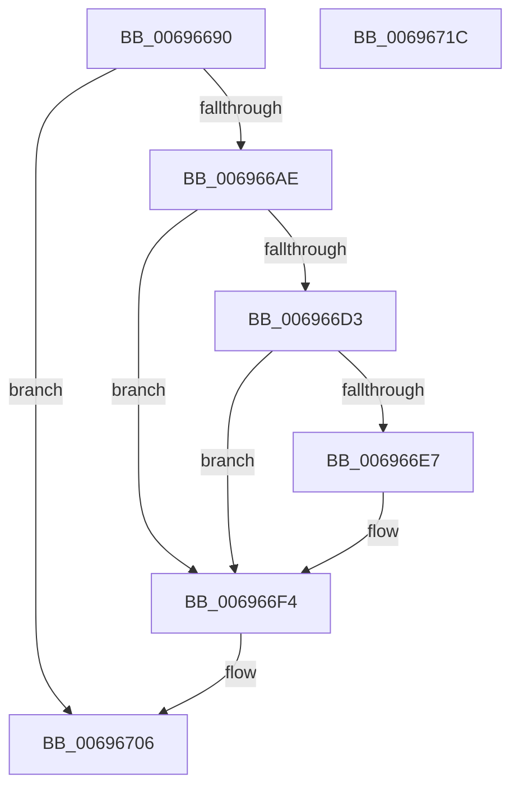

# MiSignalZeroingPassComplete

- RVA: `0x00696690`–`0x0069671D` (길이 `141` bytes)
- VA: `0x0000000140696690`
- 실행 섹션: `.text`
- PDB 이름 있음: `예`; PDB Function 태그: `아니요`
- unwind 정보 RVA: `0x000A85B0`
- 디코드: `36`개 명령, `141/141` bytes 표시
- 미해석 바이트: `0` (있으면 어셈블리에 `.byte`로 보존)

> 이 문서는 커널 이미지의 기계어와 PDB 기호를 분석해 생성했습니다. 4번과 5번은 함수 원형과 자료형을 바이너리 사용 방식에서 추정한 C 해석이며 원본 소스 복구 결과는 아닙니다.

## 1. Dependencies

- 직접 호출 지점: **3**; 고유 호출 대상: **3**
- 직접 호출자로 확인된 함수: **3**
- RIP 상대 이미지 참조: **0**

### Outgoing calls
- `0x006966C5` → [ExAcquireSpinLockExclusive](../24/ExAcquireSpinLockExclusive_function_00248690.md) (function, `0x00248690`)
- `0x006966EF` → [KeSetEvent](../33/KeSetEvent_function_0033F310.md) (function, `0x0033F310`)
- `0x00696701` → [MiReleaseSpinLockExclusive](../24/MiReleaseSpinLockExclusive_function_002482C0.md) (function, `0x002482C0`)

### Direct callers
- [MiBackgroundZeroNodePages](../2C/MiBackgroundZeroNodePages_function_002CB9B0.md) at `0x002CBB24`
- [MiDeleteZeroThreadContext](../4D/MiDeleteZeroThreadContext_function_004DF788.md) at `0x004DF7C0`
- [MiStartZeroEngineThreads](../../page/81/MiStartZeroEngineThreads_function_00810CCC.md) at `0x00810D5F`

### Static image references
- 디코드된 RIP-relative 메모리 참조가 없습니다.

## 2. Other-region calls and transfers

- 다른 실행 섹션으로 향하는 call: **0**
- 별도 외부 분기/꼬리 이동을 확인하지 못했습니다.

## 3. Assembly (complete function range)

```asm
00696690  48 89 5C 24 10                  mov qword ptr [rsp + 0x10], rbx
00696695  48 89 74 24 18                  mov qword ptr [rsp + 0x18], rsi
0069669A  48 89 7C 24 20                  mov qword ptr [rsp + 0x20], rdi
0069669F  41 56                           push r14
006966A1  48 83 EC 20                     sub rsp, 0x20
006966A5  80 79 1E 00                     cmp byte ptr [rcx + 0x1e], 0
006966A9  48 8B D9                        mov rbx, rcx
006966AC  74 58                           je 0x140696706
006966AE  48 8B B9 B0 00 00 00            mov rdi, qword ptr [rcx + 0xb0]
006966B5  41 BE B0 3B 00 00               mov r14d, 0x3bb0
006966BB  48 8B 89 D0 00 00 00            mov rcx, qword ptr [rcx + 0xd0]
006966C2  49 03 CE                        add rcx, r14
006966C5  E8 C6 1F BB FF                  call 0x140248690
006966CA  80 7B 1E 00                     cmp byte ptr [rbx + 0x1e], 0
006966CE  40 8A F0                        mov sil, al
006966D1  74 21                           je 0x1406966f4
006966D3  C6 43 1E 00                     mov byte ptr [rbx + 0x1e], 0
006966D7  83 C8 FF                        or eax, 0xffffffff
006966DA  F0 0F C1 87 80 00 00 00         lock xadd dword ptr [rdi + 0x80], eax
006966E2  83 F8 01                        cmp eax, 1
006966E5  75 0D                           jne 0x1406966f4
006966E7  45 33 C0                        xor r8d, r8d
006966EA  33 D2                           xor edx, edx
006966EC  48 8B CF                        mov rcx, rdi
006966EF  E8 1C 8C CA FF                  call 0x14033f310
006966F4  48 8B 8B D0 00 00 00            mov rcx, qword ptr [rbx + 0xd0]
006966FB  40 8A D6                        mov dl, sil
006966FE  49 03 CE                        add rcx, r14
00696701  E8 BA 1B BB FF                  call 0x1402482c0
00696706  48 8B 5C 24 38                  mov rbx, qword ptr [rsp + 0x38]
0069670B  48 8B 74 24 40                  mov rsi, qword ptr [rsp + 0x40]
00696710  48 8B 7C 24 48                  mov rdi, qword ptr [rsp + 0x48]
00696715  48 83 C4 20                     add rsp, 0x20
00696719  41 5E                           pop r14
0069671B  C3                              ret
0069671C  CC                              int3
```

## 4. C-style interpretation (structured pseudocode)

```c
__int64 __fastcall MiSignalZeroingPassComplete(__int64 a1, int a2, int a3)
{
    __int64 result;
    __int64 v_rsp;
    unsigned __int64 v_stack_p10;
    unsigned __int64 v_stack_p18;
    unsigned __int64 v_stack_p20;

    v_stack_p10 = v_rbx;
    v_stack_p18 = v_rsi;
    v_stack_p20 = v_rdi;
    v_rsp = (v_rsp) - (32);
    if ((*(unsigned __int8 *)(a1 + 30)) == 0) goto loc_00696706;
    a1 = (*(unsigned __int64 *)(a1 + 208)) + ((unsigned int)(0x3BB0ULL));
    result = ExAcquireSpinLockExclusive(a1, a2, a3, a4);
    if ((*(unsigned __int8 *)(a1 + 30)) == 0) goto loc_006966F4;
    *(unsigned __int8 *)(a1 + 30) = 0;
    result = (unsigned int)((result) | (0xFFFFFFFFULL));
    if (((unsigned int)(result)) == 1) {
        a3 = 0;
        a2 = 0;
        a1 = *(unsigned __int64 *)(a1 + 176);
        result = KeSetEvent(a1, a2, a3, a4);
    }
    a1 = (*(unsigned __int64 *)(a1 + 208)) + ((unsigned int)(0x3BB0ULL));
    result = MiReleaseSpinLockExclusive(a1, (unsigned __int8)((unsigned __int8)(result)), a3, a4);
loc_00696706:
    v_rsp = (v_rsp) + (32);
    return result;
}
```

## 5. (Beta) C Style

```c
int64_t MiSignalZeroingPassComplete(void *Arg1, int32_t Arg2, int32_t Arg3)
{
    uint8_t *arg1 = (uint8_t *)Arg1;

    int64_t result;
    int64_t local_rsp;
    uint64_t v_stack_p10;
    uint64_t v_stack_p18;
    uint64_t v_stack_p20;

    v_stack_p10 = local_rbx;
    v_stack_p18 = local_rsi;
    v_stack_p20 = local_rdi;
    local_rsp = (local_rsp) - (32);
    if ((*(uint8_t *)(arg1 + 0x1E)) == 0) goto loc_00696706;
    Arg1 = (*(uint64_t *)(arg1 + 0xD0)) + ((uint32_t)(0x3BB0ULL));
    result = ExAcquireSpinLockExclusive(Arg1, Arg2, Arg3, a4);
    if ((*(uint8_t *)(arg1 + 0x1E)) == 0) goto loc_006966F4;
    *(uint8_t *)(arg1 + 0x1E) = 0;
    result = (uint32_t)((result) | (0xFFFFFFFFULL));
    if (((uint32_t)(result)) == 1) {
        Arg3 = 0;
        Arg2 = 0;
        Arg1 = *(uint64_t *)(arg1 + 0xB0);
        result = KeSetEvent(Arg1, Arg2, Arg3, a4);
    }
    Arg1 = (*(uint64_t *)(arg1 + 0xD0)) + ((uint32_t)(0x3BB0ULL));
    result = MiReleaseSpinLockExclusive(Arg1, (uint8_t)((uint8_t)(result)), Arg3, a4);
loc_00696706:
    local_rsp = (local_rsp) + (32);
    return result;
}
```

### 관측된 메모리 오프셋

구조체 형식이 확인되지 않은 접근은 인자 기준의 오프셋으로만 기록했습니다.

| 기준 인자 | 오프셋 표현 | 폭 (bit) | 접근 |
|---|---:|---:|---|
| `Arg1` | `+ 0x1E` | `8` | `R` |
| `Arg1` | `+ 0x1E` | `8` | `W` |
| `Arg1` | `+ 0xB0` | `64` | `R` |
| `Arg1` | `+ 0xD0` | `64` | `R` |

## 6. Execution-region graph

[열기: 2D/3D 그래프와 함수 탐색 컨트롤 패널](../../../control-panel.html?section=text&rva=0x00696690&view=graph)

- 2D 그래프는 위에서 아래로 흐르고, 3D 그래프는 빈 공간을 드래그해 회전합니다. Shift+드래그는 이동, 휠은 확대·축소, 함수 노드 선택은 대상 보고서 이동입니다.

### Static fallback


