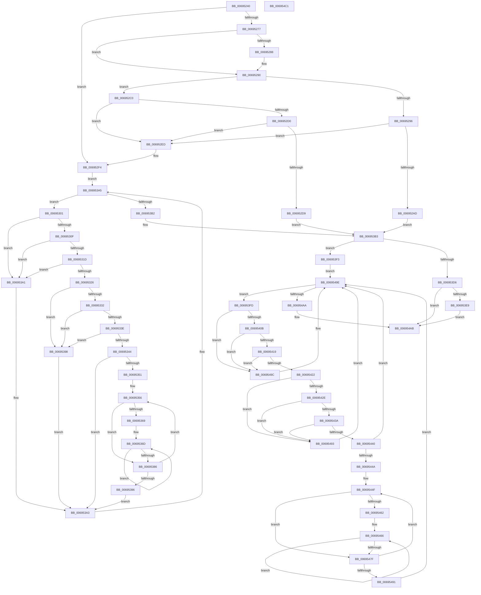

# MiSpecialPurposeMemoryCacheUpdateDpc

- RVA: `0x00695240`–`0x006954C2` (길이 `642` bytes)
- VA: `0x0000000140695240`
- 실행 섹션: `.text`
- PDB 이름 있음: `예`; PDB Function 태그: `아니요`
- unwind 정보 RVA: `0x000D9374`
- 디코드: `200`개 명령, `642/642` bytes 표시
- 미해석 바이트: `0` (있으면 어셈블리에 `.byte`로 보존)

> 이 문서는 커널 이미지의 기계어와 PDB 기호를 분석해 생성했습니다. 4번과 5번은 함수 원형과 자료형을 바이너리 사용 방식에서 추정한 C 해석이며 원본 소스 복구 결과는 아닙니다.

## 1. Dependencies

- 직접 호출 지점: **10**; 고유 호출 대상: **5**
- 직접 호출자로 확인된 함수: **0**
- RIP 상대 이미지 참조: **3**

### Outgoing calls
- `0x0069528B` → [KeWakeAddressAll](../21/KeWakeAddressAll_function_00217C20.md) (function, `0x00217C20`)
- `0x0069531D` → [KiCheckVpBackingLongSpinWaitHypercall](../30/KiCheckVpBackingLongSpinWaitHypercall_function_0030F490.md) (function, `0x0030F490`)
- `0x00695329` → [KeCanUseHaltOnAddress](../4F/KeCanUseHaltOnAddress_function_004FC22C.md) (function, `0x004FC22C`)
- `0x0069537B` → [KiHaltOnAddress](../4F/KiHaltOnAddress_function_004FBA3C.md) (function, `0x004FBA3C`)
- `0x0069539A` → [HvlNotifyLongSpinWait](../30/HvlNotifyLongSpinWait_function_0030F460.md) (function, `0x0030F460`)
- `0x006953E9` → [KeWakeAddressAll](../21/KeWakeAddressAll_function_00217C20.md) (function, `0x00217C20`)
- `0x00695419` → [KiCheckVpBackingLongSpinWaitHypercall](../30/KiCheckVpBackingLongSpinWaitHypercall_function_0030F490.md) (function, `0x0030F490`)
- `0x00695425` → [KeCanUseHaltOnAddress](../4F/KeCanUseHaltOnAddress_function_004FC22C.md) (function, `0x004FC22C`)
- `0x00695474` → [KiHaltOnAddress](../4F/KiHaltOnAddress_function_004FBA3C.md) (function, `0x004FBA3C`)
- `0x00695495` → [HvlNotifyLongSpinWait](../30/HvlNotifyLongSpinWait_function_0030F460.md) (function, `0x0030F460`)

### Direct callers
- 이 함수 시작 RVA로 연결되는 직접 call은 확인되지 않았습니다. 간접 호출은 완전히 역산할 수 없습니다.

### Static image references
- `0x00695303` → RVA `0x00FC52AC` (`ALMOSTRO`; reference)
- `0x0069530F` → RVA `0x00FC6AB8` (`ALMOSTRO`; read)
- `0x00695332` → RVA `0x00FC6B38` (`ALMOSTRO`; read)

## 2. Other-region calls and transfers

- 다른 실행 섹션으로 향하는 call: **0**
- 별도 외부 분기/꼬리 이동을 확인하지 못했습니다.

## 3. Assembly (complete function range)

```asm
00695240  48 89 5C 24 08                  mov qword ptr [rsp + 8], rbx
00695245  55                              push rbp
00695246  56                              push rsi
00695247  57                              push rdi
00695248  41 55                           push r13
0069524A  41 56                           push r14
0069524C  48 83 EC 20                     sub rsp, 0x20
00695250  48 8B 2A                        mov rbp, qword ptr [rdx]
00695253  49 8B D9                        mov rbx, r9
00695256  4D 8B E8                        mov r13, r8
00695259  48 8B F2                        mov rsi, rdx
0069525C  83 C8 FF                        or eax, 0xffffffff
0069525F  F0 41 0F C1 01                  lock xadd dword ptr [r9], eax
00695264  FF C8                           dec eax
00695266  8B F8                           mov edi, eax
00695268  F7 D7                           not edi
0069526A  81 E7 00 00 00 80               and edi, 0x80000000
00695270  A9 FF FF FF 3F                  test eax, 0x3fffffff
00695275  75 7D                           jne 0x1406952f4
00695277  41 0B 79 04                     or edi, dword ptr [r9 + 4]
0069527B  41 87 39                        xchg dword ptr [r9], edi
0069527E  89 7C 24 58                     mov dword ptr [rsp + 0x58], edi
00695282  0F BA E7 1E                     bt edi, 0x1e
00695286  73 08                           jae 0x140695290
00695288  48 8B CB                        mov rcx, rbx
0069528B  E8 90 29 B8 FF                  call 0x140217c20
00695290  83 7E 10 00                     cmp dword ptr [rsi + 0x10], 0
00695294  74 2A                           je 0x1406952c0
00695296  48 8B 46 08                     mov rax, qword ptr [rsi + 8]
0069529A  48 8D 4D 48                     lea rcx, [rbp + 0x48]
0069529E  48 05 E8 44 00 00               add rax, 0x44e8
006952A4  48 8B 10                        mov rdx, qword ptr [rax]
006952A7  48 39 42 08                     cmp qword ptr [rdx + 8], rax
006952AB  75 40                           jne 0x1406952ed
006952AD  48 89 11                        mov qword ptr [rcx], rdx
006952B0  48 89 41 08                     mov qword ptr [rcx + 8], rax
006952B4  48 89 4A 08                     mov qword ptr [rdx + 8], rcx
006952B8  48 89 08                        mov qword ptr [rax], rcx
006952BB  E9 F3 00 00 00                  jmp 0x1406953b3
006952C0  48 8B 06                        mov rax, qword ptr [rsi]
006952C3  48 83 C0 48                     add rax, 0x48
006952C7  48 8B 10                        mov rdx, qword ptr [rax]
006952CA  48 39 42 08                     cmp qword ptr [rdx + 8], rax
006952CE  75 1D                           jne 0x1406952ed
006952D0  48 8B 48 08                     mov rcx, qword ptr [rax + 8]
006952D4  48 39 01                        cmp qword ptr [rcx], rax
006952D7  75 14                           jne 0x1406952ed
006952D9  48 89 11                        mov qword ptr [rcx], rdx
006952DC  48 89 4A 08                     mov qword ptr [rdx + 8], rcx
006952E0  48 8B 06                        mov rax, qword ptr [rsi]
006952E3  48 83 60 48 00                  and qword ptr [rax + 0x48], 0
006952E8  E9 C6 00 00 00                  jmp 0x1406953b3
006952ED  B9 03 00 00 00                  mov ecx, 3
006952F2  CD 29                           int 0x29
006952F4  41 8B 01                        mov eax, dword ptr [r9]
006952F7  33 ED                           xor ebp, ebp
006952F9  45 33 F6                        xor r14d, r14d
006952FC  E9 A4 00 00 00                  jmp 0x1406953a5
00695301  FF C5                           inc ebp
00695303  85 2D A3 FF 92 00               test dword ptr [rip + 0x92ffa3], ebp
00695309  0F 85 92 00 00 00               jne 0x1406953a1
0069530F  8B 05 A3 17 93 00               mov eax, dword ptr [rip + 0x9317a3]
00695315  A8 40                           test al, 0x40
00695317  0F 84 84 00 00 00               je 0x1406953a1
0069531D  E8 6E A1 C7 FF                  call 0x14030f490
00695322  84 C0                           test al, al
00695324  74 7B                           je 0x1406953a1
00695326  41 FF C6                        inc r14d
00695329  E8 FE 6E E6 FF                  call 0x1404fc22c
0069532E  84 C0                           test al, al
00695330  74 66                           je 0x140695398
00695332  F7 05 FC 17 93 00 00 00 02 00   test dword ptr [rip + 0x9317fc], 0x20000
0069533C  74 5A                           je 0x140695398
0069533E  41 F6 C6 07                     test r14b, 7
00695342  75 54                           jne 0x140695398
00695344  8B 0B                           mov ecx, dword ptr [rbx]
00695346  8B C1                           mov eax, ecx
00695348  25 00 00 00 80                  and eax, 0x80000000
0069534D  3B C7                           cmp eax, edi
0069534F  74 52                           je 0x1406953a3
00695351  8B D1                           mov edx, ecx
00695353  44 8B C1                        mov r8d, ecx
00695356  0F BA E9 1E                     bts ecx, 0x1e
0069535A  8B C2                           mov eax, edx
0069535C  8B F1                           mov esi, ecx
0069535E  F0 0F B1 33                     lock cmpxchg dword ptr [rbx], esi
00695362  8B C8                           mov ecx, eax
00695364  41 3B C0                        cmp eax, r8d
00695367  75 1D                           jne 0x140695386
00695369  89 74 24 58                     mov dword ptr [rsp + 0x58], esi
0069536D  41 B8 04 00 00 00               mov r8d, 4
00695373  48 8D 54 24 58                  lea rdx, [rsp + 0x58]
00695378  48 8B CB                        mov rcx, rbx
0069537B  E8 BC 66 E6 FF                  call 0x1404fba3c
00695380  8B 0B                           mov ecx, dword ptr [rbx]
00695382  3B CE                           cmp ecx, esi
00695384  74 E7                           je 0x14069536d
00695386  8B C1                           mov eax, ecx
00695388  8B D1                           mov edx, ecx
0069538A  25 00 00 00 80                  and eax, 0x80000000
0069538F  44 8B C1                        mov r8d, ecx
00695392  3B C7                           cmp eax, edi
00695394  75 C0                           jne 0x140695356
00695396  EB 0B                           jmp 0x1406953a3
00695398  8B CD                           mov ecx, ebp
0069539A  E8 C1 A0 C7 FF                  call 0x14030f460
0069539F  EB 02                           jmp 0x1406953a3
006953A1  F3 90                           pause
006953A3  8B 03                           mov eax, dword ptr [rbx]
006953A5  25 00 00 00 80                  and eax, 0x80000000
006953AA  3B C7                           cmp eax, edi
006953AC  0F 85 4F FF FF FF               jne 0x140695301
006953B2  90                              nop
006953B3  48 8B CB                        mov rcx, rbx
006953B6  BA 04 00 00 00                  mov edx, 4
006953BB  83 C8 FF                        or eax, 0xffffffff
006953BE  F0 0F C1 03                     lock xadd dword ptr [rbx], eax
006953C2  FF C8                           dec eax
006953C4  BE 00 00 00 80                  mov esi, 0x80000000
006953C9  8B F8                           mov edi, eax
006953CB  F7 D7                           not edi
006953CD  23 FE                           and edi, esi
006953CF  A9 FF FF FF 3F                  test eax, 0x3fffffff
006953D4  75 1D                           jne 0x1406953f3
006953D6  0B 3C 1A                        or edi, dword ptr [rdx + rbx]
006953D9  87 3B                           xchg dword ptr [rbx], edi
006953DB  89 7C 24 68                     mov dword ptr [rsp + 0x68], edi
006953DF  0F BA E7 1E                     bt edi, 0x1e
006953E3  0F 83 C2 00 00 00               jae 0x1406954ab
006953E9  E8 32 28 B8 FF                  call 0x140217c20
006953EE  E9 B8 00 00 00                  jmp 0x1406954ab
006953F3  33 ED                           xor ebp, ebp
006953F5  45 33 F6                        xor r14d, r14d
006953F8  E9 A1 00 00 00                  jmp 0x14069549e
006953FD  FF C5                           inc ebp
006953FF  85 2D A7 FE 92 00               test dword ptr [rip + 0x92fea7], ebp
00695405  0F 85 91 00 00 00               jne 0x14069549c
0069540B  8B 05 A7 16 93 00               mov eax, dword ptr [rip + 0x9316a7]
00695411  A8 40                           test al, 0x40
00695413  0F 84 83 00 00 00               je 0x14069549c
00695419  E8 72 A0 C7 FF                  call 0x14030f490
0069541E  84 C0                           test al, al
00695420  74 7A                           je 0x14069549c
00695422  41 FF C6                        inc r14d
00695425  E8 02 6E E6 FF                  call 0x1404fc22c
0069542A  84 C0                           test al, al
0069542C  74 65                           je 0x140695493
0069542E  F7 05 00 17 93 00 00 00 02 00   test dword ptr [rip + 0x931700], 0x20000
00695438  74 59                           je 0x140695493
0069543A  41 F6 C6 07                     test r14b, 7
0069543E  75 53                           jne 0x140695493
00695440  8B 0B                           mov ecx, dword ptr [rbx]
00695442  8B C1                           mov eax, ecx
00695444  23 C6                           and eax, esi
00695446  3B C7                           cmp eax, edi
00695448  74 54                           je 0x14069549e
0069544A  8B D1                           mov edx, ecx
0069544C  44 8B C1                        mov r8d, ecx
0069544F  0F BA E9 1E                     bts ecx, 0x1e
00695453  8B C2                           mov eax, edx
00695455  8B F1                           mov esi, ecx
00695457  F0 0F B1 33                     lock cmpxchg dword ptr [rbx], esi
0069545B  8B C8                           mov ecx, eax
0069545D  41 3B C0                        cmp eax, r8d
00695460  75 1D                           jne 0x14069547f
00695462  89 74 24 68                     mov dword ptr [rsp + 0x68], esi
00695466  41 B8 04 00 00 00               mov r8d, 4
0069546C  48 8D 54 24 68                  lea rdx, [rsp + 0x68]
00695471  48 8B CB                        mov rcx, rbx
00695474  E8 C3 65 E6 FF                  call 0x1404fba3c
00695479  8B 0B                           mov ecx, dword ptr [rbx]
0069547B  3B CE                           cmp ecx, esi
0069547D  74 E7                           je 0x140695466
0069547F  8B C1                           mov eax, ecx
00695481  BE 00 00 00 80                  mov esi, 0x80000000
00695486  23 C6                           and eax, esi
00695488  8B D1                           mov edx, ecx
0069548A  44 8B C1                        mov r8d, ecx
0069548D  3B C7                           cmp eax, edi
0069548F  75 BE                           jne 0x14069544f
00695491  EB 0B                           jmp 0x14069549e
00695493  8B CD                           mov ecx, ebp
00695495  E8 C6 9F C7 FF                  call 0x14030f460
0069549A  EB 02                           jmp 0x14069549e
0069549C  F3 90                           pause
0069549E  8B 03                           mov eax, dword ptr [rbx]
006954A0  23 C6                           and eax, esi
006954A2  3B C7                           cmp eax, edi
006954A4  0F 85 53 FF FF FF               jne 0x1406953fd
006954AA  90                              nop
006954AB  F0 41 FF 4D 00                  lock dec dword ptr [r13]
006954B0  48 8B 5C 24 50                  mov rbx, qword ptr [rsp + 0x50]
006954B5  48 83 C4 20                     add rsp, 0x20
006954B9  41 5E                           pop r14
006954BB  41 5D                           pop r13
006954BD  5F                              pop rdi
006954BE  5E                              pop rsi
006954BF  5D                              pop rbp
006954C0  C3                              ret
006954C1  CC                              int3
```

## 4. C-style interpretation (structured pseudocode)

```c
__int64 __fastcall MiSpecialPurposeMemoryCacheUpdateDpc(__int64 a1, __int64 a2, __int64 a3, __int64 a4)
{
    __int64 result;
    __int64 v_r14;
    __int64 v_rbp;
    __int64 v_rdi;
    __int64 v_rsp;
    unsigned int v_stack_p10;
    unsigned int v_stack_p20;
    unsigned __int64 v_stack_p8;

    v_stack_p8 = v_rbx;
    v_rsp = (v_rsp) - (32);
    result = (unsigned int)((result) | (0xFFFFFFFFULL));
    result = (unsigned int)((result) - 1);
    v_rdi = (unsigned int)(~((unsigned int)((unsigned int)(result))));
    v_rdi = (unsigned int)((v_rdi) & (0x80000000ULL));
    if ((((unsigned int)(result)) & (0x3FFFFFFFULL)) != 0) goto loc_006952F4;
    v_rdi = (unsigned int)((v_rdi) | (*(unsigned int *)(a4 + 4)));
    v_stack_p10 = (unsigned int)(v_rdi);
    if (!(condition_is_above_or_equal)) {
        a1 = a4;
        result = KeWakeAddressAll(a1, a2, a3, a4);
    }
    if ((*(unsigned int *)(a2 + 16)) == 0) goto loc_006952C0;
    result = (*(unsigned __int64 *)(a2 + 8)) + (0x44E8ULL);
    if ((*(unsigned __int64 *)(*(unsigned __int64 *)(result) + 8)) != result) goto loc_006952ED;
    *(unsigned __int64 *)(*(unsigned __int64 *)(a2) + 72) = *(unsigned __int64 *)(result);
    *(unsigned __int64 *)(*(unsigned __int64 *)(a2) + 72 + 8) = result;
    *(unsigned __int64 *)(*(unsigned __int64 *)(result) + 8) = *(unsigned __int64 *)(a2) + 72;
    *(unsigned __int64 *)(result) = *(unsigned __int64 *)(a2) + 72;
    goto loc_006953B3;
loc_006952C0:
    result = (*(unsigned __int64 *)(a2)) + (72);
    if ((*(unsigned __int64 *)(*(unsigned __int64 *)(result) + 8)) != result) goto loc_006952ED;
    if ((*(unsigned __int64 *)(*(unsigned __int64 *)(result + 8))) != result) goto loc_006952ED;
    *(unsigned __int64 *)(*(unsigned __int64 *)(result + 8)) = *(unsigned __int64 *)(result);
    *(unsigned __int64 *)(*(unsigned __int64 *)(result) + 8) = *(unsigned __int64 *)(result + 8);
    goto loc_006953B3;
loc_006952ED:
loc_006952F4:
    v_rbp = 0;
    v_r14 = 0;
    goto loc_006953A5;
loc_00695301:
    v_rbp = (unsigned int)((v_rbp) + 1);
    if (((*(unsigned int *)(v_rip + 9633699)) & ((unsigned int)(v_rbp))) != 0) goto loc_006953A1;
    if ((((unsigned __int8)((unsigned int)(*(unsigned int *)(v_rip + 9639843)))) & (64)) == 0) goto loc_006953A1;
    result = KiCheckVpBackingLongSpinWaitHypercall(3, *(unsigned __int64 *)(result), a3, a4);
    if ((unsigned __int8)(result) == 0) goto loc_006953A1;
    v_r14 = (unsigned int)((v_r14) + 1);
    result = KeCanUseHaltOnAddress(3, *(unsigned __int64 *)(result), a3, a4);
    if ((unsigned __int8)(result) == 0) goto loc_00695398;
    if (((*(unsigned int *)(v_rip + 9639932)) & (0x20000ULL)) == 0) goto loc_00695398;
    if ((((unsigned __int8)(v_r14)) & (7)) != 0) goto loc_00695398;
    result = (unsigned int)(((unsigned int)((unsigned int)((unsigned int)(*(unsigned int *)(a4))))) & (0x80000000ULL));
    if (((unsigned int)(result)) == ((unsigned int)(v_rdi))) goto loc_006953A3;
loc_00695356:
    if (((unsigned int)((unsigned int)((unsigned int)((unsigned int)((unsigned int)((unsigned int)(*(unsigned int *)(a4)))))))) != ((unsigned int)((unsigned int)((unsigned int)((unsigned int)(*(unsigned int *)(a4))))))) goto loc_00695386;
    v_stack_p10 = (unsigned int)((unsigned int)((unsigned int)((unsigned int)(*(unsigned int *)(a4)))));
loc_0069536D:
    result = KiHaltOnAddress(a4, v_stack_p10, 4, a4);
    if (((unsigned int)((unsigned int)(*(unsigned int *)(a4)))) == ((unsigned int)((unsigned int)((unsigned int)((unsigned int)(*(unsigned int *)(a4))))))) goto loc_0069536D;
loc_00695386:
    result = (unsigned int)(((unsigned int)((unsigned int)((unsigned int)(*(unsigned int *)(a4))))) & (0x80000000ULL));
    if (((unsigned int)(result)) != ((unsigned int)(v_rdi))) goto loc_00695356;
    goto loc_006953A3;
loc_00695398:
    result = HvlNotifyLongSpinWait((unsigned int)((unsigned int)(v_rbp)), (unsigned int)((unsigned int)((unsigned int)(*(unsigned int *)(a4)))), (unsigned int)((unsigned int)((unsigned int)(*(unsigned int *)(a4)))), a4);
    goto loc_006953A3;
loc_006953A1:
loc_006953A3:
loc_006953A5:
    result = (unsigned int)(((unsigned int)(*(unsigned int *)(a4))) & (0x80000000ULL));
    if (((unsigned int)(result)) != ((unsigned int)(v_rdi))) goto loc_00695301;
loc_006953B3:
    result = (unsigned int)((result) | (0xFFFFFFFFULL));
    result = (unsigned int)((result) - 1);
    v_rdi = (unsigned int)(~((unsigned int)((unsigned int)(result))));
    v_rdi = (unsigned int)((v_rdi) & ((unsigned int)((unsigned int)(0x80000000ULL))));
    if ((((unsigned int)(result)) & (0x3FFFFFFFULL)) != 0) goto loc_006953F3;
    v_rdi = (unsigned int)((v_rdi) | (*(unsigned int *)(4 + a4 * 1)));
    v_stack_p20 = (unsigned int)(v_rdi);
    if (condition_is_above_or_equal) goto loc_006954AB;
    result = KeWakeAddressAll(a4, 4, (unsigned int)((unsigned int)((unsigned int)(*(unsigned int *)(a4)))), a4);
    goto loc_006954AB;
loc_006953F3:
    v_rbp = 0;
    v_r14 = 0;
    goto loc_0069549E;
loc_006953FD:
    v_rbp = (unsigned int)((v_rbp) + 1);
    if (((*(unsigned int *)(v_rip + 9633447)) & ((unsigned int)(v_rbp))) != 0) goto loc_0069549C;
    if ((((unsigned __int8)((unsigned int)(*(unsigned int *)(v_rip + 9639591)))) & (64)) == 0) goto loc_0069549C;
    result = KiCheckVpBackingLongSpinWaitHypercall(a4, 4, (unsigned int)((unsigned int)((unsigned int)(*(unsigned int *)(a4)))), a4);
    if ((unsigned __int8)(result) == 0) goto loc_0069549C;
    v_r14 = (unsigned int)((v_r14) + 1);
    result = KeCanUseHaltOnAddress(a4, 4, (unsigned int)((unsigned int)((unsigned int)(*(unsigned int *)(a4)))), a4);
    if ((unsigned __int8)(result) == 0) goto loc_00695493;
    if (((*(unsigned int *)(v_rip + 9639680)) & (0x20000ULL)) == 0) goto loc_00695493;
    if ((((unsigned __int8)(v_r14)) & (7)) != 0) goto loc_00695493;
    result = (unsigned int)(((unsigned int)((unsigned int)((unsigned int)(*(unsigned int *)(a4))))) & ((unsigned int)((unsigned int)(0x80000000ULL))));
    if (((unsigned int)(result)) == ((unsigned int)(v_rdi))) goto loc_0069549E;
loc_0069544F:
    if (((unsigned int)((unsigned int)((unsigned int)((unsigned int)((unsigned int)((unsigned int)(*(unsigned int *)(a4)))))))) != ((unsigned int)((unsigned int)((unsigned int)((unsigned int)(*(unsigned int *)(a4))))))) goto loc_0069547F;
    v_stack_p20 = (unsigned int)((unsigned int)((unsigned int)((unsigned int)(*(unsigned int *)(a4)))));
loc_00695466:
    result = KiHaltOnAddress(a4, v_stack_p20, 4, a4);
    if (((unsigned int)((unsigned int)(*(unsigned int *)(a4)))) == ((unsigned int)((unsigned int)((unsigned int)((unsigned int)(*(unsigned int *)(a4))))))) goto loc_00695466;
loc_0069547F:
    result = (unsigned int)(((unsigned int)((unsigned int)((unsigned int)(*(unsigned int *)(a4))))) & ((unsigned int)((unsigned int)(0x80000000ULL))));
    if (((unsigned int)(result)) != ((unsigned int)(v_rdi))) goto loc_0069544F;
    goto loc_0069549E;
loc_00695493:
    result = HvlNotifyLongSpinWait((unsigned int)((unsigned int)(v_rbp)), (unsigned int)((unsigned int)((unsigned int)(*(unsigned int *)(a4)))), (unsigned int)((unsigned int)((unsigned int)(*(unsigned int *)(a4)))), a4);
    goto loc_0069549E;
loc_0069549C:
loc_0069549E:
    result = (unsigned int)(((unsigned int)(*(unsigned int *)(a4))) & ((unsigned int)((unsigned int)(0x80000000ULL))));
    if (((unsigned int)(result)) != ((unsigned int)(v_rdi))) goto loc_006953FD;
loc_006954AB:
    v_rsp = (v_rsp) + (32);
    return result;
}
```

## 5. (Beta) C Style

```c
int64_t MiSpecialPurposeMemoryCacheUpdateDpc(int64_t Arg1, void *Arg2, void *Arg3, void *Arg4)
{
    uint8_t *arg2 = (uint8_t *)Arg2;
    uint8_t *arg3 = (uint8_t *)Arg3;
    uint8_t *arg4 = (uint8_t *)Arg4;

    int64_t result;
    int64_t local_r14;
    int64_t local_rbp;
    int64_t local_rdi;
    int64_t local_rsp;
    uint32_t v_stack_p10;
    uint32_t v_stack_p20;
    uint64_t v_stack_p8;

    v_stack_p8 = local_rbx;
    local_rsp = (local_rsp) - (32);
    result = (uint32_t)((result) | (0xFFFFFFFFULL));
    result = (uint32_t)((result) - 1);
    local_rdi = (uint32_t)(~((uint32_t)((uint32_t)(result))));
    local_rdi = (uint32_t)((local_rdi) & (0x80000000ULL));
    if ((((uint32_t)(result)) & (0x3FFFFFFFULL)) != 0) goto loc_006952F4;
    local_rdi = (uint32_t)((local_rdi) | (*(uint32_t *)(arg4 + 0x4)));
    v_stack_p10 = (uint32_t)(local_rdi);
    if (!(condition_is_above_or_equal)) {
        Arg1 = Arg4;
        result = KeWakeAddressAll(Arg1, Arg2, Arg3, Arg4);
    }
    if ((*(uint32_t *)(arg2 + 0x10)) == 0) goto loc_006952C0;
    result = (*(uint64_t *)(arg2 + 0x8)) + (0x44E8ULL);
    if ((*(uint64_t *)(*(uint64_t *)(result) + 0x8)) != result) goto loc_006952ED;
    *(uint64_t *)(*(uint64_t *)(arg2) + 0x48) = *(uint64_t *)(result);
    *(uint64_t *)(*(uint64_t *)(arg2) + 0x48 + 0x8) = result;
    *(uint64_t *)(*(uint64_t *)(result) + 0x8) = *(uint64_t *)(arg2) + 72;
    *(uint64_t *)(result) = *(uint64_t *)(arg2) + 72;
    goto loc_006953B3;
loc_006952C0:
    result = (*(uint64_t *)(arg2)) + (72);
    if ((*(uint64_t *)(*(uint64_t *)(result) + 0x8)) != result) goto loc_006952ED;
    if ((*(uint64_t *)(*(uint64_t *)(result + 0x8))) != result) goto loc_006952ED;
    *(uint64_t *)(*(uint64_t *)(result + 0x8)) = *(uint64_t *)(result);
    *(uint64_t *)(*(uint64_t *)(result) + 0x8) = *(uint64_t *)(result + 0x8);
    goto loc_006953B3;
loc_006952ED:
loc_006952F4:
    local_rbp = 0;
    local_r14 = 0;
    goto loc_006953A5;
loc_00695301:
    local_rbp = (uint32_t)((local_rbp) + 1);
    if (((*(uint32_t *)(v_rip + 0x92FFA3)) & ((uint32_t)(local_rbp))) != 0) goto loc_006953A1;
    if ((((uint8_t)((uint32_t)(*(uint32_t *)(v_rip + 0x9317A3)))) & (64)) == 0) goto loc_006953A1;
    result = KiCheckVpBackingLongSpinWaitHypercall(3, *(uint64_t *)(result), Arg3, Arg4);
    if ((uint8_t)(result) == 0) goto loc_006953A1;
    local_r14 = (uint32_t)((local_r14) + 1);
    result = KeCanUseHaltOnAddress(3, *(uint64_t *)(result), Arg3, Arg4);
    if ((uint8_t)(result) == 0) goto loc_00695398;
    if (((*(uint32_t *)(v_rip + 0x9317FC)) & (0x20000ULL)) == 0) goto loc_00695398;
    if ((((uint8_t)(local_r14)) & (7)) != 0) goto loc_00695398;
    result = (uint32_t)(((uint32_t)((uint32_t)((uint32_t)(*(uint32_t *)(arg4))))) & (0x80000000ULL));
    if (((uint32_t)(result)) == ((uint32_t)(local_rdi))) goto loc_006953A3;
loc_00695356:
    if (((uint32_t)((uint32_t)((uint32_t)((uint32_t)((uint32_t)((uint32_t)(*(uint32_t *)(arg4)))))))) != ((uint32_t)((uint32_t)((uint32_t)((uint32_t)(*(uint32_t *)(arg4))))))) goto loc_00695386;
    v_stack_p10 = (uint32_t)((uint32_t)((uint32_t)((uint32_t)(*(uint32_t *)(arg4)))));
loc_0069536D:
    result = KiHaltOnAddress(Arg4, v_stack_p10, 4, Arg4);
    if (((uint32_t)((uint32_t)(*(uint32_t *)(arg4)))) == ((uint32_t)((uint32_t)((uint32_t)((uint32_t)(*(uint32_t *)(arg4))))))) goto loc_0069536D;
loc_00695386:
    result = (uint32_t)(((uint32_t)((uint32_t)((uint32_t)(*(uint32_t *)(arg4))))) & (0x80000000ULL));
    if (((uint32_t)(result)) != ((uint32_t)(local_rdi))) goto loc_00695356;
    goto loc_006953A3;
loc_00695398:
    result = HvlNotifyLongSpinWait((uint32_t)((uint32_t)(local_rbp)), (uint32_t)((uint32_t)((uint32_t)(*(uint32_t *)(arg4)))), (uint32_t)((uint32_t)((uint32_t)(*(uint32_t *)(arg4)))), Arg4);
    goto loc_006953A3;
loc_006953A1:
loc_006953A3:
loc_006953A5:
    result = (uint32_t)(((uint32_t)(*(uint32_t *)(arg4))) & (0x80000000ULL));
    if (((uint32_t)(result)) != ((uint32_t)(local_rdi))) goto loc_00695301;
loc_006953B3:
    result = (uint32_t)((result) | (0xFFFFFFFFULL));
    result = (uint32_t)((result) - 1);
    local_rdi = (uint32_t)(~((uint32_t)((uint32_t)(result))));
    local_rdi = (uint32_t)((local_rdi) & ((uint32_t)((uint32_t)(0x80000000ULL))));
    if ((((uint32_t)(result)) & (0x3FFFFFFFULL)) != 0) goto loc_006953F3;
    local_rdi = (uint32_t)((local_rdi) | (*(uint32_t *)(4 + arg4 * 1)));
    v_stack_p20 = (uint32_t)(local_rdi);
    if (condition_is_above_or_equal) goto loc_006954AB;
    result = KeWakeAddressAll(Arg4, 4, (uint32_t)((uint32_t)((uint32_t)(*(uint32_t *)(arg4)))), Arg4);
    goto loc_006954AB;
loc_006953F3:
    local_rbp = 0;
    local_r14 = 0;
    goto loc_0069549E;
loc_006953FD:
    local_rbp = (uint32_t)((local_rbp) + 1);
    if (((*(uint32_t *)(v_rip + 0x92FEA7)) & ((uint32_t)(local_rbp))) != 0) goto loc_0069549C;
    if ((((uint8_t)((uint32_t)(*(uint32_t *)(v_rip + 0x9316A7)))) & (64)) == 0) goto loc_0069549C;
    result = KiCheckVpBackingLongSpinWaitHypercall(Arg4, 4, (uint32_t)((uint32_t)((uint32_t)(*(uint32_t *)(arg4)))), Arg4);
    if ((uint8_t)(result) == 0) goto loc_0069549C;
    local_r14 = (uint32_t)((local_r14) + 1);
    result = KeCanUseHaltOnAddress(Arg4, 4, (uint32_t)((uint32_t)((uint32_t)(*(uint32_t *)(arg4)))), Arg4);
    if ((uint8_t)(result) == 0) goto loc_00695493;
    if (((*(uint32_t *)(v_rip + 0x931700)) & (0x20000ULL)) == 0) goto loc_00695493;
    if ((((uint8_t)(local_r14)) & (7)) != 0) goto loc_00695493;
    result = (uint32_t)(((uint32_t)((uint32_t)((uint32_t)(*(uint32_t *)(arg4))))) & ((uint32_t)((uint32_t)(0x80000000ULL))));
    if (((uint32_t)(result)) == ((uint32_t)(local_rdi))) goto loc_0069549E;
loc_0069544F:
    if (((uint32_t)((uint32_t)((uint32_t)((uint32_t)((uint32_t)((uint32_t)(*(uint32_t *)(arg4)))))))) != ((uint32_t)((uint32_t)((uint32_t)((uint32_t)(*(uint32_t *)(arg4))))))) goto loc_0069547F;
    v_stack_p20 = (uint32_t)((uint32_t)((uint32_t)((uint32_t)(*(uint32_t *)(arg4)))));
loc_00695466:
    result = KiHaltOnAddress(Arg4, v_stack_p20, 4, Arg4);
    if (((uint32_t)((uint32_t)(*(uint32_t *)(arg4)))) == ((uint32_t)((uint32_t)((uint32_t)((uint32_t)(*(uint32_t *)(arg4))))))) goto loc_00695466;
loc_0069547F:
    result = (uint32_t)(((uint32_t)((uint32_t)((uint32_t)(*(uint32_t *)(arg4))))) & ((uint32_t)((uint32_t)(0x80000000ULL))));
    if (((uint32_t)(result)) != ((uint32_t)(local_rdi))) goto loc_0069544F;
    goto loc_0069549E;
loc_00695493:
    result = HvlNotifyLongSpinWait((uint32_t)((uint32_t)(local_rbp)), (uint32_t)((uint32_t)((uint32_t)(*(uint32_t *)(arg4)))), (uint32_t)((uint32_t)((uint32_t)(*(uint32_t *)(arg4)))), Arg4);
    goto loc_0069549E;
loc_0069549C:
loc_0069549E:
    result = (uint32_t)(((uint32_t)(*(uint32_t *)(arg4))) & ((uint32_t)((uint32_t)(0x80000000ULL))));
    if (((uint32_t)(result)) != ((uint32_t)(local_rdi))) goto loc_006953FD;
loc_006954AB:
    local_rsp = (local_rsp) + (32);
    return result;
}
```

### 관측된 메모리 오프셋

구조체 형식이 확인되지 않은 접근은 인자 기준의 오프셋으로만 기록했습니다.

| 기준 인자 | 오프셋 표현 | 폭 (bit) | 접근 |
|---|---:|---:|---|
| `Arg2` | `+ 0x0` | `64` | `R` |
| `Arg2` | `+ 0x8` | `64` | `R` |
| `Arg2` | `+ 0x10` | `32` | `R` |
| `Arg3` | `+ 0x0` | `32` | `R/W` |
| `Arg4` | `+ 0x0` | `32` | `R` |
| `Arg4` | `+ 0x0` | `32` | `R/W` |
| `Arg4` | `+ 0x4` | `32` | `R` |

## 6. Execution-region graph

[열기: 2D/3D 그래프와 함수 탐색 컨트롤 패널](../../../control-panel.html?section=text&rva=0x00695240&view=graph)

- 2D 그래프는 위에서 아래로 흐르고, 3D 그래프는 빈 공간을 드래그해 회전합니다. Shift+드래그는 이동, 휠은 확대·축소, 함수 노드 선택은 대상 보고서 이동입니다.

### Static fallback


