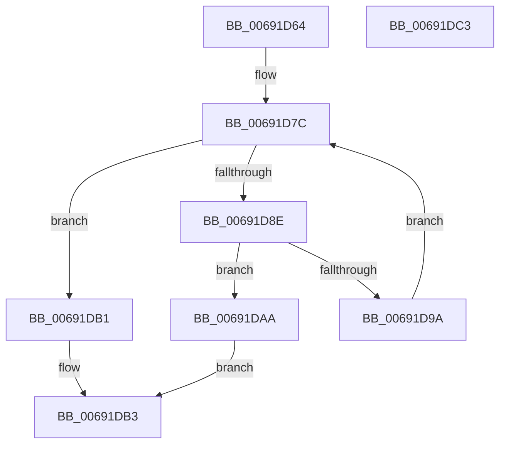

# MiSplitPfnBitMapsForPartitionHierarchy

- RVA: `0x00691D64`–`0x00691DC4` (길이 `96` bytes)
- VA: `0x0000000140691D64`
- 실행 섹션: `.text`
- PDB 이름 있음: `예`; PDB Function 태그: `아니요`
- unwind 정보 RVA: `0x00060BC4`
- 디코드: `29`개 명령, `96/96` bytes 표시
- 미해석 바이트: `0` (있으면 어셈블리에 `.byte`로 보존)

> 이 문서는 커널 이미지의 기계어와 PDB 기호를 분석해 생성했습니다. 4번과 5번은 함수 원형과 자료형을 바이너리 사용 방식에서 추정한 C 해석이며 원본 소스 복구 결과는 아닙니다.

## 1. Dependencies

- 직접 호출 지점: **1**; 고유 호출 대상: **1**
- 직접 호출자로 확인된 함수: **2**
- RIP 상대 이미지 참조: **1**

### Outgoing calls
- `0x00691D85` → [MiSplitPfnBitMaps](../../page/80/MiSplitPfnBitMaps_function_0080C25C.md) (function, `0x0080C25C`)

### Direct callers
- [MiActOnPartitionNodePages](../68/MiActOnPartitionNodePages_function_0068F7F4.md) at `0x0068FB5B`
- [MiAcquireAddMemoryResources](../../page/7F/MiAcquireAddMemoryResources_function_007F9538.md) at `0x007F95C2`

### Static image references
- `0x00691D8E` → RVA `0x00E38D00` (`.data`; read)

## 2. Other-region calls and transfers

- 다른 실행 섹션으로 향하는 call: **1**
  - `0x00691D85` → [MiSplitPfnBitMaps](../../page/80/MiSplitPfnBitMaps_function_0080C25C.md) (`.text` → `PAGE`)
- 별도 외부 분기/꼬리 이동을 확인하지 못했습니다.

## 3. Assembly (complete function range)

```asm
00691D64  48 89 5C 24 08                  mov qword ptr [rsp + 8], rbx
00691D69  48 89 74 24 10                  mov qword ptr [rsp + 0x10], rsi
00691D6E  57                              push rdi
00691D6F  48 83 EC 20                     sub rsp, 0x20
00691D73  49 8B F8                        mov rdi, r8
00691D76  48 8B F2                        mov rsi, rdx
00691D79  48 8B D9                        mov rbx, rcx
00691D7C  4C 8B C7                        mov r8, rdi
00691D7F  48 8B D6                        mov rdx, rsi
00691D82  48 8B CB                        mov rcx, rbx
00691D85  E8 D2 A4 17 00                  call 0x14080c25c
00691D8A  85 C0                           test eax, eax
00691D8C  74 23                           je 0x140691db1
00691D8E  48 8D 05 6B 6F 7A 00            lea rax, [rip + 0x7a6f6b]
00691D95  48 3B D8                        cmp rbx, rax
00691D98  74 10                           je 0x140691daa
00691D9A  48 8B 83 B8 00 00 00            mov rax, qword ptr [rbx + 0xb8]
00691DA1  48 8B 48 48                     mov rcx, qword ptr [rax + 0x48]
00691DA5  48 8B 19                        mov rbx, qword ptr [rcx]
00691DA8  EB D2                           jmp 0x140691d7c
00691DAA  B8 01 00 00 00                  mov eax, 1
00691DAF  EB 02                           jmp 0x140691db3
00691DB1  33 C0                           xor eax, eax
00691DB3  48 8B 5C 24 30                  mov rbx, qword ptr [rsp + 0x30]
00691DB8  48 8B 74 24 38                  mov rsi, qword ptr [rsp + 0x38]
00691DBD  48 83 C4 20                     add rsp, 0x20
00691DC1  5F                              pop rdi
00691DC2  C3                              ret
00691DC3  CC                              int3
```

## 4. C-style interpretation (structured pseudocode)

```c
__int64 __fastcall MiSplitPfnBitMapsForPartitionHierarchy(__int64 a1, __int64 a2, __int64 a3)
{
    __int64 result;
    __int64 v_rsp;
    unsigned __int64 v_stack_p10;
    unsigned __int64 v_stack_p8;

    v_stack_p8 = v_rbx;
    v_stack_p10 = v_rsi;
    v_rsp = (v_rsp) - (32);
loc_00691D7C:
    result = MiSplitPfnBitMaps(a1, a2, a3, a4);
    if ((unsigned int)(result) == 0) goto loc_00691DB1;
    if (a1 == (v_rip + 8023915)) goto loc_00691DAA;
    goto loc_00691D7C;
loc_00691DAA:
    goto loc_00691DB3;
loc_00691DB1:
    result = 0;
loc_00691DB3:
    v_rsp = (v_rsp) + (32);
    return result;
}
```

## 5. (Beta) C Style

```c
int64_t MiSplitPfnBitMapsForPartitionHierarchy(int64_t Arg1, int64_t Arg2, int64_t Arg3)
{
    int64_t result;
    int64_t local_rsp;
    uint64_t v_stack_p10;
    uint64_t v_stack_p8;

    v_stack_p8 = local_rbx;
    v_stack_p10 = local_rsi;
    local_rsp = (local_rsp) - (32);
loc_00691D7C:
    result = MiSplitPfnBitMaps(Arg1, Arg2, Arg3, a4);
    if ((uint32_t)(result) == 0) goto loc_00691DB1;
    if (Arg1 == (v_rip + 8023915)) goto loc_00691DAA;
    goto loc_00691D7C;
loc_00691DAA:
    goto loc_00691DB3;
loc_00691DB1:
    result = 0;
loc_00691DB3:
    local_rsp = (local_rsp) + (32);
    return result;
}
```

## 6. Execution-region graph

[열기: 2D/3D 그래프와 함수 탐색 컨트롤 패널](../../../control-panel.html?section=text&rva=0x00691D64&view=graph)

- 2D 그래프는 위에서 아래로 흐르고, 3D 그래프는 빈 공간을 드래그해 회전합니다. Shift+드래그는 이동, 휠은 확대·축소, 함수 노드 선택은 대상 보고서 이동입니다.

### Static fallback


