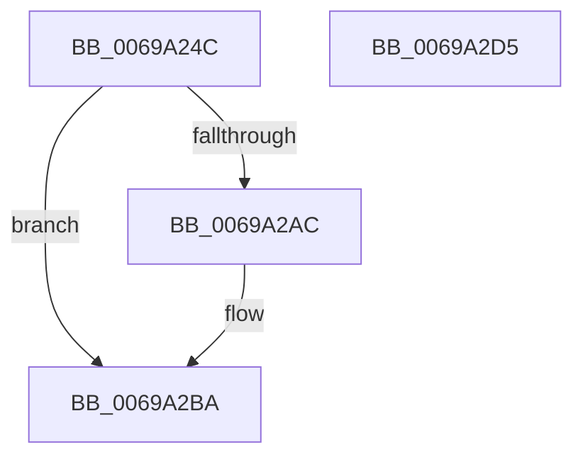

# MiStartDpcZeroingRound

- RVA: `0x0069A24C`–`0x0069A2D6` (길이 `138` bytes)
- VA: `0x000000014069A24C`
- 실행 섹션: `.text`
- PDB 이름 있음: `예`; PDB Function 태그: `아니요`
- unwind 정보 RVA: `0x0005FD94`
- 디코드: `34`개 명령, `138/138` bytes 표시
- 미해석 바이트: `0` (있으면 어셈블리에 `.byte`로 보존)

> 이 문서는 커널 이미지의 기계어와 PDB 기호를 분석해 생성했습니다. 4번과 5번은 함수 원형과 자료형을 바이너리 사용 방식에서 추정한 C 해석이며 원본 소스 복구 결과는 아닙니다.

## 1. Dependencies

- 직접 호출 지점: **2**; 고유 호출 대상: **2**
- 직접 호출자로 확인된 함수: **1**
- RIP 상대 이미지 참조: **0**

### Outgoing calls
- `0x0069A268` → [MiInitializeZeroEngineCurrentPassDpcAffinity](MiInitializeZeroEngineCurrentPassDpcAffinity_function_00699F04.md) (function, `0x00699F04`)
- `0x0069A29C` → [KeQueryPerformanceCounter](../37/KeQueryPerformanceCounter_function_0037E7E0.md) (function, `0x0037E7E0`)

### Direct callers
- [MiZeroPageCalibrateDpc](MiZeroPageCalibrateDpc_function_0069AA90.md) at `0x0069ABEF`

### Static image references
- 디코드된 RIP-relative 메모리 참조가 없습니다.

## 2. Other-region calls and transfers

- 다른 실행 섹션으로 향하는 call: **0**
- 별도 외부 분기/꼬리 이동을 확인하지 못했습니다.

## 3. Assembly (complete function range)

```asm
0069A24C  48 89 5C 24 10                  mov qword ptr [rsp + 0x10], rbx
0069A251  48 89 74 24 18                  mov qword ptr [rsp + 0x18], rsi
0069A256  57                              push rdi
0069A257  48 83 EC 20                     sub rsp, 0x20
0069A25B  8B 99 C0 00 00 00               mov ebx, dword ptr [rcx + 0xc0]
0069A261  48 8B F9                        mov rdi, rcx
0069A264  FF C3                           inc ebx
0069A266  8B D3                           mov edx, ebx
0069A268  E8 97 FC FF FF                  call 0x140699f04
0069A26D  48 83 64 24 30 00               and qword ptr [rsp + 0x30], 0
0069A273  48 8D 4C 24 30                  lea rcx, [rsp + 0x30]
0069A278  8B F0                           mov esi, eax
0069A27A  44 8B C3                        mov r8d, ebx
0069A27D  48 8B 87 18 01 00 00            mov rax, qword ptr [rdi + 0x118]
0069A284  33 D2                           xor edx, edx
0069A286  49 F7 F0                        div r8
0069A289  48 25 00 F0 FF FF               and rax, 0xfffffffffffff000
0069A28F  48 89 87 28 01 00 00            mov qword ptr [rdi + 0x128], rax
0069A296  89 9F 80 00 00 00               mov dword ptr [rdi + 0x80], ebx
0069A29C  E8 3F 45 CE FF                  call 0x14037e7e0
0069A2A1  48 81 7C 24 30 80 96 98 00      cmp qword ptr [rsp + 0x30], 0x989680
0069A2AA  74 0E                           je 0x14069a2ba
0069A2AC  48 69 C0 80 96 98 00            imul rax, rax, 0x989680
0069A2B3  48 99                           cqo
0069A2B5  48 F7 7C 24 30                  idiv qword ptr [rsp + 0x30]
0069A2BA  48 89 47 10                     mov qword ptr [rdi + 0x10], rax
0069A2BE  F0 83 0C 24 00                  lock or dword ptr [rsp], 0
0069A2C3  48 8B 5C 24 38                  mov rbx, qword ptr [rsp + 0x38]
0069A2C8  8B C6                           mov eax, esi
0069A2CA  48 8B 74 24 40                  mov rsi, qword ptr [rsp + 0x40]
0069A2CF  48 83 C4 20                     add rsp, 0x20
0069A2D3  5F                              pop rdi
0069A2D4  C3                              ret
0069A2D5  CC                              int3
```

## 4. C-style interpretation (structured pseudocode)

```c
__int64 __fastcall MiStartDpcZeroingRound(__int64 a1)
{
    __int64 result;
    __int64 v_rbx;
    __int64 v_rsp;
    unsigned int v_stack_m28;
    unsigned __int64 v_stack_p10;
    unsigned __int64 v_stack_p18;
    unsigned __int64 v_stack_p8;

    v_stack_p10 = v_rbx;
    v_stack_p18 = v_rsi;
    v_rsp = (v_rsp) - (32);
    v_rbx = (unsigned int)(((unsigned int)(*(unsigned int *)(a1 + 192))) + 1);
    result = MiInitializeZeroEngineCurrentPassDpcAffinity(a1, (unsigned int)((unsigned int)(v_rbx)), a3, a4);
    a2 = 0;
    result = (*(unsigned __int64 *)(a1 + 280)) & (0xFFFFFFFFFFFFF000ULL);
    *(unsigned __int64 *)(a1 + 296) = result;
    *(unsigned int *)(a1 + 128) = (unsigned int)(v_rbx);
    result = KeQueryPerformanceCounter(v_stack_p8, a2, (unsigned int)((unsigned int)(v_rbx)), a4);
    if (v_stack_p8 != 0x989680ULL) {
        result = (result) * (result);
    }
    *(unsigned __int64 *)(a1 + 16) = result;
    v_rsp = (v_rsp) + (32);
    return (unsigned int)((unsigned int)((unsigned int)((unsigned int)(result))));
}
```

## 5. (Beta) C Style

```c
int64_t MiStartDpcZeroingRound(void *Arg1)
{
    uint8_t *arg1 = (uint8_t *)Arg1;

    int64_t result;
    int64_t local_rbx;
    int64_t local_rsp;
    uint32_t v_stack_m28;
    uint64_t v_stack_p10;
    uint64_t v_stack_p18;
    uint64_t v_stack_p8;

    v_stack_p10 = local_rbx;
    v_stack_p18 = local_rsi;
    local_rsp = (local_rsp) - (32);
    local_rbx = (uint32_t)(((uint32_t)(*(uint32_t *)(arg1 + 0xC0))) + 1);
    result = MiInitializeZeroEngineCurrentPassDpcAffinity(Arg1, (uint32_t)((uint32_t)(local_rbx)), a3, a4);
    a2 = 0;
    result = (*(uint64_t *)(arg1 + 0x118)) & (0xFFFFFFFFFFFFF000ULL);
    *(uint64_t *)(arg1 + 0x128) = result;
    *(uint32_t *)(arg1 + 0x80) = (uint32_t)(local_rbx);
    result = KeQueryPerformanceCounter(v_stack_p8, a2, (uint32_t)((uint32_t)(local_rbx)), a4);
    if (v_stack_p8 != 0x989680ULL) {
        result = (result) * (result);
    }
    *(uint64_t *)(arg1 + 0x10) = result;
    local_rsp = (local_rsp) + (32);
    return (uint32_t)((uint32_t)((uint32_t)((uint32_t)(result))));
}
```

### 관측된 메모리 오프셋

구조체 형식이 확인되지 않은 접근은 인자 기준의 오프셋으로만 기록했습니다.

| 기준 인자 | 오프셋 표현 | 폭 (bit) | 접근 |
|---|---:|---:|---|
| `Arg1` | `+ 0x10` | `64` | `W` |
| `Arg1` | `+ 0x80` | `32` | `W` |
| `Arg1` | `+ 0xC0` | `32` | `R` |
| `Arg1` | `+ 0x118` | `64` | `R` |
| `Arg1` | `+ 0x128` | `64` | `W` |

## 6. Execution-region graph

[열기: 2D/3D 그래프와 함수 탐색 컨트롤 패널](../../../control-panel.html?section=text&rva=0x0069A24C&view=graph)

- 2D 그래프는 위에서 아래로 흐르고, 3D 그래프는 빈 공간을 드래그해 회전합니다. Shift+드래그는 이동, 휠은 확대·축소, 함수 노드 선택은 대상 보고서 이동입니다.

### Static fallback


