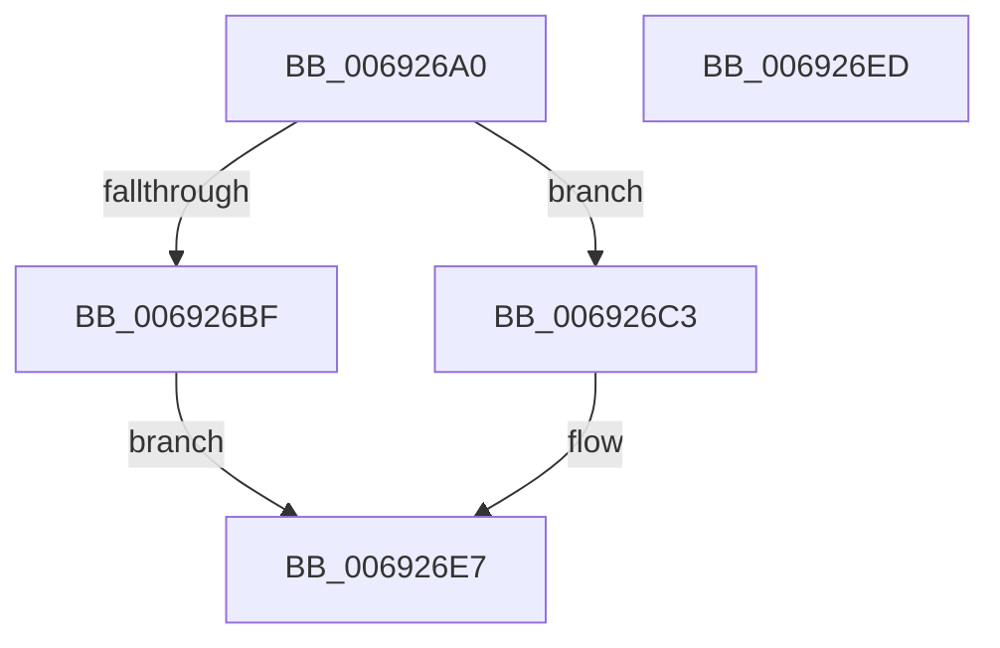

# MiStoreChargeReservedPages

- RVA: `0x006926A0`–`0x006926EE` (길이 `78` bytes)
- VA: `0x00000001406926A0`
- 실행 섹션: `.text`
- PDB 이름 있음: `예`; PDB Function 태그: `아니요`
- unwind 정보 RVA: `0x0005CF00`
- 디코드: `22`개 명령, `78/78` bytes 표시
- 미해석 바이트: `0` (있으면 어셈블리에 `.byte`로 보존)

> 이 문서는 커널 이미지의 기계어와 PDB 기호를 분석해 생성했습니다. 4번과 5번은 함수 원형과 자료형을 바이너리 사용 방식에서 추정한 C 해석이며 원본 소스 복구 결과는 아닙니다.

## 1. Dependencies

- 직접 호출 지점: **3**; 고유 호출 대상: **3**
- 직접 호출자로 확인된 함수: **1**
- RIP 상대 이미지 참조: **1**

### Outgoing calls
- `0x006926B6` → [MiAcquireNonPagedResources](../28/MiAcquireNonPagedResources_function_00286C60.md) (function, `0x00286C60`)
- `0x006926CA` → [ExAcquireSpinLockExclusive](../24/ExAcquireSpinLockExclusive_function_00248690.md) (function, `0x00248690`)
- `0x006926DD` → [MiReleaseSpinLockExclusive](../24/MiReleaseSpinLockExclusive_function_002482C0.md) (function, `0x002482C0`)

### Direct callers
- [MmStoreRegister](../../page/80/MmStoreRegister_function_0080E6D8.md) at `0x0080E84A`

### Static image references
- `0x006926C3` → RVA `0x00E30040` (`.data`; read)

## 2. Other-region calls and transfers

- 다른 실행 섹션으로 향하는 call: **0**
- 별도 외부 분기/꼬리 이동을 확인하지 못했습니다.

## 3. Assembly (complete function range)

```asm
006926A0  40 53                           push rbx
006926A2  48 83 EC 20                     sub rsp, 0x20
006926A6  41 B9 06 00 00 00               mov r9d, 6
006926AC  45 33 C0                        xor r8d, r8d
006926AF  48 8B D9                        mov rbx, rcx
006926B2  41 8D 51 1A                     lea edx, [r9 + 0x1a]
006926B6  E8 A5 45 BF FF                  call 0x140286c60
006926BB  85 C0                           test eax, eax
006926BD  79 04                           jns 0x1406926c3
006926BF  33 C0                           xor eax, eax
006926C1  EB 24                           jmp 0x1406926e7
006926C3  48 8D 0D 76 D9 79 00            lea rcx, [rip + 0x79d976]
006926CA  E8 C1 5F BB FF                  call 0x140248690
006926CF  F0 83 4B 04 04                  lock or dword ptr [rbx + 4], 4
006926D4  8A D0                           mov dl, al
006926D6  48 8D 0D 63 D9 79 00            lea rcx, [rip + 0x79d963]
006926DD  E8 DE 5B BB FF                  call 0x1402482c0
006926E2  B8 01 00 00 00                  mov eax, 1
006926E7  48 83 C4 20                     add rsp, 0x20
006926EB  5B                              pop rbx
006926EC  C3                              ret
006926ED  CC                              int3
```

## 4. C-style interpretation (structured pseudocode)

```c
__int64 __fastcall MiStoreChargeReservedPages(__int64 a1, __int64 a2, int a3)
{
    __int64 result;
    __int64 v_rsp;

    v_rsp = (v_rsp) - (32);
    a3 = 0;
    result = MiAcquireNonPagedResources(a1, 6 + 26, a3, 6);
    if (!sign_flag) goto loc_006926C3;
    result = 0;
    goto loc_006926E7;
loc_006926C3:
    result = ExAcquireSpinLockExclusive(v_rip + 7985526, 6 + 26, a3, 6);
    result = MiReleaseSpinLockExclusive(v_rip + 7985507, (unsigned __int8)(result), a3, 6);
loc_006926E7:
    v_rsp = (v_rsp) + (32);
    return 1;
}
```

## 5. (Beta) C Style

```c
int64_t MiStoreChargeReservedPages(void *Arg1, int64_t Arg2, int32_t Arg3)
{
    uint8_t *arg1 = (uint8_t *)Arg1;

    int64_t result;
    int64_t local_rsp;

    local_rsp = (local_rsp) - (32);
    Arg3 = 0;
    result = MiAcquireNonPagedResources(Arg1, 6 + 26, Arg3, 6);
    if (!sign_flag) goto loc_006926C3;
    result = 0;
    goto loc_006926E7;
loc_006926C3:
    result = ExAcquireSpinLockExclusive(v_rip + 7985526, 6 + 26, Arg3, 6);
    result = MiReleaseSpinLockExclusive(v_rip + 7985507, (uint8_t)(result), Arg3, 6);
loc_006926E7:
    local_rsp = (local_rsp) + (32);
    return 1;
}
```

### 관측된 메모리 오프셋

구조체 형식이 확인되지 않은 접근은 인자 기준의 오프셋으로만 기록했습니다.

| 기준 인자 | 오프셋 표현 | 폭 (bit) | 접근 |
|---|---:|---:|---|
| `Arg1` | `+ 0x4` | `32` | `R/W` |

## 6. Execution-region graph

[열기: 2D/3D 그래프와 함수 탐색 컨트롤 패널](../../../control-panel.html?section=text&rva=0x006926A0&view=graph)

- 2D 그래프는 위에서 아래로 흐르고, 3D 그래프는 빈 공간을 드래그해 회전합니다. Shift+드래그는 이동, 휠은 확대·축소, 함수 노드 선택은 대상 보고서 이동입니다.

### Static fallback


