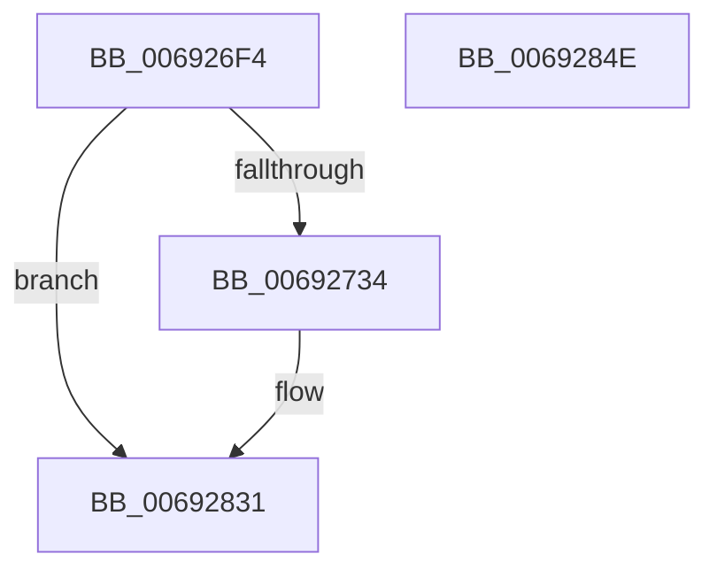

# MiStoreDeletePartition

- RVA: `0x006926F4`–`0x0069284F` (길이 `347` bytes)
- VA: `0x00000001406926F4`
- 실행 섹션: `.text`
- PDB 이름 있음: `예`; PDB Function 태그: `아니요`
- unwind 정보 RVA: `0x000D91F0`
- 디코드: `81`개 명령, `347/347` bytes 표시
- 미해석 바이트: `0` (있으면 어셈블리에 `.byte`로 보존)

> 이 문서는 커널 이미지의 기계어와 PDB 기호를 분석해 생성했습니다. 4번과 5번은 함수 원형과 자료형을 바이너리 사용 방식에서 추정한 C 해석이며 원본 소스 복구 결과는 아닙니다.

## 1. Dependencies

- 직접 호출 지점: **12**; 고유 호출 대상: **11**
- 직접 호출자로 확인된 함수: **1**
- RIP 상대 이미지 참조: **1**

### Outgoing calls
- `0x00692720` → [memset](../6C/memset_function_006C6C40.md) (function, `0x006C6C40`)
- `0x00692786` → [MiQueueSyncModifiedWriterApc](../4B/MiQueueSyncModifiedWriterApc_function_004B70B8.md) (function, `0x004B70B8`)
- `0x0069279C` → [KeWaitForSingleObject](../20/KeWaitForSingleObject_function_0020E6B0.md) (function, `0x0020E6B0`)
- `0x006927A8` → [MmStoreFlushOutstandingEvictions](../4B/MmStoreFlushOutstandingEvictions_function_004B769C.md) (function, `0x004B769C`)
- `0x006927B7` → [ExAcquireSpinLockExclusive](../24/ExAcquireSpinLockExclusive_function_00248690.md) (function, `0x00248690`)
- `0x006927CA` → [KeSetEvent](../33/KeSetEvent_function_0033F310.md) (function, `0x0033F310`)
- `0x006927D4` → [MiReleaseSpinLockExclusive](../24/MiReleaseSpinLockExclusive_function_002482C0.md) (function, `0x002482C0`)
- `0x006927EF` → [KeWaitForSingleObject](../20/KeWaitForSingleObject_function_0020E6B0.md) (function, `0x0020E6B0`)
- `0x00692800` → [ObfDereferenceObjectWithTag](../2F/ObfDereferenceObjectWithTag_function_002F78E0.md) (function, `0x002F78E0`)
- `0x00692815` → [ExFreePoolWithTag](../../poolcode/B8/ExFreePoolWithTag_function_00B82870.md) (function, `0x00B82870`)
- `0x00692824` → [MiStoreDrainWriteSupports](../47/MiStoreDrainWriteSupports_function_0047EE3C.md) (function, `0x0047EE3C`)
- `0x0069282C` → [MiStoreReleaseReservedPageCharges](MiStoreReleaseReservedPageCharges_function_00693054.md) (function, `0x00693054`)

### Direct callers
- [MiDrainCrossPartitionUsage](MiDrainCrossPartitionUsage_function_00690984.md) at `0x00690AF1`

### Static image references
- `0x00692758` → RVA `0x006930A0` (`MiStoreRundownWritesApc`; read)

## 2. Other-region calls and transfers

- 다른 실행 섹션으로 향하는 call: **1**
  - `0x00692815` → [ExFreePoolWithTag](../../poolcode/B8/ExFreePoolWithTag_function_00B82870.md) (`.text` → `POOLCODE`)
- 별도 외부 분기/꼬리 이동을 확인하지 못했습니다.

## 3. Assembly (complete function range)

```asm
006926F4  48 8B C4                        mov rax, rsp
006926F7  48 89 58 08                     mov qword ptr [rax + 8], rbx
006926FB  48 89 70 10                     mov qword ptr [rax + 0x10], rsi
006926FF  48 89 78 18                     mov qword ptr [rax + 0x18], rdi
00692703  4C 89 70 20                     mov qword ptr [rax + 0x20], r14
00692707  55                              push rbp
00692708  48 8D 68 A1                     lea rbp, [rax - 0x5f]
0069270C  48 81 EC D0 00 00 00            sub rsp, 0xd0
00692713  33 D2                           xor edx, edx
00692715  48 8B F1                        mov rsi, rcx
00692718  48 8D 4D F7                     lea rcx, [rbp - 9]
0069271C  44 8D 42 58                     lea r8d, [rdx + 0x58]
00692720  E8 1B 45 03 00                  call 0x1406c6c40
00692725  8B 86 B4 04 00 00               mov eax, dword ptr [rsi + 0x4b4]
0069272B  83 F8 FF                        cmp eax, -1
0069272E  0F 84 FD 00 00 00               je 0x140692831
00692734  48 8D 45 BF                     lea rax, [rbp - 0x41]
00692738  48 C7 45 B7 00 00 06 00         mov qword ptr [rbp - 0x49], 0x60000
00692740  48 89 45 C7                     mov qword ptr [rbp - 0x39], rax
00692744  4C 8D 4D B7                     lea r9, [rbp - 0x49]
00692748  48 8D 45 BF                     lea rax, [rbp - 0x41]
0069274C  48 C7 45 CF 00 00 06 00         mov qword ptr [rbp - 0x31], 0x60000
00692754  48 89 45 BF                     mov qword ptr [rbp - 0x41], rax
00692758  4C 8D 05 41 09 00 00            lea r8, [rip + 0x941]
0069275F  48 8D 45 D7                     lea rax, [rbp - 0x29]
00692763  48 89 75 E7                     mov qword ptr [rbp - 0x19], rsi
00692767  48 89 45 DF                     mov qword ptr [rbp - 0x21], rax
0069276B  48 8D 55 F7                     lea rdx, [rbp - 9]
0069276F  48 8D 45 D7                     lea rax, [rbp - 0x29]
00692773  48 8B CE                        mov rcx, rsi
00692776  48 89 45 D7                     mov qword ptr [rbp - 0x29], rax
0069277A  45 33 F6                        xor r14d, r14d
0069277D  48 8D 45 CF                     lea rax, [rbp - 0x31]
00692781  48 89 44 24 20                  mov qword ptr [rsp + 0x20], rax
00692786  E8 2D 49 E2 FF                  call 0x1404b70b8
0069278B  45 33 C9                        xor r9d, r9d
0069278E  4C 89 74 24 20                  mov qword ptr [rsp + 0x20], r14
00692793  45 33 C0                        xor r8d, r8d
00692796  48 8D 4D B7                     lea rcx, [rbp - 0x49]
0069279A  33 D2                           xor edx, edx
0069279C  E8 0F BF B7 FF                  call 0x14020e6b0
006927A1  48 8B 8E B8 00 00 00            mov rcx, qword ptr [rsi + 0xb8]
006927A8  E8 EF 4E E2 FF                  call 0x1404b769c
006927AD  48 8D BE A8 06 00 00            lea rdi, [rsi + 0x6a8]
006927B4  48 8B CF                        mov rcx, rdi
006927B7  E8 D4 5E BB FF                  call 0x140248690
006927BC  48 8D 8E 48 05 00 00            lea rcx, [rsi + 0x548]
006927C3  45 33 C0                        xor r8d, r8d
006927C6  33 D2                           xor edx, edx
006927C8  8A D8                           mov bl, al
006927CA  E8 41 CB CA FF                  call 0x14033f310
006927CF  8A D3                           mov dl, bl
006927D1  48 8B CF                        mov rcx, rdi
006927D4  E8 E7 5A BB FF                  call 0x1402482c0
006927D9  48 8B 8E 28 05 00 00            mov rcx, qword ptr [rsi + 0x528]
006927E0  41 8D 56 1A                     lea edx, [r14 + 0x1a]
006927E4  45 33 C9                        xor r9d, r9d
006927E7  4C 89 74 24 20                  mov qword ptr [rsp + 0x20], r14
006927EC  45 33 C0                        xor r8d, r8d
006927EF  E8 BC BE B7 FF                  call 0x14020e6b0
006927F4  48 8B 8E 28 05 00 00            mov rcx, qword ptr [rsi + 0x528]
006927FB  BA 4D 6D 50 66                  mov edx, 0x66506d4d
00692800  E8 DB 50 C6 FF                  call 0x1402f78e0
00692805  48 8B 8E 88 05 00 00            mov rcx, qword ptr [rsi + 0x588]
0069280C  33 D2                           xor edx, edx
0069280E  4C 89 B6 28 05 00 00            mov qword ptr [rsi + 0x528], r14
00692815  E8 56 00 4F 00                  call 0x140b82870
0069281A  48 8B CE                        mov rcx, rsi
0069281D  4C 89 B6 88 05 00 00            mov qword ptr [rsi + 0x588], r14
00692824  E8 13 C6 DE FF                  call 0x14047ee3c
00692829  48 8B CE                        mov rcx, rsi
0069282C  E8 23 08 00 00                  call 0x140693054
00692831  4C 8D 9C 24 D0 00 00 00         lea r11, [rsp + 0xd0]
00692839  49 8B 5B 10                     mov rbx, qword ptr [r11 + 0x10]
0069283D  49 8B 73 18                     mov rsi, qword ptr [r11 + 0x18]
00692841  49 8B 7B 20                     mov rdi, qword ptr [r11 + 0x20]
00692845  4D 8B 73 28                     mov r14, qword ptr [r11 + 0x28]
00692849  49 8B E3                        mov rsp, r11
0069284C  5D                              pop rbp
0069284D  C3                              ret
0069284E  CC                              int3
```

## 4. C-style interpretation (structured pseudocode)

```c
__int64 __fastcall MiStoreDeletePartition(__int64 a1, int a2)
{
    __int64 result;
    __int64 v_r14;
    __int64 v_rbx;
    __int64 v_rdi;
    __int64 v_rsp;
    unsigned __int64 v_stack_m8;
    unsigned __int64 v_stack_mB8;

    *(unsigned __int64 *)(v_rsp + 8) = v_rbx;
    *(unsigned __int64 *)(v_rsp + 16) = v_rsi;
    *(unsigned __int64 *)(v_rsp + 24) = v_rdi;
    *(unsigned __int64 *)(v_rsp + 32) = v_r14;
    v_rsp = (v_rsp) - (208);
    a2 = 0;
    result = memset(v_rsp - 95 - 9, a2, a2 + 88, a4);
    result = (unsigned int)(*(unsigned int *)(a1 + 1204));
    if (((unsigned int)((unsigned int)(*(unsigned int *)(a1 + 1204)))) != -1) {
        result = v_rsp - 95 - 65;
        *(unsigned __int64 *)(v_rsp - 95 - 73) = 0x60000ULL;
        *(unsigned __int64 *)(v_rsp - 95 - 57) = result;
        a4 = v_rsp - 95 - 73;
        result = v_rsp - 95 - 65;
        *(unsigned __int64 *)(v_rsp - 95 - 49) = 0x60000ULL;
        *(unsigned __int64 *)(v_rsp - 95 - 65) = result;
        a3 = v_rip + 2369;
        result = v_rsp - 95 - 41;
        *(unsigned __int64 *)(v_rsp - 95 - 25) = a1;
        *(unsigned __int64 *)(v_rsp - 95 - 33) = result;
        a2 = v_rsp - 95 - 9;
        result = v_rsp - 95 - 41;
        a1 = a1;
        *(unsigned __int64 *)(v_rsp - 95 - 41) = result;
        v_r14 = 0;
        result = v_rsp - 95 - 49;
        v_stack_mB8 = result;
        result = MiQueueSyncModifiedWriterApc(a1, a2, a3, a4);
        a4 = 0;
        v_stack_mB8 = 0;
        a3 = 0;
        a1 = v_rsp - 95 - 73;
        a2 = 0;
        result = KeWaitForSingleObject(a1, a2, a3, a4);
        a1 = *(unsigned __int64 *)(a1 + 184);
        result = MmStoreFlushOutstandingEvictions(a1, a2, a3, a4);
        v_rdi = a1 + 1704;
        a1 = v_rdi;
        result = ExAcquireSpinLockExclusive(a1, a2, a3, a4);
        a1 = a1 + 1352;
        a3 = 0;
        a2 = 0;
        v_rbx = (unsigned __int8)(result);
        result = KeSetEvent(a1, a2, a3, a4);
        a2 = (unsigned __int8)(v_rbx);
        a1 = v_rdi;
        result = MiReleaseSpinLockExclusive(a1, a2, a3, a4);
        a1 = *(unsigned __int64 *)(a1 + 1320);
        a2 = v_r14 + 26;
        a4 = 0;
        v_stack_mB8 = 0;
        a3 = 0;
        result = KeWaitForSingleObject(a1, a2, a3, a4);
        a1 = *(unsigned __int64 *)(a1 + 1320);
        a2 = 0x66506D4DULL;
        result = ObfDereferenceObjectWithTag(a1, a2, a3, a4);
        a1 = *(unsigned __int64 *)(a1 + 1416);
        a2 = 0;
        *(unsigned __int64 *)(a1 + 1320) = 0;
        result = ExFreePoolWithTag(a1, a2, a3, a4);
        a1 = a1;
        *(unsigned __int64 *)(a1 + 1416) = 0;
        result = MiStoreDrainWriteSupports(a1, a2, a3, a4);
        a1 = a1;
        result = MiStoreReleaseReservedPageCharges(a1, a2, a3, a4);
    }
    return result;
}
```

## 5. (Beta) C Style

```c
int64_t MiStoreDeletePartition(void *Arg1, int32_t Arg2)
{
    uint8_t *arg1 = (uint8_t *)Arg1;

    int64_t result;
    int64_t local_r14;
    int64_t local_rbx;
    int64_t local_rdi;
    int64_t local_rsp;
    uint64_t v_stack_m8;
    uint64_t v_stack_mB8;

    *(uint64_t *)(local_rsp + 0x8) = local_rbx;
    *(uint64_t *)(local_rsp + 0x10) = local_rsi;
    *(uint64_t *)(local_rsp + 0x18) = local_rdi;
    *(uint64_t *)(local_rsp + 0x20) = local_r14;
    local_rsp = (local_rsp) - (208);
    Arg2 = 0;
    result = memset(local_rsp - 95 - 9, Arg2, Arg2 + 88, a4);
    result = (uint32_t)(*(uint32_t *)(arg1 + 0x4B4));
    if (((uint32_t)((uint32_t)(*(uint32_t *)(arg1 + 0x4B4)))) != -1) {
        result = local_rsp - 95 - 65;
        *(uint64_t *)(local_rsp - 0x5F - 0x49) = 0x60000ULL;
        *(uint64_t *)(local_rsp - 0x5F - 0x39) = result;
        a4 = local_rsp - 95 - 73;
        result = local_rsp - 95 - 65;
        *(uint64_t *)(local_rsp - 0x5F - 0x31) = 0x60000ULL;
        *(uint64_t *)(local_rsp - 0x5F - 0x41) = result;
        a3 = v_rip + 2369;
        result = local_rsp - 95 - 41;
        *(void **)(local_rsp - 0x5F - 0x19) = Arg1;
        *(uint64_t *)(local_rsp - 0x5F - 0x21) = result;
        Arg2 = local_rsp - 95 - 9;
        result = local_rsp - 95 - 41;
        Arg1 = Arg1;
        *(uint64_t *)(local_rsp - 0x5F - 0x29) = result;
        local_r14 = 0;
        result = local_rsp - 95 - 49;
        v_stack_mB8 = result;
        result = MiQueueSyncModifiedWriterApc(Arg1, Arg2, a3, a4);
        a4 = 0;
        v_stack_mB8 = 0;
        a3 = 0;
        Arg1 = local_rsp - 95 - 73;
        Arg2 = 0;
        result = KeWaitForSingleObject(Arg1, Arg2, a3, a4);
        Arg1 = *(uint64_t *)(arg1 + 0xB8);
        result = MmStoreFlushOutstandingEvictions(Arg1, Arg2, a3, a4);
        local_rdi = Arg1 + 1704;
        Arg1 = local_rdi;
        result = ExAcquireSpinLockExclusive(Arg1, Arg2, a3, a4);
        Arg1 = Arg1 + 1352;
        a3 = 0;
        Arg2 = 0;
        local_rbx = (uint8_t)(result);
        result = KeSetEvent(Arg1, Arg2, a3, a4);
        Arg2 = (uint8_t)(local_rbx);
        Arg1 = local_rdi;
        result = MiReleaseSpinLockExclusive(Arg1, Arg2, a3, a4);
        Arg1 = *(uint64_t *)(arg1 + 0x528);
        Arg2 = local_r14 + 26;
        a4 = 0;
        v_stack_mB8 = 0;
        a3 = 0;
        result = KeWaitForSingleObject(Arg1, Arg2, a3, a4);
        Arg1 = *(uint64_t *)(arg1 + 0x528);
        Arg2 = 0x66506D4DULL;
        result = ObfDereferenceObjectWithTag(Arg1, Arg2, a3, a4);
        Arg1 = *(uint64_t *)(arg1 + 0x588);
        Arg2 = 0;
        *(uint64_t *)(arg1 + 0x528) = 0;
        result = ExFreePoolWithTag(Arg1, Arg2, a3, a4);
        Arg1 = Arg1;
        *(uint64_t *)(arg1 + 0x588) = 0;
        result = MiStoreDrainWriteSupports(Arg1, Arg2, a3, a4);
        Arg1 = Arg1;
        result = MiStoreReleaseReservedPageCharges(Arg1, Arg2, a3, a4);
    }
    return result;
}
```

### 관측된 메모리 오프셋

구조체 형식이 확인되지 않은 접근은 인자 기준의 오프셋으로만 기록했습니다.

| 기준 인자 | 오프셋 표현 | 폭 (bit) | 접근 |
|---|---:|---:|---|
| `Arg1` | `+ 0xB8` | `64` | `R` |
| `Arg1` | `+ 0x4B4` | `32` | `R` |
| `Arg1` | `+ 0x528` | `64` | `R` |
| `Arg1` | `+ 0x528` | `64` | `W` |
| `Arg1` | `+ 0x548` | `64` | `R` |
| `Arg1` | `+ 0x588` | `64` | `R` |
| `Arg1` | `+ 0x588` | `64` | `W` |
| `Arg1` | `+ 0x6A8` | `64` | `R` |

## 6. Execution-region graph

[열기: 2D/3D 그래프와 함수 탐색 컨트롤 패널](../../../control-panel.html?section=text&rva=0x006926F4&view=graph)

- 2D 그래프는 위에서 아래로 흐르고, 3D 그래프는 빈 공간을 드래그해 회전합니다. Shift+드래그는 이동, 휠은 확대·축소, 함수 노드 선택은 대상 보고서 이동입니다.

### Static fallback


