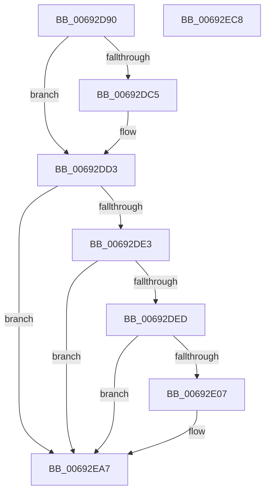

# MiStoreLogDiscardPoisonedPage

- RVA: `0x00692D90`–`0x00692EC9` (길이 `313` bytes)
- VA: `0x0000000140692D90`
- 실행 섹션: `.text`
- PDB 이름 있음: `예`; PDB Function 태그: `아니요`
- unwind 정보 RVA: `0x000D1DCC`
- 디코드: `76`개 명령, `313/313` bytes 표시
- 미해석 바이트: `0` (있으면 어셈블리에 `.byte`로 보존)

> 이 문서는 커널 이미지의 기계어와 PDB 기호를 분석해 생성했습니다. 4번과 5번은 함수 원형과 자료형을 바이너리 사용 방식에서 추정한 C 해석이며 원본 소스 복구 결과는 아닙니다.

## 1. Dependencies

- 직접 호출 지점: **3**; 고유 호출 대상: **3**
- 직접 호출자로 확인된 함수: **1**
- RIP 상대 이미지 참조: **3**

### Outgoing calls
- `0x00692DFA` → [tlgKeywordOn](../42/tlgKeywordOn_function_0042EAA0.md) (function, `0x0042EAA0`)
- `0x00692EA2` → [tlgWriteEx_EtwWriteEx](../4A/tlgWriteEx_EtwWriteEx_function_004AA348.md) (function, `0x004AA348`)
- `0x00692EAE` → [_security_check_cookie](../6A/_security_check_cookie_function_006AC640.md) (function, `0x006AC640`)

### Direct callers
- [MiStoreDiscardPoisonedPage](MiStoreDiscardPoisonedPage_function_00692858.md) at `0x00692D57`

### Static image references
- `0x00692DA7` → RVA `0x00E0A740` (`.data`; read)
- `0x00692DD3` → RVA `0x00E37618` (`.data`; read)
- `0x00692E82` → RVA `0x00059CE2` (`.rdata`; read)

## 2. Other-region calls and transfers

- 다른 실행 섹션으로 향하는 call: **0**
- 별도 외부 분기/꼬리 이동을 확인하지 못했습니다.

## 3. Assembly (complete function range)

```asm
00692D90  48 89 5C 24 10                  mov qword ptr [rsp + 0x10], rbx
00692D95  48 89 7C 24 18                  mov qword ptr [rsp + 0x18], rdi
00692D9A  55                              push rbp
00692D9B  48 8D 6C 24 B1                  lea rbp, [rsp - 0x4f]
00692DA0  48 81 EC 00 01 00 00            sub rsp, 0x100
00692DA7  48 8B 05 92 79 77 00            mov rax, qword ptr [rip + 0x777992]
00692DAE  48 33 C4                        xor rax, rsp
00692DB1  48 89 45 3F                     mov qword ptr [rbp + 0x3f], rax
00692DB5  8B 5D 7F                        mov ebx, dword ptr [rbp + 0x7f]
00692DB8  49 8B F8                        mov rdi, r8
00692DBB  4C 8B DA                        mov r11, rdx
00692DBE  4C 8B D1                        mov r10, rcx
00692DC1  85 DB                           test ebx, ebx
00692DC3  75 0E                           jne 0x140692dd3
00692DC5  F0 FF 81 B4 06 00 00            lock inc dword ptr [rcx + 0x6b4]
00692DCC  48 89 91 B8 06 00 00            mov qword ptr [rcx + 0x6b8], rdx
00692DD3  4C 8B 05 3E 48 7A 00            mov r8, qword ptr [rip + 0x7a483e]
00692DDA  4D 85 C0                        test r8, r8
00692DDD  0F 84 C4 00 00 00               je 0x140692ea7
00692DE3  41 83 38 05                     cmp dword ptr [r8], 5
00692DE7  0F 86 BA 00 00 00               jbe 0x140692ea7
00692DED  48 BA 02 00 00 00 00 40 00 00   movabs rdx, 0x400000000002
00692DF7  49 8B C8                        mov rcx, r8
00692DFA  E8 A1 BC D9 FF                  call 0x14042eaa0
00692DFF  84 C0                           test al, al
00692E01  0F 84 A0 00 00 00               je 0x140692ea7
00692E07  83 65 EB 00                     and dword ptr [rbp - 0x15], 0
00692E0B  48 8D 45 8F                     lea rax, [rbp - 0x71]
00692E0F  83 65 FB 00                     and dword ptr [rbp - 5], 0
00692E13  BA 04 00 00 00                  mov edx, 4
00692E18  83 65 0B 00                     and dword ptr [rbp + 0xb], 0
00692E1C  83 65 1B 00                     and dword ptr [rbp + 0x1b], 0
00692E20  83 65 2B 00                     and dword ptr [rbp + 0x2b], 0
00692E24  83 65 3B 00                     and dword ptr [rbp + 0x3b], 0
00692E28  8D 4A 04                        lea ecx, [rdx + 4]
00692E2B  48 89 45 DF                     mov qword ptr [rbp - 0x21], rax
00692E2F  48 8D 45 93                     lea rax, [rbp - 0x6d]
00692E33  48 89 45 EF                     mov qword ptr [rbp - 0x11], rax
00692E37  48 8D 45 9F                     lea rax, [rbp - 0x61]
00692E3B  48 89 45 FF                     mov qword ptr [rbp - 1], rax
00692E3F  48 8D 45 A7                     lea rax, [rbp - 0x59]
00692E43  48 89 45 0F                     mov qword ptr [rbp + 0xf], rax
00692E47  41 0F B7 02                     movzx eax, word ptr [r10]
00692E4B  89 45 97                        mov dword ptr [rbp - 0x69], eax
00692E4E  48 8D 45 97                     lea rax, [rbp - 0x69]
00692E52  48 89 45 1F                     mov qword ptr [rbp + 0x1f], rax
00692E56  48 8D 45 AF                     lea rax, [rbp - 0x51]
00692E5A  48 89 45 2F                     mov qword ptr [rbp + 0x2f], rax
00692E5E  48 8D 45 BF                     lea rax, [rbp - 0x41]
00692E62  48 89 44 24 38                  mov qword ptr [rsp + 0x38], rax
00692E67  44 89 4D 93                     mov dword ptr [rbp - 0x6d], r9d
00692E6B  44 8D 4A FD                     lea r9d, [rdx - 3]
00692E6F  89 4C 24 30                     mov dword ptr [rsp + 0x30], ecx
00692E73  89 55 E7                        mov dword ptr [rbp - 0x19], edx
00692E76  89 55 F7                        mov dword ptr [rbp - 9], edx
00692E79  89 4D 07                        mov dword ptr [rbp + 7], ecx
00692E7C  89 4D 17                        mov dword ptr [rbp + 0x17], ecx
00692E7F  89 55 27                        mov dword ptr [rbp + 0x27], edx
00692E82  48 8D 15 59 6E 9C FF            lea rdx, [rip - 0x6391a7]
00692E89  89 4D 37                        mov dword ptr [rbp + 0x37], ecx
00692E8C  49 8B C8                        mov rcx, r8
00692E8F  89 5D 8F                        mov dword ptr [rbp - 0x71], ebx
00692E92  4C 89 5D 9F                     mov qword ptr [rbp - 0x61], r11
00692E96  48 89 7D A7                     mov qword ptr [rbp - 0x59], rdi
00692E9A  48 C7 45 AF 00 00 00 01         mov qword ptr [rbp - 0x51], 0x1000000
00692EA2  E8 A1 74 E1 FF                  call 0x1404aa348
00692EA7  48 8B 4D 3F                     mov rcx, qword ptr [rbp + 0x3f]
00692EAB  48 33 CC                        xor rcx, rsp
00692EAE  E8 8D 97 01 00                  call 0x1406ac640
00692EB3  4C 8D 9C 24 00 01 00 00         lea r11, [rsp + 0x100]
00692EBB  49 8B 5B 18                     mov rbx, qword ptr [r11 + 0x18]
00692EBF  49 8B 7B 20                     mov rdi, qword ptr [r11 + 0x20]
00692EC3  49 8B E3                        mov rsp, r11
00692EC6  5D                              pop rbp
00692EC7  C3                              ret
00692EC8  CC                              int3
```

## 4. C-style interpretation (structured pseudocode)

```c
__int64 __fastcall MiStoreLogDiscardPoisonedPage(__int64 a1, __int64 a2, __int64 a3, int a4, unsigned int a5)
{
    __int64 result;
    __int64 v_rsp;
    unsigned __int64 v_stack_m18;
    unsigned int v_stack_m1C;
    unsigned int v_stack_m20;
    unsigned __int64 v_stack_m28;
    unsigned int v_stack_m2C;
    unsigned int v_stack_m30;
    unsigned __int64 v_stack_m38;
    unsigned int v_stack_m3C;
    unsigned int v_stack_m40;
    unsigned __int64 v_stack_m48;
    unsigned int v_stack_m4C;
    unsigned int v_stack_m50;
    unsigned __int64 v_stack_m57;
    unsigned __int64 v_stack_m58;
    unsigned int v_stack_m5C;
    unsigned int v_stack_m60;
    unsigned __int64 v_stack_m68;
    unsigned int v_stack_m6C;
    unsigned int v_stack_m70;
    unsigned __int64 v_stack_m78;
    unsigned __int64 v_stack_m8;
    unsigned __int64 v_stack_m98;
    unsigned __int64 v_stack_mA8;
    unsigned __int64 v_stack_mB0;
    unsigned __int64 v_stack_mB8;
    unsigned int v_stack_mC0;
    unsigned __int64 v_stack_mC4;
    unsigned __int64 v_stack_mC8;
    unsigned __int64 v_stack_mD0;
    unsigned int v_stack_mD8;
    unsigned __int64 v_stack_p10;
    unsigned __int64 v_stack_p18;

    v_stack_p10 = v_rbx;
    v_stack_p18 = v_rdi;
    v_rsp = (v_rsp) - (256);
    result = (*(unsigned __int64 *)(v_rip + 7829906)) ^ (v_rsp);
    v_stack_m18 = result;
    if ((unsigned int)((unsigned int)(a5)) == 0) {
        *(unsigned __int64 *)(a1 + 1720) = a2;
    }
    if (*(unsigned __int64 *)(v_rip + 8013886) == 0) goto loc_00692EA7;
    if ((*(unsigned int *)(*(unsigned __int64 *)(v_rip + 8013886))) <= 5) goto loc_00692EA7;
    result = tlgKeywordOn(*(unsigned __int64 *)(v_rip + 8013886), a2, *(unsigned __int64 *)(v_rip + 8013886), a4);
    if ((unsigned __int8)(result) != 0) {
        result = v_stack_mC8;
        a2 = 4;
        a1 = a2 + 4;
        v_stack_m78 = result;
        result = v_stack_mC4;
        v_stack_m68 = result;
        result = v_stack_mB8;
        v_stack_m58 = result;
        result = v_stack_mB0;
        v_stack_m48 = result;
        result = *(unsigned __int16 *)(a1);
        v_stack_mC0 = (unsigned int)(result);
        result = v_stack_mC0;
        v_stack_m38 = result;
        result = v_stack_mA8;
        v_stack_m28 = result;
        result = v_stack_m98;
        v_stack_mD0 = result;
        v_stack_mC4 = a4;
        a4 = a2 - 3;
        v_stack_mD8 = (unsigned int)(a1);
        v_stack_m70 = (unsigned int)(a2);
        v_stack_m60 = (unsigned int)(a2);
        v_stack_m50 = (unsigned int)(a1);
        v_stack_m40 = (unsigned int)(a1);
        v_stack_m30 = (unsigned int)(a2);
        a2 = v_rip - 6525351;
        v_stack_m20 = (unsigned int)(a1);
        a1 = *(unsigned __int64 *)(v_rip + 8013886);
        v_stack_mC8 = (unsigned int)((unsigned int)(a5));
        v_stack_mB8 = a2;
        v_stack_mB0 = a3;
        v_stack_mA8 = 0x1000000ULL;
        result = tlgWriteEx_EtwWriteEx(a1, a2, *(unsigned __int64 *)(v_rip + 8013886), a4);
    }
    a1 = (v_stack_m18) ^ (v_rsp);
    result = _security_check_cookie(a1, a2, *(unsigned __int64 *)(v_rip + 8013886), a4);
    return result;
}
```

## 5. (Beta) C Style

```c
int64_t MiStoreLogDiscardPoisonedPage(void *Arg1, int64_t Arg2, int64_t Arg3, int32_t Arg4, uint32_t Arg5)
{
    uint8_t *arg1 = (uint8_t *)Arg1;

    int64_t result;
    int64_t local_rsp;
    uint64_t v_stack_m18;
    uint32_t v_stack_m1C;
    uint32_t v_stack_m20;
    uint64_t v_stack_m28;
    uint32_t v_stack_m2C;
    uint32_t v_stack_m30;
    uint64_t v_stack_m38;
    uint32_t v_stack_m3C;
    uint32_t v_stack_m40;
    uint64_t v_stack_m48;
    uint32_t v_stack_m4C;
    uint32_t v_stack_m50;
    uint64_t v_stack_m57;
    uint64_t v_stack_m58;
    uint32_t v_stack_m5C;
    uint32_t v_stack_m60;
    uint64_t v_stack_m68;
    uint32_t v_stack_m6C;
    uint32_t v_stack_m70;
    uint64_t v_stack_m78;
    uint64_t v_stack_m8;
    uint64_t v_stack_m98;
    uint64_t v_stack_mA8;
    uint64_t v_stack_mB0;
    uint64_t v_stack_mB8;
    uint32_t v_stack_mC0;
    uint64_t v_stack_mC4;
    uint64_t v_stack_mC8;
    uint64_t v_stack_mD0;
    uint32_t v_stack_mD8;
    uint64_t v_stack_p10;
    uint64_t v_stack_p18;

    v_stack_p10 = local_rbx;
    v_stack_p18 = local_rdi;
    local_rsp = (local_rsp) - (256);
    result = (*(uint64_t *)(v_rip + 0x777992)) ^ (local_rsp);
    v_stack_m18 = result;
    if ((uint32_t)((uint32_t)(Arg5)) == 0) {
        *(uint64_t *)(arg1 + 0x6B8) = Arg2;
    }
    if (*(uint64_t *)(v_rip + 0x7A483E) == 0) goto loc_00692EA7;
    if ((*(uint32_t *)(*(uint64_t *)(v_rip + 0x7A483E))) <= 5) goto loc_00692EA7;
    result = tlgKeywordOn(*(uint64_t *)(v_rip + 0x7A483E), Arg2, *(uint64_t *)(v_rip + 0x7A483E), Arg4);
    if ((uint8_t)(result) != 0) {
        result = v_stack_mC8;
        Arg2 = 4;
        Arg1 = Arg2 + 4;
        v_stack_m78 = result;
        result = v_stack_mC4;
        v_stack_m68 = result;
        result = v_stack_mB8;
        v_stack_m58 = result;
        result = v_stack_mB0;
        v_stack_m48 = result;
        result = *(uint16_t *)(arg1);
        v_stack_mC0 = (uint32_t)(result);
        result = v_stack_mC0;
        v_stack_m38 = result;
        result = v_stack_mA8;
        v_stack_m28 = result;
        result = v_stack_m98;
        v_stack_mD0 = result;
        v_stack_mC4 = Arg4;
        Arg4 = Arg2 - 3;
        v_stack_mD8 = (uint32_t)(Arg1);
        v_stack_m70 = (uint32_t)(Arg2);
        v_stack_m60 = (uint32_t)(Arg2);
        v_stack_m50 = (uint32_t)(Arg1);
        v_stack_m40 = (uint32_t)(Arg1);
        v_stack_m30 = (uint32_t)(Arg2);
        Arg2 = v_rip - 6525351;
        v_stack_m20 = (uint32_t)(Arg1);
        Arg1 = *(uint64_t *)(v_rip + 0x7A483E);
        v_stack_mC8 = (uint32_t)((uint32_t)(Arg5));
        v_stack_mB8 = Arg2;
        v_stack_mB0 = Arg3;
        v_stack_mA8 = 0x1000000ULL;
        result = tlgWriteEx_EtwWriteEx(Arg1, Arg2, *(uint64_t *)(v_rip + 0x7A483E), Arg4);
    }
    Arg1 = (v_stack_m18) ^ (local_rsp);
    result = _security_check_cookie(Arg1, Arg2, *(uint64_t *)(v_rip + 0x7A483E), Arg4);
    return result;
}
```

### 관측된 메모리 오프셋

구조체 형식이 확인되지 않은 접근은 인자 기준의 오프셋으로만 기록했습니다.

| 기준 인자 | 오프셋 표현 | 폭 (bit) | 접근 |
|---|---:|---:|---|
| `Arg1` | `+ 0x6B4` | `32` | `R/W` |
| `Arg1` | `+ 0x6B8` | `64` | `W` |

## 6. Execution-region graph

[열기: 2D/3D 그래프와 함수 탐색 컨트롤 패널](../../../control-panel.html?section=text&rva=0x00692D90&view=graph)

- 2D 그래프는 위에서 아래로 흐르고, 3D 그래프는 빈 공간을 드래그해 회전합니다. Shift+드래그는 이동, 휠은 확대·축소, 함수 노드 선택은 대상 보고서 이동입니다.

### Static fallback


