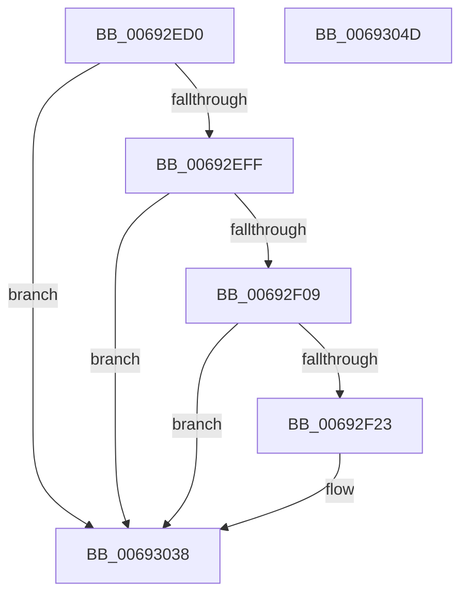

# MiStoreLogReadFailure

- RVA: `0x00692ED0`–`0x0069304E` (길이 `382` bytes)
- VA: `0x0000000140692ED0`
- 실행 섹션: `.text`
- PDB 이름 있음: `예`; PDB Function 태그: `아니요`
- unwind 정보 RVA: `0x000CC6F8`
- 디코드: `73`개 명령, `382/382` bytes 표시
- 미해석 바이트: `0` (있으면 어셈블리에 `.byte`로 보존)

> 이 문서는 커널 이미지의 기계어와 PDB 기호를 분석해 생성했습니다. 4번과 5번은 함수 원형과 자료형을 바이너리 사용 방식에서 추정한 C 해석이며 원본 소스 복구 결과는 아닙니다.

## 1. Dependencies

- 직접 호출 지점: **3**; 고유 호출 대상: **3**
- 직접 호출자로 확인된 함수: **1**
- RIP 상대 이미지 참조: **4**

### Outgoing calls
- `0x00692F16` → [tlgKeywordOn](../42/tlgKeywordOn_function_0042EAA0.md) (function, `0x0042EAA0`)
- `0x00693033` → [tlgWriteEx_EtwWriteEx](../4A/tlgWriteEx_EtwWriteEx_function_004AA348.md) (function, `0x004AA348`)
- `0x0069303F` → [_security_check_cookie](../6A/_security_check_cookie_function_006AC640.md) (function, `0x006AC640`)

### Direct callers
- [sub_006E46EA](../6E/Unknown_function_006E46EA.md) at `0x006E473E`

### Static image references
- `0x00692EDE` → RVA `0x00E0A740` (`.data`; read)
- `0x00692EEC` → RVA `0x00E37618` (`.data`; read)
- `0x00692F2C` → RVA `0x00059C5C` (`.rdata`; read)
- `0x00692FBD` → RVA `0x00E37420` (`.data`; read)

## 2. Other-region calls and transfers

- 다른 실행 섹션으로 향하는 call: **0**
- 별도 외부 분기/꼬리 이동을 확인하지 못했습니다.

## 3. Assembly (complete function range)

```asm
00692ED0  40 55                           push rbp
00692ED2  48 8D 6C 24 E0                  lea rbp, [rsp - 0x20]
00692ED7  48 81 EC 20 01 00 00            sub rsp, 0x120
00692EDE  48 8B 05 5B 78 77 00            mov rax, qword ptr [rip + 0x77785b]
00692EE5  48 33 C4                        xor rax, rsp
00692EE8  48 89 45 10                     mov qword ptr [rbp + 0x10], rax
00692EEC  4C 8B 05 25 47 7A 00            mov r8, qword ptr [rip + 0x7a4725]
00692EF3  4C 8B C9                        mov r9, rcx
00692EF6  4D 85 C0                        test r8, r8
00692EF9  0F 84 39 01 00 00               je 0x140693038
00692EFF  41 83 38 05                     cmp dword ptr [r8], 5
00692F03  0F 86 2F 01 00 00               jbe 0x140693038
00692F09  48 BA 02 00 00 00 00 40 00 00   movabs rdx, 0x400000000002
00692F13  49 8B C8                        mov rcx, r8
00692F16  E8 85 BB D9 FF                  call 0x14042eaa0
00692F1B  84 C0                           test al, al
00692F1D  0F 84 15 01 00 00               je 0x140693038
00692F23  65 48 8B 04 25 88 01 00 00      mov rax, qword ptr gs:[0x188]
00692F2C  48 8D 15 29 6D 9C FF            lea rdx, [rip - 0x6392d7]
00692F33  48 8B 88 B8 00 00 00            mov rcx, qword ptr [rax + 0xb8]
00692F3A  8B 81 D0 01 00 00               mov eax, dword ptr [rcx + 0x1d0]
00692F40  89 44 24 40                     mov dword ptr [rsp + 0x40], eax
00692F44  48 8D 44 24 40                  lea rax, [rsp + 0x40]
00692F49  48 89 45 90                     mov qword ptr [rbp - 0x70], rax
00692F4D  49 8B 81 98 00 00 00            mov rax, qword ptr [r9 + 0x98]
00692F54  48 C7 45 98 04 00 00 00         mov qword ptr [rbp - 0x68], 4
00692F5C  8B 88 10 05 00 00               mov ecx, dword ptr [rax + 0x510]
00692F62  48 8D 44 24 44                  lea rax, [rsp + 0x44]
00692F67  48 89 45 A0                     mov qword ptr [rbp - 0x60], rax
00692F6B  41 8B 41 50                     mov eax, dword ptr [r9 + 0x50]
00692F6F  89 44 24 48                     mov dword ptr [rsp + 0x48], eax
00692F73  48 8D 44 24 48                  lea rax, [rsp + 0x48]
00692F78  48 89 45 B0                     mov qword ptr [rbp - 0x50], rax
00692F7C  49 8B 81 E0 00 00 00            mov rax, qword ptr [r9 + 0xe0]
00692F83  48 89 44 24 58                  mov qword ptr [rsp + 0x58], rax
00692F88  48 8D 44 24 58                  lea rax, [rsp + 0x58]
00692F8D  48 89 45 C0                     mov qword ptr [rbp - 0x40], rax
00692F91  41 8B 81 B8 00 00 00            mov eax, dword ptr [r9 + 0xb8]
00692F98  89 44 24 4C                     mov dword ptr [rsp + 0x4c], eax
00692F9C  48 8D 44 24 4C                  lea rax, [rsp + 0x4c]
00692FA1  48 89 45 D0                     mov qword ptr [rbp - 0x30], rax
00692FA5  49 8B 41 60                     mov rax, qword ptr [r9 + 0x60]
00692FA9  41 B9 01 00 00 00               mov r9d, 1
00692FAF  48 89 44 24 60                  mov qword ptr [rsp + 0x60], rax
00692FB4  48 8D 44 24 60                  lea rax, [rsp + 0x60]
00692FB9  48 89 45 E0                     mov qword ptr [rbp - 0x20], rax
00692FBD  8B 05 5D 44 7A 00               mov eax, dword ptr [rip + 0x7a445d]
00692FC3  89 44 24 50                     mov dword ptr [rsp + 0x50], eax
00692FC7  48 8D 44 24 50                  lea rax, [rsp + 0x50]
00692FCC  48 89 45 F0                     mov qword ptr [rbp - 0x10], rax
00692FD0  48 8D 44 24 68                  lea rax, [rsp + 0x68]
00692FD5  48 89 45 00                     mov qword ptr [rbp], rax
00692FD9  48 8D 44 24 70                  lea rax, [rsp + 0x70]
00692FDE  89 4C 24 44                     mov dword ptr [rsp + 0x44], ecx
00692FE2  49 8B C8                        mov rcx, r8
00692FE5  48 89 44 24 38                  mov qword ptr [rsp + 0x38], rax
00692FEA  C7 44 24 30 0A 00 00 00         mov dword ptr [rsp + 0x30], 0xa
00692FF2  48 C7 45 A8 04 00 00 00         mov qword ptr [rbp - 0x58], 4
00692FFA  48 C7 45 B8 04 00 00 00         mov qword ptr [rbp - 0x48], 4
00693002  48 C7 45 C8 08 00 00 00         mov qword ptr [rbp - 0x38], 8
0069300A  48 C7 45 D8 04 00 00 00         mov qword ptr [rbp - 0x28], 4
00693012  48 C7 45 E8 08 00 00 00         mov qword ptr [rbp - 0x18], 8
0069301A  48 C7 45 F8 04 00 00 00         mov qword ptr [rbp - 8], 4
00693022  48 C7 44 24 68 00 00 00 01      mov qword ptr [rsp + 0x68], 0x1000000
0069302B  48 C7 45 08 08 00 00 00         mov qword ptr [rbp + 8], 8
00693033  E8 10 73 E1 FF                  call 0x1404aa348
00693038  48 8B 4D 10                     mov rcx, qword ptr [rbp + 0x10]
0069303C  48 33 CC                        xor rcx, rsp
0069303F  E8 FC 95 01 00                  call 0x1406ac640
00693044  48 81 C4 20 01 00 00            add rsp, 0x120
0069304B  5D                              pop rbp
0069304C  C3                              ret
0069304D  CC                              int3
```

## 4. C-style interpretation (structured pseudocode)

```c
__int64 __fastcall MiStoreLogReadFailure(__int64 a1)
{
    __int64 result;
    __int64 v_rsp;
    unsigned __int64 v_stack_m18;
    unsigned __int64 v_stack_m20;
    unsigned __int64 v_stack_m28;
    unsigned __int64 v_stack_m30;
    unsigned __int64 v_stack_m38;
    unsigned __int64 v_stack_m40;
    unsigned __int64 v_stack_m48;
    unsigned __int64 v_stack_m50;
    unsigned __int64 v_stack_m58;
    unsigned __int64 v_stack_m60;
    unsigned __int64 v_stack_m68;
    unsigned __int64 v_stack_m70;
    unsigned __int64 v_stack_m78;
    unsigned __int64 v_stack_m80;
    unsigned __int64 v_stack_m88;
    unsigned __int64 v_stack_m90;
    unsigned __int64 v_stack_m98;
    unsigned __int64 v_stack_mB8;
    unsigned __int64 v_stack_mC0;
    unsigned __int64 v_stack_mC8;
    unsigned __int64 v_stack_mD0;
    unsigned int v_stack_mD8;
    unsigned int v_stack_mDC;
    unsigned int v_stack_mE0;
    unsigned __int64 v_stack_mE4;
    unsigned int v_stack_mE8;
    unsigned __int64 v_stack_mF0;
    unsigned int v_stack_mF8;

    v_rsp = (v_rsp) - (288);
    result = (*(unsigned __int64 *)(v_rip + 7829595)) ^ (v_rsp);
    v_stack_m18 = result;
    if (*(unsigned __int64 *)(v_rip + 8013605) == 0) goto loc_00693038;
    if ((*(unsigned int *)(*(unsigned __int64 *)(v_rip + 8013605))) <= 5) goto loc_00693038;
    result = tlgKeywordOn(*(unsigned __int64 *)(v_rip + 8013605), a2, *(unsigned __int64 *)(v_rip + 8013605), a1);
    if ((unsigned __int8)(result) != 0) {
        result = *(unsigned __int64 *)(gs_base + (0 + 392));
        a2 = v_rip - 6525655;
        a1 = *(unsigned __int64 *)(result + 184);
        result = *(unsigned int *)(a1 + 464);
        v_stack_mE8 = (unsigned int)(result);
        result = v_stack_mE8;
        v_stack_m98 = result;
        result = *(unsigned __int64 *)(a1 + 152);
        v_stack_m90 = 4;
        a1 = *(unsigned int *)(result + 1296);
        result = v_stack_mE4;
        v_stack_m88 = result;
        result = *(unsigned int *)(a1 + 80);
        v_stack_mE0 = (unsigned int)(result);
        result = v_stack_mE0;
        v_stack_m78 = result;
        result = *(unsigned __int64 *)(a1 + 224);
        v_stack_mD0 = result;
        result = v_stack_mD0;
        v_stack_m68 = result;
        result = *(unsigned int *)(a1 + 184);
        v_stack_mDC = (unsigned int)(result);
        result = v_stack_mDC;
        v_stack_m58 = result;
        result = *(unsigned __int64 *)(a1 + 96);
        a4 = 1;
        v_stack_mC8 = result;
        result = v_stack_mC8;
        v_stack_m48 = result;
        result = *(unsigned int *)(v_rip + 8012893);
        v_stack_mD8 = (unsigned int)(result);
        result = v_stack_mD8;
        v_stack_m38 = result;
        result = v_stack_mC0;
        v_stack_m28 = result;
        result = v_stack_mB8;
        v_stack_mE4 = (unsigned int)(a1);
        a1 = *(unsigned __int64 *)(v_rip + 8013605);
        v_stack_mF0 = result;
        v_stack_mF8 = 10;
        v_stack_m80 = 4;
        v_stack_m70 = 4;
        v_stack_m60 = 8;
        v_stack_m50 = 4;
        v_stack_m40 = 8;
        v_stack_m30 = 4;
        v_stack_mC0 = 0x1000000ULL;
        v_stack_m20 = 8;
        result = tlgWriteEx_EtwWriteEx(a1, a2, *(unsigned __int64 *)(v_rip + 8013605), a4);
    }
    a1 = (v_stack_m18) ^ (v_rsp);
    result = _security_check_cookie(a1, a2, *(unsigned __int64 *)(v_rip + 8013605), a4);
    v_rsp = (v_rsp) + (288);
    return result;
}
```

## 5. (Beta) C Style

```c
int64_t MiStoreLogReadFailure(int64_t Arg1)
{
    int64_t result;
    int64_t local_rsp;
    uint64_t v_stack_m18;
    uint64_t v_stack_m20;
    uint64_t v_stack_m28;
    uint64_t v_stack_m30;
    uint64_t v_stack_m38;
    uint64_t v_stack_m40;
    uint64_t v_stack_m48;
    uint64_t v_stack_m50;
    uint64_t v_stack_m58;
    uint64_t v_stack_m60;
    uint64_t v_stack_m68;
    uint64_t v_stack_m70;
    uint64_t v_stack_m78;
    uint64_t v_stack_m80;
    uint64_t v_stack_m88;
    uint64_t v_stack_m90;
    uint64_t v_stack_m98;
    uint64_t v_stack_mB8;
    uint64_t v_stack_mC0;
    uint64_t v_stack_mC8;
    uint64_t v_stack_mD0;
    uint32_t v_stack_mD8;
    uint32_t v_stack_mDC;
    uint32_t v_stack_mE0;
    uint64_t v_stack_mE4;
    uint32_t v_stack_mE8;
    uint64_t v_stack_mF0;
    uint32_t v_stack_mF8;

    local_rsp = (local_rsp) - (288);
    result = (*(uint64_t *)(v_rip + 0x77785B)) ^ (local_rsp);
    v_stack_m18 = result;
    if (*(uint64_t *)(v_rip + 0x7A4725) == 0) goto loc_00693038;
    if ((*(uint32_t *)(*(uint64_t *)(v_rip + 0x7A4725))) <= 5) goto loc_00693038;
    result = tlgKeywordOn(*(uint64_t *)(v_rip + 0x7A4725), a2, *(uint64_t *)(v_rip + 0x7A4725), Arg1);
    if ((uint8_t)(result) != 0) {
        result = *(uint64_t *)(gs_base + (0 + 0x188));
        a2 = v_rip - 6525655;
        Arg1 = *(uint64_t *)(result + 0xB8);
        result = *(uint32_t *)(Arg1 + 0x1D0);
        v_stack_mE8 = (uint32_t)(result);
        result = v_stack_mE8;
        v_stack_m98 = result;
        result = *(uint64_t *)(Arg1 + 0x98);
        v_stack_m90 = 4;
        Arg1 = *(uint32_t *)(result + 0x510);
        result = v_stack_mE4;
        v_stack_m88 = result;
        result = *(uint32_t *)(Arg1 + 0x50);
        v_stack_mE0 = (uint32_t)(result);
        result = v_stack_mE0;
        v_stack_m78 = result;
        result = *(uint64_t *)(Arg1 + 0xE0);
        v_stack_mD0 = result;
        result = v_stack_mD0;
        v_stack_m68 = result;
        result = *(uint32_t *)(Arg1 + 0xB8);
        v_stack_mDC = (uint32_t)(result);
        result = v_stack_mDC;
        v_stack_m58 = result;
        result = *(uint64_t *)(Arg1 + 0x60);
        a4 = 1;
        v_stack_mC8 = result;
        result = v_stack_mC8;
        v_stack_m48 = result;
        result = *(uint32_t *)(v_rip + 0x7A445D);
        v_stack_mD8 = (uint32_t)(result);
        result = v_stack_mD8;
        v_stack_m38 = result;
        result = v_stack_mC0;
        v_stack_m28 = result;
        result = v_stack_mB8;
        v_stack_mE4 = (uint32_t)(Arg1);
        Arg1 = *(uint64_t *)(v_rip + 0x7A4725);
        v_stack_mF0 = result;
        v_stack_mF8 = 10;
        v_stack_m80 = 4;
        v_stack_m70 = 4;
        v_stack_m60 = 8;
        v_stack_m50 = 4;
        v_stack_m40 = 8;
        v_stack_m30 = 4;
        v_stack_mC0 = 0x1000000ULL;
        v_stack_m20 = 8;
        result = tlgWriteEx_EtwWriteEx(Arg1, a2, *(uint64_t *)(v_rip + 0x7A4725), a4);
    }
    Arg1 = (v_stack_m18) ^ (local_rsp);
    result = _security_check_cookie(Arg1, a2, *(uint64_t *)(v_rip + 0x7A4725), a4);
    local_rsp = (local_rsp) + (288);
    return result;
}
```

## 6. Execution-region graph

[열기: 2D/3D 그래프와 함수 탐색 컨트롤 패널](../../../control-panel.html?section=text&rva=0x00692ED0&view=graph)

- 2D 그래프는 위에서 아래로 흐르고, 3D 그래프는 빈 공간을 드래그해 회전합니다. Shift+드래그는 이동, 휠은 확대·축소, 함수 노드 선택은 대상 보고서 이동입니다.

### Static fallback


