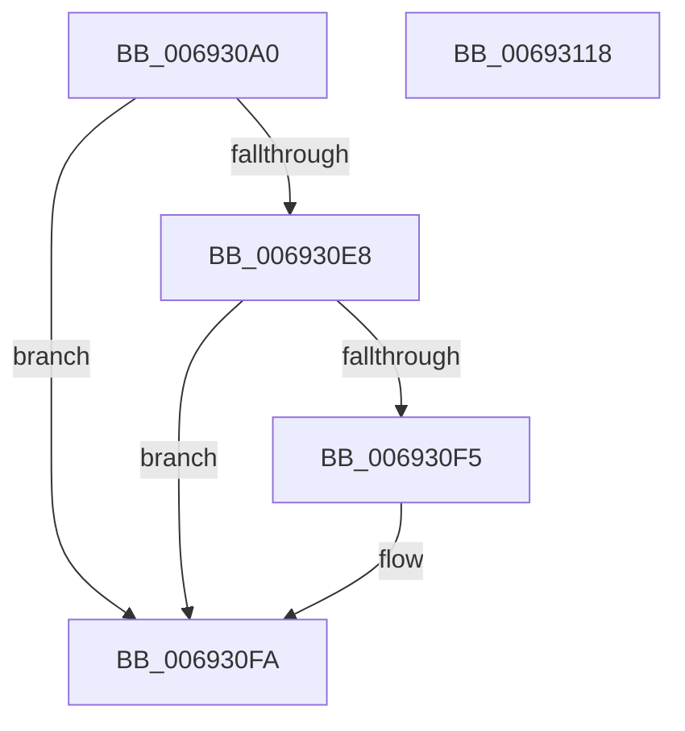

# MiStoreRundownWritesApc

- RVA: `0x006930A0`–`0x00693119` (길이 `121` bytes)
- VA: `0x00000001406930A0`
- 실행 섹션: `.text`
- PDB 이름 있음: `예`; PDB Function 태그: `아니요`
- unwind 정보 RVA: `0x00060BC4`
- 디코드: `31`개 명령, `121/121` bytes 표시
- 미해석 바이트: `0` (있으면 어셈블리에 `.byte`로 보존)

> 이 문서는 커널 이미지의 기계어와 PDB 기호를 분석해 생성했습니다. 4번과 5번은 함수 원형과 자료형을 바이너리 사용 방식에서 추정한 C 해석이며 원본 소스 복구 결과는 아닙니다.

## 1. Dependencies

- 직접 호출 지점: **3**; 고유 호출 대상: **3**
- 직접 호출자로 확인된 함수: **0**
- RIP 상대 이미지 참조: **0**

### Outgoing calls
- `0x006930D9` → [MiStoreDecrementOutstandingWrites](../48/MiStoreDecrementOutstandingWrites_function_0048EF68.md) (function, `0x0048EF68`)
- `0x006930F5` → [KiCheckForKernelApcDelivery](../2E/KiCheckForKernelApcDelivery_function_002E2C80.md) (function, `0x002E2C80`)
- `0x00693103` → [KeSetEvent](../33/KeSetEvent_function_0033F310.md) (function, `0x0033F310`)

### Direct callers
- 이 함수 시작 RVA로 연결되는 직접 call은 확인되지 않았습니다. 간접 호출은 완전히 역산할 수 없습니다.

### Static image references
- 디코드된 RIP-relative 메모리 참조가 없습니다.

## 2. Other-region calls and transfers

- 다른 실행 섹션으로 향하는 call: **0**
- 별도 외부 분기/꼬리 이동을 확인하지 못했습니다.

## 3. Assembly (complete function range)

```asm
006930A0  48 89 5C 24 08                  mov qword ptr [rsp + 8], rbx
006930A5  48 89 74 24 10                  mov qword ptr [rsp + 0x10], rsi
006930AA  57                              push rdi
006930AB  48 83 EC 20                     sub rsp, 0x20
006930AF  65 48 8B 1C 25 88 01 00 00      mov rbx, qword ptr gs:[0x188]
006930B8  48 8B F9                        mov rdi, rcx
006930BB  48 8B 49 30                     mov rcx, qword ptr [rcx + 0x30]
006930BF  BE 01 00 00 00                  mov esi, 1
006930C4  66 29 B3 E6 01 00 00            sub word ptr [rbx + 0x1e6], si
006930CB  90                              nop
006930CC  01 B1 CC 04 00 00               add dword ptr [rcx + 0x4cc], esi
006930D2  48 89 B9 18 05 00 00            mov qword ptr [rcx + 0x518], rdi
006930D9  E8 8A BE DF FF                  call 0x14048ef68
006930DE  90                              nop
006930DF  66 01 B3 E6 01 00 00            add word ptr [rbx + 0x1e6], si
006930E6  75 12                           jne 0x1406930fa
006930E8  48 8D 83 98 00 00 00            lea rax, [rbx + 0x98]
006930EF  90                              nop
006930F0  48 39 00                        cmp qword ptr [rax], rax
006930F3  74 05                           je 0x1406930fa
006930F5  E8 86 FB C4 FF                  call 0x1402e2c80
006930FA  48 8D 4F 18                     lea rcx, [rdi + 0x18]
006930FE  45 33 C0                        xor r8d, r8d
00693101  33 D2                           xor edx, edx
00693103  E8 08 C2 CA FF                  call 0x14033f310
00693108  48 8B 5C 24 30                  mov rbx, qword ptr [rsp + 0x30]
0069310D  48 8B 74 24 38                  mov rsi, qword ptr [rsp + 0x38]
00693112  48 83 C4 20                     add rsp, 0x20
00693116  5F                              pop rdi
00693117  C3                              ret
00693118  CC                              int3
```

## 4. C-style interpretation (structured pseudocode)

```c
__int64 __fastcall MiStoreRundownWritesApc(__int64 a1, int a2, int a3)
{
    __int64 result;
    __int64 v_rsp;
    unsigned __int64 v_stack_p10;
    unsigned __int64 v_stack_p8;

    v_stack_p8 = v_rbx;
    v_stack_p10 = v_rsi;
    v_rsp = (v_rsp) - (32);
    *(unsigned __int64 *)(*(unsigned __int64 *)(a1 + 48) + 1304) = a1;
    result = MiStoreDecrementOutstandingWrites(*(unsigned __int64 *)(a1 + 48), a2, a3, a4);
    if (condition_is_not_equal) goto loc_006930FA;
    result = *(unsigned __int64 *)(gs_base + (0 + 392)) + 152;
    if ((*(unsigned __int64 *)(*(unsigned __int64 *)(gs_base + (0 + 392)) + 152)) != (*(unsigned __int64 *)(gs_base + (0 + 392)) + 152)) {
        result = KiCheckForKernelApcDelivery(*(unsigned __int64 *)(a1 + 48), a2, a3, a4);
    }
    a3 = 0;
    a2 = 0;
    result = KeSetEvent(a1 + 24, a2, a3, a4);
    v_rsp = (v_rsp) + (32);
    return result;
}
```

## 5. (Beta) C Style

```c
int64_t MiStoreRundownWritesApc(void *Arg1, int32_t Arg2, int32_t Arg3)
{
    uint8_t *arg1 = (uint8_t *)Arg1;

    int64_t result;
    int64_t local_rsp;
    uint64_t v_stack_p10;
    uint64_t v_stack_p8;

    v_stack_p8 = local_rbx;
    v_stack_p10 = local_rsi;
    local_rsp = (local_rsp) - (32);
    *(void **)(*(uint64_t *)(arg1 + 0x30) + 0x518) = Arg1;
    result = MiStoreDecrementOutstandingWrites(*(uint64_t *)(arg1 + 0x30), Arg2, Arg3, a4);
    if (condition_is_not_equal) goto loc_006930FA;
    result = *(uint64_t *)(gs_base + (0 + 0x188)) + 152;
    if ((*(uint64_t *)(*(uint64_t *)(gs_base + (0 + 0x188)) + 0x98)) != (*(uint64_t *)(gs_base + (0 + 0x188)) + 152)) {
        result = KiCheckForKernelApcDelivery(*(uint64_t *)(arg1 + 0x30), Arg2, Arg3, a4);
    }
    Arg3 = 0;
    Arg2 = 0;
    result = KeSetEvent(Arg1 + 24, Arg2, Arg3, a4);
    local_rsp = (local_rsp) + (32);
    return result;
}
```

### 관측된 메모리 오프셋

구조체 형식이 확인되지 않은 접근은 인자 기준의 오프셋으로만 기록했습니다.

| 기준 인자 | 오프셋 표현 | 폭 (bit) | 접근 |
|---|---:|---:|---|
| `Arg1` | `+ 0x18` | `64` | `R` |
| `Arg1` | `+ 0x30` | `64` | `R` |

## 6. Execution-region graph

[열기: 2D/3D 그래프와 함수 탐색 컨트롤 패널](../../../control-panel.html?section=text&rva=0x006930A0&view=graph)

- 2D 그래프는 위에서 아래로 흐르고, 3D 그래프는 빈 공간을 드래그해 회전합니다. Shift+드래그는 이동, 휠은 확대·축소, 함수 노드 선택은 대상 보고서 이동입니다.

### Static fallback


