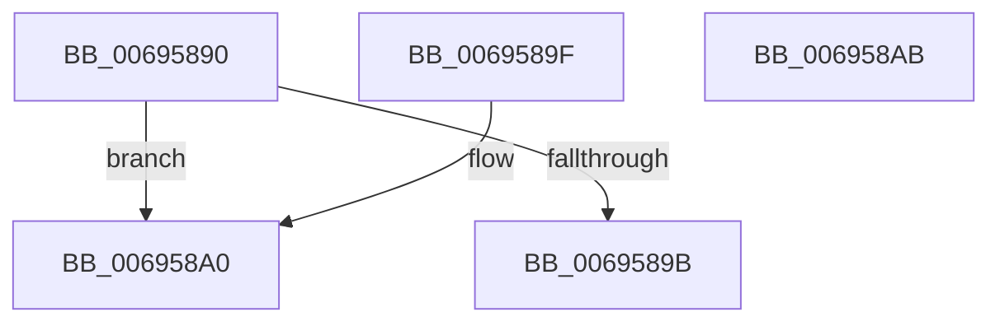

# MiTbFlushSort

- RVA: `0x00695890`–`0x006958AC` (길이 `28` bytes)
- VA: `0x0000000140695890`
- 실행 섹션: `.text`
- PDB 이름 있음: `예`; PDB Function 태그: `아니요`
- unwind 정보 RVA: `0x000DB714`
- 디코드: `13`개 명령, `28/28` bytes 표시
- 미해석 바이트: `0` (있으면 어셈블리에 `.byte`로 보존)

> 이 문서는 커널 이미지의 기계어와 PDB 기호를 분석해 생성했습니다. 4번과 5번은 함수 원형과 자료형을 바이너리 사용 방식에서 추정한 C 해석이며 원본 소스 복구 결과는 아닙니다.

## 1. Dependencies

- 직접 호출 지점: **0**; 고유 호출 대상: **0**
- 직접 호출자로 확인된 함수: **0**
- RIP 상대 이미지 참조: **0**

### Outgoing calls
- 직접 디코드된 call 명령이 없습니다.

### Direct callers
- 이 함수 시작 RVA로 연결되는 직접 call은 확인되지 않았습니다. 간접 호출은 완전히 역산할 수 없습니다.

### Static image references
- 디코드된 RIP-relative 메모리 참조가 없습니다.

## 2. Other-region calls and transfers

- 다른 실행 섹션으로 향하는 call: **0**
- 별도 외부 분기/꼬리 이동을 확인하지 못했습니다.

## 3. Assembly (complete function range)

```asm
00695890  48 8B 01                        mov rax, qword ptr [rcx]
00695893  48 8B 0A                        mov rcx, qword ptr [rdx]
00695896  48 3B C1                        cmp rax, rcx
00695899  73 05                           jae 0x1406958a0
0069589B  83 C8 FF                        or eax, 0xffffffff
0069589E  C3                              ret
0069589F  CC                              int3
006958A0  33 D2                           xor edx, edx
006958A2  48 3B C1                        cmp rax, rcx
006958A5  0F 97 C2                        seta dl
006958A8  8B C2                           mov eax, edx
006958AA  C3                              ret
006958AB  CC                              int3
```

## 4. C-style interpretation (structured pseudocode)

```c
__int64 __fastcall MiTbFlushSort(__int64 a1, __int64 a2)
{
    __int64 result;

    if ((*(unsigned __int64 *)(a1)) >= (*(unsigned __int64 *)(a2))) goto loc_006958A0;
    result = (unsigned int)((*(unsigned __int64 *)(a1)) | (0xFFFFFFFFULL));
    return result;
loc_006958A0:
    a2 = 0;
    a2 = (result > (*(unsigned __int64 *)(a2))) ? 1 : 0;
    return (unsigned int)((unsigned int)(a2));
}
```

## 5. (Beta) C Style

```c
int64_t MiTbFlushSort(void *Arg1, void *Arg2)
{
    uint8_t *arg1 = (uint8_t *)Arg1;
    uint8_t *arg2 = (uint8_t *)Arg2;

    int64_t result;

    if ((*(uint64_t *)(arg1)) >= (*(uint64_t *)(arg2))) goto loc_006958A0;
    result = (uint32_t)((*(uint64_t *)(arg1)) | (0xFFFFFFFFULL));
    return result;
loc_006958A0:
    Arg2 = 0;
    Arg2 = (result > (*(uint64_t *)(arg2))) ? 1 : 0;
    return (uint32_t)((uint32_t)(Arg2));
}
```

### 관측된 메모리 오프셋

구조체 형식이 확인되지 않은 접근은 인자 기준의 오프셋으로만 기록했습니다.

| 기준 인자 | 오프셋 표현 | 폭 (bit) | 접근 |
|---|---:|---:|---|
| `Arg1` | `+ 0x0` | `64` | `R` |
| `Arg2` | `+ 0x0` | `64` | `R` |

## 6. Execution-region graph

[열기: 2D/3D 그래프와 함수 탐색 컨트롤 패널](../../../control-panel.html?section=text&rva=0x00695890&view=graph)

- 2D 그래프는 위에서 아래로 흐르고, 3D 그래프는 빈 공간을 드래그해 회전합니다. Shift+드래그는 이동, 휠은 확대·축소, 함수 노드 선택은 대상 보고서 이동입니다.

### Static fallback


