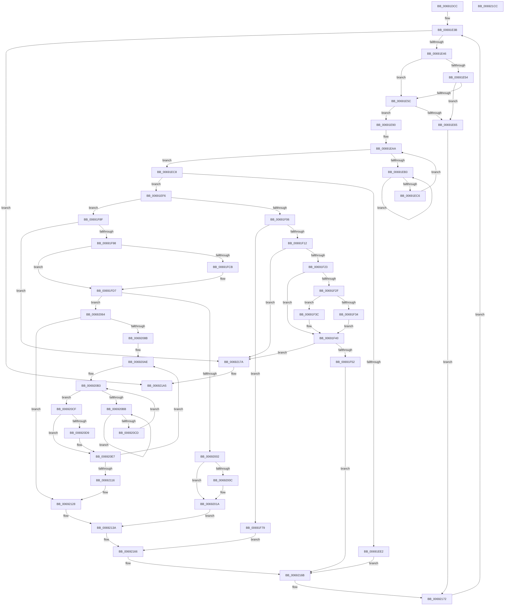

# MiTransferPartitionPageRun

- RVA: `0x00691DCC`–`0x006921CD` (길이 `1,025` bytes)
- VA: `0x0000000140691DCC`
- 실행 섹션: `.text`
- PDB 이름 있음: `예`; PDB Function 태그: `아니요`
- unwind 정보 RVA: `0x000D90A8`
- 디코드: `256`개 명령, `1,025/1,025` bytes 표시
- 미해석 바이트: `0` (있으면 어셈블리에 `.byte`로 보존)

> 이 문서는 커널 이미지의 기계어와 PDB 기호를 분석해 생성했습니다. 4번과 5번은 함수 원형과 자료형을 바이너리 사용 방식에서 추정한 C 해석이며 원본 소스 복구 결과는 아닙니다.

## 1. Dependencies

- 직접 호출 지점: **23**; 고유 호출 대상: **17**
- 직접 호출자로 확인된 함수: **1**
- RIP 상대 이미지 참조: **3**

### Outgoing calls
- `0x00691E1D` → [ExAcquireSpinLockExclusive](../24/ExAcquireSpinLockExclusive_function_00248690.md) (function, `0x00248690`)
- `0x00691E36` → [ExAcquireSpinLockExclusiveAtDpcLevel](../24/ExAcquireSpinLockExclusiveAtDpcLevel_function_00248E80.md) (function, `0x00248E80`)
- `0x00691E5C` → [KeShouldYieldProcessor](../27/KeShouldYieldProcessor_function_002773E0.md) (function, `0x002773E0`)
- `0x00691E68` → [ExReleaseSpinLockExclusiveFromDpcLevel](../24/ExReleaseSpinLockExclusiveFromDpcLevel_function_002497E0.md) (function, `0x002497E0`)
- `0x00691E73` → [MiReleaseSpinLockExclusive](../24/MiReleaseSpinLockExclusive_function_002482C0.md) (function, `0x002482C0`)
- `0x00691E7E` → [ExAcquireSpinLockExclusive](../24/ExAcquireSpinLockExclusive_function_00248690.md) (function, `0x00248690`)
- `0x00691E86` → [ExAcquireSpinLockExclusiveAtDpcLevel](../24/ExAcquireSpinLockExclusiveAtDpcLevel_function_00248E80.md) (function, `0x00248E80`)
- `0x00691EB8` → [KeYieldProcessorEx](../3F/KeYieldProcessorEx_function_003FBD00.md) (function, `0x003FBD00`)
- `0x00691F09` → [MiIsPageOnBadList](../2B/MiIsPageOnBadList_function_002B1018.md) (function, `0x002B1018`)
- `0x00691F16` → [MiInvalidPteConforms](../37/MiInvalidPteConforms_function_00372A10.md) (function, `0x00372A10`)
- `0x00691F6C` → [MiDrainZeroLookasides](../44/MiDrainZeroLookasides_function_0044D818.md) (function, `0x0044D818`)
- `0x00691F82` → [MiMoveBadPagePartition](MiMoveBadPagePartition_function_00691924.md) (function, `0x00691924`)
- `0x00691F9B` → [MiGetPfnPageSizeIndex](../31/MiGetPfnPageSizeIndex_function_0031C710.md) (function, `0x0031C710`)
- `0x00691FBA` → [MiUnlinkFreeOrZeroedPage](../33/MiUnlinkFreeOrZeroedPage_function_00336C40.md) (function, `0x00336C40`)
- `0x00692015` → [MiMoveBadPageChargesCrossPartition](../68/MiMoveBadPageChargesCrossPartition_function_00689F60.md) (function, `0x00689F60`)
- `0x0069204B` → [MiInsertPageInFreeOrZeroedList](../33/MiInsertPageInFreeOrZeroedList_function_00334D20.md) (function, `0x00334D20`)
- `0x006920C0` → [KeYieldProcessorEx](../3F/KeYieldProcessorEx_function_003FBD00.md) (function, `0x003FBD00`)
- `0x006920E2` → [MiMoveBadPageChargesCrossPartition](../68/MiMoveBadPageChargesCrossPartition_function_00689F60.md) (function, `0x00689F60`)
- `0x0069212E` → [MiInsertPossiblyBadPage](../68/MiInsertPossiblyBadPage_function_00689DF0.md) (function, `0x00689DF0`)
- `0x00692146` → [MiUpdatePartitionChildPageCounts](MiUpdatePartitionChildPageCounts_function_006921D4.md) (function, `0x006921D4`)
- `0x0069219F` → [KeBugCheckEx](../4F/KeBugCheckEx_function_004FD660.md) (function, `0x004FD660`)
- `0x006921A8` → [ExReleaseSpinLockExclusiveFromDpcLevel](../24/ExReleaseSpinLockExclusiveFromDpcLevel_function_002497E0.md) (function, `0x002497E0`)
- `0x006921B3` → [MiReleaseSpinLockExclusive](../24/MiReleaseSpinLockExclusive_function_002482C0.md) (function, `0x002482C0`)

### Direct callers
- [MiActOnPartitionNodePages](../68/MiActOnPartitionNodePages_function_0068F7F4.md) at `0x0068FBBE`

### Static image references
- `0x00691F23` → RVA `0x00E2DC80` (`.data`; read)
- `0x00691FA2` → RVA `0x00011C60` (`.rdata`; read)
- `0x00691FBF` → RVA `0x00E38D00` (`.data`; read)

## 2. Other-region calls and transfers

- 다른 실행 섹션으로 향하는 call: **0**
- 별도 외부 분기/꼬리 이동을 확인하지 못했습니다.

## 3. Assembly (complete function range)

```asm
00691DCC  48 89 4C 24 08                  mov qword ptr [rsp + 8], rcx
00691DD1  53                              push rbx
00691DD2  55                              push rbp
00691DD3  56                              push rsi
00691DD4  57                              push rdi
00691DD5  41 54                           push r12
00691DD7  41 55                           push r13
00691DD9  41 56                           push r14
00691DDB  41 57                           push r15
00691DDD  48 83 EC 68                     sub rsp, 0x68
00691DE1  0F B7 01                        movzx eax, word ptr [rcx]
00691DE4  48 8D 99 C8 00 00 00            lea rbx, [rcx + 0xc8]
00691DEB  66 89 84 24 C8 00 00 00         mov word ptr [rsp + 0xc8], ax
00691DF3  4C 8B F9                        mov r15, rcx
00691DF6  0F B7 02                        movzx eax, word ptr [rdx]
00691DF9  33 F6                           xor esi, esi
00691DFB  66 89 84 24 C0 00 00 00         mov word ptr [rsp + 0xc0], ax
00691E03  48 8B CB                        mov rcx, rbx
00691E06  4B 8D 04 08                     lea rax, [r8 + r9]
00691E0A  48 89 74 24 40                  mov qword ptr [rsp + 0x40], rsi
00691E0F  48 89 44 24 48                  mov qword ptr [rsp + 0x48], rax
00691E14  49 8B F8                        mov rdi, r8
00691E17  4C 8B EA                        mov r13, rdx
00691E1A  45 33 F6                        xor r14d, r14d
00691E1D  E8 6E 68 BB FF                  call 0x140248690
00691E22  49 8D AD C8 00 00 00            lea rbp, [r13 + 0xc8]
00691E29  88 84 24 B8 00 00 00            mov byte ptr [rsp + 0xb8], al
00691E30  48 8B CD                        mov rcx, rbp
00691E33  44 8A E0                        mov r12b, al
00691E36  E8 45 70 BB FF                  call 0x140248e80
00691E3B  48 3B 7C 24 48                  cmp rdi, qword ptr [rsp + 0x48]
00691E40  0F 84 5F 03 00 00               je 0x1406921a5
00691E46  41 FF C6                        inc r14d
00691E49  44 89 74 24 3C                  mov dword ptr [rsp + 0x3c], r14d
00691E4E  41 F6 C6 0F                     test r14b, 0xf
00691E52  75 08                           jne 0x140691e5c
00691E54  8B 03                           mov eax, dword ptr [rbx]
00691E56  0F BA E0 1E                     bt eax, 0x1e
00691E5A  72 09                           jb 0x140691e65
00691E5C  E8 7F 55 BE FF                  call 0x1402773e0
00691E61  85 C0                           test eax, eax
00691E63  74 2B                           je 0x140691e90
00691E65  48 8B CD                        mov rcx, rbp
00691E68  E8 73 79 BB FF                  call 0x1402497e0
00691E6D  41 8A D4                        mov dl, r12b
00691E70  48 8B CB                        mov rcx, rbx
00691E73  E8 48 64 BB FF                  call 0x1402482c0
00691E78  48 8B CB                        mov rcx, rbx
00691E7B  48 FF CF                        dec rdi
00691E7E  E8 0D 68 BB FF                  call 0x140248690
00691E83  48 8B CD                        mov rcx, rbp
00691E86  E8 F5 6F BB FF                  call 0x140248e80
00691E8B  E9 E2 02 00 00                  jmp 0x140692172
00691E90  48 8D 1C 7F                     lea rbx, [rdi + rdi*2]
00691E94  48 C1 E3 04                     shl rbx, 4
00691E98  48 B8 00 00 00 00 00 DE FF FF   movabs rax, 0xffffde0000000000
00691EA2  48 03 D8                        add rbx, rax
00691EA5  83 64 24 30 00                  and dword ptr [rsp + 0x30], 0
00691EAA  F0 48 0F BA 6B 18 3F            lock bts qword ptr [rbx + 0x18], 0x3f
00691EB1  73 15                           jae 0x140691ec8
00691EB3  48 8D 4C 24 30                  lea rcx, [rsp + 0x30]
00691EB8  E8 43 9E D6 FF                  call 0x1403fbd00
00691EBD  48 8B 43 18                     mov rax, qword ptr [rbx + 0x18]
00691EC1  48 85 C0                        test rax, rax
00691EC4  78 ED                           js 0x140691eb3
00691EC6  EB E2                           jmp 0x140691eaa
00691EC8  48 8B 43 28                     mov rax, qword ptr [rbx + 0x28]
00691ECC  B9 FF 03 00 00                  mov ecx, 0x3ff
00691ED1  48 C1 E8 2B                     shr rax, 0x2b
00691ED5  66 23 C1                        and ax, cx
00691ED8  66 3B 84 24 C8 00 00 00         cmp ax, word ptr [rsp + 0xc8]
00691EE0  74 14                           je 0x140691ef6
00691EE2  48 B8 FF FF FF FF FF FF FF 7F   movabs rax, 0x7fffffffffffffff
00691EEC  F0 48 21 43 18                  lock and qword ptr [rbx + 0x18], rax
00691EF1  E9 75 02 00 00                  jmp 0x14069216b
00691EF6  0F B6 53 22                     movzx edx, byte ptr [rbx + 0x22]
00691EFA  83 E2 07                        and edx, 7
00691EFD  83 FA 05                        cmp edx, 5
00691F00  0F 85 89 00 00 00               jne 0x140691f8f
00691F06  48 8B CB                        mov rcx, rbx
00691F09  E8 0A F1 C1 FF                  call 0x1402b1018
00691F0E  85 C0                           test eax, eax
00691F10  75 67                           jne 0x140691f79
00691F12  48 8B 4B 10                     mov rcx, qword ptr [rbx + 0x10]
00691F16  E8 F5 0A CE FF                  call 0x140372a10
00691F1B  85 C0                           test eax, eax
00691F1D  0F 84 57 02 00 00               je 0x14069217a
00691F23  48 8B 05 56 BD 79 00            mov rax, qword ptr [rip + 0x79bd56]
00691F2A  48 85 C0                        test rax, rax
00691F2D  74 11                           je 0x140691f40
00691F2F  F6 C1 10                        test cl, 0x10
00691F32  75 08                           jne 0x140691f3c
00691F34  48 F7 D0                        not rax
00691F37  48 23 C8                        and rcx, rax
00691F3A  EB 04                           jmp 0x140691f40
00691F3C  48 83 E1 EF                     and rcx, 0xffffffffffffffef
00691F40  48 C1 E9 20                     shr rcx, 0x20
00691F44  B8 FE FF FF FF                  mov eax, 0xfffffffe
00691F49  48 3B C8                        cmp rcx, rax
00691F4C  0F 85 28 02 00 00               jne 0x14069217a
00691F52  48 B8 FF FF FF FF FF FF FF 7F   movabs rax, 0x7fffffffffffffff
00691F5C  F0 48 21 43 18                  lock and qword ptr [rbx + 0x18], rax
00691F61  45 33 C9                        xor r9d, r9d
00691F64  45 33 C0                        xor r8d, r8d
00691F67  33 D2                           xor edx, edx
00691F69  49 8B CF                        mov rcx, r15
00691F6C  E8 A7 B8 DB FF                  call 0x14044d818
00691F71  48 FF CF                        dec rdi
00691F74  E9 F2 01 00 00                  jmp 0x14069216b
00691F79  4C 8B C3                        mov r8, rbx
00691F7C  49 8B D5                        mov rdx, r13
00691F7F  49 8B CF                        mov rcx, r15
00691F82  E8 9D F9 FF FF                  call 0x140691924
00691F87  48 FF C6                        inc rsi
00691F8A  E9 D7 01 00 00                  jmp 0x140692166
00691F8F  83 FA 01                        cmp edx, 1
00691F92  0F 87 E2 01 00 00               ja 0x14069217a
00691F98  48 8B CB                        mov rcx, rbx
00691F9B  E8 70 A7 C8 FF                  call 0x14031c710
00691FA0  8B F0                           mov esi, eax
00691FA2  4C 8D 35 B7 FC 97 FF            lea r14, [rip - 0x680349]
00691FA9  45 33 C0                        xor r8d, r8d
00691FAC  33 D2                           xor edx, edx
00691FAE  48 8B CF                        mov rcx, rdi
00691FB1  4D 8B 34 F6                     mov r14, qword ptr [r14 + rsi*8]
00691FB5  4C 89 74 24 50                  mov qword ptr [rsp + 0x50], r14
00691FBA  E8 81 4C CA FF                  call 0x140336c40
00691FBF  48 8D 05 3A 6D 7A 00            lea rax, [rip + 0x7a6d3a]
00691FC6  4C 3B E8                        cmp r13, rax
00691FC9  74 0C                           je 0x140691fd7
00691FCB  4D 01 B5 50 48 00 00            add qword ptr [r13 + 0x4850], r14
00691FD2  41 C6 45 0C 01                  mov byte ptr [r13 + 0xc], 1
00691FD7  4D 29 B7 50 48 00 00            sub qword ptr [r15 + 0x4850], r14
00691FDE  41 C6 47 0C 01                  mov byte ptr [r15 + 0xc], 1
00691FE3  48 8B 43 10                     mov rax, qword ptr [rbx + 0x10]
00691FE7  25 E0 03 00 00                  and eax, 0x3e0
00691FEC  48 F7 D8                        neg rax
00691FEF  45 1B E4                        sbb r12d, r12d
00691FF2  41 F7 DC                        neg r12d
00691FF5  41 FF C4                        inc r12d
00691FF8  44 89 64 24 38                  mov dword ptr [rsp + 0x38], r12d
00691FFD  83 FE 03                        cmp esi, 3
00692000  75 62                           jne 0x140692064
00692002  8B 43 20                        mov eax, dword ptr [rbx + 0x20]
00692005  C1 E8 18                        shr eax, 0x18
00692008  A8 40                           test al, 0x40
0069200A  74 0E                           je 0x14069201a
0069200C  4D 8B C5                        mov r8, r13
0069200F  49 8B D7                        mov rdx, r15
00692012  48 8B CB                        mov rcx, rbx
00692015  E8 46 7F FF FF                  call 0x140689f60
0069201A  48 8B 43 28                     mov rax, qword ptr [rbx + 0x28]
0069201E  41 8B D4                        mov edx, r12d
00692021  44 0F B7 84 24 C0 00 00 00      movzx r8d, word ptr [rsp + 0xc0]
0069202A  49 C1 E0 2B                     shl r8, 0x2b
0069202E  49 8B C8                        mov rcx, r8
00692031  48 33 C8                        xor rcx, rax
00692034  48 B8 FF FF FF FF FF 07 E0 FF   movabs rax, 0xffe007ffffffffff
0069203E  48 23 C8                        and rcx, rax
00692041  49 33 C8                        xor rcx, r8
00692044  48 89 4B 28                     mov qword ptr [rbx + 0x28], rcx
00692048  48 8B CF                        mov rcx, rdi
0069204B  E8 D0 2C CA FF                  call 0x140334d20
00692050  48 B8 FF FF FF FF FF FF FF 7F   movabs rax, 0x7fffffffffffffff
0069205A  F0 48 21 43 18                  lock and qword ptr [rbx + 0x18], rax
0069205F  E9 D6 00 00 00                  jmp 0x14069213a
00692064  48 B8 FF FF FF FF FF FF FF 7F   movabs rax, 0x7fffffffffffffff
0069206E  F0 48 21 43 18                  lock and qword ptr [rbx + 0x18], rax
00692073  4B 8D 2C 76                     lea rbp, [r14 + r14*2]
00692077  48 C1 E5 04                     shl rbp, 4
0069207B  48 83 C5 D0                     add rbp, -0x30
0069207F  48 03 EB                        add rbp, rbx
00692082  48 3B EB                        cmp rbp, rbx
00692085  0F 82 9D 00 00 00               jb 0x140692128
0069208B  44 0F B7 BC 24 C0 00 00 00      movzx r15d, word ptr [rsp + 0xc0]
00692094  48 8D 75 18                     lea rsi, [rbp + 0x18]
00692098  4C 8B A4 24 B0 00 00 00         mov r12, qword ptr [rsp + 0xb0]
006920A0  49 BE FF FF FF FF FF 07 E0 FF   movabs r14, 0xffe007ffffffffff
006920AA  49 C1 E7 2B                     shl r15, 0x2b
006920AE  83 64 24 34 00                  and dword ptr [rsp + 0x34], 0
006920B3  F0 48 0F BA 2E 3F               lock bts qword ptr [rsi], 0x3f
006920B9  73 14                           jae 0x1406920cf
006920BB  48 8D 4C 24 34                  lea rcx, [rsp + 0x34]
006920C0  E8 3B 9C D6 FF                  call 0x1403fbd00
006920C5  48 8B 06                        mov rax, qword ptr [rsi]
006920C8  48 85 C0                        test rax, rax
006920CB  78 EE                           js 0x1406920bb
006920CD  EB E4                           jmp 0x1406920b3
006920CF  8B 46 08                        mov eax, dword ptr [rsi + 8]
006920D2  C1 E8 18                        shr eax, 0x18
006920D5  A8 40                           test al, 0x40
006920D7  74 0E                           je 0x1406920e7
006920D9  4D 8B C5                        mov r8, r13
006920DC  49 8B D4                        mov rdx, r12
006920DF  48 8B CD                        mov rcx, rbp
006920E2  E8 79 7E FF FF                  call 0x140689f60
006920E7  48 8B 46 10                     mov rax, qword ptr [rsi + 0x10]
006920EB  49 8B CF                        mov rcx, r15
006920EE  48 33 C8                        xor rcx, rax
006920F1  48 B8 FF FF FF FF FF FF FF 7F   movabs rax, 0x7fffffffffffffff
006920FB  49 23 CE                        and rcx, r14
006920FE  49 33 CF                        xor rcx, r15
00692101  48 89 4E 10                     mov qword ptr [rsi + 0x10], rcx
00692105  F0 48 21 06                     lock and qword ptr [rsi], rax
00692109  48 83 ED 30                     sub rbp, 0x30
0069210D  48 83 EE 30                     sub rsi, 0x30
00692111  48 3B EB                        cmp rbp, rbx
00692114  73 98                           jae 0x1406920ae
00692116  4C 8B 74 24 50                  mov r14, qword ptr [rsp + 0x50]
0069211B  44 8B 64 24 38                  mov r12d, dword ptr [rsp + 0x38]
00692120  4C 8B BC 24 B0 00 00 00         mov r15, qword ptr [rsp + 0xb0]
00692128  41 8B D4                        mov edx, r12d
0069212B  48 8B CF                        mov rcx, rdi
0069212E  E8 BD 7C FF FF                  call 0x140689df0
00692133  49 8D AD C8 00 00 00            lea rbp, [r13 + 0xc8]
0069213A  4D 8B CE                        mov r9, r14
0069213D  4C 8B C7                        mov r8, rdi
00692140  49 8B D7                        mov rdx, r15
00692143  49 8B CD                        mov rcx, r13
00692146  E8 89 00 00 00                  call 0x1406921d4
0069214B  48 8B 74 24 40                  mov rsi, qword ptr [rsp + 0x40]
00692150  48 FF CF                        dec rdi
00692153  44 8A A4 24 B8 00 00 00         mov r12b, byte ptr [rsp + 0xb8]
0069215B  49 03 FE                        add rdi, r14
0069215E  49 03 F6                        add rsi, r14
00692161  44 8B 74 24 3C                  mov r14d, dword ptr [rsp + 0x3c]
00692166  48 89 74 24 40                  mov qword ptr [rsp + 0x40], rsi
0069216B  49 8D 9F C8 00 00 00            lea rbx, [r15 + 0xc8]
00692172  48 FF C7                        inc rdi
00692175  E9 C1 FC FF FF                  jmp 0x140691e3b
0069217A  48 B8 FF FF FF FF FF FF FF 7F   movabs rax, 0x7fffffffffffffff
00692184  F0 48 21 43 18                  lock and qword ptr [rbx + 0x18], rax
00692189  48 83 64 24 20 00               and qword ptr [rsp + 0x20], 0
0069218F  4C 8B C7                        mov r8, rdi
00692192  44 8B CA                        mov r9d, edx
00692195  B9 1A 00 00 00                  mov ecx, 0x1a
0069219A  BA 00 10 04 00                  mov edx, 0x41000
0069219F  E8 BC B4 E6 FF                  call 0x1404fd660
006921A4  CC                              int3
006921A5  48 8B CD                        mov rcx, rbp
006921A8  E8 33 76 BB FF                  call 0x1402497e0
006921AD  41 8A D4                        mov dl, r12b
006921B0  48 8B CB                        mov rcx, rbx
006921B3  E8 08 61 BB FF                  call 0x1402482c0
006921B8  48 8B C6                        mov rax, rsi
006921BB  48 83 C4 68                     add rsp, 0x68
006921BF  41 5F                           pop r15
006921C1  41 5E                           pop r14
006921C3  41 5D                           pop r13
006921C5  41 5C                           pop r12
006921C7  5F                              pop rdi
006921C8  5E                              pop rsi
006921C9  5D                              pop rbp
006921CA  5B                              pop rbx
006921CB  C3                              ret
006921CC  CC                              int3
```

## 4. C-style interpretation (structured pseudocode)

```c
__int64 __fastcall MiTransferPartitionPageRun(__int64 a1, __int64 a2, __int64 a3, __int64 a4)
{
    __int64 result;
    __int64 v_r12;
    __int64 v_r14;
    __int64 v_r15;
    __int64 v_rbp;
    __int64 v_rbx;
    __int64 v_rdi;
    __int64 v_rsi;
    __int64 v_rsp;
    unsigned __int64 v_stack_m58;
    unsigned __int64 v_stack_m60;
    unsigned __int64 v_stack_m68;
    unsigned int v_stack_m6C;
    unsigned int v_stack_m70;
    unsigned int v_stack_m74;
    unsigned int v_stack_m78;
    unsigned __int64 v_stack_m88;
    unsigned __int8 v_stack_p10;
    unsigned __int16 v_stack_p18;
    unsigned __int16 v_stack_p20;
    unsigned __int64 v_stack_p8;

    v_stack_p8 = a1;
    v_rsp = (v_rsp) - (104);
    v_stack_p20 = (unsigned __int16)(*(unsigned __int16 *)(a1));
    v_rsi = 0;
    v_stack_p18 = (unsigned __int16)(*(unsigned __int16 *)(a2));
    v_stack_m68 = 0;
    v_stack_m60 = a3 + a4 * 1;
    v_r14 = 0;
    result = ExAcquireSpinLockExclusive(a1 + 200, a2, a3, a4);
    v_stack_p10 = (unsigned __int8)(result);
    result = ExAcquireSpinLockExclusiveAtDpcLevel(a2 + 200, a2, a3, a4);
loc_00691E3B:
    if (a3 == v_stack_m60) goto loc_006921A5;
    v_r14 = (unsigned int)((v_r14) + 1);
    v_stack_m6C = (unsigned int)(v_r14);
    if ((((unsigned __int8)(v_r14)) & (15)) != 0) goto loc_00691E5C;
    if (condition_is_below) goto loc_00691E65;
loc_00691E5C:
    result = KeShouldYieldProcessor(a2 + 200, a2, a3, a4);
    if ((unsigned int)(result) == 0) goto loc_00691E90;
loc_00691E65:
    result = ExReleaseSpinLockExclusiveFromDpcLevel(a2 + 200, a2, a3, a4);
    result = MiReleaseSpinLockExclusive(a1 + 200, (unsigned __int8)((unsigned __int8)(result)), a3, a4);
    v_rdi = (a3) - 1;
    result = ExAcquireSpinLockExclusive(a1 + 200, (unsigned __int8)((unsigned __int8)(result)), a3, a4);
    result = ExAcquireSpinLockExclusiveAtDpcLevel(a2 + 200, (unsigned __int8)((unsigned __int8)(result)), a3, a4);
    goto loc_00692172;
loc_00691E90:
    v_rbx = (v_rdi + v_rdi * 2) << (4);
    v_rbx = (v_rbx) + (result);
loc_00691EAA:
    if (condition_is_above_or_equal) goto loc_00691EC8;
loc_00691EB3:
    result = KeYieldProcessorEx(v_stack_m78, (unsigned __int8)((unsigned __int8)(result)), a3, a4);
    if (sign_flag) goto loc_00691EB3;
    goto loc_00691EAA;
loc_00691EC8:
    result = (*(unsigned __int64 *)(v_rbx + 40)) >> (43);
    result = (unsigned __int16)((result) & ((unsigned __int16)((unsigned int)(0x3FFULL))));
    if (((unsigned __int16)(result)) == v_stack_p20) goto loc_00691EF6;
    goto loc_0069216B;
loc_00691EF6:
    a2 = (unsigned int)((*(unsigned __int8 *)(v_rbx + 34)) & (7));
    if (((unsigned int)(a2)) != 5) goto loc_00691F8F;
    result = MiIsPageOnBadList(v_rbx, a2, a3, a4);
    if ((unsigned int)(result) != 0) goto loc_00691F79;
    result = MiInvalidPteConforms(*(unsigned __int64 *)(v_rbx + 16), a2, a3, a4);
    if ((unsigned int)(result) == 0) goto loc_0069217A;
    if (*(unsigned __int64 *)(v_rip + 7978326) == 0) goto loc_00691F40;
    if ((((unsigned __int8)(*(unsigned __int64 *)(v_rbx + 16))) & (16)) != 0) goto loc_00691F3C;
    result = ~(*(unsigned __int64 *)(v_rip + 7978326));
    a1 = (*(unsigned __int64 *)(v_rbx + 16)) & (result);
    goto loc_00691F40;
loc_00691F3C:
    a1 = (a1) & (-17);
loc_00691F40:
    a1 = (a1) >> (32);
    if (a1 != ((unsigned int)(0xFFFFFFFEULL))) goto loc_0069217A;
    a4 = 0;
    a3 = 0;
    a2 = 0;
    result = MiDrainZeroLookasides(a1, a2, a3, a4);
    v_rdi = (v_rdi) - 1;
    goto loc_0069216B;
loc_00691F79:
    result = MiMoveBadPagePartition(a1, 0, v_rbx, a4);
    v_rsi = (v_rsi) + 1;
    goto loc_00692166;
loc_00691F8F:
    if (0 > 1) goto loc_0069217A;
    result = MiGetPfnPageSizeIndex(v_rbx, 0, v_rbx, a4);
    a3 = 0;
    a2 = 0;
    v_stack_m58 = *(unsigned __int64 *)(v_rip - 6816585 + (unsigned int)((unsigned int)(result)) * 8);
    result = MiUnlinkFreeOrZeroedPage(v_rdi, a2, a3, a4);
    if (0 != (v_rip + 8023354)) {
        *(unsigned __int8 *)(a2 + 12) = 1;
    }
    *(unsigned __int8 *)(a1 + 12) = 1;
    result = (unsigned int)((*(unsigned __int64 *)(v_rbx + 16)) & (992));
    result = -(result);
    v_r12 = (unsigned int)(-((unsigned __int8)(result)));
    v_r12 = (unsigned int)((v_r12) + 1);
    v_stack_m70 = (unsigned int)(v_r12);
    if (((unsigned int)((unsigned int)((unsigned int)(result)))) != 3) goto loc_00692064;
    result = (unsigned int)(((unsigned int)(*(unsigned int *)(v_rbx + 32))) >> (24));
    if ((((unsigned __int8)(result)) & (64)) != 0) {
        a3 = 0;
        a2 = a1;
        a1 = v_rbx;
        result = MiMoveBadPageChargesCrossPartition(a1, a2, a3, a4);
    }
    a3 = (v_stack_p18) << (43);
    a1 = (a3) ^ (*(unsigned __int64 *)(v_rbx + 40));
    a1 = (a1) & (*(unsigned __int64 *)(v_rbx + 40));
    a1 = (a1) ^ (a3);
    *(unsigned __int64 *)(v_rbx + 40) = a1;
    result = MiInsertPageInFreeOrZeroedList(v_rdi, (unsigned int)((unsigned int)(v_r12)), a3, a4);
    goto loc_0069213A;
loc_00692064:
    v_rbp = (*(unsigned __int64 *)(v_rip - 6816585 + (unsigned int)((unsigned int)(result)) * 8) + *(unsigned __int64 *)(v_rip - 6816585 + (unsigned int)((unsigned int)(result)) * 8) * 2) << (4);
    v_rbp = (v_rbp) + (-48);
    v_rbp = (v_rbp) + (v_rbx);
    if (v_rbp < v_rbx) goto loc_00692128;
    v_r15 = (v_stack_p18) << (43);
loc_006920AE:
loc_006920B3:
    if (condition_is_above_or_equal) goto loc_006920CF;
loc_006920BB:
    result = KeYieldProcessorEx(v_stack_m74, (unsigned int)((unsigned int)(v_r12)), a3, a4);
    if (sign_flag) goto loc_006920BB;
    goto loc_006920B3;
loc_006920CF:
    result = (unsigned int)(((unsigned int)(*(unsigned int *)(v_rbp + 24 + 8))) >> (24));
    if ((((unsigned __int8)(result)) & (64)) != 0) {
        a3 = a2;
        a2 = v_stack_p8;
        a1 = v_rbp;
        result = MiMoveBadPageChargesCrossPartition(a1, a2, a3, a4);
    }
    a1 = (v_r15) ^ (*(unsigned __int64 *)(v_rbp + 24 + 16));
    a1 = (a1) & (*(unsigned __int64 *)(v_rip - 6816585 + (unsigned int)((unsigned int)(result)) * 8));
    a1 = (a1) ^ (v_r15);
    *(unsigned __int64 *)(v_rbp + 24 + 16) = a1;
    v_rbp = (v_rbp) - (48);
    v_rsi = (v_rbp + 24) - (48);
    if (v_rbp >= v_rbx) goto loc_006920AE;
loc_00692128:
    result = MiInsertPossiblyBadPage(v_rdi, (unsigned int)((unsigned int)((unsigned int)(v_stack_m70))), a3, a4);
loc_0069213A:
    result = MiUpdatePartitionChildPageCounts(a2, v_stack_p8, v_rdi, v_stack_m58);
    v_rdi = (v_rdi) - 1;
    v_rdi = (v_rdi) + (v_stack_m58);
    v_rsi = (v_stack_m68) + (v_stack_m58);
loc_00692166:
    v_stack_m68 = v_rsi;
loc_0069216B:
loc_00692172:
    v_rdi = (v_rdi) + 1;
    goto loc_00691E3B;
loc_0069217A:
    result = KeBugCheckEx(26, (unsigned int)(0x41000ULL), v_rdi, (unsigned int)((unsigned int)(v_stack_p8)));
loc_006921A5:
    result = ExReleaseSpinLockExclusiveFromDpcLevel(a2 + 200, (unsigned int)(0x41000ULL), v_rdi, (unsigned int)((unsigned int)(v_stack_p8)));
    result = MiReleaseSpinLockExclusive(v_stack_p8 + 200, (unsigned __int8)(v_stack_p10), v_rdi, (unsigned int)((unsigned int)(v_stack_p8)));
    v_rsp = (v_rsp) + (104);
    return v_rsi;
}
```

## 5. (Beta) C Style

```c
int64_t MiTransferPartitionPageRun(void *Arg1, void *Arg2, void *Arg3, int64_t Arg4)
{
    uint8_t *arg1 = (uint8_t *)Arg1;
    uint8_t *arg2 = (uint8_t *)Arg2;
    uint8_t *arg3 = (uint8_t *)Arg3;

    int64_t result;
    int64_t local_r12;
    int64_t local_r14;
    int64_t local_r15;
    int64_t local_rbp;
    int64_t local_rbx;
    int64_t local_rdi;
    int64_t local_rsi;
    int64_t local_rsp;
    uint64_t v_stack_m58;
    uint64_t v_stack_m60;
    uint64_t v_stack_m68;
    uint32_t v_stack_m6C;
    uint32_t v_stack_m70;
    uint32_t v_stack_m74;
    uint32_t v_stack_m78;
    uint64_t v_stack_m88;
    uint8_t v_stack_p10;
    uint16_t v_stack_p18;
    uint16_t v_stack_p20;
    uint64_t v_stack_p8;

    v_stack_p8 = Arg1;
    local_rsp = (local_rsp) - (104);
    v_stack_p20 = (uint16_t)(*(uint16_t *)(arg1));
    local_rsi = 0;
    v_stack_p18 = (uint16_t)(*(uint16_t *)(arg2));
    v_stack_m68 = 0;
    v_stack_m60 = Arg3 + Arg4 * 1;
    local_r14 = 0;
    result = ExAcquireSpinLockExclusive(Arg1 + 200, Arg2, Arg3, Arg4);
    v_stack_p10 = (uint8_t)(result);
    result = ExAcquireSpinLockExclusiveAtDpcLevel(Arg2 + 200, Arg2, Arg3, Arg4);
loc_00691E3B:
    if (Arg3 == v_stack_m60) goto loc_006921A5;
    local_r14 = (uint32_t)((local_r14) + 1);
    v_stack_m6C = (uint32_t)(local_r14);
    if ((((uint8_t)(local_r14)) & (15)) != 0) goto loc_00691E5C;
    if (condition_is_below) goto loc_00691E65;
loc_00691E5C:
    result = KeShouldYieldProcessor(Arg2 + 200, Arg2, Arg3, Arg4);
    if ((uint32_t)(result) == 0) goto loc_00691E90;
loc_00691E65:
    result = ExReleaseSpinLockExclusiveFromDpcLevel(Arg2 + 200, Arg2, Arg3, Arg4);
    result = MiReleaseSpinLockExclusive(Arg1 + 200, (uint8_t)((uint8_t)(result)), Arg3, Arg4);
    local_rdi = (Arg3) - 1;
    result = ExAcquireSpinLockExclusive(Arg1 + 200, (uint8_t)((uint8_t)(result)), Arg3, Arg4);
    result = ExAcquireSpinLockExclusiveAtDpcLevel(Arg2 + 200, (uint8_t)((uint8_t)(result)), Arg3, Arg4);
    goto loc_00692172;
loc_00691E90:
    local_rbx = (local_rdi + local_rdi * 2) << (4);
    local_rbx = (local_rbx) + (result);
loc_00691EAA:
    if (condition_is_above_or_equal) goto loc_00691EC8;
loc_00691EB3:
    result = KeYieldProcessorEx(v_stack_m78, (uint8_t)((uint8_t)(result)), Arg3, Arg4);
    if (sign_flag) goto loc_00691EB3;
    goto loc_00691EAA;
loc_00691EC8:
    result = (*(uint64_t *)(local_rbx + 0x28)) >> (43);
    result = (uint16_t)((result) & ((uint16_t)((uint32_t)(0x3FFULL))));
    if (((uint16_t)(result)) == v_stack_p20) goto loc_00691EF6;
    goto loc_0069216B;
loc_00691EF6:
    Arg2 = (uint32_t)((*(uint8_t *)(local_rbx + 0x22)) & (7));
    if (((uint32_t)(Arg2)) != 5) goto loc_00691F8F;
    result = MiIsPageOnBadList(local_rbx, Arg2, Arg3, Arg4);
    if ((uint32_t)(result) != 0) goto loc_00691F79;
    result = MiInvalidPteConforms(*(uint64_t *)(local_rbx + 0x10), Arg2, Arg3, Arg4);
    if ((uint32_t)(result) == 0) goto loc_0069217A;
    if (*(uint64_t *)(v_rip + 0x79BD56) == 0) goto loc_00691F40;
    if ((((uint8_t)(*(uint64_t *)(local_rbx + 0x10))) & (16)) != 0) goto loc_00691F3C;
    result = ~(*(uint64_t *)(v_rip + 0x79BD56));
    Arg1 = (*(uint64_t *)(local_rbx + 0x10)) & (result);
    goto loc_00691F40;
loc_00691F3C:
    Arg1 = (Arg1) & (-17);
loc_00691F40:
    Arg1 = (Arg1) >> (32);
    if (Arg1 != ((uint32_t)(0xFFFFFFFEULL))) goto loc_0069217A;
    Arg4 = 0;
    Arg3 = 0;
    Arg2 = 0;
    result = MiDrainZeroLookasides(Arg1, Arg2, Arg3, Arg4);
    local_rdi = (local_rdi) - 1;
    goto loc_0069216B;
loc_00691F79:
    result = MiMoveBadPagePartition(Arg1, 0, local_rbx, Arg4);
    local_rsi = (local_rsi) + 1;
    goto loc_00692166;
loc_00691F8F:
    if (0 > 1) goto loc_0069217A;
    result = MiGetPfnPageSizeIndex(local_rbx, 0, local_rbx, Arg4);
    Arg3 = 0;
    Arg2 = 0;
    v_stack_m58 = *(uint64_t *)(v_rip - 0x680349 + (uint32_t)((uint32_t)(result)) * 8);
    result = MiUnlinkFreeOrZeroedPage(local_rdi, Arg2, Arg3, Arg4);
    if (0 != (v_rip + 8023354)) {
        *(uint8_t *)(arg2 + 0xC) = 1;
    }
    *(uint8_t *)(arg1 + 0xC) = 1;
    result = (uint32_t)((*(uint64_t *)(local_rbx + 0x10)) & (992));
    result = -(result);
    local_r12 = (uint32_t)(-((uint8_t)(result)));
    local_r12 = (uint32_t)((local_r12) + 1);
    v_stack_m70 = (uint32_t)(local_r12);
    if (((uint32_t)((uint32_t)((uint32_t)(result)))) != 3) goto loc_00692064;
    result = (uint32_t)(((uint32_t)(*(uint32_t *)(local_rbx + 0x20))) >> (24));
    if ((((uint8_t)(result)) & (64)) != 0) {
        Arg3 = 0;
        Arg2 = Arg1;
        Arg1 = local_rbx;
        result = MiMoveBadPageChargesCrossPartition(Arg1, Arg2, Arg3, Arg4);
    }
    Arg3 = (v_stack_p18) << (43);
    Arg1 = (Arg3) ^ (*(uint64_t *)(local_rbx + 0x28));
    Arg1 = (Arg1) & (*(uint64_t *)(local_rbx + 0x28));
    Arg1 = (Arg1) ^ (Arg3);
    *(void **)(local_rbx + 0x28) = Arg1;
    result = MiInsertPageInFreeOrZeroedList(local_rdi, (uint32_t)((uint32_t)(local_r12)), Arg3, Arg4);
    goto loc_0069213A;
loc_00692064:
    local_rbp = (*(uint64_t *)(v_rip - 0x680349 + (uint32_t)((uint32_t)(result)) * 8) + *(uint64_t *)(v_rip - 0x680349 + (uint32_t)((uint32_t)(result)) * 8) * 2) << (4);
    local_rbp = (local_rbp) + (-48);
    local_rbp = (local_rbp) + (local_rbx);
    if (local_rbp < local_rbx) goto loc_00692128;
    local_r15 = (v_stack_p18) << (43);
loc_006920AE:
loc_006920B3:
    if (condition_is_above_or_equal) goto loc_006920CF;
loc_006920BB:
    result = KeYieldProcessorEx(v_stack_m74, (uint32_t)((uint32_t)(local_r12)), Arg3, Arg4);
    if (sign_flag) goto loc_006920BB;
    goto loc_006920B3;
loc_006920CF:
    result = (uint32_t)(((uint32_t)(*(uint32_t *)(local_rbp + 0x18 + 0x8))) >> (24));
    if ((((uint8_t)(result)) & (64)) != 0) {
        Arg3 = Arg2;
        Arg2 = v_stack_p8;
        Arg1 = local_rbp;
        result = MiMoveBadPageChargesCrossPartition(Arg1, Arg2, Arg3, Arg4);
    }
    Arg1 = (local_r15) ^ (*(uint64_t *)(local_rbp + 0x18 + 0x10));
    Arg1 = (Arg1) & (*(uint64_t *)(v_rip - 0x680349 + (uint32_t)((uint32_t)(result)) * 8));
    Arg1 = (Arg1) ^ (local_r15);
    *(void **)(local_rbp + 0x18 + 0x10) = Arg1;
    local_rbp = (local_rbp) - (48);
    local_rsi = (local_rbp + 24) - (48);
    if (local_rbp >= local_rbx) goto loc_006920AE;
loc_00692128:
    result = MiInsertPossiblyBadPage(local_rdi, (uint32_t)((uint32_t)((uint32_t)(v_stack_m70))), Arg3, Arg4);
loc_0069213A:
    result = MiUpdatePartitionChildPageCounts(Arg2, v_stack_p8, local_rdi, v_stack_m58);
    local_rdi = (local_rdi) - 1;
    local_rdi = (local_rdi) + (v_stack_m58);
    local_rsi = (v_stack_m68) + (v_stack_m58);
loc_00692166:
    v_stack_m68 = local_rsi;
loc_0069216B:
loc_00692172:
    local_rdi = (local_rdi) + 1;
    goto loc_00691E3B;
loc_0069217A:
    result = KeBugCheckEx(26, (uint32_t)(0x41000ULL), local_rdi, (uint32_t)((uint32_t)(v_stack_p8)));
loc_006921A5:
    result = ExReleaseSpinLockExclusiveFromDpcLevel(Arg2 + 200, (uint32_t)(0x41000ULL), local_rdi, (uint32_t)((uint32_t)(v_stack_p8)));
    result = MiReleaseSpinLockExclusive(v_stack_p8 + 200, (uint8_t)(v_stack_p10), local_rdi, (uint32_t)((uint32_t)(v_stack_p8)));
    local_rsp = (local_rsp) + (104);
    return local_rsi;
}
```

### 관측된 메모리 오프셋

구조체 형식이 확인되지 않은 접근은 인자 기준의 오프셋으로만 기록했습니다.

| 기준 인자 | 오프셋 표현 | 폭 (bit) | 접근 |
|---|---:|---:|---|
| `Arg1` | `+ 0x0` | `16` | `R` |
| `Arg1` | `+ 0xC8` | `64` | `R` |
| `Arg2` | `+ 0x0` | `16` | `R` |
| `Arg2` | `+ 0xC8` | `64` | `R` |
| `Arg3` | `+ 0x0 + r9*1` | `64` | `R` |

## 6. Execution-region graph

[열기: 2D/3D 그래프와 함수 탐색 컨트롤 패널](../../../control-panel.html?section=text&rva=0x00691DCC&view=graph)

- 2D 그래프는 위에서 아래로 흐르고, 3D 그래프는 빈 공간을 드래그해 회전합니다. Shift+드래그는 이동, 휠은 확대·축소, 함수 노드 선택은 대상 보고서 이동입니다.

### Static fallback


